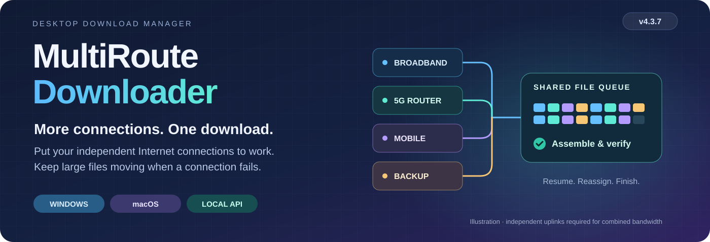
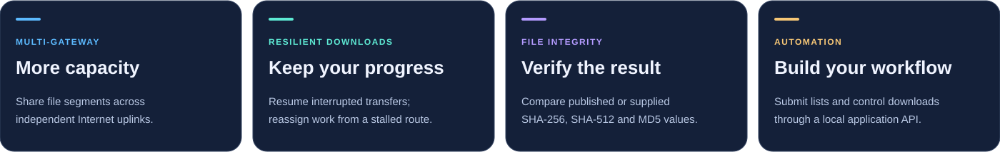
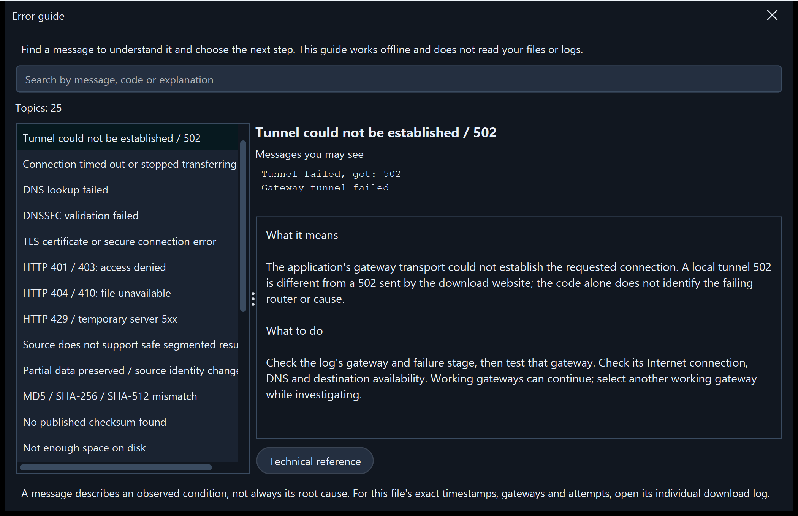

# MultiRoute Downloader

<!-- product-languages:start -->
<p align="center" dir="ltr">
<strong>English</strong> · <a href="README.ru.md">Русский</a> · <a href="docs/overview/de.md">Deutsch</a> · <a href="docs/overview/es.md">Español</a> · <a href="docs/overview/fr.md">Français</a> · <a href="docs/overview/zh.md">中文</a><br />
<a href="docs/overview/ko.md">한국어</a> · <a href="docs/overview/ar.md">العربية</a> · <a href="docs/overview/it.md">Italiano</a> · <a href="docs/overview/ja.md">日本語</a> · <a href="docs/overview/hi.md">हिन्दी</a> · <a href="docs/overview/vi.md">Tiếng Việt</a>
</p>
<!-- product-languages:end -->

<p align="center"></p>

<p align="center"><strong>Download large files with the connections you already have.</strong><br />Combine independent broadband and mobile gateways for large downloads, preserve resumable progress and check the finished file.</p>

<p align="center">
  <a href="https://github.com/2018-spec-fdsds/multiroute-downloader/releases/tag/v4.3.9"><strong>Download 4.3.9</strong></a> ·
  <a href="downloads/README.md">Current downloads</a> ·
  <a href="docs/en.md">User guide</a> ·
  <a href="docs/support.md">Support the project</a> ·
  <a href="API.ru.txt">API reference</a> ·
  <a href="README.ru.md">Русский</a>
</p>

**On macOS:** [Install, first start and permissions](docs/macos/en.md) · [Русский](docs/macos/ru.md) · [12 languages](docs/macos/README.md)

## Why MultiRoute exists

The idea came from a familiar home-network problem: wired broadband, a mobile router and a backup Internet connection were all available, but a large download still used only the computer’s default gateway. When that connection slowed down or failed, the other links could not help.

MultiRoute brings those independent links into one download workspace. Available gateways take file segments from a shared queue; faster gateways take more work, and unfinished segments from a stalled connection can be reassigned. The app preserves supported resumable progress, assembles the result and compares it with an available reference checksum.

- **More bandwidth for one file.** Independent uplinks fetch different parts concurrently. Their combined capacity can shorten a large download when the source and local network can keep up.
- **Progress through interruptions.** Completed parts are saved; working gateways keep downloading and stalled segments can return to the shared pool.
- **Visible control.** Follow total and per-gateway speed, change gateway selection during a transfer and see how each connection contributes.
- **Repeatable workflows.** Reuse site profiles, queue link lists or hand transfers to the local API from scripts and development tools.

Actual gains depend on independent uplinks, source limits and the local network. Routers sharing one upstream connection do not multiply its bandwidth.



### Useful with a single connection, too

Use supported resume, published-checksum comparison, protected DNS, batch queues, schedules, site profiles, uploads and the local API. Start with one gateway; add others when available.

## Download and install

**Current version: 4.3.9.** Native installers include private Java 21 and the platform network component. Open the application from its normal icon.

| Your computer | Single-file installer |
| --- | --- |
| **Windows 11 · x64** | [Windows Setup EXE](https://github.com/2018-spec-fdsds/multiroute-downloader/releases/download/v4.3.9/MultiRoute-Downloader-4.3.9-Windows-x64-Setup.exe) |
| **Mac · Apple Silicon · macOS 26+** | [Apple Silicon PKG](https://github.com/2018-spec-fdsds/multiroute-downloader/releases/download/v4.3.9/MultiRoute-Downloader-4.3.9-macOS-arm64.pkg) |
| **Mac · Intel · macOS 15+** | [Intel PKG](https://github.com/2018-spec-fdsds/multiroute-downloader/releases/download/v4.3.9/MultiRoute-Downloader-4.3.9-macOS-x86_64.pkg) |

[Chrome / Edge integration](docs/en.md#chrome-and-edge-integration) · [Checksums and report](downloads/v4.3.9/README.md) · [Download details](downloads/README.md)

Windows Setup uses English and creates a desktop shortcut. Npcap is checked separately and its official installer is offered when needed; macOS uses system libpcap. See your language guide for installation and security confirmations. Public native installers cover Windows and macOS; a Linux 4.x installer is not included here.

**Free / Pro in 4.3.9:** Free uses up to **2 gateways**, **3 simultaneous downloads** and creates **3 site profiles**, with Graphite/System appearance. The corresponding Pro capabilities allow up to **8 gateways**, **32 simultaneous downloads**, additional profiles, priorities, gateway history/reports, batch operations, the external API and extra styles. Free does not deliberately throttle download speed. [Full capability details](docs/licensing.en.md).


## Mac gateway transport

- **Mac gateway replies with a manual address.** The POSIX capture setup is corrected so both a manually selected application address and DHCP use a receive mode that accepts replies addressed to the application’s own MAC, matching the existing Windows behavior. A working system ping tests the computer’s own connection; it does not prove that the application’s virtual address can receive gateway replies.

- Existing DHCP diagnostics keep their twelve-language wording instead of being replaced by a generic error. The existing authorization behavior is unchanged: normal network checks reuse the prepared component. This changes neither API endpoints nor interface controls, OS routes or the physical adapter MAC. First privileged Ethernet BPF access may still need normal administrator authorization.

This addresses one capture-mode mismatch, not every cause of an unreachable gateway. Address availability, subnet and DHCP-lease/conflict checks remain active. Physical Mac transfers with a manual address still require hardware confirmation; wired Ethernet remains required.

### Transfer controls at a glance

- **Safer Mac startup and gateway setup.** Native Mac startup recovers the recognizable legacy relative default, including a missing leading slash, using a verified existing profile or an empty user-owned default. Ambiguous custom locations still require an explicit choice instead of guessing.

- After gateway preparation fails or is cancelled, remaining gateways and background checks stop repeating authorization requests until you explicitly retry network setup. The first privileged start may still require the normal macOS administrator confirmation to open the Ethernet BPF device.

- The Mac network component 4.3.2 handles an adapter MAC hidden by macOS while retaining checks that protect the physical adapter. The application keeps its own MAC; OS routes and the physical adapter MAC are not changed. Mac icon and application name now use the same MultiRoute identity as Windows. Exit the app before running the PKG updater. The caller label of a real authorization dialog and physical LAN/DHCP transfers still require hardware confirmation; wired Ethernet remains required for this transport.


- **Remaining download data.** The download table now has a separate **Remaining data** column. It shows the bytes still to download, independently of the remaining-time estimate, and sorts numerically. The value uses current saved and in-flight progress, never falls below zero, and is shown as a dash while the total size is unknown.


- **Give your gateways a preference.** Set 0–1000 priorities and see them beside the gateway indicators. Higher-priority links are preferred for small files and receive more parallel segments for larger files. Other working gateways still help. This needs the separate `gateway_priorities` Pro capability.

- **See why a transfer stopped.** Open a file’s individual log from its context menu, including after completion, or use the searchable 25-topic error guide in Settings. Disk-full errors are explicit, and save locations show free space in GB.

- **Keep control of a busy queue.** Configure simultaneous downloads within your licence limit and automatic retries. Copy names of selected files, pause/resume selected supported jobs, and open a file’s folder with a double-click. Saved-prefix progress stays visible while a resumed segment waits for data.


<details>
<summary><strong>Searchable error guide — 25 topics in twelve languages</strong></summary>



</details>

## See your transfers clearly

The 4.3.7 workspace puts your files at the center: separate name and size columns, individual progress, total and per-gateway speed, a speed graph and file details. Graphite and System are included in Free; additional styles such as Rose require the corresponding Pro capability.


*Current Windows interface, captured in an isolated demonstration profile. Example files, progress, speeds and Pro-enabled views illustrate the controls and are not performance measurements.*

<details>
<summary><strong>Network settings and speed history</strong></summary>


</details>


## Choose your look

Choose from nine appearances: Graphite, Nordic, Streams Studio, Neon, Community, Chat, Studio, Rose and System. Graphite is the default. Graphite and System are included in Free; the other choices require the corresponding Pro appearance capability. Open Settings → Appearance to change the style and rounded controls. Your downloads continue while you choose.

<table>
<tr>
<td width="50%" valign="top"><strong>Graphite</strong><br /><a href="docs/images/v4.3.7/downloads-en-ae5b55131583.png"></a></td>
<td width="50%" valign="top"><strong>Nordic</strong><br /><a href="docs/images/v4.3.7/skin-nordic-a4e8d79666e0.png"></a></td>
</tr>
<tr>
<td width="50%" valign="top"><strong>Streams Studio</strong><br /><a href="docs/images/v4.3.7/skin-streams-b2f3be388bda.png"></a></td>
<td width="50%" valign="top"><strong>Neon</strong><br /><a href="docs/images/v4.3.7/skin-neon-6b0c1d2da5f8.png"></a></td>
</tr>
<tr>
<td width="50%" valign="top"><strong>Community</strong><br /><a href="docs/images/v4.3.7/skin-community-9763964c8f12.png"></a></td>
<td width="50%" valign="top"><strong>Chat</strong><br /><a href="docs/images/v4.3.7/skin-chat-221a28cc76f4.png"></a></td>
</tr>
<tr>
<td width="50%" valign="top"><strong>Studio</strong><br /><a href="docs/images/v4.3.7/skin-studio-094e14ba38ea.png"></a></td>
<td width="50%" valign="top"><strong>Rose</strong><br /><a href="docs/images/v4.3.7/skin-rose-02646e7f35bf.png"></a></td>
</tr>
<tr>
<td width="50%" valign="top"><strong>System</strong><br /><a href="docs/images/v4.3.7/skin-system-c148099984c6.png"></a></td>
<td width="50%" valign="top"></td>
</tr>
</table>

## A courier that follows your downloads

The optional desktop courier turns download progress into a visible load. Choose the man or woman in Appearance settings and set the size from 40% to 100%. The bag shows the combined known remaining data of active downloads and shrinks as bytes arrive. Movement follows their combined download speed; at zero speed the courier stands still. Small loads are carried on the shoulder, larger loads are dragged and very large loads show more effort.

Use the Avatar button to show or hide the courier. Drag it to move it, double-click with the left mouse button to show the application, or right-click for its options. This is a visual companion: files remain in their selected folders.

When a download finishes, the courier puts down the delivered load and fades. If work continues, it returns with the remaining data.

### Small remaining load · 768 MB

<table>
<tr>
<td width="50%" valign="top"><strong>Male courier</strong><br /><a href="docs/images/v4.3.7/avatar-man-shoulder-eeeb879d0240.png"></a></td>
<td width="50%" valign="top"><strong>Female courier</strong><br /><a href="docs/images/v4.3.7/avatar-woman-shoulder-5682615d5576.png"></a></td>
</tr>
</table>

### Medium remaining load · 7 GB

<table>
<tr>
<td width="50%" valign="top"><strong>Male courier</strong><br /><a href="docs/images/v4.3.7/avatar-man-drag-a3dc0a3ed22c.png"></a></td>
<td width="50%" valign="top"><strong>Female courier</strong><br /><a href="docs/images/v4.3.7/avatar-woman-drag-48d8ee0fa4d1.png"></a></td>
</tr>
</table>

### Large remaining load · 18 GB

<table>
<tr>
<td width="50%" valign="top"><strong>Male courier</strong><br /><a href="docs/images/v4.3.7/avatar-man-heavy-649f17608748.png"></a></td>
<td width="50%" valign="top"><strong>Female courier</strong><br /><a href="docs/images/v4.3.7/avatar-woman-heavy-d445fdb37867.png"></a></td>
</tr>
</table>

## Settings at a glance

Set the download folder, site profiles and language, then adjust appearance, courier size and completion sounds. Network settings keep the application address, MAC, gateways and DNS in one place. Optional sounds can distinguish a single completed file from the completed queue, with built-in melodies or your own MP3/WAV clips up to 10 seconds.

<table>
<tr>
<td width="50%" valign="top"><strong>Application settings</strong><br /><a href="docs/images/v4.3.7/settings-8abcb12a782d.png"></a></td>
<td width="50%" valign="top"><strong>Appearance, courier and sounds</strong><br /><a href="docs/images/v4.3.7/appearance-cebf121d5de7.png"></a></td>
</tr>
<tr>
<td width="50%" valign="top"><strong>Application address and protected DNS</strong><br /><a href="docs/images/v4.3.7/network-dns-e29dfdba1007.png"></a></td>
<td width="50%" valign="top"><strong>Gateway selection and speed checks</strong><br /><a href="docs/images/v4.3.7/network-gateways-aee0a7897f48.png"></a></td>
</tr>
</table>

<details>
<summary><strong>Download and upload workspaces</strong></summary>

<table>
<tr>
<td width="50%" valign="top"><strong>Create a download</strong><br /><a href="docs/images/v4.3.7/new-download-dcb720c7769d.png"></a></td>
<td width="50%" valign="top"><strong>Upload workspace</strong><br /><a href="docs/images/v4.3.7/uploads-31c63833de2e.png"></a></td>
</tr>
</table>

</details>

## From everyday need to practical control

| You want to… | MultiRoute provides |
| --- | --- |
| **Use available connections** | A shared HTTP segment queue, 1–8 editable gateway profiles and live selection of one, several or all gateways. |
| **Keep and check large files** | Supported resume, saved parts, automatic assembly and publisher-reference checks using MD5, SHA-256 or SHA-512. |
| **Protect DNS requests** | Encrypted DoH/DoT, presets or custom providers and local DNSSEC, without changing OS DNS settings or routes. |
| **Organize multiple downloads** | Bulk links, priorities, daily windows, delayed starts, speed/job limits, per-gateway statistics, graphs and dated history. |
| **Reuse familiar sites** | Saved profiles, remote folder browsing, FTP/FTPS/SFTP uploads and archive previews. |
| **Fit your workflow** | Browser link delivery, a local API, twelve languages, light/dark/system themes, keyboard paste, system folder dialogs, a speed tray and optional start at sign-in. |

| Transfer | Supported options |
| --- | --- |
| **Download** | HTTP/HTTPS, FTP, explicit FTPS, SFTP, WebDAV, Metalink, BitTorrent and magnet; Hugging Face links and repository file selection. |
| **Upload** | FTP, explicit FTPS and SFTP, with site profiles and SHA-256 readback verification. |
| **Archive preview** | ZIP, TAR, 7Z and RAR listings before the full download, when byte ranges and supported headers are available. |

### Know what was verified

File checks compare assembled data with a trusted reference when available; a local hash alone does not establish publisher identity. DoH/DoT encrypt DNS transport; DNSSEC separately validates signed DNS data. These checks do not establish that downloaded content is harmless.

## An API for your applications and AI coding workflow

Scripts, third-party applications and AI coding agents can ask MultiRoute to fetch model weights, datasets, libraries, assets and project artifacts needed for development. The caller receives progress, completion and checksum results, and can control the queue while MultiRoute handles gateways, retries and supported resume.

The API runs locally at **`http://127.0.0.1:8765/api/v1`**. For example, send this JSON to **`POST /api/v1/jobs`** with `Content-Type: application/json`:

```json
{
  "url": "https://example.org/model.bin",
  "directory": "C:/Users/YOUR_USER/Downloads",
  "routes": [
    {"type": "gateway", "gateway": "192.168.1.1", "enabled": true}
  ]
}
```

General external API management requires the corresponding Pro capability; batch creation and gateway limits are checked separately. Replace the URL, folder and gateway with your values; configure the network first. Set routes explicitly: UI checkboxes are not copied into API requests. `201` means job creation; retain `id` and read `GET /jobs/{id}` for progress, `complete`/`failed` status and checksum details. The example is illustrative and does not submit a download.

[API reference](API.ru.txt) · [OpenAPI schema](openapi.yaml) · [Integration guide](docs/en.md#multiroute-api)

## Start in four steps

1. **Install** your platform’s package and follow its guide.
2. **Choose network settings:** wired Ethernet, gateways in the same IPv4 LAN and an unused application virtual address. This leaves other applications’ OS routes unchanged.
3. **Select and test gateways.** Defaults are `192.168.1.1`–`192.168.1.4`, with virtual address `192.168.1.70`; edit them for your network.
4. **Paste a link or list, choose a folder and start.** Follow each gateway’s contribution and final verification.

<details>
<summary><strong>Requirements and transfer details</strong></summary>

- Multi-gateway transport supports public IPv4 over wired Ethernet; Wi-Fi-only/VPN-only adapters, IPv6-only sources and local-LAN torrent peers are outside this mode.
- Segmented resume needs range support and stable source identity. HTTP segments default to 20 MiB; stalled work can be reassigned after 60 seconds without data, once its writer closes. Non-resumable HTTP restarts after interruption. Torrent pieces use metadata hashes.
- One upload file uses one gateway; multiple files can use different gateways. Readback verification uses bandwidth and needs remote read/write/rename permissions. Archive preview has metadata/header limits.
- Schedules require the app running and computer awake; they do not wake it or schedule the separate upload queue.
- System DNS follows OS/VPN policy. DNSSEC root anchors update with releases. Encrypted DNS does not itself encrypt HTTP/FTP file contents.
- Installers are unsigned; macOS packages are not Developer ID signed or notarized. Follow normal confirmations in the guides without disabling system protections. Each release includes its verification report and remaining limits.

</details>

## Guides in twelve languages

[English](docs/en.md) · [Русский](docs/ru.md) · [Deutsch](docs/de.md) · [Español](docs/es.md) · [Français](docs/fr.md) · [中文](docs/zh.md)<br />
[한국어](docs/ko.md) · [العربية](docs/ar.md) · [Italiano](docs/it.md) · [日本語](docs/ja.md) · [हिन्दी](docs/hi.md) · [Tiếng Việt](docs/vi.md)


<a name="application-virtual-ip"></a>

### Application address and current packages

The application uses its own local IPv4 address and application MAC so its selected gateways can operate independently of the OS default gateway, without changing OS routes or the physical adapter MAC. Use a free address in the same actual subnet. Keep a manual address outside automatic DHCP allocation, or reserve/exclude it on the LAN DHCP servers; then use **Check and apply** in Network settings. [Address selection and checks](docs/en.md#application-virtual-ip).

Windows 4.3.7 passed native-launcher, application startup and installer-metadata checks. macOS packages passed native and Java runtime checks on the target Mac runners. Physical Mac LAN/DHCP gateway transfers still need hardware validation. [Verification report](NATIVE-INSTALLER-TESTS.json).


## Support the project

If MultiRoute is useful to you, you can [support its development voluntarily](docs/support.md).

<p align="center"><a href="docs/support.md"></a><br /><strong>USDT · Ethereum (ERC-20)</strong></p>

## Owner and licence

Created by **[2018-spec-fdsds](https://github.com/2018-spec-fdsds)**. Free use includes personal and organizational/business use. Selling the original application, charging for its licence or paid redistribution requires separate written permission. General modification/redistribution rights are not granted; third-party terms remain applicable.

[Licence](LICENSE.txt) · [Licence summary](LICENSING.md) · [Third-party notices](THIRD-PARTY-NOTICES.txt)

This distribution area contains the current 4.3.9 installers and user documentation.
