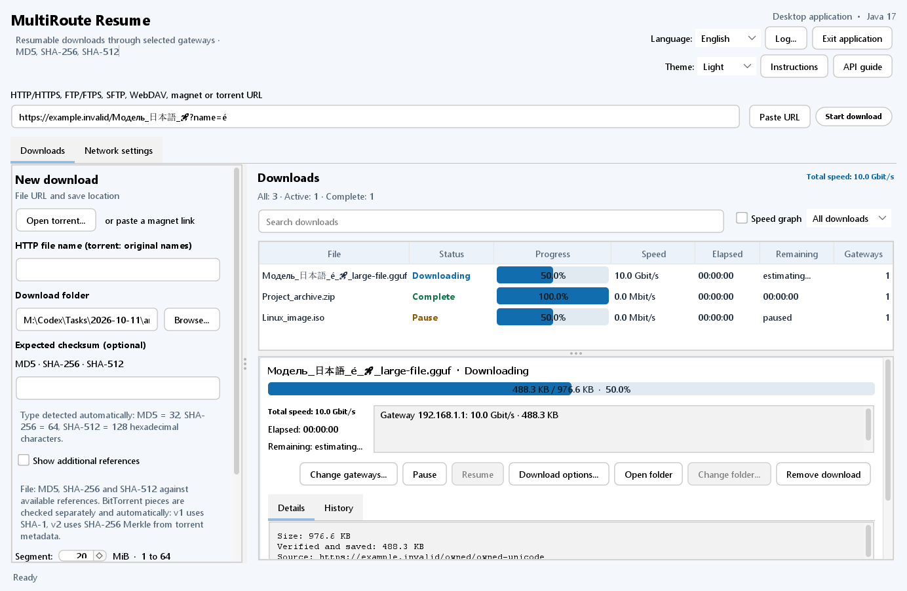
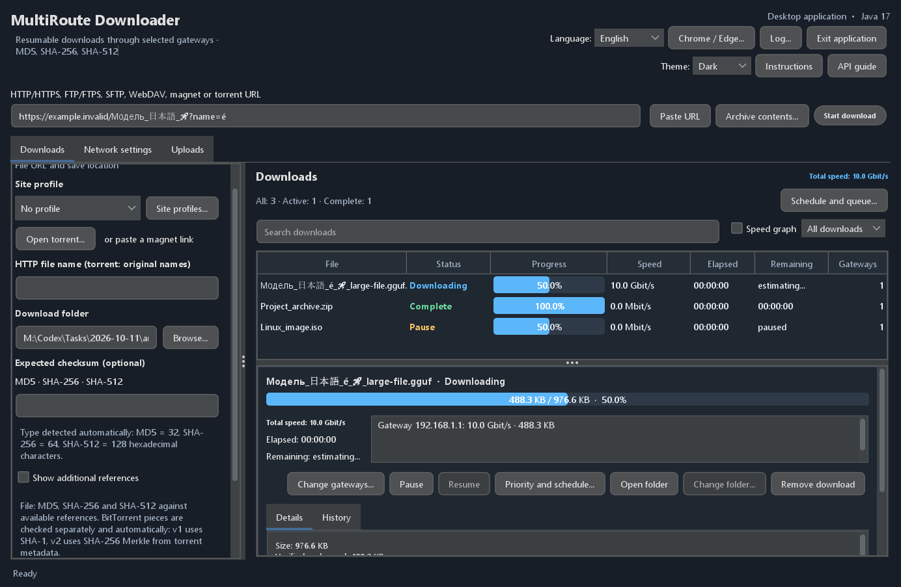
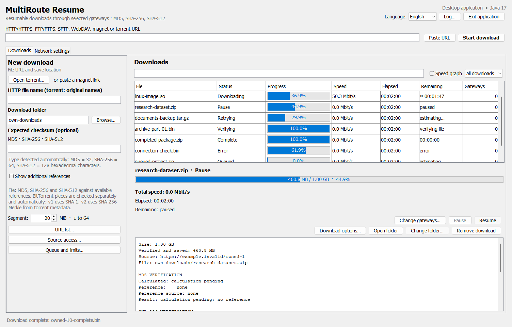
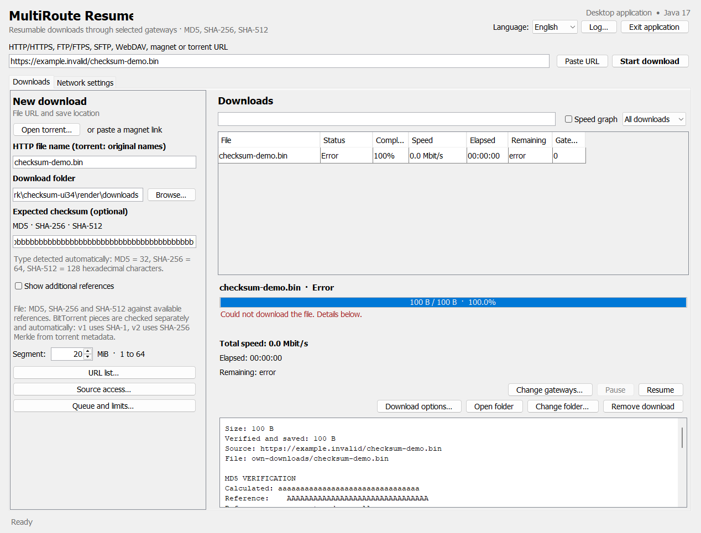
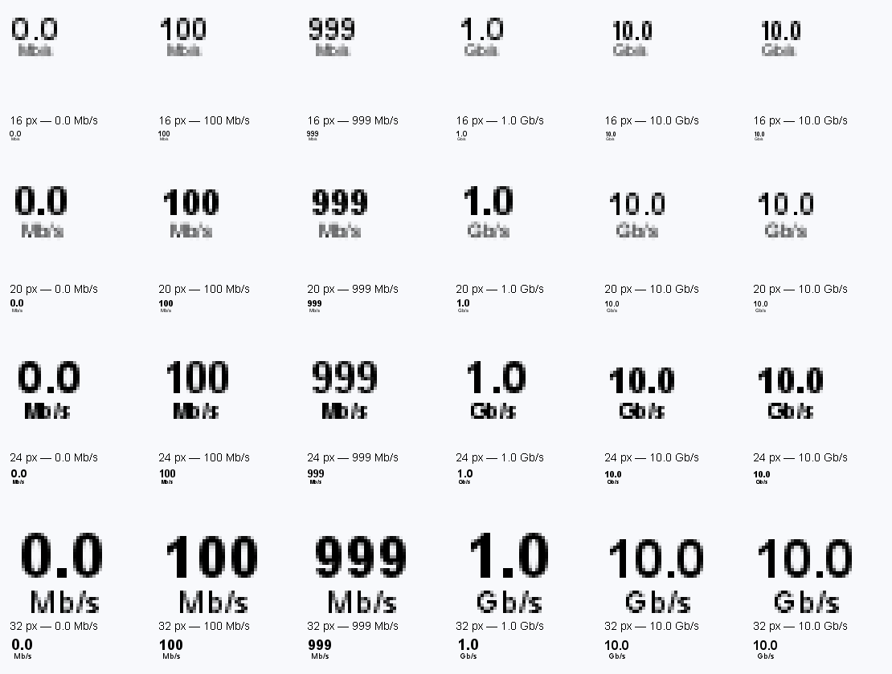
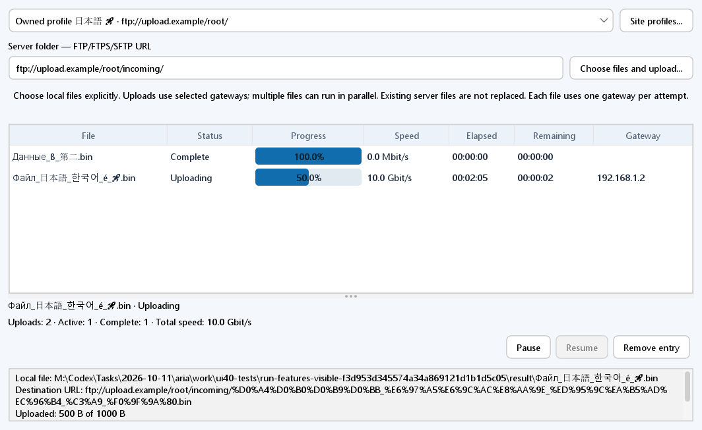

# MultiRoute Downloader

**Новое в 4.1.3:** исправлены проверка диапазонов Civitai/CDN, ограниченное чтение первого сегмента и продолжение сохранённых последовательных данных по сегментам. Временный HTTP 200 для ненулевого диапазона вызывает повтор через 2–30 секунд с сохранением данных и доступности потока шлюза. Постоянный журнал по шлюзам различает полученный трафик и сохранённый прогресс. [Описание релиза и границы проверки](docs/releases/4.1.3.ru.md) · [Диагностика передачи](docs/transfer-diagnostics.ru.md).

**Новое в 4.0.1:** несколько загрузок можно выделить через Ctrl/Cmd и щелчок или Shift, а все видимые строки — через Ctrl/Cmd+A, затем удалить с одним подтверждением. Удаление файлов необязательно и по умолчанию выключено. Выделение сохраняется при автоматическом обновлении списка; задания с ошибкой удаления остаются выделенными для повторной попытки.

**Новое в 4.0:** профили сайтов с раздельными учётными записями, проверяемая отправка FTP/FTPS/SFTP и просмотр удалённых папок, ограниченный просмотр ZIP/TAR/7Z/RAR. Для полной проверки SHA-256 после отправки нужно право чтения удалённого файла. Одна отправка использует один шлюз, несколько файлов могут отправляться параллельно. [Полная инструкция](docs/ru.md#профили-сайтов-отправка-файлов-и-просмотр-архивов-40).

[Полная инструкция на русском](docs/ru.md)

[English](docs/en.md) · [Deutsch](docs/de.md) · [Español](docs/es.md) · [Français](docs/fr.md)

[中文](docs/zh.md) · [한국어](docs/ko.md) · [العربية](docs/ar.md) · [Italiano](docs/it.md) · [日本語](docs/ja.md) · [हिन्दी](docs/hi.md) · [Tiếng Việt](docs/vi.md)

Настольное Java-приложение для распределённой докачки через выбранные шлюзы
локальной сети, с проверкой файлов и локальным API.

Владелец проекта: [2018-spec-fdsds](https://github.com/2018-spec-fdsds).

**Новое в 4.0:** обновлённый интерфейс FlatLaf с системной, светлой и тёмной темой, сводкой очереди и горячими клавишами. Подсказка строки показывает полное имя файла и абсолютный путь; путь можно скопировать через меню правой кнопки. История хранит даты начала, продолжений и завершения загрузки после перезапуска приложения.

**Сохранено из 3.9:** устранена зависимость запуска от удаления временных файлов вывода после превышения времени ожидания команды поиска процесса. Вывод читается через каналы с ограниченным буфером; проверка принадлежности ранее запущенного процесса MultiRoute сохранена.

**Сохранено из 3.8:** кнопки **Инструкция** и **Работа с API** вверху справа открывают руководство для версии приложения на выбранном языке в браузере по умолчанию. Кнопка API сразу открывает раздел API.

**Сохранено из 3.7:** нижняя панель подробностей выбранной загрузки и отчёта контрольных сумм сохраняет место чтения и выделение текста при обновлениях. При выборе другой загрузки её отчёт открывается с начала.

**Сохранено из 3.6:** отдельное окно журнала сохраняет место просмотра при обновлении, показывает новые записи при прокрутке до конца и сохраняет выделение текста.

**Сохранено из 3.5:** отдельная полоса прогресса каждой загрузки, прокрутка списка с сохранением положения при обновлении и колонки на всю ширину панели. Сортировка, фильтры и подробности сохранены.

**Сохранено из 3.4:** проверка MD5 и SHA-512 вместе с SHA-256, автоматический поиск эталонов, ручной ввод и результаты каждого алгоритма в интерфейсе и API. Прозрачный значок трея с чёрными цифрами сохранён.

**Скачать установщики:** [файлы Windows и macOS в папке downloads](downloads/v4.1.3/).

Папка загрузок по умолчанию определяется для текущего пользователя при запуске: `%USERPROFILE%\Downloads` в Windows и `~/Downloads` в macOS/Linux. Сохранённая папка по умолчанию следует за текущим профилем; выбранная вручную папка сохраняется.

## Зачем нужно приложение

Если в локальной сети есть несколько независимых выходов в Интернет, приложение
позволяет использовать их пропускную способность одновременно. Например, один
шлюз подключён к проводному провайдеру, а другой — к мобильной сети 4G/5G.
Компьютер обращается к обоим роутерам через общую локальную Ethernet-сеть.

- **Ускорение скачивания:** части файлов загружаются параллельно через все
  выбранные доступные шлюзы. Более быстрые шлюзы получают больше частей из общей
  очереди, используя доступную суммарную пропускную способность подключений.
- **Отказоустойчивость:** при отказе отдельного шлюза остальные продолжают
  сегментированную загрузку. Незавершённые части возвращаются в общий пул для
  скачивания через другие шлюзы; уже проверенные данные сохраняются.
- **Групповая загрузка:** можно добавить список ссылок, управлять очередью
  нескольких файлов или передать группу заданий через локальный API.

Прирост скорости зависит от независимости интернет-подключений и ограничений
сервера источника. Докачка и перераспределение частей требуют поддержки
возобновления передачи выбранным протоколом и источником.

## Скриншоты

Версия 4.0 со светлой и тёмной темой. Это реальные компоненты настольного интерфейса в отдельном нашем демонстрационном профиле с именами Unicode и условными счётчиками заданий. Скорости показаны для примера, это не измерение пропускной способности Интернета.

Версия 3.5: отдельные полосы прогресса и колонки на всю ширину панели. Наш демонстрационный профиль использует условные задания и счётчики.

Редактор контрольных сумм 3.4 автоматически распознаёт MD5, SHA-256 и SHA-512. Наш тестовый профиль с условными значениями показывает ошибку сверки; настоящий файл не скачивался.

Настольный интерфейс на английском языке, отрисованный из отдельного **демонстрационного профиля**. Примеры главного окна сняты в 3.1; в 3.2 добавлены трей и команда выхода; в 3.4 — MD5 и SHA-512. Задания и счётчики показаны для примера: это не реальные скачивания и не измеренные скорости Интернета.

Примеры значка трея отрисованы настоящим кодом 3.3 для штатных размеров значка и увеличены для проверки. Скорости условные; точное суммарное значение показывается в подсказке.

Настройки сети и групповая загрузка

Четыре выбранных шлюза и виртуальный адрес приложения. В этом примере проверки шлюзов и скорости не выполняются.

Групповой импорт: одна ссылка в строке, проверка списка перед добавлением.

## Установка и обычный запуск

Дистрибутивы: [релиз 4.1.3](https://github.com/2018-spec-fdsds/multiroute-downloader/releases/tag/v4.1.3).
Новые установщики 4.1.3 содержат программу, отдельную Java 21 и готовый
сетевой компонент в одном файле:

| Система | Установщик | Запуск |
| --- | --- | --- |
| Windows 11 x64 | `MultiRoute-Downloader-4.1.3-Windows-x64-Setup.exe` | **MultiRoute Downloader** в «Пуск» либо ярлык |
| Apple Silicon, macOS 26+ | `MultiRoute-Downloader-4.1.3-macOS-arm64.pkg` | `/Applications/MultiRoute Downloader.app` |
| Intel, macOS 15+ | `MultiRoute-Downloader-4.1.3-macOS-x86_64.pkg` | `/Applications/MultiRoute Downloader.app` |

Программа открывается как обычное приложение, без командной строки и сессии
Terminal. В Windows при отсутствии Npcap программа предложит проверенное скачивание
официального драйвера и его обычную установку с UAC. В macOS отдельные Java,
Command Line Tools и Homebrew не нужны; доступ сетевого компонента подтверждается
обычным диалогом администратора. Java работает от вашего пользователя.

Подтверждения безопасности Windows/macOS, отсутствие подписи Developer ID и
нотарификации, разрешения локальной сети и папок описаны в
[русской инструкции](docs/ru.md) и отдельных инструкциях каждого языка.

Portable ZIP 3.0 и Linux сохраняют прежний способ: `Deploy-Windows.cmd`,
`Deploy-Linux.sh` или `Deploy-macOS.command`. Терминал требуется старому macOS
portable-варианту, а не новой установке `.pkg`.
Исходники в репозитории требуют сборки; они не являются готовым установщиком.

Минимальная совместимость поставляемого BitTorrent JNI: Linux glibc 2.38+;
macOS 26+ для Apple Silicon, 15+ для Intel. Только старый portable macOS 3.0
допускает 11+ для части HTTP-функций; новые `.pkg` требуют 26+/15+.
Нужны Java 17+ (включена в новые установщики) и Ethernet
в общей IPv4-подсети выбранных роутеров.

Подробности: [инструкция](docs/ru.md), [API](API.ru.txt),
[проверки](CHECKS.ru.md), [исторический аудит совместимости portable 3.0](docs/COMPATIBILITY.json).

## Проверка установщиков 4.1.3

Отчёт `NATIVE-INSTALLER-TESTS.json` соответствующей версии распространяется рядом с установщиками на странице релиза и не входит в документацию установленного приложения. Он указывает версию исходников, контрольные суммы пакетов и фактически проверенные платформы и сценарии. Сопоставляйте его версию и commit с устанавливаемым пакетом.

[Описание релиза 4.1.3](docs/releases/4.1.3.ru.md) отделяет завершённую проверку установленного приложения от проверок новых пакетов релиза. [Сетевая диагностика](docs/network-diagnostics.ru.md) описывает проверку подсети; реальная смена DHCP при передаче через несколько роутеров ещё не проверялась. Доступность WAN нужно оценивать отдельно для каждого шлюза: одна завершённая загрузка не подтверждает работу всех настроенных роутеров.

Установщики не имеют подписи издателя; macOS-пакеты не подписаны Developer ID и не нотарифицированы. Инструкции внутри пакетов соответствуют версии исходников, указанной в отчёте соответствующего релиза.

## Лицензия

Оригинальное приложение можно бесплатно устанавливать и использовать лично и в организациях, включая работу бизнеса. **Продажа приложения, платные лицензии и распространение за плату запрещены** без отдельного разрешения. Пользовательская лицензия не даёт общего права изменять или распространять оригинальный код и не является открытой лицензией, одобренной OSI. Сторонние компоненты сохраняют свои лицензии. Это перевод кратких условий; определяющий английский текст находится в [LICENSE.txt](LICENSE.txt).

## Расписание скачивания и приоритет

В настройках очереди/расписания задайте `max_active_jobs` (1–32), общий лимит скорости и лимиты шлюзов, суточное окно скачивания (`schedule_enabled`, `schedule_start`, `schedule_end`, HH:mm). Используется часовой пояс компьютера, API показывает его как `schedule_timezone`; окно может проходить через полночь, одинаковое начало/конец означает весь день. Вне окна загрузки возвращаются в очередь, затем продолжаются. Вручную приостановленное задание остаётся на паузе. Для выбранной загрузки `priority` от -100 до 100 задаёт порядок: большее число запускается раньше, при равенстве — порядок создания. Изменение приоритета не прерывает активную загрузку. `start_after_ms` — необязательное самое раннее время Unix epoch в миллисекундах, 0 снимает разовую задержку. Настройки сохраняются. Они относятся к скачиванию, а не независимой очереди отправок. Приложение должно работать, в том числе в трее, а компьютер — не спать; пробуждения средствами ОС нет. Те же настройки доступны через `GET`/`PUT`/`POST /api/v1/queue` и `PUT`/`POST /api/v1/jobs/{id}/options`.

### Отправки в приложении

На снимке собственные демонстрационные задания Unicode. Показанные значения не являются измерением пропускной способности.

## Интеграция с Chrome и Edge

Откройте в приложении интеграцию **Chrome / Edge**, разрешите передачу ссылок и откройте папку расширения. Один раз перейдите в Chrome на `chrome://extensions`, в Edge — `edge://extensions`, включите режим разработчика, нажмите **Загрузить распакованное** и выберите `browser-extension` с `manifest.json`. Native-установщики включают её рядом с JAR; в исходниках есть [browser-extension/](browser-extension/). Не перемещайте выбранную папку. Отдельный `MultiRoute-Downloader-4.1.3-Chrome-Edge.zip` сначала распакуйте. Эта версия устанавливается локально, публикации в магазинах браузеров нет.

MultiRoute должен быть запущен, достаточно трея. Нажмите правой кнопкой по ссылке и выберите действие скачивания MultiRoute либо отправьте URL из окна расширения. Используются выбранные в приложении папка, шлюзы и профиль сайта; при необходимости остаётся выбор файлов репозитория/torrent. Порт расширения по умолчанию 8765; если API работает на другом порту, задайте его. Передаётся только URL: cookies и пароли браузера не копируются, остальные закачки браузера не перехватываются. Доступ к источнику настройте в приложении. Если браузер запрашивает доступ к локальному соединению, подтвердите его только для выбранного расширения.

Мост по умолчанию выключен; разрешён только origin `chrome-extension://ljdklefabmaecjalfhjoicmgedmjjkbl` на `/api/v1/browser/status` и `/api/v1/browser/download`. Правила остальных API не ослабляются. HTTP 202 означает передачу URL в приложение, а не завершение файла. Один headless-сервер не открывает нужный настольный выбор. Для отключения удалите расширение на странице браузера или снимите разрешение в приложении.

[Chrome](https://developer.chrome.com/docs/extensions/get-started/tutorial/hello-world) · [Edge](https://learn.microsoft.com/en-us/microsoft-edge/extensions-chromium/getting-started/extension-sideloading).
