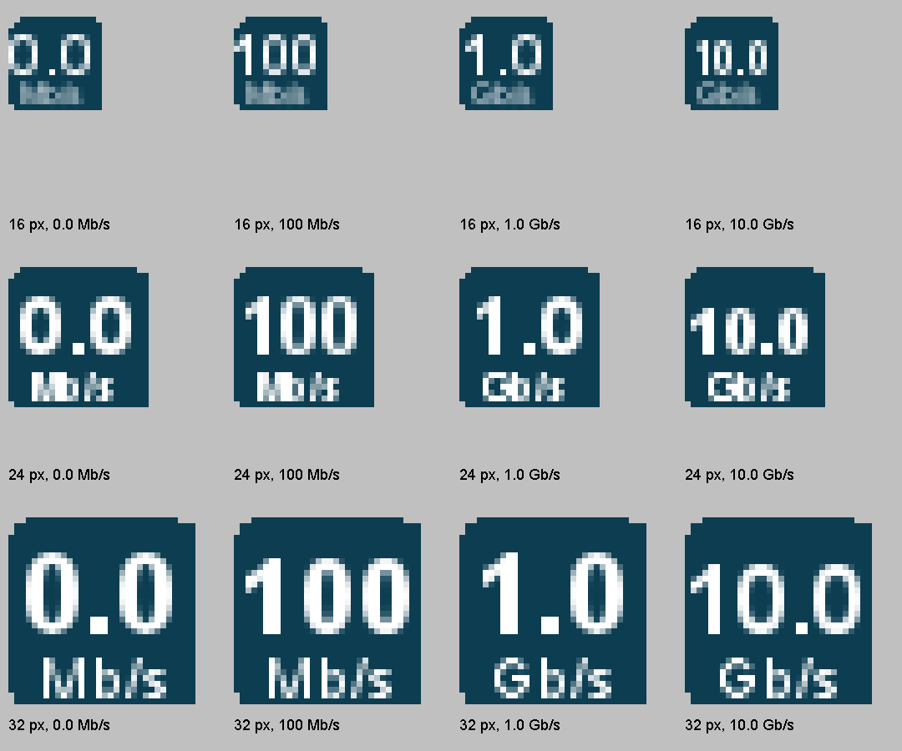

# MultiRoute Resume

[Полная инструкция на русском](docs/ru.md)

[English](docs/en.md) · [Deutsch](docs/de.md) · [Español](docs/es.md) · [Français](docs/fr.md)

Настольное Java-приложение для распределённой докачки через выбранные шлюзы
локальной сети, с проверкой файлов и локальным API.

Владелец проекта: [2018-spec-fdsds](https://github.com/2018-spec-fdsds).

**Новое в 3.2:** сворачивание в трей, суммарная скорость загрузок, явный выход, ярлыки на рабочем столе и английские тексты setup.

**Скачать установщики:** [файлы Windows и macOS в папке downloads](https://github.com/2018-spec-fdsds/multiroute-resume/tree/main/downloads/v3.2).

## Зачем нужно приложение

Если в локальной сети есть несколько независимых выходов в Интернет, приложение
позволяет использовать их пропускную способность одновременно. Например, один
шлюз подключён к проводному провайдеру, а другой — к мобильной сети 4G/5G.
Компьютер обращается к обоим роутерам через общую локальную Ethernet-сеть.

- **Ускорение скачивания:** части файлов загружаются параллельно через все
  выбранные доступные шлюзы. Более быстрые шлюзы получают больше частей из общей
  очереди, используя доступную суммарную пропускную способность подключений.
- **Отказоустойчивость:** при отказе отдельного шлюза остальные продолжают
  сегментированную загрузку. Незавершённые части возвращаются в общий пул для
  скачивания через другие шлюзы; уже проверенные данные сохраняются.
- **Групповая загрузка:** можно добавить список ссылок, управлять очередью
  нескольких файлов или передать группу заданий через локальный API.

Прирост скорости зависит от независимости интернет-подключений и ограничений
сервера источника. Докачка и перераспределение частей требуют поддержки
возобновления передачи выбранным протоколом и источником.

## Скриншоты

Настольный интерфейс на английском языке, отрисованный из отдельного **демонстрационного профиля**. Примеры главного окна сняты в 3.1; в 3.2 добавлены трей и команда выхода. Задания и счётчики показаны для примера: это не реальные скачивания и не измеренные скорости Интернета.

Примеры значка трея отрисованы настоящим кодом 3.2 для размеров 16, 24 и 32 пикселя и увеличены для проверки. Скорости условные; точное суммарное значение показывается в подсказке.

Настройки сети и групповая загрузка

Четыре выбранных шлюза и виртуальный адрес приложения. В этом примере проверки шлюзов и скорости не выполняются.

Групповой импорт: одна ссылка в строке, проверка списка перед добавлением.

## Установка и обычный запуск

Дистрибутивы: [релиз 3.2](https://github.com/2018-spec-fdsds/multiroute-resume/releases/tag/v3.2).
Новые установщики 3.2 содержат программу, Java и готовый
сетевой компонент в одном файле:

| Система | Установщик | Запуск |
| --- | --- | --- |
| Windows 11 x64 | `MultiRoute-Resume-3.2-Windows-x64-Setup.exe` | **MultiRoute Resume** в «Пуск» либо ярлык |
| Apple Silicon, macOS 26+ | `MultiRoute-Resume-3.2-macOS-arm64.pkg` | `/Applications/MultiRoute Resume.app` |
| Intel, macOS 15+ | `MultiRoute-Resume-3.2-macOS-x86_64.pkg` | `/Applications/MultiRoute Resume.app` |

Программа открывается как обычное приложение, без командной строки и сессии
Terminal. В Windows при отсутствии Npcap программа предложит проверенное скачивание
официального драйвера и его обычную установку с UAC. В macOS отдельные Java,
Command Line Tools и Homebrew не нужны; доступ сетевого компонента подтверждается
обычным диалогом администратора. Java работает от вашего пользователя.

Подтверждения безопасности Windows/macOS, отсутствие подписи Developer ID и
нотарификации, разрешения локальной сети и папок описаны в
[русской инструкции](docs/ru.md) и отдельных инструкциях каждого языка.

Portable ZIP 3.0 и Linux сохраняют прежний способ: `Deploy-Windows.cmd`,
`Deploy-Linux.sh` или `Deploy-macOS.command`. Терминал требуется старому macOS
portable-варианту, а не новой установке `.pkg`.
Исходники в репозитории требуют сборки; они не являются готовым установщиком.

Минимальная совместимость поставляемого BitTorrent JNI: Linux glibc 2.38+;
macOS 26+ для Apple Silicon, 15+ для Intel. Только старый portable macOS 3.0
допускает 11+ для части HTTP-функций; новые `.pkg` требуют 26+/15+.
Нужны Java 17+ (включена в новые установщики) и Ethernet
в общей IPv4-подсети выбранных роутеров.

Подробности: [инструкция](docs/ru.md), [API](API.ru.txt),
[проверки](CHECKS.ru.md), [аудит совместимости](docs/COMPATIBILITY.json).

## Проверка установщиков 3.2

[Отчёт](https://github.com/2018-spec-fdsds/multiroute-resume/blob/main/NATIVE-INSTALLER-TESTS.json) содержит контрольные суммы трёх пакетов и
результаты проверок. В Windows проверены запуск нативного EXE, замена своего
предыдущего экземпляра и сохранение профиля. Обе версии macOS собраны на настоящих
GitHub Mac-runner; проверены нативный запуск/API, JNI и тестовые режимы защищённого
сетевого компонента.

Завершение установки на пользовательском компьютере, диалоги безопасности,
захват BPF и передача через физические шлюзы ещё не проверены. Поэтому 3.2
опубликована как предварительный релиз. Пакеты не имеют подписи издателя;
macOS-пакеты не нотарифицированы. Инструкции внутри пакетов соответствуют версии
исходников, указанной в отчёте; свежие результаты проверки есть в отчёте и описании
релиза.

## Лицензия

Оригинальное приложение можно бесплатно устанавливать и использовать лично и в организациях, включая работу бизнеса. **Продажа приложения, платные лицензии и распространение за плату запрещены** без отдельного разрешения. Пользовательская лицензия не даёт общего права изменять или распространять оригинальный код и не является открытой лицензией, одобренной OSI. Сторонние компоненты сохраняют свои лицензии. Это перевод кратких условий; определяющий английский текст находится в [LICENSE.txt](LICENSE.txt).
