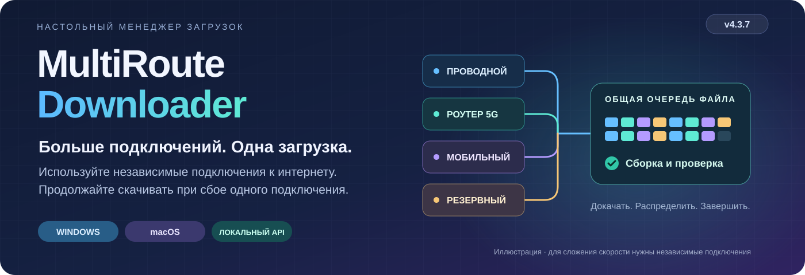
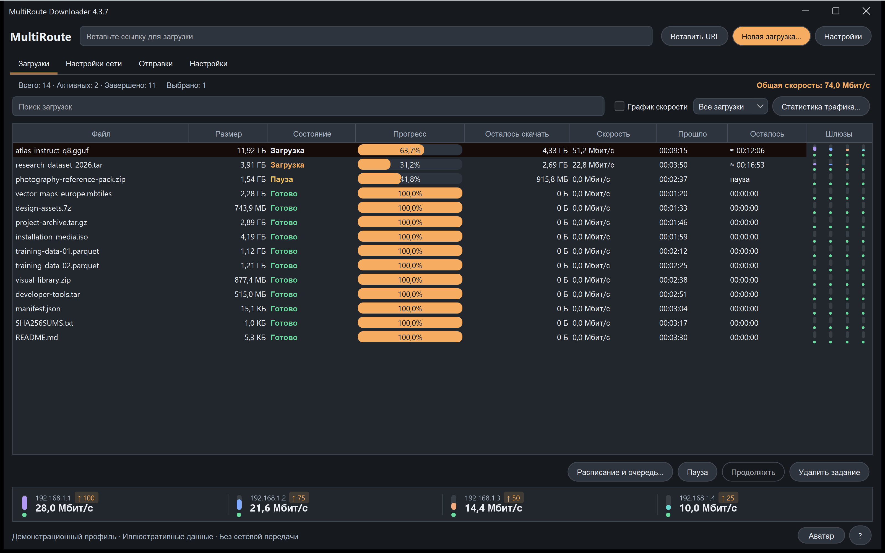

# MultiRoute Downloader

<!-- product-languages:start -->
<p align="center" dir="ltr">
<a href="README.md">English</a> · <strong>Русский</strong> · <a href="docs/overview/de.md">Deutsch</a> · <a href="docs/overview/es.md">Español</a> · <a href="docs/overview/fr.md">Français</a> · <a href="docs/overview/zh.md">中文</a><br />
<a href="docs/overview/ko.md">한국어</a> · <a href="docs/overview/ar.md">العربية</a> · <a href="docs/overview/it.md">Italiano</a> · <a href="docs/overview/ja.md">日本語</a> · <a href="docs/overview/hi.md">हिन्दी</a> · <a href="docs/overview/vi.md">Tiếng Việt</a>
</p>
<!-- product-languages:end -->

<p align="center"></p>

<p align="center"><strong>Скачивайте большие файлы через доступные вам подключения.</strong><br />Объединяйте независимые проводные и мобильные шлюзы для больших загрузок, сохраняйте прогресс и проверяйте готовый файл.</p>

<p align="center">
  <a href="https://github.com/2018-spec-fdsds/multiroute-downloader/releases/tag/v4.3.9"><strong>Скачать 4.3.9</strong></a> ·
  <a href="downloads/README.md">Актуальные загрузки</a> ·
  <a href="docs/ru.md">Инструкция</a> ·
  <a href="API.ru.txt">Работа с API</a> ·
  <a href="README.md">English</a>
</p>

**На macOS:** [Установка, первый запуск и разрешения](docs/macos/ru.md) · [English](docs/macos/en.md) · [12 языков](docs/macos/README.md)

## Зачем появился MultiRoute

Идея появилась из знакомой проблемы домашней сети: проводной интернет, мобильный роутер и резервное подключение доступны одновременно, но большой файл всё равно скачивается только через основной шлюз компьютера. Когда это подключение замедляется или пропадает, остальные не помогают завершить передачу.

MultiRoute объединяет эти независимые подключения в одном рабочем пространстве. Доступные шлюзы берут сегменты файла из общей очереди: быстрые успевают скачать больше, а незавершённые части зависшего соединения могут перейти другим шлюзам. Приложение сохраняет прогресс при поддержке докачки, собирает результат и сверяет его с доступной эталонной контрольной суммой.

- **Больше пропускной способности для одного файла.** Независимые подключения параллельно скачивают разные части. Их суммарная скорость помогает сократить время загрузки, если источник и локальная сеть обеспечивают нужную пропускную способность.
- **Прогресс при обрывах связи.** Готовые части сохраняются; работающие шлюзы продолжают передачу, а зависшие сегменты могут вернуться в общий пул.
- **Наглядное управление.** Следите за общей скоростью и скоростью каждого шлюза, меняйте выбранные шлюзы во время загрузки и оценивайте вклад каждого подключения.
- **Повторяемые рабочие процессы.** Используйте профили сайтов, ставьте в очередь списки ссылок или поручайте загрузки локальному API из скриптов и инструментов разработки.

Прирост зависит от независимости каналов, ограничений источника и локальной сети. Роутеры с одним общим выходом в интернет не умножают его пропускную способность.


### Полезно и с одним подключением

Используйте поддерживаемую докачку, сверку с опубликованными суммами, защищённый DNS, пакетные очереди, расписание, профили сайтов, upload и локальный API. Начните с одного шлюза и добавьте остальные, когда они появятся.

## Скачать и установить

**Текущая версия — 4.3.9.** Native-установщики включают отдельную Java 21 и сетевой компонент платформы. Приложение открывается обычным значком.

| Ваш компьютер | Установщик одним файлом |
| --- | --- |
| **Windows 11 · x64** | [Windows Setup EXE](https://github.com/2018-spec-fdsds/multiroute-downloader/releases/download/v4.3.9/MultiRoute-Downloader-4.3.9-Windows-x64-Setup.exe) |
| **Mac · Apple Silicon · macOS 26+** | [PKG для Apple Silicon](https://github.com/2018-spec-fdsds/multiroute-downloader/releases/download/v4.3.9/MultiRoute-Downloader-4.3.9-macOS-arm64.pkg) |
| **Mac · Intel · macOS 15+** | [PKG для Intel](https://github.com/2018-spec-fdsds/multiroute-downloader/releases/download/v4.3.9/MultiRoute-Downloader-4.3.9-macOS-x86_64.pkg) |

[Интеграция Chrome / Edge](docs/ru.md#chrome-and-edge-integration) · [Контрольные суммы и отчёт](downloads/v4.3.9/README.md) · [Подробнее о скачивании](downloads/README.md)

Windows Setup работает на английском и создаёт ярлык на рабочем столе. Npcap проверяется отдельно: при необходимости предлагается официальный установщик. macOS использует системную libpcap. Установку и подтверждения безопасности описывает инструкция на вашем языке. Готовые native-установщики здесь предназначены для Windows и macOS; установщика Linux 4.x в этом разделе пока нет.

**Free / Pro в 4.3.9:** Free использует до **2 шлюзов**, **3 одновременных загрузок** и позволяет создавать **3 профиля сайтов**, с оформлением Graphite/System. Соответствующие права Pro открывают до **8 шлюзов**, **32 загрузок**, дополнительные профили, приоритеты, историю/отчёты по шлюзам, пакетные операции, внешний API и дополнительные оформления. Искусственного ограничения скорости в Free нет. [Подробности возможностей](docs/licensing.ru.md).


## Связь Mac со шлюзами

- **Ответы шлюзов Mac при ручном адресе.** Настройка захвата POSIX исправлена: и ручной адрес приложения, и DHCP используют режим приёма ответов на собственный MAC приложения, как уже было в Windows. Успешный системный ping проверяет соединение самого компьютера и не подтверждает приём ответов шлюза виртуальным адресом приложения.

- Диагностика DHCP сохраняет формулировки на двенадцати языках вместо замены общим сообщением. Поведение авторизации остаётся прежним: обычные проверки сети повторно используют подготовленный компонент. Методы API, элементы интерфейса, маршруты ОС и MAC физической карты не меняются. Первый привилегированный доступ к Ethernet BPF по-прежнему может запросить обычное подтверждение администратора.

Исправляется конкретное различие режима захвата, а не все причины недоступности шлюза. Проверки свободного адреса, подсети и аренды/конфликтов DHCP остаются активны. Передачи Mac с ручным адресом ещё требуют проверки на оборудовании; проводной Ethernet по-прежнему необходим.

### Управление передачами

- **Надёжнее запуск Mac и настройка шлюзов.** При нативном запуске Mac распознаётся старый относительный путь по умолчанию, в том числе без начального слеша: используется подтверждённый существующий профиль или пустая папка по умолчанию в учётной записи. Для неоднозначного пользовательского пути требуется явный выбор, а не догадка.

- После ошибки или отмены подготовки шлюза остальные шлюзы и фоновые проверки не повторяют запросы прав до явной повторной настройки сети. Первый привилегированный запуск по-прежнему может потребовать обычного подтверждения администратора macOS для открытия Ethernet-устройства BPF.

- Сетевой компонент Mac 4.3.2 учитывает скрытый системой MAC адаптера, сохраняя проверки защиты физической карты. У приложения остаётся собственный MAC; маршруты ОС и MAC физической карты не меняются. Значок и имя Mac-приложения приведены к идентичности MultiRoute в Windows. Перед обновлением через PKG закройте приложение. Имя инициатора в реальном системном диалоге и передачи LAN/DHCP ещё требуют проверки на оборудовании; для этого транспорта по-прежнему нужен проводной Ethernet.


- **Оставшийся объём загрузки.** В таблице загрузок появилась отдельная колонка **Осталось скачать**. Она показывает объём ещё не загруженных данных отдельно от оценки оставшегося времени и сортируется численно. Значение учитывает сохранённые данные и текущий прогресс, не опускается ниже нуля; при неизвестном общем размере отображается тире.


- **Задавайте предпочтения шлюзам.** Приоритеты 0–1000 видны рядом с индикаторами: шлюз с большим значением предпочтительнее для небольшого файла и получает больше параллельных сегментов большого файла. Другие исправные шлюзы продолжают помогать. Нужно отдельное право Pro `gateway_priorities`.

- **Понимайте причину остановки.** Открывайте индивидуальный лог файла через контекстное меню, в том числе после завершения, или справочник с поиском по 25 темам в настройках. Заполнение диска обозначается явно; у места сохранения видно свободное место в ГБ.

- **Управляйте большой очередью.** Выбирайте число одновременных скачиваний в пределах лицензии и правила автоматических повторов. Копируйте имена выбранных файлов, ставьте подходящие задания на паузу/продолжение; двойной щелчок открывает папку. При ожидании данных после докачки сохранённый префикс остаётся в прогрессе.


<details>
<summary><strong>Справочник ошибок с поиском — 25 тем на двенадцати языках</strong></summary>


</details>

## Наглядно следите за передачами

В рабочем пространстве 4.3.7 главное место отдано файлам: отдельные колонки имени и размера, прогресс каждого задания, общая и поканальные скорости, график и свойства файла. Graphite и System доступны в Free; дополнительным оформлениям, включая Rose, нужно соответствующее право Pro.


*Окна текущего приложения Windows, снятые с изолированным демонстрационным профилем. Файлы, прогресс, скорости и возможности Pro показаны для знакомства с интерфейсом, а не для измерения производительности.*

<details>
<summary><strong>Настройки сети и история скорости</strong></summary>


</details>


## Оформление на ваш вкус

Выбирайте из девяти оформлений: Graphite, Nordic, Streams Studio, Neon, Community, Chat, Studio, Rose и System. По умолчанию используется Graphite. Graphite и System доступны в Free; остальным нужно соответствующее право Pro на оформление. В разделе Настройки → Оформление можно менять стиль и скругление элементов. Загрузки при этом продолжаются.

<table>
<tr>
<td width="50%" valign="top"><strong>Graphite</strong><br /><a href="docs/images/v4.3.7/downloads-en-ae5b55131583.png"></a></td>
<td width="50%" valign="top"><strong>Nordic</strong><br /><a href="docs/images/v4.3.7/skin-nordic-a4e8d79666e0.png"></a></td>
</tr>
<tr>
<td width="50%" valign="top"><strong>Streams Studio</strong><br /><a href="docs/images/v4.3.7/downloads-streams-ru-ca2a8876ed8f.png"></a></td>
<td width="50%" valign="top"><strong>Neon</strong><br /><a href="docs/images/v4.3.7/skin-neon-6b0c1d2da5f8.png"></a></td>
</tr>
<tr>
<td width="50%" valign="top"><strong>Community</strong><br /><a href="docs/images/v4.3.7/skin-community-9763964c8f12.png"></a></td>
<td width="50%" valign="top"><strong>Chat</strong><br /><a href="docs/images/v4.3.7/skin-chat-221a28cc76f4.png"></a></td>
</tr>
<tr>
<td width="50%" valign="top"><strong>Studio</strong><br /><a href="docs/images/v4.3.7/skin-studio-094e14ba38ea.png"></a></td>
<td width="50%" valign="top"><strong>Rose</strong><br /><a href="docs/images/v4.3.7/skin-rose-02646e7f35bf.png"></a></td>
</tr>
<tr>
<td width="50%" valign="top"><strong>System</strong><br /><a href="docs/images/v4.3.7/skin-system-c148099984c6.png"></a></td>
<td width="50%" valign="top"></td>
</tr>
</table>

## Курьер, который следует за загрузками

Необязательный курьер на рабочем столе превращает прогресс скачивания в наглядный груз. В настройках оформления выберите мужчину или женщину и масштаб от 40% до 100%. На мешке показана сумма известного оставшегося объёма активных загрузок; по мере получения байтов мешок уменьшается. Движение зависит от общей скорости скачивания, а при нулевой скорости курьер стоит. Маленький груз он несёт на плече, больший тащит по земле, а очень большой — с заметным усилием.

Кнопка Аватар показывает или скрывает курьера. Перетаскивайте его мышью, дважды нажмите левой кнопкой, чтобы открыть приложение, или нажмите правой для меню действий. Это визуальный спутник: файлы сохраняются в выбранных вами папках.

После завершения курьер кладёт доставленный груз и плавно исчезает. Если загрузки продолжаются, он возвращается с оставшимся объёмом.

### Небольшой остаток · 768 МБ

<table>
<tr>
<td width="50%" valign="top"><strong>Курьер-мужчина</strong><br /><a href="docs/images/v4.3.7/avatar-man-shoulder-eeeb879d0240.png"></a></td>
<td width="50%" valign="top"><strong>Курьер-женщина</strong><br /><a href="docs/images/v4.3.7/avatar-woman-shoulder-5682615d5576.png"></a></td>
</tr>
</table>

### Средний остаток · 7 ГБ

<table>
<tr>
<td width="50%" valign="top"><strong>Курьер-мужчина</strong><br /><a href="docs/images/v4.3.7/avatar-man-drag-a3dc0a3ed22c.png"></a></td>
<td width="50%" valign="top"><strong>Курьер-женщина</strong><br /><a href="docs/images/v4.3.7/avatar-woman-drag-48d8ee0fa4d1.png"></a></td>
</tr>
</table>

### Большой остаток · 18 ГБ

<table>
<tr>
<td width="50%" valign="top"><strong>Курьер-мужчина</strong><br /><a href="docs/images/v4.3.7/avatar-man-heavy-649f17608748.png"></a></td>
<td width="50%" valign="top"><strong>Курьер-женщина</strong><br /><a href="docs/images/v4.3.7/avatar-woman-heavy-d445fdb37867.png"></a></td>
</tr>
</table>

## Настройки наглядно

Задайте папку загрузки, профили сайтов и язык, затем настройте оформление, размер курьера и звуки завершения. Адрес приложения, MAC, шлюзы и DNS собраны в настройках сети. Необязательные звуки различают завершение одного файла и всей очереди: можно выбрать встроенные мелодии или свои MP3/WAV длительностью до 10 секунд.

<table>
<tr>
<td width="50%" valign="top"><strong>Настройки приложения</strong><br /><a href="docs/images/v4.3.7/settings-8abcb12a782d.png"></a></td>
<td width="50%" valign="top"><strong>Оформление, курьер и звуки</strong><br /><a href="docs/images/v4.3.7/appearance-cebf121d5de7.png"></a></td>
</tr>
<tr>
<td width="50%" valign="top"><strong>Адрес приложения и защищённый DNS</strong><br /><a href="docs/images/v4.3.7/network-dns-e29dfdba1007.png"></a></td>
<td width="50%" valign="top"><strong>Выбор шлюзов и проверка скорости</strong><br /><a href="docs/images/v4.3.7/network-gateways-aee0a7897f48.png"></a></td>
</tr>
</table>

<details>
<summary><strong>Рабочие окна скачивания и отправки</strong></summary>

<table>
<tr>
<td width="50%" valign="top"><strong>Создание загрузки</strong><br /><a href="docs/images/v4.3.7/new-download-dcb720c7769d.png"></a></td>
<td width="50%" valign="top"><strong>Окно отправки файлов</strong><br /><a href="docs/images/v4.3.7/uploads-31c63833de2e.png"></a></td>
</tr>
</table>

</details>

## От повседневной задачи к удобному управлению

| Ваша задача | Что даёт MultiRoute |
| --- | --- |
| **Использовать доступные подключения** | Общую очередь HTTP-сегментов, 1–8 изменяемых профиля шлюзов и выбор одного, нескольких или всех шлюзов во время загрузки. |
| **Сохранять и проверять большие файлы** | Поддерживаемую докачку, сохранение частей, автоматическую сборку и сверку с эталонами источника по MD5, SHA-256 или SHA-512. |
| **Защитить DNS-запросы** | Шифрование DoH/DoT, готовые или собственные серверы и локальную проверку DNSSEC без изменения DNS и маршрутов ОС. |
| **Организовать несколько загрузок** | Списки ссылок, приоритеты, ежедневные окна, отложенный старт, ограничения заданий/скорости, поканальную статистику, графики и историю с датами. |
| **Работать с привычными сайтами** | Сохранённые профили, просмотр удалённых папок, upload по FTP/FTPS/SFTP и предпросмотр архивов. |
| **Встроить скачивание в свою работу** | Отправку ссылок из браузера, локальный API, двенадцать языков, темы оформления, вставку с клавиатуры, системный выбор папки, скорость в трее и необязательный автозапуск. |

| Передача | Поддержка |
| --- | --- |
| **Download** | HTTP/HTTPS, FTP, явный FTPS, SFTP, WebDAV, Metalink, BitTorrent и magnet; ссылки Hugging Face и выбор файлов из репозитория. |
| **Upload** | FTP, явный FTPS и SFTP, профили сайтов и обратное чтение для проверки SHA-256. |
| **Предпросмотр архивов** | Списки ZIP, TAR, 7Z и RAR до полной загрузки, если доступны запросы диапазонов и поддерживаемые заголовки. |

### Понимайте результат проверки

Собранный файл сверяется с доверенным эталоном, когда он доступен; только локально вычисленная сумма не подтверждает принадлежность файла издателю. DoH/DoT шифруют передачу DNS, а DNSSEC отдельно проверяет подписанные DNS-данные. Эти проверки не устанавливают безвредность скачанного содержимого.

## API для ваших приложений и AI-кодинга

Скрипты, сторонние приложения и агенты AI-кодинга могут поручить MultiRoute скачивание весов моделей, датасетов, библиотек, ресурсов и артефактов проекта для разработки. Вызывающая программа получает прогресс, результат завершения и сведения о проверке сумм, управляет очередью, а MultiRoute выполняет работу со шлюзами, повторами и поддерживаемой докачкой.

Локальный API работает по адресу **`http://127.0.0.1:8765/api/v1`**. Например, отправьте этот JSON в **`POST /api/v1/jobs`** с `Content-Type: application/json`:

```json
{
  "url": "https://example.org/model.bin",
  "directory": "C:/Users/YOUR_USER/Downloads",
  "routes": [
    {"type": "gateway", "gateway": "192.168.1.1", "enabled": true}
  ]
}
```

Общему внешнему управлению по API нужно соответствующее право Pro; пакетные операции и число шлюзов проверяются отдельно. Замените ссылку, папку и шлюз своими значениями; предварительно настройте сеть. Шлюзы задаются явно: галочки интерфейса не переносятся в запрос API. Код `201` означает создание задания; сохраните `id` и читайте `GET /jobs/{id}` для получения прогресса, состояния `complete`/`failed` и сведений о суммах. Пример иллюстративный и не отправляет загрузку.

[Описание API](API.ru.txt) · [Схема OpenAPI](openapi.yaml) · [Инструкция по интеграции](docs/ru.md#multiroute-api)

## Начать за четыре шага

1. **Установите** пакет своей платформы и следуйте инструкции.
2. **Задайте сеть:** проводной Ethernet, шлюзы в одной IPv4-подсети и свободный виртуальный адрес приложения. Маршруты ОС для остальных программ сохраняются.
3. **Выберите и проверьте шлюзы.** По умолчанию — `192.168.1.1`–`192.168.1.4`, виртуальный адрес — `192.168.1.70`. Измените их под свою сеть.
4. **Вставьте ссылку или список, выберите папку и запускайте.** Следите за вкладом шлюзов и итоговой проверкой.

<details>
<summary><strong>Требования и особенности передачи</strong></summary>

- Режим нескольких шлюзов поддерживает публичные IPv4-источники через проводной Ethernet. Режим только через Wi-Fi/VPN-адаптеры, источники только с IPv6 и локальные torrent-пиры в него не входят.
- Сегментированной докачке нужны диапазонные запросы и неизменность источника. HTTP-сегмент по умолчанию — 20 МиБ; через 60 секунд без данных зависшую часть можно передать другому шлюзу после завершения предыдущей записи. HTTP без докачки начинает передачу заново. Части торрентов проверяются по метаданным.
- Один upload использует один шлюз; разные файлы могут использовать разные. Обратная проверка расходует трафик и требует удалённых прав чтения/записи/переименования. У предпросмотра архивов есть ограничения метаданных и заголовков.
- Расписанию нужны работающая программа и бодрствующий компьютер; оно не будит его и не управляет отдельной очередью upload.
- Системный DNS следует политике ОС/VPN. Корневые ключи DNSSEC обновляются с релизами. Защищённый DNS сам по себе не шифрует содержимое HTTP/FTP-передач.
- Установщики не подписаны издателем; пакеты macOS не имеют Developer ID и нотариализации. Следуйте штатным подтверждениям из инструкций без отключения защиты. Каждый релиз содержит отчёт проверки и оставшиеся ограничения.

</details>

## Инструкции на двенадцати языках

[English](docs/en.md) · [Русский](docs/ru.md) · [Deutsch](docs/de.md) · [Español](docs/es.md) · [Français](docs/fr.md) · [中文](docs/zh.md)<br />
[한국어](docs/ko.md) · [العربية](docs/ar.md) · [Italiano](docs/it.md) · [日本語](docs/ja.md) · [हिन्दी](docs/hi.md) · [Tiếng Việt](docs/vi.md)


<a name="application-virtual-ip"></a>

### Адрес приложения и текущие пакеты

Собственный локальный IPv4-адрес и MAC приложения позволяют использовать выбранные шлюзы независимо от основного шлюза ОС, без изменения системных маршрутов и MAC физической сетевой карты. Выбирайте свободный адрес в той же реальной подсети. Ручной адрес должен быть вне автоматического DHCP-пула либо зарезервирован/исключён на DHCP-серверах сети. Затем нажмите **Проверить и применить** в настройках сети. [Выбор и проверка адреса](docs/ru.md#application-virtual-ip).

Проверены запуск настоящего приложения Windows 4.3.7 и метаданные установщика; пакеты macOS прошли нативные проверки и проверку Java на целевых Mac-серверах. DHCP-аренду и передачу через шлюзы в физической LAN Mac ещё нужно проверить на оборудовании. [Отчёт проверки](NATIVE-INSTALLER-TESTS.json).

## Автор и лицензия

Автор — **[2018-spec-fdsds](https://github.com/2018-spec-fdsds)**. Бесплатное использование разрешено лично и внутри организаций, включая коммерческую деятельность. Продажа оригинального приложения, плата за лицензию и платное распространение требуют отдельного письменного разрешения. Общих прав на изменение/распространение не предоставлено; сторонние условия сохраняются.

[Лицензия](LICENSE.txt) · [Краткое описание условий](LICENSING.md) · [Сторонние компоненты](THIRD-PARTY-NOTICES.txt)

Этот раздел содержит актуальные установщики 4.3.9 и пользовательскую документацию.

[Support the project](docs/support.md) · Voluntary support via QR code.
