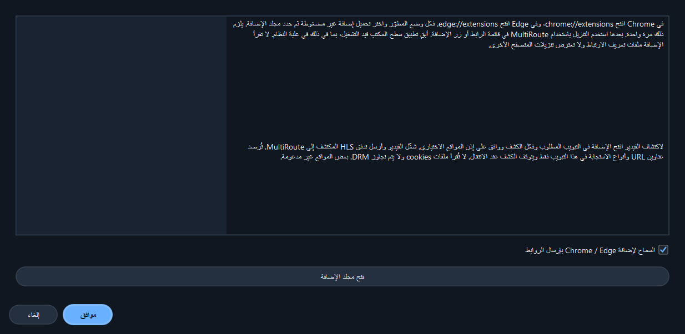
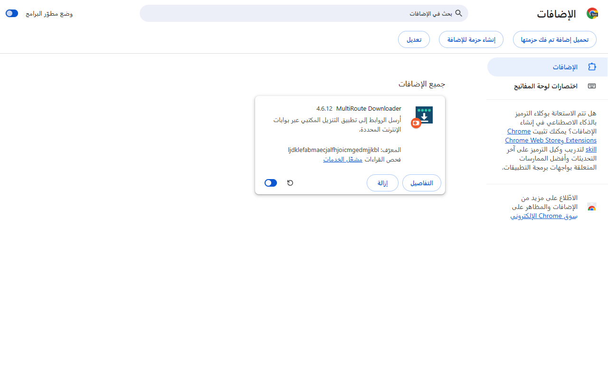
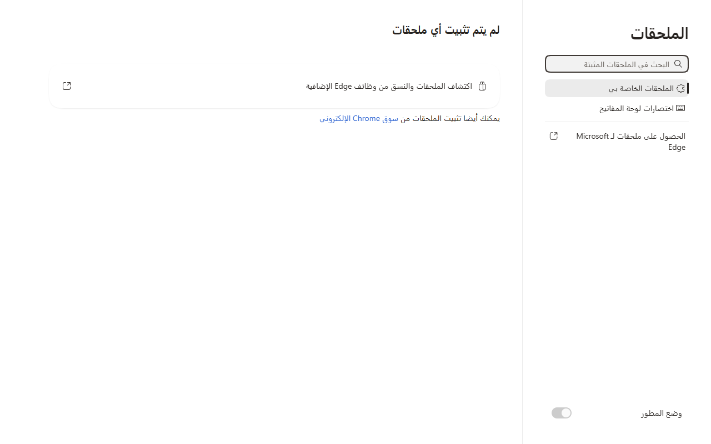
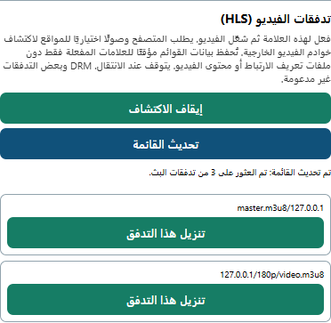
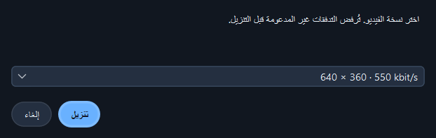
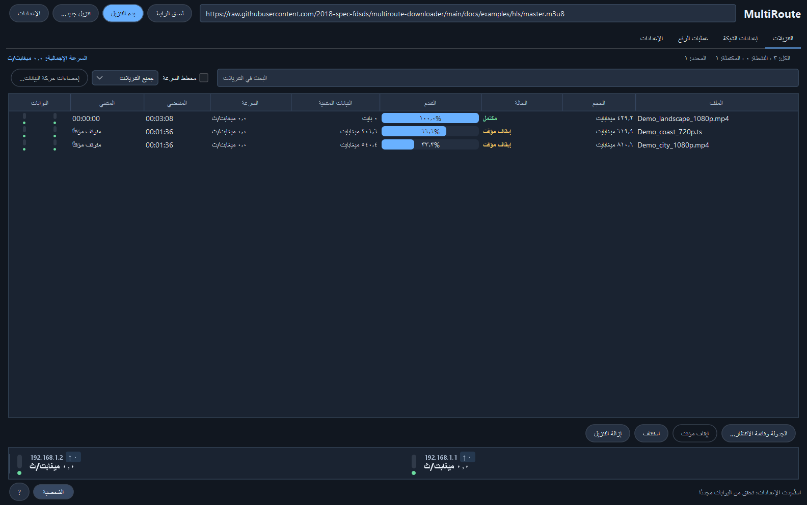

# تنزيل فيديو HLS باستخدام MultiRoute وChrome وEdge

<!-- hls-guide-languages:start -->
<p align="center" dir="ltr">
<a href="HLS-CHROME-EDGE.en.md">English</a> · <a href="HLS-CHROME-EDGE.ru.md">Русский</a> · <a href="HLS-CHROME-EDGE.de.md">Deutsch</a> · <a href="HLS-CHROME-EDGE.es.md">Español</a> · <a href="HLS-CHROME-EDGE.fr.md">Français</a> · <a href="HLS-CHROME-EDGE.zh.md">中文</a><br />
<a href="HLS-CHROME-EDGE.ko.md">한국어</a> · <strong>العربية</strong> · <a href="HLS-CHROME-EDGE.it.md">Italiano</a> · <a href="HLS-CHROME-EDGE.ja.md">日本語</a> · <a href="HLS-CHROME-EDGE.hi.md">हिन्दी</a> · <a href="HLS-CHROME-EDGE.vi.md">Tiếng Việt</a>
</p>
<!-- hls-guide-languages:end -->


> يلزم **MultiRoute Downloader 4.5.2 أو أحدث** وإضافة تدعم اكتشاف HLS. تعرض صور التطبيق الإصدار **4.6.12**. لا يضيف هذا الدليل HLS إلى المثبتات القديمة؛ تحقق من إصدار تطبيقك والحزم في [صفحة الإصدارات](https://github.com/2018-spec-fdsds/multiroute-downloader/releases).

فيديو HLS عبارة عن قائمة تشغيل وعدد كبير من مقاطع الوسائط الصغيرة. يكتشف MultiRoute القائمة عبر إضافة متصفح بعد تفعيل الاكتشاف، ويتيح اختيار الجودة المتاحة، وينزل المقاطع عبر البوابات المحددة ثم يجمع ملف فيديو بتنسيق مدعوم. عنوان صفحة الويب يختلف عادة عن عنوان قائمة التشغيل.

## قبل البدء

- ثبّت تطبيق سطح المكتب المطابق وشغّله. يمكن إبقاؤه في منطقة الإعلام.
- حدد مجلد التنزيل وتحقق من البوابات المحددة في التطبيق. تكفي بوابة واحدة تعمل؛ ويمكن لاتصالات إنترنت مستقلة متعددة تقاسم تنزيل المقاطع. يعتمد عدد البوابات والتنزيلات المتزامنة على الترخيص المثبت.
- استخدم Chrome أو Microsoft Edge المبني على Chromium على الكمبيوتر نفسه الذي يشغّل MultiRoute.
- ثبّت الإضافة المطابقة من مجلد التطبيق. تستخدم هذه الطريقة **تحميل إضافة غير مضغوطة**، وليست تثبيتًا من Chrome Web Store أو Edge Add-ons.
- اختر فيديو يحق لك حفظه. يدعم التنفيذ الحالي **الفيديو غير المشفر عند الطلب بخط زمني متصل بتنسيق MPEG-TS أو fMP4**. وهو ليس أداة عامة لتنزيل الفيديو من جميع المواقع.

## 1. تفعيل جسر تطبيق سطح المكتب

1. افتح MultiRoute ← **الإعدادات** ← **Chrome / Edge…**.
2. فعّل **السماح لإضافة Chrome / Edge بإرسال الروابط** ثم أكد بـ **موافق**. تتبع صياغة الخيارات لغة التطبيق.
3. انقر **فتح مجلد الإضافة** في مربع الحوار، واحتفظ بالمجلد للخطوة التالية.



يستمع الجسر على منفذ API المحلي للتطبيق، وهو عادة **8765**، ويقبل مصدر إضافة هذا المشروع. لا يحتاج إلى عنوان API عام أو قاعدة تحويل منافذ في الموجه. لا يلزم تثبيت مضيف native messaging منفصل: يظل تطبيق سطح المكتب قيد التشغيل وتتصل الإضافة بجسره عبر عنوان loopback.

### العثور على المجلد في macOS

استخدم **فتح مجلد الإضافة** أولًا. في التثبيت المعتاد يكون المجلد داخل:

```text
/Applications/MultiRoute Downloader.app/Contents/app/browser-extension
```

في نافذة اختيار المجلد بالمتصفح اضغط **⌘⇧G**، والصق المسار ثم اختر المجلد. أو افتح Applications في Finder، وانقر بزر الفأرة الأيمن على **MultiRoute Downloader.app** ← **Show Package Contents** ← `Contents` ← `app` ← `browser-extension`. إذا ثبّت التطبيق في موضع آخر، استخدم موضعه الفعلي. اختر المجلد الذي يحتوي `manifest.json` وليس حزمة `.app` كاملة.

## 2. تحميل الإضافة في المتصفح

| Chrome | Microsoft Edge |
|---|---|
| أدخل `chrome://extensions` في شريط العنوان. | أدخل `edge://extensions` في شريط العنوان. |
| فعّل **وضع المطور**. | فعّل **وضع المطور**. |
| انقر **تحميل إضافة غير مضغوطة**. | انقر **تحميل إضافة غير مضغوطة**. |
| اختر مجلد `browser-extension` الذي فتحه MultiRoute. | اختر المجلد نفسه. |

يمكن تثبيت **MultiRoute Downloader** في شريط الأدوات من قائمة إضافات المتصفح لإبقاء زره ظاهرًا. ثبّت الإضافة بصورة مستقلة في كل متصفح أو ملف شخصي تستخدمه. قد تقيد المتصفحات التي تديرها المؤسسات الإضافات المحلية؛ اتبع سياسة المسؤول.





هذه إجراءات التثبيت المحلي القياسية الموثقة لدى [Chrome](https://developer.chrome.com/docs/extensions/get-started/tutorial/hello-world#load-unpacked) و[Microsoft Edge](https://learn.microsoft.com/en-us/microsoft-edge/extensions/getting-started/extension-sideloading). تعرض صورة Edge وضع المطور قبل تشغيله؛ بعد تفعيله يظهر زر تحميل الإضافة غير المضغوطة.

### هل الإضافة مثبتة بالفعل؟ أعد تحميل الإضافة نفسها

بعد تحديث التطبيق افتح `chrome://extensions/` أو `edge://extensions/`. ابحث عن **بطاقة MultiRoute Downloader** وانقر زر **↻ / إعادة التحميل**. فعّل وضع المطور في Chrome إن كان الزر مخفيًا. تحقق من أن إصدار الإضافة **4.5.2 أو أحدث**، ثم عد إلى صفحة الفيديو وافتح أدوات الإضافة مجددًا.

زر **تحديث القائمة داخل أدوات الإضافة** يحدث بيانات التدفقات فقط ولا يحمّل ملفات الإضافة المحدثة. إذا ظل الإصدار قديمًا، فتحقق من مجلد الإضافة المحمّل. المسار المعتاد في Windows هو `%LOCALAPPDATA%\MultiRoute Downloader App\app\browser-extension`؛ افتح مجلد تثبيتك من إعدادات MultiRoute.

قد تبقى سجلات أخطاء Chrome القديمة بعد الإصلاح. إذا ظهر `Cannot create item with duplicate id multiroute-download` مجددًا، فتحقق من الإصدار المحمّل وهل يتولد خطأ جديد بعد إعادة التحميل. عولج تسجيل القائمة المتكرر في الإصدار 4.5.2.

## 3. اكتشاف قائمة تشغيل الفيديو

1. افتح صفحة الفيديو في علامة تبويب HTTP/HTTPS عادية.
2. انقر بزر الفأرة الأيمن على أيقونة إضافة MultiRoute واختر **أدوات الإضافة**. في 4.6.12 يفتح النقر العادي بالزر الأيسر اللوحة العائمة للتطبيق؛ أما اكتشاف HLS فيوجد في نافذة أدوات الإضافة.
3. ضمن **تدفقات الفيديو (HLS)** انقر **اكتشاف في هذه العلامة**.
4. وافق على الإذن الاختياري للوصول إلى المواقع إذا رغبت في الاكتشاف. قد يذكر المتصفح الوصول إلى مواقع كثيرة لأن مقاطع المشغّل قد تأتي من مضيف فيديو أو CDN مختلف. ومع ذلك يقتصر اكتشاف الإضافة على علامات التبويب التي فعّلتها صراحة.
5. أغلق نافذة الأدوات و**شغّل الفيديو**. يراقب الاكتشاف استجابات قوائم التشغيل اللاحقة، ولا يستطيع اكتشاف قائمة حُمّلت قبل تفعيله بأثر رجعي.
6. افتح **أدوات الإضافة** مجددًا. انقر **تحديث القائمة** عند الحاجة؛ وتتحدث القائمة أيضًا أثناء بقاء النافذة مفتوحة.
7. ابحث عن التدفق المناسب وانقر **تنزيل هذا التدفق**.

إذا أغلق مربع أذونات المتصفح نافذة الأدوات، فأعد فتحها بعد الموافقة. وإذا بقي الاكتشاف معطلًا فانقر زر الاكتشاف مرة أخرى، ثم شغّل الفيديو.



إذا حمّلت الصفحة القائمة بالفعل فأعد تحميل الصفحة، وافتح الأدوات مجددًا، وتحقق من استمرار الاكتشاف وأعد تفعيله عند الحاجة، ثم شغّل الفيديو. **الانتقال إلى صفحة أخرى يعطّل الاكتشاف لتلك العلامة.** يؤدي إغلاق علامة التبويب أيضًا إلى مسح حالة اكتشافها. لا تفترض أن منح الإذن يفعّل الاكتشاف تلقائيًا في كل العلامات.

تحتفظ الإضافة مؤقتًا بقائمة محدودة من بيانات قوائم التشغيل. لا تلتقط محتوى الفيديو أو ملفات تعريف ارتباط المتصفح أو ترويسات مصادقة الطلبات، ولا تعترض تلقائيًا كل تنزيل عادي في المتصفح. استخدم **إيقاف الاكتشاف** عند الانتهاء.

## 4. اختيار الجودة في MultiRoute

بعد **تنزيل هذا التدفق** انتقل إلى تطبيق سطح المكتب. يستخدم MultiRoute مجلد الوجهة والبوابات وملف إعدادات الموقع المحددة حاليًا. يظهر محدد الجودة بعد فحص قائمة التشغيل.

- اختر الدقة ومعدل البت، مثل `1280 × 720 · … kbit/s`، ثم ابدأ.
- قد توفر القائمة الرئيسية عدة جودات، بينما قد توفر قائمة الوسائط مصدرًا واحدًا فقط.
- معدل البت المعروض يصف نسخة الفيديو، **ولا يمثل** سرعة الإنترنت أو التنزيل المقاسة لديك.
- تقلل الجودة الأقل عادة حجم التنزيل. لا يرفع MultiRoute الدقة ولا يعيد ترميز الفيديو.
- يتبع امتداد الملف الحاوية المدعومة: `.ts` لـ MPEG-TS أو `.mp4` لـ fMP4. تغيير اسم ملف TS إلى `.mp4` لا يحوله.



إذا كان لديك رابط `.m3u8` مباشر، يمكنك لصقه في MultiRoute. يتعرف زر التدفق المكتشف أيضًا على استجابات HLS التي لا تنتهي عناوينها بـ `.m3u8`. HLS هو قائمة تشغيل؛ عنوان صفحة HTML بحد ذاته لا يحدد رابط m3u8. معالجة صفحات الفيديو المدعومة مسار عمل منفصل عن اكتشاف HLS هذا.

## 5. متابعة التنزيل وإيقافه مؤقتًا واستئنافه وفحصه

تظهر المهمة في **التنزيلات**. استخدم **إيقاف مؤقت** و**استئناف** للمهمة المحددة. يحفظ MultiRoute المقاطع المكتملة ويتحقق من سجلاتها قبل إعادة استخدامها؛ ويتبع التجميع النهائي ترتيب قائمة التشغيل لا ترتيب اكتمال التنزيل عبر البوابات.



لفحص مهمة بعينها، انقر عليها بزر الفأرة الأيمن وافتح سجل تنزيلها. راجع سجلات تنزيل المقاطع وإعادة استخدامها والأخطاء هناك؛ سجل التطبيق العام ليس المصدر الوحيد للتحقيق. تفيد السجلات أيضًا بعد اكتمال التنزيل.

يتطلب الاستئناف نفس المصدر والجودة وقائمة التشغيل المتوافقة. قد يمنع تغيير قائمة الموقع أو روابط المقاطع الموقعة أو الجودة إعادة الاستخدام الآمنة. تحمي البصمة المحلية للمقطع المكتمل إعادة استخدام البيانات المحفوظة؛ لكنها لا توفر مجموع تحقق من الناشر إذا لم يقدمه الموقع. احتفظ بالمهمة وبيانات مقاطعها إذا كنت تنوي الاستئناف لاحقًا.

## استكشاف المشكلات

| العَرَض | ما يجب التحقق منه |
|---|---|
| لا تظهر تدفقات فيديو | فعّل الاكتشاف **قبل** التشغيل. شغّل الفيديو أو أعد تحميله وافتح الأدوات مجددًا. تحقق من أذونات المواقع وحالة اكتشاف العلامة. قد يستخدم المشغّل MP4 أو DASH أو قائمة مخزنة مؤقتًا أو تنسيقًا آخر غير مدعوم. |
| أصبح الاكتشاف معطلًا | أعد تفعيله بعد الانتقال إلى صفحة أخرى. الموافقة على الإذن والاكتشاف لكل علامة أمران مستقلان. |
| لا تعرض الأدوات سوى عنوان صفحة المشاهدة | هذا حقل العنوان العادي، وليس دليلًا على اكتشاف HLS. استخدم قائمة **تدفقات الفيديو (HLS)**. |
| «تعذر الإرسال…» | أبقِ التطبيق مفتوحًا وفعّل جسر Chrome/Edge، وطابق **منفذ API التطبيق** مع منفذه. الافتراضي 8765. |
| HTTP 401/403 أو رابط منتهي الصلاحية | قد يتطلب الموقع رابطًا موقعًا جديدًا أو طلبات موثقة. افتح الصفحة المصرح بها واكتشف قائمة جديدة. الإضافة **لا** تنقل ملفات تعريف ارتباط المتصفح. إعداد ملف موقع في التطبيق أمر منفصل ولا يضمن التوافق مع جميع المواقع. |
| قائمة HLS غير مدعومة | DRM وHLS المشفر، بما فيه AES-128، والبث المباشر والمنخفض التأخير، وانقطاعات الخط الزمني، ومسارات الصوت والفيديو الخارجية، خارج المسار المدعوم. إعادة المحاولة لا تحول تدفقًا غير مدعوم. |
| التشغيل يعمل لكن التنزيل لا يعمل | يستخدم تشغيل المتصفح وجلب التطبيق بيانات اعتماد مختلفة وربما بوابات مختلفة. افحص سجل المهمة وتوفر البوابات. |
| توقف التنزيل | افحص سجل المهمة ومساحة التخزين وإعدادات إعادة المحاولة والبوابات المحددة قبل الاستئناف. لا تنشئ مهمة جديدة أو تحذف المقاطع دون حاجة. |
| بقيت أدوات الإضافة قديمة بعد تحديث التطبيق | افتح `chrome://extensions` أو `edge://extensions` وانقر **إعادة التحميل** في بطاقة MultiRoute. تحقق من استخدام مجلد إضافة التطبيق الحالي ثم أعد فتح صفحة الفيديو. |

## تجربة مثال GitHub الجاهز

يحتوي **فيديو الاختبار المولد ومدته 12 ثانية** على صورة اصطناعية ونغمة، بنسختي **180p / 300 kbit/s** و**360p / 550 kbit/s**. هذه معدلات البت المعلنة للنسخ وليست سرعات إنترنت مقاسة.

1. [افتح المثال في هذا المستودع](../examples/hls/README.md)، أو [افتح صفحة تشغيله](https://hlsjs.video-dev.org/demo/?src=https%3A%2F%2Fraw.githubusercontent.com%2F2018-spec-fdsds%2Fmultiroute-downloader%2Fmain%2Fdocs%2Fexamples%2Fhls%2Fmaster.m3u8). المشغّل الخارجي هو عرض hls.js الرسمي؛ والوسائط موجودة في مستودع GitHub الخاص بنا.
2. فعّل اكتشاف MultiRoute لتلك العلامة. إذا حُمّل ملف manifest أولًا فأعد التحميل، وتحقق من الاكتشاف وأعد تفعيله عند الحاجة.
3. ابدأ التشغيل وافتح أدوات الإضافة وانقر **تحديث القائمة**.
4. اختر **master.m3u8** ← **تنزيل هذا التدفق**. يمثل الصفان `180p/video.m3u8` و`360p/video.m3u8` نسختين منفصلتين؛ اختيار إحداهما لن يعرض الجودة الأخرى.
5. اختر **320 × 180** أو **640 × 360** في MultiRoute وابدأ. ستحصل على ملف **.ts** قصير مع فيديو وصوت، مدته نحو 12 ثانية. يعتمد الحجم على الجودة.

للاختبار دون الإضافة، الصق عنوان القائمة المباشر في MultiRoute:

```text
https://raw.githubusercontent.com/2018-spec-fdsds/multiroute-downloader/main/docs/examples/hls/master.m3u8
```

هذا عنوان قائمة تشغيل، وليس صفحة HTML في GitHub. عرض master.m3u8 على GitHub لا يشغّل الفيديو ولا يختبر اكتشاف المتصفح. قد يكتمل المثال الصغير قبل أن تتمكن من إيقافه مؤقتًا؛ اختبر الانقطاع والاستئناف بمحتوى أطول يحق لك تنزيله.

تستخدم صور أدوات الإضافة نسخة محلية من التدفق نفسه، ولذلك يظهر `127.0.0.1` في القائمة. سيعرض فيديوك مضيفه الخاص. تستخدم صور مساحة عمل MultiRoute مهامًا توضيحية، وليست سجل تنزيلات خاصًا. صور المتصفح بلغة هذه الصفحة. تعرض صورة Edge موضع تفعيل وضع المطور قبل اختيار تحميل إضافة غير مضغوطة. وسائط الاختبار متاحة بموجب [CC0](../examples/hls/README.md#license--лицензия)، دون تغيير ترخيص التطبيق.

## نطاق التحقق

شملت اختبارات عيناتنا الفعلية تشغيل فيديو وصوت HLS، واكتشاف الإضافة، وتمرير العنوان المختار إلى مستقبل اختبار نملكه. شملت اختبارات المحرك المنفصلة التحقق من المقاطع المحفوظة واستئنافها، والترتيب، وفك ترميز مخرجات TS/MP4. لا يضمن ذلك دعم كل موقع أو طريقة مصادقة أو زيادة سرعة الشبكة.

المراجع الأصلية: [التثبيت المحلي في Chrome](https://developer.chrome.com/docs/extensions/get-started/tutorial/hello-world#load-unpacked)، [التثبيت المحلي في Edge](https://learn.microsoft.com/en-us/microsoft-edge/extensions/getting-started/extension-sideloading)، [مشغّل hls.js الرسمي](https://github.com/video-dev/hls.js)، [HLS / RFC 8216](https://www.rfc-editor.org/rfc/rfc8216).
