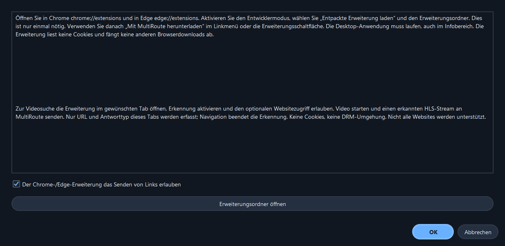
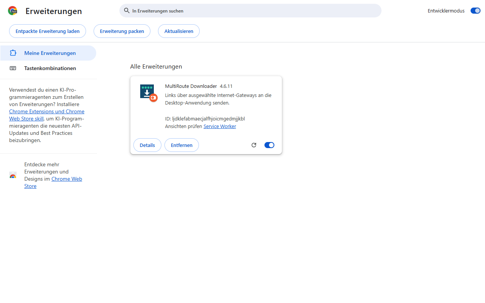
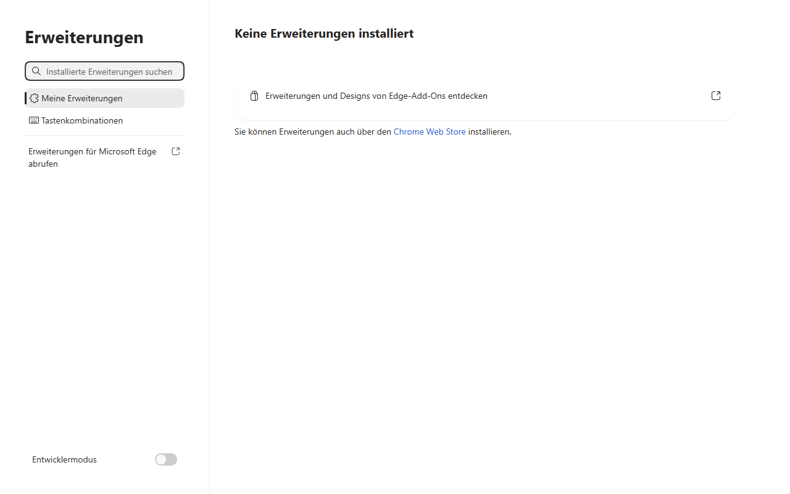
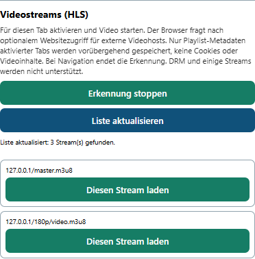
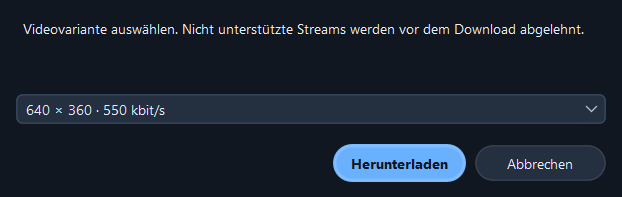
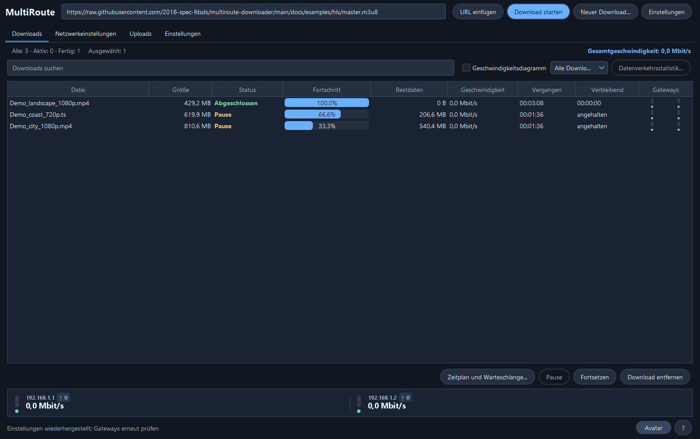

# HLS-Videos mit MultiRoute, Chrome und Edge herunterladen

<!-- hls-guide-languages:start -->
<p align="center" dir="ltr">
<a href="HLS-CHROME-EDGE.en.md">English</a> · <a href="HLS-CHROME-EDGE.ru.md">Русский</a> · <strong>Deutsch</strong> · <a href="HLS-CHROME-EDGE.es.md">Español</a> · <a href="HLS-CHROME-EDGE.fr.md">Français</a> · <a href="HLS-CHROME-EDGE.zh.md">中文</a><br />
<a href="HLS-CHROME-EDGE.ko.md">한국어</a> · <a href="HLS-CHROME-EDGE.ar.md">العربية</a> · <a href="HLS-CHROME-EDGE.it.md">Italiano</a> · <a href="HLS-CHROME-EDGE.ja.md">日本語</a> · <a href="HLS-CHROME-EDGE.hi.md">हिन्दी</a> · <a href="HLS-CHROME-EDGE.vi.md">Tiếng Việt</a>
</p>
<!-- hls-guide-languages:end -->

> Erforderlich sind **MultiRoute Downloader 4.5.2 oder neuer** und eine Erweiterung mit HLS-Erkennung. Die Abbildungen zeigen Version 4.6.11. Diese Anleitung ergänzt ältere Installationspakete nicht um HLS; prüfen Sie Ihre App-Version und die Pakete auf der [Releases-Seite](https://github.com/2018-spec-fdsds/multiroute-downloader/releases).

Ein HLS-Video besteht aus einer Wiedergabeliste und vielen kleinen Medienfragmenten. MultiRoute erkennt die Wiedergabeliste über eine ausdrücklich aktivierte Browsererweiterung, bietet die verfügbaren Qualitätsstufen an, lädt Fragmente über Ihre ausgewählten Gateways und setzt daraus eine unterstützte Videodatei zusammen. Die Adresse der Webseite und die der Wiedergabeliste sind normalerweise verschieden.

## Vorbereitungen

- Installieren und starten Sie die passende Desktop-Anwendung. Sie darf im Infobereich weiterlaufen.
- Legen Sie einen Downloadordner fest und prüfen Sie die ausgewählten Gateways in der Anwendung. Ein funktionierendes Gateway genügt; mehrere unabhängige Internetverbindungen können sich die Fragmentdownloads teilen. Die verfügbaren Gateway- und parallelen Downloadzahlen hängen von der installierten Lizenz ab.
- Verwenden Sie Chrome oder das Chromium-basierte Microsoft Edge auf demselben Computer wie MultiRoute.
- Installieren Sie die passende Erweiterung aus dem Anwendungsordner. Diese Einrichtung verwendet **Entpackte Erweiterung laden**, keinen Eintrag im Chrome Web Store oder bei Edge Add-ons.
- Wählen Sie ein Video, das Sie speichern dürfen. Die aktuelle Implementierung unterstützt **unverschlüsselte Abrufvideos mit einer durchgehenden MPEG-TS- oder fMP4-Zeitleiste**. Sie ist kein universeller Downloader für jede Videowebseite.

## 1. Desktop-Verbindung aktivieren

1. Öffnen Sie MultiRoute → **Einstellungen** → **Chrome / Edge…**.
2. Aktivieren Sie **Chrome-/Edge-Erweiterung das Senden von Links erlauben** und bestätigen Sie mit **OK**. Der genaue Wortlaut richtet sich nach der Anwendungssprache.
3. Klicken Sie hier auf **Erweiterungsordner öffnen**. Halten Sie den Ordner für den nächsten Schritt bereit.



Die Verbindung lauscht am lokalen API-Port der Anwendung, normalerweise **8765**. Sie akzeptiert den Erweiterungsursprung dieses Projekts. Eine öffentliche API-Adresse oder eine Portweiterleitung am Router ist nicht erforderlich. In diesem Ablauf gibt es keinen separaten Installer für einen Native-Messaging-Host: Die native Desktop-Anwendung bleibt geöffnet, und die Erweiterung kommuniziert mit ihrer Loopback-Verbindung.

### Ordner unter macOS finden

Verwenden Sie zuerst **Erweiterungsordner öffnen**. Bei einer Standardinstallation liegt er unter:

```text
/Applications/MultiRoute Downloader.app/Contents/app/browser-extension
```

Drücken Sie in der Ordnerauswahl des Browsers **⌘⇧G**, fügen Sie den Pfad ein und wählen Sie den Ordner. Alternativ im Finder: Programme → Rechtsklick auf **MultiRoute Downloader.app** → **Paketinhalt zeigen** → `Contents` → `app` → `browser-extension`. Falls Sie die Anwendung anderswo installiert haben, verwenden Sie ihren tatsächlichen Speicherort. Wählen Sie den Ordner mit `manifest.json`, nicht das gesamte `.app`-Paket.

## 2. Erweiterung im Browser laden

| Chrome | Microsoft Edge |
|---|---|
| Geben Sie `chrome://extensions` in die Adressleiste ein. | Geben Sie `edge://extensions` in die Adressleiste ein. |
| Aktivieren Sie **Entwicklermodus**. | Aktivieren Sie **Entwicklermodus**. |
| Klicken Sie auf **Entpackte Erweiterung laden**. | Klicken Sie auf **Entpackte Erweiterung laden**. |
| Wählen Sie den von MultiRoute geöffneten Ordner `browser-extension`. | Wählen Sie denselben Ordner. |

Heften Sie **MultiRoute Downloader** im Erweiterungsmenü des Browsers an, wenn die Schaltfläche immer sichtbar sein soll. Installieren Sie die Erweiterung in jedem verwendeten Browser/Profil separat. Von Organisationen verwaltete Browser können lokale Erweiterungen einschränken; beachten Sie die Vorgaben der Administration.





Die Edge-Abbildung zeigt den noch ausgeschalteten **Entwicklermodus**. Schalten Sie ihn ein; danach erscheint **Entpackte Erweiterung laden**. Dies sind die von [Chrome](https://developer.chrome.com/docs/extensions/get-started/tutorial/hello-world#load-unpacked) und [Microsoft Edge](https://learn.microsoft.com/en-us/microsoft-edge/extensions/getting-started/extension-sideloading) dokumentierten Standardverfahren zur lokalen Installation.

### Bereits installiert? Erweiterung selbst neu laden

Öffnen Sie nach einem Anwendungsupdate `chrome://extensions/` oder `edge://extensions/`. Suchen Sie die **Karte von MultiRoute Downloader** und klicken Sie auf **↻ / Neu laden**. Aktivieren Sie in Chrome den Entwicklermodus, falls das Symbol ausgeblendet ist. Prüfen Sie, dass die Erweiterung **4.5.2 oder neuer** ist, kehren Sie zur Videoseite zurück und öffnen Sie die Erweiterung erneut. Die aktuellen Abbildungen zeigen 4.6.11.

**Liste aktualisieren im Popup** aktualisiert Stream-Metadaten; aktualisierte Erweiterungsdateien werden dadurch nicht geladen. Bleibt die Version alt, prüfen Sie den installierten Erweiterungsordner. Unter Windows lautet der Standardordner `%LOCALAPPDATA%\MultiRoute Downloader App\app\browser-extension`; öffnen Sie den Ordner Ihrer Installation über die MultiRoute-Einstellungen.

Alte Chrome-Fehlereinträge können nach einer Korrektur erhalten bleiben. Erscheint erneut `Cannot create item with duplicate id multiroute-download`, prüfen Sie die geladene Version und ob nach dem Neuladen ein neuer Fehler entsteht. Die wiederholte Menüregistrierung wurde in 4.5.2 korrigiert.

## 3. Video-Wiedergabeliste erkennen

1. Öffnen Sie die Seite mit dem Video in einem normalen HTTP-/HTTPS-Tab.
2. Klicken Sie mit der rechten Maustaste auf das MultiRoute-Erweiterungssymbol und wählen Sie **Erweiterungswerkzeuge**. Ein normaler Linksklick öffnet das schwebende Desktop-Panel; die HLS-Erkennung befindet sich im Werkzeugfenster der Erweiterung.
3. Klicken Sie unter **Videostreams (HLS)** auf **In diesem Tab erkennen**.
4. Erteilen Sie die optionale Websitezugriffsberechtigung, wenn Sie die Erkennung nutzen möchten. Der Browser kann Zugriff auf viele Websites erwähnen: Die Fragmente eines Players können von einem anderen Video-/CDN-Host stammen. Die Erkennung bleibt auf die Tabs beschränkt, die Sie ausdrücklich aktiviert haben.
5. Schließen Sie das Popup und **starten Sie das Video**. Die Erkennung beobachtet künftige Antworten mit Wiedergabelisten; sie kann eine schon zuvor geladene Liste nicht nachträglich erkennen.
6. Öffnen Sie die Erweiterungswerkzeuge erneut. Klicken Sie bei Bedarf auf **Liste aktualisieren**. Die Liste wird auch bei geöffnetem Popup aktualisiert.
7. Suchen Sie den passenden Stream und klicken Sie auf **Diesen Stream laden**.

Falls der Berechtigungsdialog das Erweiterungspopup schließt, öffnen Sie es nach der Freigabe erneut. Ist die Erkennung weiterhin aus, klicken Sie noch einmal auf **In diesem Tab erkennen** und starten Sie das Video.



Wenn die Seite die Wiedergabeliste schon geladen hat, laden Sie die Seite neu, öffnen Sie das Popup, prüfen Sie den Erkennungszustand und aktivieren Sie ihn bei Bedarf erneut; starten Sie dann das Video. **Der Wechsel zu einer anderen Seite schaltet die Erkennung für diesen Tab aus.** Auch das Schließen des Tabs löscht seinen Erkennungszustand. Die Berechtigungsfreigabe aktiviert nicht automatisch alle Tabs.

Die Erweiterung hält eine begrenzte, temporäre Liste mit Wiedergabelisten-Metadaten. Sie erfasst keine Videoinhalte, Browsercookies oder Authentifizierungsheader von Anfragen. Sie fängt gewöhnliche Browserdownloads nicht automatisch ab. Verwenden Sie zum Abschluss **Erkennung stoppen**.

## 4. Qualität in MultiRoute auswählen

Wechseln Sie nach **Diesen Stream laden** zur Desktop-Anwendung. MultiRoute verwendet den aktuellen Zielordner, die ausgewählten Gateways und das Websiteprofil. Nach der Untersuchung der Wiedergabeliste erscheint die Qualitätsauswahl.

- Wählen Sie eine Auflösung/Bitrate, zum Beispiel `1280 × 720 · … kbit/s`, und starten Sie.
- Eine Master-Wiedergabeliste kann mehrere Qualitätsstufen anbieten; eine Medien-Wiedergabeliste eventuell nur eine Quelle.
- Die angezeigte Bitrate beschreibt die Videovariante. Sie ist **nicht** Ihre gemessene Internet-/Downloadgeschwindigkeit.
- Eine niedrigere Qualität verringert in der Regel die Downloadmenge. MultiRoute skaliert Videos nicht hoch und transkodiert sie nicht.
- Die Dateiendung richtet sich nach dem unterstützten Container: `.ts` für MPEG-TS oder `.mp4` für fMP4. Eine Umbenennung eines TS-Downloads in `.mp4` konvertiert ihn nicht.



Wenn Sie bereits einen direkten `.m3u8`-Link haben, können Sie ihn stattdessen in MultiRoute einfügen. Die Schaltfläche für erkannte Streams erkennt auch HLS-Antworten, deren URL nicht mit `.m3u8` endet. Verwenden Sie für HLS die URL der Wiedergabeliste. Das Senden einer HTML-Seitenadresse mit **An MultiRoute senden** ermittelt allein noch nicht deren m3u8; unterstützte Videoseiten werden über einen separaten Ablauf zum Herunterladen von Videoseiten verarbeitet.

## 5. Fortschritt verfolgen, pausieren, fortsetzen und prüfen

Der Auftrag erscheint unter **Downloads**. Verwenden Sie **Pause** und **Fortsetzen** für den ausgewählten Auftrag. MultiRoute speichert fertige Fragmente dauerhaft und prüft ihre gespeicherten Datensätze vor der Wiederverwendung; die abschließende Zusammensetzung folgt der Reihenfolge der Wiedergabeliste, nicht der Fertigstellungsreihenfolge der Gateways.



Für eine Erklärung zum einzelnen Auftrag klicken Sie ihn mit rechts an und öffnen Sie sein Downloadprotokoll. Prüfen Sie dort Fragmentdownloads, Wiederverwendung und Fehler; das allgemeine Anwendungsprotokoll ist nicht die einzige Untersuchungsquelle. Protokolle helfen auch nach dem Abschluss.

Das Fortsetzen erfordert dieselbe kompatible Quelle/Qualität/Wiedergabeliste. Änderungen an der Wiedergabeliste, signierten Fragment-URLs oder der Qualität können eine sichere Wiederverwendung verhindern. Der lokale Hash eines fertigen Fragments schützt seine Wiederverwendung; er liefert keine Prüfsumme des Herausgebers, wenn die Website keine bereitstellt. Behalten Sie den Auftrag und seine Fragmentdaten, wenn Sie später fortfahren möchten.

## Fehlerbehebung

| Symptom | Prüfen |
|---|---|
| Keine Videostreams erscheinen | Aktivieren Sie die Erkennung **vor** der Wiedergabe. Starten/laden Sie neu und öffnen Sie das Popup erneut. Prüfen Sie Websiteberechtigungen und Tab-Erkennung. Der Player verwendet möglicherweise MP4, DASH, eine zwischengespeicherte Wiedergabeliste oder ein anderes nicht unterstütztes Format. |
| Erkennung wurde ausgeschaltet | Aktivieren Sie sie nach einer Seitennavigation erneut. Berechtigungsfreigabe und Tab-Erkennung sind getrennt. |
| Popup zeigt nur die Adresse der Videoseite | Das ist das normale URL-Feld und kein Nachweis einer HLS-Erkennung. Verwenden Sie die Liste **Videostreams (HLS)**. |
| „Stream konnte nicht gesendet werden…“ | Lassen Sie die Anwendung geöffnet, aktivieren Sie ihre Chrome-/Edge-Verbindung und gleichen Sie **API-Port der Anwendung** mit dem App-Port ab. Standard: 8765. |
| HTTP 401/403 oder abgelaufener Link | Die Website benötigt vielleicht eine frische signierte URL oder authentifizierte Anfragen. Öffnen Sie die autorisierte Seite erneut und erkennen Sie eine neue Wiedergabeliste. Die Erweiterung überträgt **keine** Browsercookies. Ein konfiguriertes Websiteprofil in der Anwendung ist separat und garantiert keine Kompatibilität mit jeder Website. |
| Nicht unterstützte HLS-Wiedergabeliste | DRM, verschlüsseltes HLS einschließlich AES-128, Live-/Low-Latency-Streams, Unterbrechungen der Zeitleiste und externe Audio-/Videovarianten werden in diesem Ablauf nicht unterstützt. Wiederholungen konvertieren einen nicht unterstützten Stream nicht. |
| Wiedergabe klappt, Download nicht | Browserwiedergabe und Desktopabruf verwenden unterschiedliche Anmeldedaten und möglicherweise unterschiedliche Gateways. Prüfen Sie Auftragsprotokolle und Gatewayverfügbarkeit. |
| Download wurde angehalten | Prüfen Sie Auftragsprotokoll, freien Speicher, Wiederholungseinstellungen und ausgewählte Gateways vor dem Fortsetzen. Legen Sie nicht unnötig einen neuen Auftrag an und löschen Sie keine Fragmente. |
| Alte Bedienelemente nach App-Update | Öffnen Sie `chrome://extensions` oder `edge://extensions` und klicken Sie bei MultiRoute auf **Neu laden**. Prüfen Sie den Ordner der aktuellen App-Erweiterung und öffnen Sie danach die Videoseite erneut. |

## Fertiges GitHub-Beispiel ausprobieren

Unser erzeugtes **12-Sekunden-Testvideo** enthält ein synthetisches Bild und einen Ton und bietet Varianten mit **180p / 300 kbit/s** und **360p / 550 kbit/s**. Dies sind die angegebenen Variantenbandbreiten, keine gemessenen Internetgeschwindigkeiten.

1. [Öffnen Sie das Beispiel im Repository](../examples/hls/README.md) oder [seine Wiedergabeseite](https://hlsjs.video-dev.org/demo/?src=https%3A%2F%2Fraw.githubusercontent.com%2F2018-spec-fdsds%2Fmultiroute-downloader%2Fmain%2Fdocs%2Fexamples%2Fhls%2Fmaster.m3u8). Der externe Player ist die offizielle hls.js-Demo; die Medien liegen in unserem GitHub-Repository.
2. Aktivieren Sie die MultiRoute-Erkennung für diesen Tab. Falls das Manifest zuerst geladen wurde, laden Sie neu, prüfen Sie die Erkennung und aktivieren Sie sie bei Bedarf erneut.
3. Starten Sie die Wiedergabe, öffnen Sie die Erweiterung und klicken Sie auf **Liste aktualisieren**.
4. Wählen Sie **master.m3u8** → **Diesen Stream laden**. Die Zeilen `180p/video.m3u8` und `360p/video.m3u8` sind einzelne Varianten; bei Auswahl einer davon steht die andere Qualität nicht zur Verfügung.
5. Wählen Sie **320 × 180** oder **640 × 360** in MultiRoute und starten Sie. Es entsteht eine kurze **.ts**-Datei mit Bild und Ton, etwa 12 Sekunden lang. Die Dateigröße hängt von der Qualität ab.

Zum Testen ohne Erweiterung fügen Sie diese direkte Wiedergabelisten-URL in MultiRoute ein:

```text
https://raw.githubusercontent.com/2018-spec-fdsds/multiroute-downloader/main/docs/examples/hls/master.m3u8
```

Dies ist die URL einer Wiedergabeliste, keine GitHub-HTML-Seite. Das Anzeigen von master.m3u8 in GitHub spielt kein Video ab und testet keine Browsererkennung. Das kleine Beispiel kann enden, bevor Sie pausieren können; prüfen Sie Unterbrechung/Fortsetzen mit längeren Inhalten, die Sie herunterladen dürfen.

Die Erweiterungsabbildungen verwenden eine lokale Kopie desselben Streams, daher steht `127.0.0.1` in der Liste. Ihr Video zeigt seinen eigenen Host. Die MultiRoute-Abbildungen zeigen Demonstrationsaufträge und keinen privaten Downloadverlauf. Die Abbildungen verwenden dieselbe Sprachversion wie diese Seite. Die Edge-Abbildung zeigt, wo der Entwicklermodus zunächst eingeschaltet wird; danach erscheint „Entpackte Erweiterung laden“. Das Testmedium steht unter [CC0](../examples/hls/README.md#license--лицензия); die Anwendungslizenz bleibt unverändert.

## Umfang der Überprüfung

Prüfungen mit eigenen Testdaten umfassten die tatsächliche HLS-Bild-/Tonwiedergabe, die Erweiterungserkennung und die Übergabe der ausgewählten URL an einen eigenen Testempfänger. Separate Engine-Tests prüften gespeicherte Fragmente und deren Fortsetzung, Reihenfolge sowie die Dekodierung der TS-/MP4-Ausgabe. Das garantiert keine Unterstützung jeder Website, jedes Authentifizierungsablaufs oder jeder Netzwerkbeschleunigung.

Primärquellen: [Lokale Installation in Chrome](https://developer.chrome.com/docs/extensions/get-started/tutorial/hello-world#load-unpacked), [lokale Installation in Edge](https://learn.microsoft.com/en-us/microsoft-edge/extensions/getting-started/extension-sideloading), [offizieller hls.js-Player](https://github.com/video-dev/hls.js), [HLS / RFC 8216](https://www.rfc-editor.org/rfc/rfc8216).
