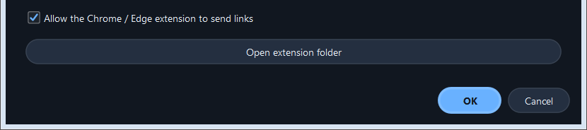
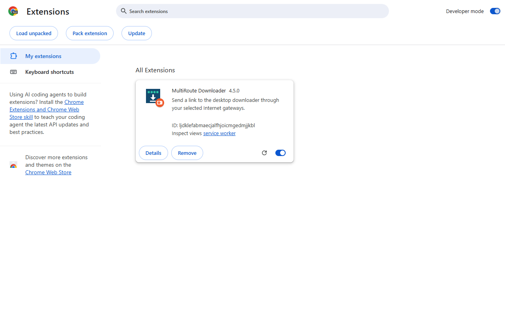
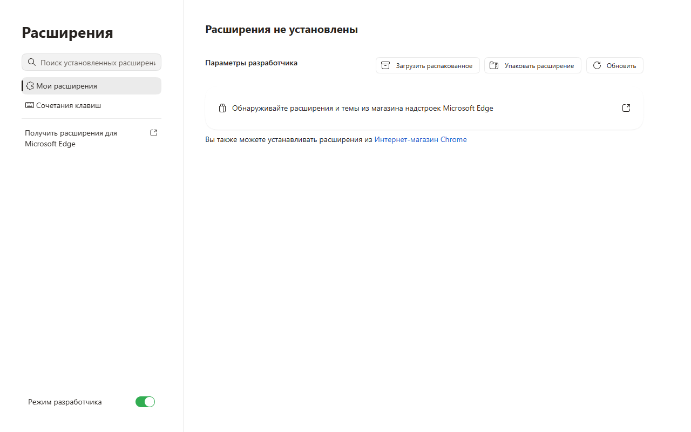
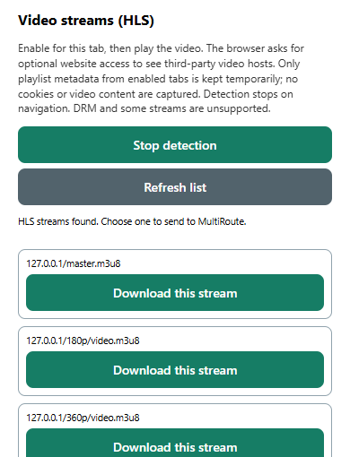
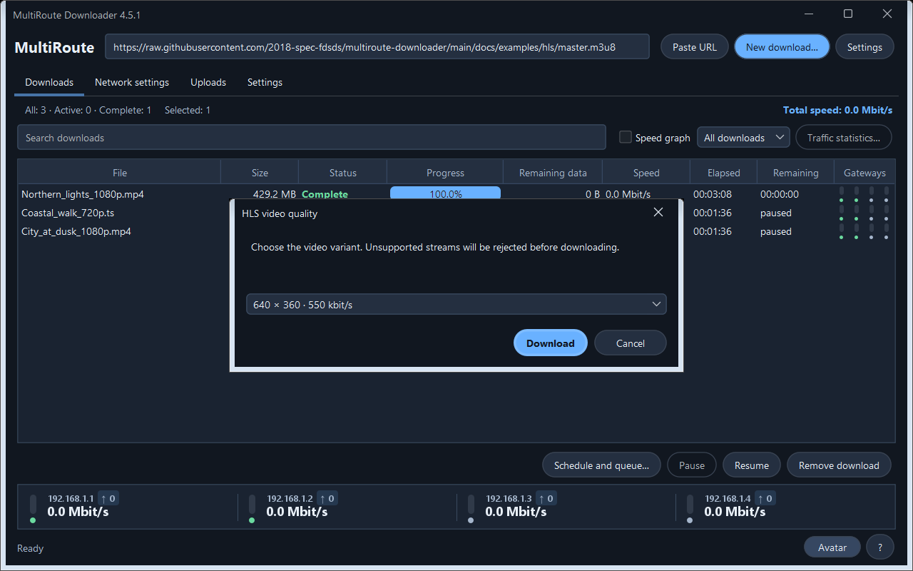
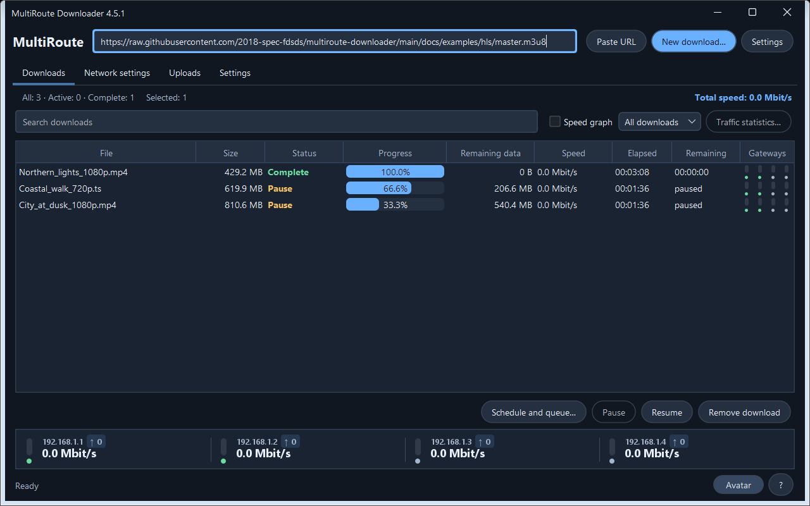

# Download HLS video with MultiRoute, Chrome and Edge

[Русский](HLS-CHROME-EDGE.ru.md)

> Requires **MultiRoute Downloader 4.5.0 or later** and an extension with HLS discovery. App illustrations use 4.5.1. This guide does not add HLS to older installers; check your app version and the packages on the [Releases page](https://github.com/2018-spec-fdsds/multiroute-downloader/releases).

HLS video is a playlist plus many small media fragments. MultiRoute discovers the playlist through an opt-in browser extension, lets you select an available quality, downloads fragments through your selected gateways and assembles a supported video file. The web page address and the playlist address are usually different.

## Before you begin

- Install and start the matching desktop application. It can remain in the system tray.
- Set a download folder and verify the selected gateways in the application. One working gateway is sufficient; multiple independent Internet connections can share fragment downloads. Available gateway and concurrent-download counts depend on the installed license.
- Use Chrome or Chromium-based Microsoft Edge on the same computer as MultiRoute.
- Install the matching extension from the application folder. This setup uses **Load unpacked**, not a Chrome Web Store or Edge Add-ons listing.
- Choose a video that you are entitled to save. The current implementation supports **unencrypted video on demand with a continuous MPEG-TS or fMP4 timeline**. It is not a universal downloader for every video website.

## 1. Enable the desktop bridge

1. Open MultiRoute → **Settings** → **Chrome / Edge…**.
2. Check **Allow Chrome / Edge extension to send links**, then confirm with **OK**. The translated wording follows the application language.
3. In this dialog, click **Open extension folder**. Keep the folder available for the next step.



The bridge listens on the application's local API port, normally **8765**. It accepts this project's extension origin. It does not need a public API address or a router port-forwarding rule. There is no separate native-messaging-host installer in this workflow: the native desktop app stays running and the extension talks to its loopback bridge.

### Finding the folder on macOS

Use **Open extension folder** first. For a standard installation, the folder is inside:

```text
/Applications/MultiRoute Downloader.app/Contents/app/browser-extension
```

In the browser's folder picker press **⌘⇧G**, paste that path and select the folder. Alternatively, in Finder choose Applications → right-click **MultiRoute Downloader.app** → **Show Package Contents** → `Contents` → `app` → `browser-extension`. If you installed the app elsewhere, use its actual location. Select the folder containing `manifest.json`, not the whole `.app` bundle.

## 2. Load the extension in your browser

| Chrome | Microsoft Edge |
|---|---|
| Enter `chrome://extensions` in the address bar. | Enter `edge://extensions` in the address bar. |
| Turn on **Developer mode**. | Turn on **Developer mode**. |
| Click **Load unpacked**. | Click **Load unpacked**. |
| Select the `browser-extension` folder opened by MultiRoute. | Select the same folder. |

Pin **MultiRoute Downloader** from the browser's Extensions menu if you want its button always visible. Install it separately in each browser/profile you use. Organization-managed browsers may restrict local extensions; follow the administrator's policy.





These are the standard local installation procedures documented by [Chrome](https://developer.chrome.com/docs/extensions/get-started/tutorial/hello-world#load-unpacked) and [Microsoft Edge](https://learn.microsoft.com/en-us/microsoft-edge/extensions/getting-started/extension-sideloading).

## 3. Discover the video playlist

1. Open the page containing the video in a normal HTTP/HTTPS tab.
2. Click the MultiRoute extension button.
3. Under **Video streams (HLS)**, click **Detect in this tab**.
4. Accept the optional website-access permission if you want detection. The browser may mention access to many websites: a player's fragments can come from a different video/CDN hostname. Detection in the extension is still limited to tabs that you explicitly enabled.
5. Close the popup and **play the video**. Detection observes future playlist responses; it cannot retroactively discover a playlist loaded before you enabled it.
6. Open the popup again. Click **Refresh list** if needed. The list also refreshes while the popup is open.
7. Find the relevant stream and click **Download this stream**.



If the page already loaded the playlist, reload it, reopen the popup, check whether detection is still enabled and enable it again if necessary, then play the video. **Navigating to a different page disables detection for that tab.** Closing the tab also clears its discovery state. Do not assume permission approval enables all tabs automatically.

The extension keeps a bounded, temporary list of playlist metadata. It does not capture video bodies, browser cookies or authentication request headers. It does not automatically intercept every ordinary browser download. Use **Stop detection** when finished.

## 4. Select quality in MultiRoute

After **Download this stream**, switch to the desktop app. MultiRoute uses its current destination folder, selected gateways and site profile. A quality selector appears after the playlist is inspected.

- Choose a resolution/bitrate, such as `1280 × 720 · … kbit/s`, then start.
- A master playlist can offer multiple qualities; a media playlist may offer a single source only.
- The displayed bitrate describes the video variant. It is **not** your measured Internet/download speed.
- Selecting a lower quality generally reduces the amount to download. MultiRoute does not upscale or transcode the video.
- The saved extension follows the supported container: `.ts` for MPEG-TS or `.mp4` for fMP4. Do not rename a TS download to `.mp4` expecting conversion.



If you already have a direct `.m3u8` link, you can paste it into MultiRoute instead. The extension's detected-stream button also identifies HLS responses whose URL does not end in `.m3u8`. Sending an ordinary HTML watch-page address with **Send to MultiRoute** does not make the desktop app extract its video player.

## 5. Follow, pause, resume and inspect

The job appears in **Downloads**. Use **Pause** and **Resume** for the selected job. MultiRoute persists completed fragments and checks saved fragment records before reuse; final assembly follows playlist order rather than gateway completion order.



For an individual explanation, right-click the job and open its download log. Inspect fragment download/reuse and error records there; the general application log is not the only place to investigate. Logs are also useful after completion.


Resume requires the same compatible source/quality/playlist. Changing a site's playlist, signed fragment URLs or quality can prevent safe reuse. A finished fragment's local hash protects saved fragment reuse; it does not provide a publisher's checksum when the website has not supplied one. Keep the job and its saved fragment data if you intend to continue later.

## Troubleshooting

| Symptom | What to check |
|---|---|
| No video streams appear | Enable detection **before** playback. Play/reload and reopen the popup. Confirm website permissions and tab detection state. The player may use MP4, DASH, a cached playlist or another unsupported format. |
| Detection became off | Re-enable after page navigation. Permission approval and per-tab detection are separate. |
| The popup shows only the watch-page URL | That is the normal URL field, not proof of HLS detection. Use the **Video streams (HLS)** list. |
| “Could not send…” | Keep the app open; enable its Chrome/Edge bridge; match **Application API port** to the app's port. The default is 8765. |
| HTTP 401/403 or an expired link | The website may require a fresh signed URL or authenticated requests. Reopen the authorized page and discover a fresh playlist. The extension does **not** transfer your browser cookies. A configured app site profile is separate and cannot guarantee compatibility with every site. |
| Unsupported HLS playlist | DRM, encrypted HLS including AES-128, live/low-latency streams, discontinuities and external audio/video renditions are outside the supported path. Do not expect a retry to convert an unsupported stream. |
| Playback works but downloading does not | Browser playback and desktop fetching use different credentials and potentially different gateways. Check job logs and gateway availability. |
| Download stopped | Inspect the individual job log, available storage, retry settings and selected gateways before resuming. Do not create a new job or delete fragments unnecessarily. |
| Extension has old controls after an app update | Open `chrome://extensions` or `edge://extensions` and click **Reload** on MultiRoute. Verify it points to the current app's extension folder, then reopen the video page. |

## Try the ready-made GitHub example

Our generated **12-second test video** has a synthetic image and a tone, with **180p / 300 kbit/s** and **360p / 550 kbit/s** variants. These are advertised variant bandwidths, not measured Internet speeds.

1. [Open the example in this repository](../examples/hls/README.md), or [open its playback page](https://hlsjs.video-dev.org/demo/?src=https%3A%2F%2Fraw.githubusercontent.com%2F2018-spec-fdsds%2Fmultiroute-downloader%2Fmain%2Fdocs%2Fexamples%2Fhls%2Fmaster.m3u8). The external player is the official hls.js demo; the media lives in our GitHub repository.
2. Enable MultiRoute discovery for that tab. If the manifest loaded first, reload, check detection and enable it again if needed.
3. Start playback, open the extension and click **Refresh list**.
4. Select **master.m3u8** → **Download this stream**. The `180p/video.m3u8` and `360p/video.m3u8` rows are individual variants; choosing one will not offer the other quality.
5. Choose **320 × 180** or **640 × 360** in MultiRoute and start. Expect a short **.ts** file with video and audio, about 12 seconds long. File size depends on quality.

To test without the extension, paste this direct playlist URL into MultiRoute:

```text
https://raw.githubusercontent.com/2018-spec-fdsds/multiroute-downloader/main/docs/examples/hls/master.m3u8
```

This is a playlist URL, not a GitHub HTML page. Viewing master.m3u8 in GitHub does not play video or test browser discovery. The tiny example may finish before you can pause; test interruption/resume on longer content you are allowed to download.

Extension screenshots use a local copy of this same stream, hence `127.0.0.1` in the list. Your video shows its own host. MultiRoute workspace screenshots use demonstration jobs, not private download history. Browser labels depend on browser language; the Edge illustration uses Russian. The test media is available under [CC0](../examples/hls/README.md#license--лицензия), without changing the application license.

## Verification scope

Owned-fixture checks covered actual HLS video/audio playback, extension discovery and handing the selected URL to an owned test receiver. Separate engine tests covered persisted fragment verification/resume, ordering and decoding TS/MP4 output. This does not guarantee every website, authentication flow or network speedup.

Primary references: [Chrome sideloading](https://developer.chrome.com/docs/extensions/get-started/tutorial/hello-world#load-unpacked), [Edge sideloading](https://learn.microsoft.com/en-us/microsoft-edge/extensions/getting-started/extension-sideloading), [official hls.js player](https://github.com/video-dev/hls.js), [HLS / RFC 8216](https://www.rfc-editor.org/rfc/rfc8216).
