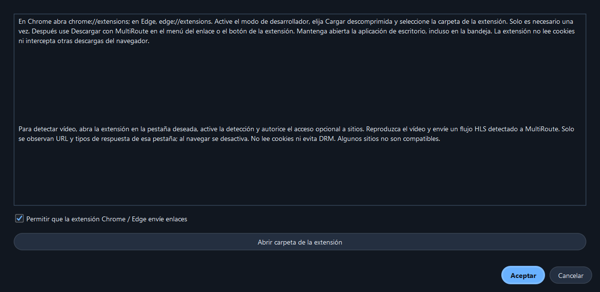
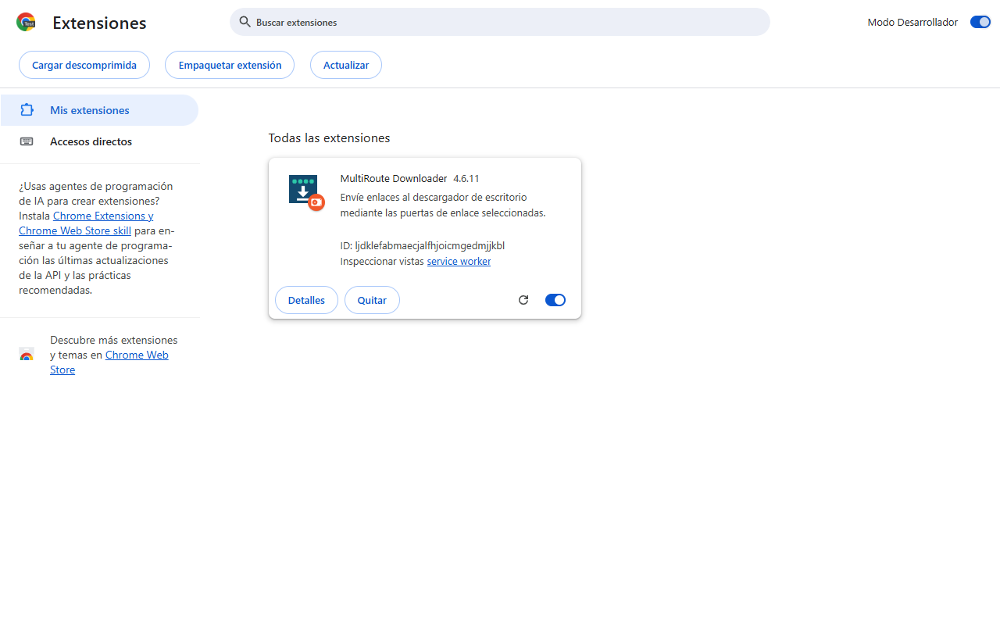
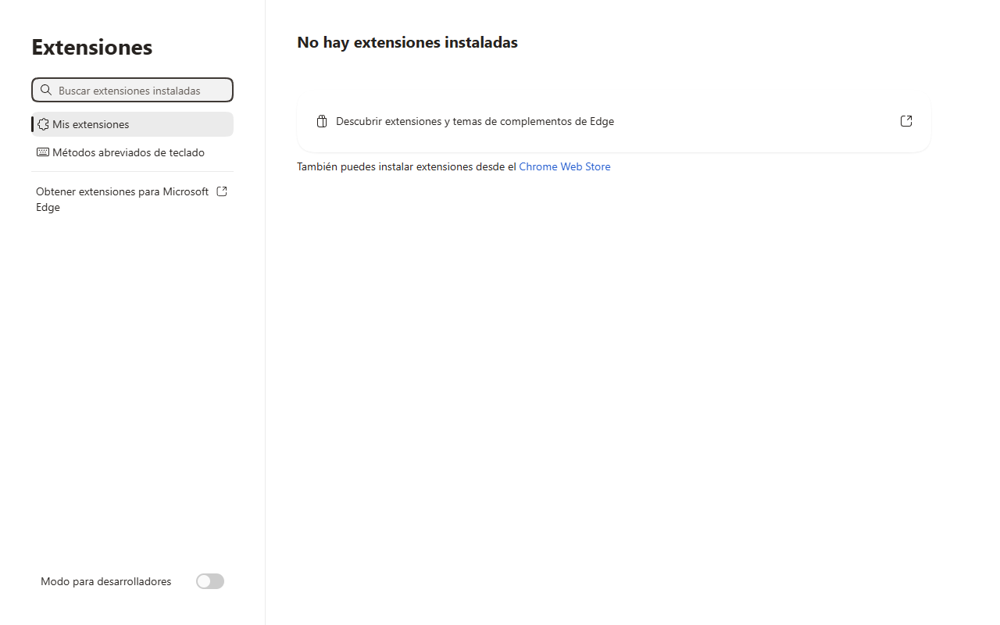
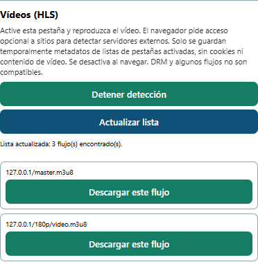
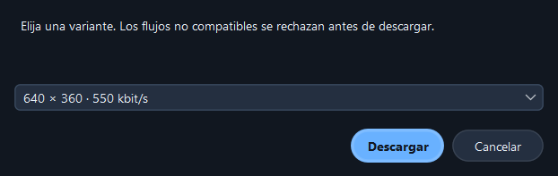
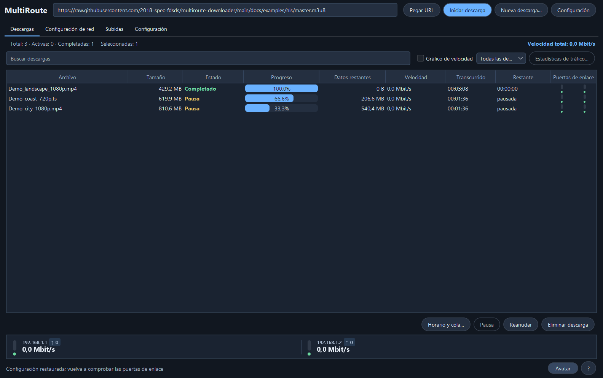

# Descargar vídeos HLS con MultiRoute, Chrome y Edge

<!-- hls-guide-languages:start -->
<p align="center" dir="ltr">
<a href="HLS-CHROME-EDGE.en.md">English</a> · <a href="HLS-CHROME-EDGE.ru.md">Русский</a> · <a href="HLS-CHROME-EDGE.de.md">Deutsch</a> · <strong>Español</strong> · <a href="HLS-CHROME-EDGE.fr.md">Français</a> · <a href="HLS-CHROME-EDGE.zh.md">中文</a><br />
<a href="HLS-CHROME-EDGE.ko.md">한국어</a> · <a href="HLS-CHROME-EDGE.ar.md">العربية</a> · <a href="HLS-CHROME-EDGE.it.md">Italiano</a> · <a href="HLS-CHROME-EDGE.ja.md">日本語</a> · <a href="HLS-CHROME-EDGE.hi.md">हिन्दी</a> · <a href="HLS-CHROME-EDGE.vi.md">Tiếng Việt</a>
</p>
<!-- hls-guide-languages:end -->

> Se necesitan **MultiRoute Downloader 4.5.2 o posterior** y una extensión con detección de HLS. Las ilustraciones muestran la versión 4.6.11. Esta guía no añade HLS a instaladores antiguos; compruebe la versión de su aplicación y los paquetes de la [página de versiones](https://github.com/2018-spec-fdsds/multiroute-downloader/releases).

Un vídeo HLS consta de una lista de reproducción y muchos fragmentos multimedia pequeños. MultiRoute descubre la lista mediante una extensión del navegador que usted activa expresamente, permite seleccionar una calidad disponible, descarga los fragmentos a través de las puertas de enlace elegidas y los ensambla en un archivo de vídeo compatible. La dirección de la página web y la de la lista suelen ser diferentes.

## Antes de empezar

- Instale e inicie la aplicación de escritorio correspondiente. Puede permanecer en la bandeja del sistema.
- Configure una carpeta de descarga y compruebe las puertas de enlace seleccionadas en la aplicación. Basta con una puerta de enlace operativa; varias conexiones a Internet independientes pueden repartirse la descarga de los fragmentos. La cantidad de puertas de enlace y descargas simultáneas disponibles depende de la licencia instalada.
- Utilice Chrome o Microsoft Edge basado en Chromium en el mismo equipo que MultiRoute.
- Instale la extensión correspondiente desde la carpeta de la aplicación. Este procedimiento utiliza **Cargar descomprimida**, no una publicación en Chrome Web Store o Edge Add-ons.
- Elija un vídeo que tenga derecho a guardar. La implementación actual admite **vídeo bajo demanda sin cifrar con una línea temporal continua MPEG-TS o fMP4**. No es un descargador universal para todos los sitios de vídeo.

## 1. Activar el puente con la aplicación de escritorio

1. Abra MultiRoute → **Configuración** → **Chrome / Edge…**.
2. Marque **Permitir que la extensión de Chrome / Edge envíe enlaces** y confirme con **Aceptar**. El texto exacto depende del idioma de la aplicación.
3. En este cuadro, pulse **Abrir carpeta de la extensión**. Mantenga la carpeta a mano para el siguiente paso.



El puente escucha en el puerto de la API local de la aplicación, normalmente **8765**. Acepta el origen de la extensión de este proyecto. No necesita una dirección de API pública ni una regla de reenvío de puertos en el router. Este procedimiento no incluye un instalador independiente de host de mensajería nativa: la aplicación nativa permanece abierta y la extensión se comunica con su puente de bucle local.

### Encontrar la carpeta en macOS

Utilice primero **Abrir carpeta de la extensión**. En una instalación estándar, la carpeta está dentro de:

```text
/Applications/MultiRoute Downloader.app/Contents/app/browser-extension
```

En el selector de carpetas del navegador, pulse **⌘⇧G**, pegue esa ruta y seleccione la carpeta. También puede ir a Finder → Aplicaciones → clic derecho en **MultiRoute Downloader.app** → **Mostrar contenido del paquete** → `Contents` → `app` → `browser-extension`. Si instaló la aplicación en otro lugar, utilice su ubicación real. Seleccione la carpeta que contiene `manifest.json`, no el paquete `.app` completo.

## 2. Cargar la extensión en el navegador

| Chrome | Microsoft Edge |
|---|---|
| Escriba `chrome://extensions` en la barra de direcciones. | Escriba `edge://extensions` en la barra de direcciones. |
| Active **Modo de desarrollador**. | Active **Modo de desarrollador**. |
| Pulse **Cargar descomprimida**. | Pulse **Cargar desempaquetado**. |
| Seleccione la carpeta `browser-extension` que abrió MultiRoute. | Seleccione la misma carpeta. |

Fije **MultiRoute Downloader** desde el menú Extensiones del navegador si desea tener siempre visible su botón. Instálela por separado en cada navegador o perfil que utilice. Los navegadores administrados por una organización pueden restringir las extensiones locales; siga la política del administrador.





La captura de Edge muestra **Modo de desarrollador** todavía desactivado. Actívelo para que aparezca **Cargar desempaquetado**. Estos son los procedimientos habituales de instalación local documentados por [Chrome](https://developer.chrome.com/docs/extensions/get-started/tutorial/hello-world#load-unpacked) y [Microsoft Edge](https://learn.microsoft.com/en-us/microsoft-edge/extensions/getting-started/extension-sideloading).

### ¿Ya está instalada? Vuelva a cargar la propia extensión

Después de actualizar la aplicación, abra `chrome://extensions/` o `edge://extensions/`. Busque la **tarjeta de MultiRoute Downloader** y pulse su control **↻ / Volver a cargar**. En Chrome, active el modo de desarrollador si el icono está oculto. Compruebe que la extensión tiene la versión **4.5.2 o posterior**, vuelva a la página del vídeo y abra la extensión otra vez. Las ilustraciones actuales muestran la versión 4.6.11.

**Actualizar lista dentro de la ventana emergente** actualiza los metadatos de los flujos; no carga los archivos actualizados de la extensión. Si sigue apareciendo la versión antigua, compruebe la carpeta de la extensión instalada. La carpeta estándar de Windows es `%LOCALAPPDATA%\MultiRoute Downloader App\app\browser-extension`; abra la carpeta de su instalación desde la configuración de MultiRoute.

Los registros antiguos de errores de Chrome pueden permanecer después de corregir un problema. Si vuelve a aparecer `Cannot create item with duplicate id multiroute-download`, compruebe la versión cargada y si se genera un error nuevo después de volver a cargar. El registro repetido del menú se corrigió en 4.5.2.

## 3. Descubrir la lista de reproducción del vídeo

1. Abra la página que contiene el vídeo en una pestaña HTTP/HTTPS normal.
2. Haga clic derecho en el icono de la extensión MultiRoute y seleccione **Herramientas de la extensión**. Un clic izquierdo normal abre el panel flotante de la aplicación; la detección HLS está en la ventana de herramientas de la extensión.
3. En **Vídeos (HLS)**, pulse **Detectar en esta pestaña**.
4. Acepte el permiso opcional de acceso a sitios si desea utilizar la detección. El navegador puede mencionar el acceso a muchos sitios: los fragmentos de un reproductor pueden proceder de otro servidor de vídeo o CDN. La detección de la extensión sigue limitada a las pestañas que usted haya activado expresamente.
5. Cierre la ventana emergente y **reproduzca el vídeo**. La detección observa las respuestas futuras que contienen listas; no puede descubrir retroactivamente una lista cargada antes de activarla.
6. Abra de nuevo las herramientas de la extensión. Pulse **Actualizar lista** si hace falta. La lista también se actualiza mientras la ventana está abierta.
7. Localice el flujo adecuado y pulse **Descargar este flujo**.

Si el cuadro de permisos del navegador cierra la ventana de la extensión, vuelva a abrirla después de conceder el acceso. Si la detección sigue desactivada, pulse otra vez **Detectar en esta pestaña** y reproduzca el vídeo.



Si la página ya había cargado la lista, vuelva a cargarla, abra de nuevo la ventana emergente, compruebe si la detección sigue activada y actívela otra vez si es necesario; después reproduzca el vídeo. **Navegar a otra página desactiva la detección de esa pestaña.** Cerrar la pestaña también borra su estado de descubrimiento. No suponga que conceder el permiso activa automáticamente todas las pestañas.

La extensión conserva una lista temporal y limitada de metadatos de listas de reproducción. No captura el contenido del vídeo, las cookies del navegador ni las cabeceras de autenticación de las solicitudes. Tampoco intercepta automáticamente todas las descargas normales del navegador. Al terminar, utilice **Detener detección**.

## 4. Seleccionar la calidad en MultiRoute

Después de pulsar **Descargar este flujo**, pase a la aplicación de escritorio. MultiRoute utiliza la carpeta de destino, las puertas de enlace y el perfil de sitio actuales. Tras analizar la lista de reproducción, aparece un selector de calidad.

- Elija una resolución/tasa de bits, como `1280 × 720 · … kbit/s`, e inicie la descarga.
- Una lista maestra puede ofrecer varias calidades; una lista multimedia puede ofrecer una sola fuente.
- La tasa de bits mostrada describe la variante de vídeo. **No** es la velocidad medida de su conexión a Internet o descarga.
- Seleccionar una calidad inferior generalmente reduce el volumen que se debe descargar. MultiRoute no aumenta la resolución ni transcodifica el vídeo.
- La extensión del archivo guardado corresponde al contenedor compatible: `.ts` para MPEG-TS o `.mp4` para fMP4. Cambiar el nombre de una descarga TS a `.mp4` no la convierte.



Si ya tiene un enlace directo `.m3u8`, puede pegarlo en MultiRoute. El botón de flujos detectados también identifica respuestas HLS cuya URL no termina en `.m3u8`. Para HLS, utilice la URL de la lista de reproducción. Enviar una dirección HTML mediante **Enviar a MultiRoute** no identifica por sí solo su m3u8; las páginas de vídeo compatibles se procesan mediante un procedimiento independiente de descarga de páginas de vídeo.

## 5. Seguir, pausar, reanudar e inspeccionar

La tarea aparece en **Descargas**. Utilice **Pausar** y **Reanudar** para la tarea seleccionada. MultiRoute conserva los fragmentos completados y comprueba los registros de fragmentos guardados antes de reutilizarlos; el ensamblado final sigue el orden de la lista, no el orden en que las puertas de enlace terminan las descargas.



Para obtener una explicación de una tarea concreta, haga clic derecho sobre ella y abra su registro de descarga. Consulte allí los registros de descarga y reutilización de fragmentos y los errores; el registro general de la aplicación no es el único lugar donde investigar. Los registros también resultan útiles después de terminar.

Para reanudar se necesita la misma fuente, calidad y lista compatibles. Los cambios en la lista del sitio, las URL firmadas de fragmentos o la calidad pueden impedir una reutilización segura. El hash local de un fragmento terminado protege su reutilización; no constituye una suma de comprobación del editor cuando el sitio no la ha proporcionado. Conserve la tarea y sus datos de fragmentos si piensa continuar más adelante.

## Solución de problemas

| Síntoma | Qué comprobar |
|---|---|
| No aparecen flujos de vídeo | Active la detección **antes** de reproducir. Reproduzca o vuelva a cargar y abra de nuevo la ventana emergente. Confirme los permisos del sitio y el estado de detección de la pestaña. El reproductor puede utilizar MP4, DASH, una lista almacenada en caché u otro formato no compatible. |
| La detección se ha desactivado | Vuelva a activarla después de navegar a otra página. La concesión del permiso y la detección por pestaña son independientes. |
| La ventana emergente solo muestra la URL de la página del vídeo | Es el campo normal de URL, no una prueba de detección HLS. Utilice la lista **Vídeos (HLS)**. |
| «No se pudo enviar…» | Mantenga abierta la aplicación, active su puente Chrome/Edge y haga coincidir **Puerto de la API de la aplicación** con el puerto de la aplicación. El predeterminado es 8765. |
| HTTP 401/403 o enlace caducado | El sitio puede necesitar una URL firmada reciente o solicitudes autenticadas. Abra de nuevo la página autorizada y descubra una lista nueva. La extensión **no** transfiere las cookies del navegador. Un perfil de sitio configurado en la aplicación es independiente y no puede garantizar la compatibilidad con todos los sitios. |
| Lista HLS no compatible | DRM, HLS cifrado incluido AES-128, emisiones en directo o de baja latencia, discontinuidades y pistas externas de audio/vídeo quedan fuera del procedimiento compatible. Reintentar no convierte un flujo no compatible. |
| La reproducción funciona, pero la descarga no | La reproducción en el navegador y la descarga desde el escritorio utilizan credenciales diferentes y posiblemente puertas de enlace distintas. Compruebe los registros de la tarea y la disponibilidad de las puertas de enlace. |
| La descarga se ha detenido | Examine el registro de la tarea, el almacenamiento disponible, los ajustes de reintento y las puertas de enlace seleccionadas antes de reanudar. No cree otra tarea ni borre fragmentos innecesariamente. |
| La extensión muestra controles antiguos después de actualizar la aplicación | Abra `chrome://extensions` o `edge://extensions` y pulse **Volver a cargar** en MultiRoute. Compruebe que apunta a la carpeta de la extensión de la aplicación actual y vuelva a abrir la página del vídeo. |

## Probar el ejemplo preparado en GitHub

Nuestro **vídeo de prueba generado de 12 segundos** contiene una imagen sintética y un tono, con variantes de **180p / 300 kbit/s** y **360p / 550 kbit/s**. Son los anchos de banda anunciados de las variantes, no velocidades de Internet medidas.

1. [Abra el ejemplo en este repositorio](../examples/hls/README.md) o [su página de reproducción](https://hlsjs.video-dev.org/demo/?src=https%3A%2F%2Fraw.githubusercontent.com%2F2018-spec-fdsds%2Fmultiroute-downloader%2Fmain%2Fdocs%2Fexamples%2Fhls%2Fmaster.m3u8). El reproductor externo es la demostración oficial de hls.js; el contenido multimedia está en nuestro repositorio de GitHub.
2. Active la detección de MultiRoute en esa pestaña. Si el manifiesto se cargó antes, vuelva a cargar, compruebe la detección y actívela de nuevo si es necesario.
3. Inicie la reproducción, abra la extensión y pulse **Actualizar lista**.
4. Seleccione **master.m3u8** → **Descargar este flujo**. Las filas `180p/video.m3u8` y `360p/video.m3u8` son variantes individuales; al elegir una, no se ofrecerá la otra calidad.
5. Elija **320 × 180** o **640 × 360** en MultiRoute e inicie la descarga. Obtendrá un archivo **.ts** corto, con vídeo y audio y una duración aproximada de 12 segundos. El tamaño depende de la calidad.

Para probar sin la extensión, pegue esta URL directa de la lista en MultiRoute:

```text
https://raw.githubusercontent.com/2018-spec-fdsds/multiroute-downloader/main/docs/examples/hls/master.m3u8
```

Esta es la URL de una lista, no una página HTML de GitHub. Ver master.m3u8 en GitHub no reproduce vídeo ni comprueba la detección del navegador. El ejemplo es tan pequeño que puede terminar antes de que pueda pausarlo; pruebe la interrupción y reanudación con contenido más largo que tenga permiso para descargar.

Las capturas de la extensión utilizan una copia local de este mismo flujo; por eso aparece `127.0.0.1` en la lista. Su vídeo mostrará su propio servidor. Las capturas del área de trabajo de MultiRoute utilizan tareas de demostración, no un historial privado de descargas. Las ilustraciones utilizan la misma versión de idioma que esta página. La captura de Edge muestra dónde activar el modo de desarrollador antes de que aparezca «Cargar desempaquetado». El contenido de prueba está disponible bajo [CC0](../examples/hls/README.md#license--лицензия), sin modificar la licencia de la aplicación.

## Alcance de la verificación

Las comprobaciones con material de prueba propio incluyeron la reproducción real de vídeo/audio HLS, la detección de la extensión y la entrega de la URL seleccionada a un receptor de prueba propio. Pruebas independientes del motor verificaron la comprobación y reanudación de fragmentos persistidos, el orden y la decodificación de la salida TS/MP4. Esto no garantiza la compatibilidad con todos los sitios, procesos de autenticación ni mejoras de velocidad de red.

Referencias principales: [Instalación local en Chrome](https://developer.chrome.com/docs/extensions/get-started/tutorial/hello-world#load-unpacked), [instalación local en Edge](https://learn.microsoft.com/en-us/microsoft-edge/extensions/getting-started/extension-sideloading), [reproductor oficial hls.js](https://github.com/video-dev/hls.js), [HLS / RFC 8216](https://www.rfc-editor.org/rfc/rfc8216).
