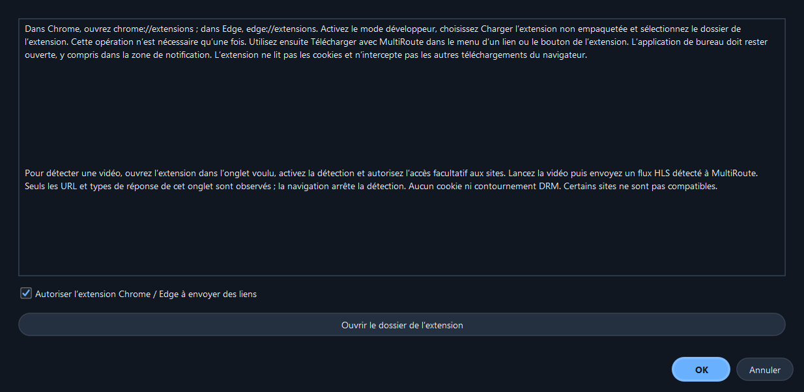
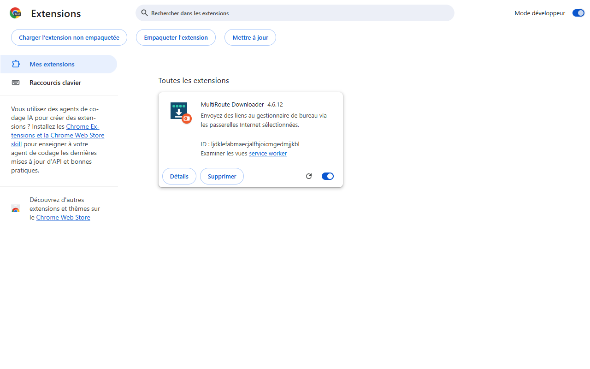
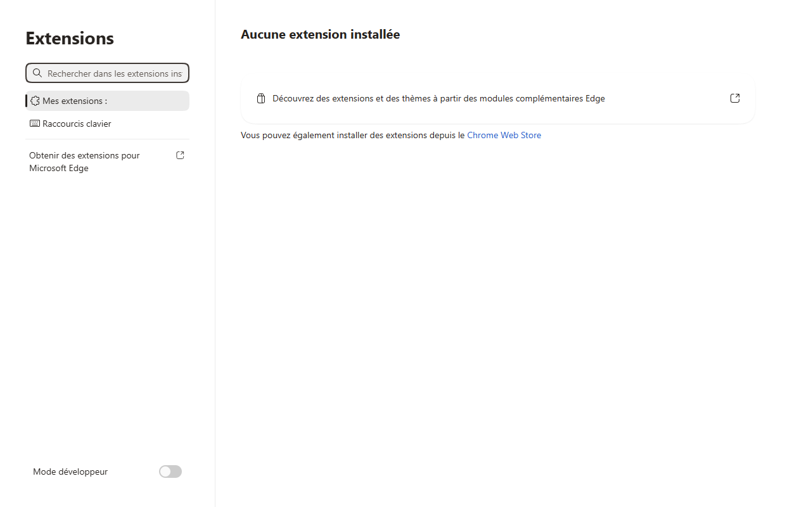
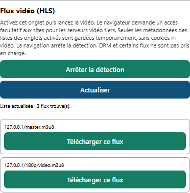
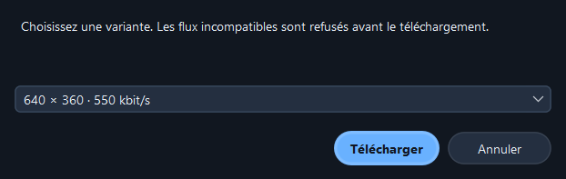
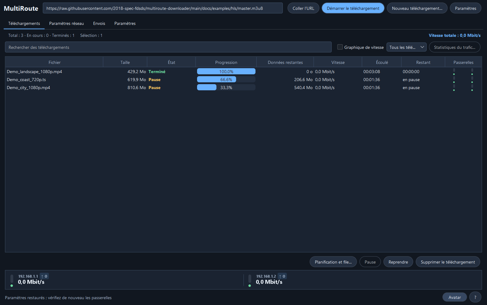

# Télécharger des vidéos HLS avec MultiRoute, Chrome et Edge

<!-- hls-guide-languages:start -->
<p align="center" dir="ltr">
<a href="HLS-CHROME-EDGE.en.md">English</a> · <a href="HLS-CHROME-EDGE.ru.md">Русский</a> · <a href="HLS-CHROME-EDGE.de.md">Deutsch</a> · <a href="HLS-CHROME-EDGE.es.md">Español</a> · <strong>Français</strong> · <a href="HLS-CHROME-EDGE.zh.md">中文</a><br />
<a href="HLS-CHROME-EDGE.ko.md">한국어</a> · <a href="HLS-CHROME-EDGE.ar.md">العربية</a> · <a href="HLS-CHROME-EDGE.it.md">Italiano</a> · <a href="HLS-CHROME-EDGE.ja.md">日本語</a> · <a href="HLS-CHROME-EDGE.hi.md">हिन्दी</a> · <a href="HLS-CHROME-EDGE.vi.md">Tiếng Việt</a>
</p>
<!-- hls-guide-languages:end -->

> Nécessite **MultiRoute Downloader 4.5.2 ou ultérieur** et une extension capable de détecter les flux HLS. Les illustrations montrent la version 4.6.12. Ce guide n’ajoute pas HLS aux anciens programmes d’installation ; vérifiez la version de votre application et les paquets sur la [page des versions](https://github.com/2018-spec-fdsds/multiroute-downloader/releases).

Une vidéo HLS se compose d’une liste de lecture et de nombreux petits fragments multimédias. MultiRoute découvre la liste grâce à une extension de navigateur que vous activez expressément, permet de choisir une qualité disponible, télécharge les fragments par les passerelles sélectionnées et assemble un fichier vidéo pris en charge. L’adresse de la page web et celle de la liste de lecture sont généralement différentes.

## Avant de commencer

- Installez et démarrez l’application de bureau correspondante. Elle peut rester dans la zone de notification.
- Définissez un dossier de téléchargement et vérifiez les passerelles sélectionnées dans l’application. Une seule passerelle fonctionnelle suffit ; plusieurs connexions Internet indépendantes peuvent se répartir le téléchargement des fragments. Le nombre de passerelles et de téléchargements simultanés disponibles dépend de la licence installée.
- Utilisez Chrome ou Microsoft Edge basé sur Chromium sur le même ordinateur que MultiRoute.
- Installez l’extension correspondante depuis le dossier de l’application. Cette procédure utilise **Charger l’extension non empaquetée**, sans passer par le Chrome Web Store ou Edge Add-ons.
- Choisissez une vidéo que vous avez le droit d’enregistrer. L’implémentation actuelle prend en charge les **vidéos à la demande non chiffrées avec une chronologie MPEG-TS ou fMP4 continue**. Ce n’est pas un téléchargeur universel pour tous les sites vidéo.

## 1. Activer la passerelle de l’application de bureau

1. Ouvrez MultiRoute → **Paramètres** → **Chrome / Edge…**.
2. Cochez **Autoriser l’extension Chrome / Edge à envoyer des liens**, puis validez avec **OK**. Le libellé exact dépend de la langue de l’application.
3. Dans cette boîte de dialogue, cliquez sur **Ouvrir le dossier de l’extension**. Gardez ce dossier accessible pour l’étape suivante.



La passerelle écoute sur le port de l’API locale de l’application, normalement **8765**. Elle accepte l’origine de l’extension de ce projet. Elle n’a besoin ni d’une adresse d’API publique ni d’une règle de redirection de port sur le routeur. Cette procédure ne nécessite aucun programme d’installation séparé d’un hôte de messagerie native : l’application de bureau native reste ouverte et l’extension communique avec sa passerelle sur l’interface de bouclage.

### Trouver le dossier sous macOS

Utilisez d’abord **Ouvrir le dossier de l’extension**. Pour une installation standard, le dossier se trouve dans :

```text
/Applications/MultiRoute Downloader.app/Contents/app/browser-extension
```

Dans le sélecteur de dossier du navigateur, appuyez sur **⌘⇧G**, collez ce chemin et sélectionnez le dossier. Autre possibilité dans le Finder : Applications → clic droit sur **MultiRoute Downloader.app** → **Afficher le contenu du paquet** → `Contents` → `app` → `browser-extension`. Si vous avez installé l’application ailleurs, utilisez son emplacement réel. Sélectionnez le dossier contenant `manifest.json`, pas le paquet `.app` entier.

## 2. Charger l’extension dans votre navigateur

| Chrome | Microsoft Edge |
|---|---|
| Saisissez `chrome://extensions` dans la barre d’adresse. | Saisissez `edge://extensions` dans la barre d’adresse. |
| Activez le **Mode développeur**. | Activez le **Mode développeur**. |
| Cliquez sur **Charger l’extension non empaquetée**. | Cliquez sur **Charger l’extension décompressée**. |
| Sélectionnez le dossier `browser-extension` ouvert par MultiRoute. | Sélectionnez le même dossier. |

Épinglez **MultiRoute Downloader** depuis le menu Extensions du navigateur si vous souhaitez que son bouton reste visible. Installez l’extension séparément dans chaque navigateur/profil utilisé. Les navigateurs gérés par une organisation peuvent restreindre les extensions locales ; respectez les règles de l’administrateur.





La capture Edge montre le **Mode développeur** encore désactivé. Activez-le pour faire apparaître **Charger l’extension décompressée**. Il s’agit des procédures habituelles d’installation locale documentées par [Chrome](https://developer.chrome.com/docs/extensions/get-started/tutorial/hello-world#load-unpacked) et [Microsoft Edge](https://learn.microsoft.com/en-us/microsoft-edge/extensions/getting-started/extension-sideloading).

### Déjà installée ? Rechargez l’extension elle-même

Après une mise à jour de l’application, ouvrez `chrome://extensions/` ou `edge://extensions/`. Repérez la **fiche MultiRoute Downloader** et cliquez sur son bouton **↻ / Recharger**. Dans Chrome, activez le mode développeur si l’icône est masquée. Vérifiez que la version de l’extension est **4.5.2 ou ultérieure**, revenez à la page vidéo et ouvrez de nouveau l’extension. Les illustrations actuelles montrent la version 4.6.12.

**Actualiser dans la fenêtre de l’extension** actualise les métadonnées des flux ; cela ne charge pas les fichiers mis à jour de l’extension. Si l’ancienne version demeure, vérifiez le dossier de l’extension installée. Sous Windows, le dossier standard est `%LOCALAPPDATA%\MultiRoute Downloader App\app\browser-extension` ; ouvrez le dossier de votre installation depuis les paramètres de MultiRoute.

Les anciens messages d’erreur de Chrome peuvent rester après une correction. Si `Cannot create item with duplicate id multiroute-download` apparaît de nouveau, vérifiez la version chargée et si une nouvelle erreur est générée après le rechargement. L’enregistrement répété du menu a été corrigé dans la version 4.5.2.

## 3. Découvrir la liste de lecture vidéo

1. Ouvrez la page contenant la vidéo dans un onglet HTTP/HTTPS normal.
2. Faites un clic droit sur l’icône de l’extension MultiRoute et choisissez **Outils de l’extension**. Dans la version 4.6.12, un clic gauche ordinaire ouvre le panneau flottant de l’application ; la détection HLS se trouve dans la fenêtre des outils de l’extension.
3. Sous **Flux vidéo (HLS)**, cliquez sur **Détecter dans cet onglet**.
4. Acceptez l’autorisation facultative d’accès aux sites si vous souhaitez activer la détection. Le navigateur peut mentionner l’accès à de nombreux sites : les fragments du lecteur peuvent provenir d’un autre nom d’hôte vidéo/CDN. La détection de l’extension reste limitée aux onglets que vous avez expressément activés.
5. Fermez la fenêtre des outils et **lancez la vidéo**. La détection observe les futures réponses contenant des listes ; elle ne peut pas découvrir rétroactivement une liste chargée avant son activation.
6. Rouvrez **Outils de l’extension**. Cliquez sur **Actualiser** si nécessaire. La liste s’actualise également lorsque la fenêtre des outils est ouverte.
7. Repérez le flux souhaité et cliquez sur **Télécharger ce flux**.

Si la boîte de dialogue d’autorisation du navigateur ferme la fenêtre de l’extension, rouvrez-la après avoir accordé l’accès. Si la détection reste désactivée, cliquez à nouveau sur **Détecter dans cet onglet**, puis lancez la vidéo.



Si la page a déjà chargé la liste, rechargez-la, rouvrez les outils, vérifiez si la détection est toujours active et réactivez-la si nécessaire, puis lancez la vidéo. **Naviguer vers une autre page désactive la détection pour cet onglet.** Fermer l’onglet efface également son état de découverte. Ne supposez pas que l’autorisation active automatiquement tous les onglets.

L’extension conserve une liste temporaire limitée de métadonnées de listes de lecture. Elle ne capture ni le contenu vidéo, ni les cookies du navigateur, ni les en-têtes d’authentification des requêtes. Elle n’intercepte pas automatiquement chaque téléchargement ordinaire du navigateur. Utilisez **Arrêter la détection** une fois terminé.

## 4. Choisir la qualité dans MultiRoute

Après **Télécharger ce flux**, passez à l’application de bureau. MultiRoute utilise son dossier de destination, ses passerelles sélectionnées et son profil de site actuels. Un sélecteur de qualité apparaît après l’analyse de la liste de lecture.

- Choisissez une résolution/un débit, par exemple `1280 × 720 · … kbit/s`, puis démarrez.
- Une liste maîtresse peut proposer plusieurs qualités ; une liste média peut ne proposer qu’une seule source.
- Le débit affiché décrit la variante vidéo. Ce n’est **pas** la vitesse mesurée de votre connexion Internet ou de téléchargement.
- Une qualité inférieure réduit généralement la quantité à télécharger. MultiRoute n’augmente pas la résolution et ne transcode pas la vidéo.
- L’extension du fichier enregistré dépend du conteneur pris en charge : `.ts` pour MPEG-TS ou `.mp4` pour fMP4. Renommer un téléchargement TS en `.mp4` ne le convertit pas.



Si vous disposez déjà d’un lien direct `.m3u8`, vous pouvez le coller dans MultiRoute. Le bouton des flux détectés reconnaît également les réponses HLS dont l’URL ne se termine pas par `.m3u8`. Pour HLS, utilisez l’URL de la liste de lecture. Envoyer une adresse de page HTML avec **Envoyer à MultiRoute** ne détermine pas à lui seul son m3u8 ; les pages vidéo prises en charge sont traitées par un processus distinct de téléchargement de pages vidéo.

## 5. Suivre, mettre en pause, reprendre et examiner

La tâche apparaît dans **Téléchargements**. Utilisez **Pause** et **Reprendre** pour la tâche sélectionnée. MultiRoute conserve les fragments terminés et vérifie les enregistrements des fragments sauvegardés avant leur réutilisation ; l’assemblage final respecte l’ordre de la liste, et non l’ordre de fin des téléchargements des passerelles.



Pour obtenir une explication propre à une tâche, faites un clic droit sur celle-ci et ouvrez son journal de téléchargement. Examinez-y les téléchargements/réutilisations de fragments et les erreurs ; le journal général de l’application n’est pas la seule source d’investigation. Les journaux sont également utiles après la fin du téléchargement.

La reprise exige une source, une qualité et une liste identiques et compatibles. Un changement de liste sur le site, d’URL signées des fragments ou de qualité peut empêcher une réutilisation sûre. Le hachage local d’un fragment terminé protège sa réutilisation ; il ne fournit pas une somme de contrôle de l’éditeur lorsque le site n’en a pas fourni. Conservez la tâche et ses données de fragments si vous souhaitez reprendre plus tard.

## Dépannage

| Symptôme | Points à vérifier |
|---|---|
| Aucun flux vidéo n’apparaît | Activez la détection **avant** la lecture. Lancez la vidéo/rechargez la page et rouvrez les outils. Vérifiez les autorisations du site et l’état de détection de l’onglet. Le lecteur peut utiliser MP4, DASH, une liste en cache ou un autre format non pris en charge. |
| La détection s’est désactivée | Réactivez-la après une navigation. L’autorisation et la détection par onglet sont distinctes. |
| La fenêtre affiche uniquement l’URL de la page vidéo | C’est le champ d’URL ordinaire, pas une preuve de détection HLS. Utilisez la liste **Flux vidéo (HLS)**. |
| « Impossible d’envoyer… » | Laissez l’application ouverte, activez sa passerelle Chrome/Edge et faites correspondre **Port de l’API de l’application** au port de l’application. La valeur par défaut est 8765. |
| HTTP 401/403 ou lien expiré | Le site peut exiger une nouvelle URL signée ou des requêtes authentifiées. Rouvrez la page autorisée et découvrez une nouvelle liste. L’extension ne transfère **pas** les cookies de votre navigateur. Le profil de site configuré dans l’application est distinct et ne garantit pas la compatibilité avec tous les sites. |
| Liste HLS non prise en charge | DRM, HLS chiffré dont AES-128, flux en direct/à faible latence, discontinuités et pistes audio/vidéo externes sortent du cadre pris en charge. Une nouvelle tentative ne convertit pas un flux non pris en charge. |
| La lecture fonctionne, mais pas le téléchargement | La lecture dans le navigateur et le téléchargement de bureau utilisent des identifiants différents et éventuellement des passerelles différentes. Vérifiez les journaux de la tâche et la disponibilité des passerelles. |
| Le téléchargement s’est arrêté | Examinez le journal de la tâche, l’espace disponible, les paramètres de nouvelle tentative et les passerelles sélectionnées avant de reprendre. Ne créez pas une nouvelle tâche et ne supprimez pas les fragments inutilement. |
| Anciens contrôles après une mise à jour de l’application | Ouvrez `chrome://extensions` ou `edge://extensions` et cliquez sur **Recharger** pour MultiRoute. Vérifiez que l’extension pointe vers le dossier de l’application actuelle, puis rouvrez la page vidéo. |

## Essayer l’exemple GitHub prêt à l’emploi

Notre **vidéo de test générée de 12 secondes** contient une image synthétique et une tonalité, avec des variantes **180p / 300 kbit/s** et **360p / 550 kbit/s**. Ce sont les bandes passantes annoncées des variantes, pas des vitesses Internet mesurées.

1. [Ouvrez l’exemple dans ce dépôt](../examples/hls/README.md) ou [sa page de lecture](https://hlsjs.video-dev.org/demo/?src=https%3A%2F%2Fraw.githubusercontent.com%2F2018-spec-fdsds%2Fmultiroute-downloader%2Fmain%2Fdocs%2Fexamples%2Fhls%2Fmaster.m3u8). Le lecteur externe est la démonstration officielle de hls.js ; les médias se trouvent dans notre dépôt GitHub.
2. Activez la découverte MultiRoute pour cet onglet. Si le manifeste a été chargé en premier, rechargez la page, vérifiez la détection et réactivez-la si nécessaire.
3. Lancez la lecture, ouvrez les outils de l’extension et cliquez sur **Actualiser**.
4. Sélectionnez **master.m3u8** → **Télécharger ce flux**. Les lignes `180p/video.m3u8` et `360p/video.m3u8` sont des variantes individuelles ; en choisir une ne proposera pas l’autre qualité.
5. Choisissez **320 × 180** ou **640 × 360** dans MultiRoute et démarrez. Vous obtiendrez un court fichier **.ts** avec vidéo et audio, d’environ 12 secondes. Sa taille dépend de la qualité.

Pour tester sans l’extension, collez cette URL directe de liste de lecture dans MultiRoute :

```text
https://raw.githubusercontent.com/2018-spec-fdsds/multiroute-downloader/main/docs/examples/hls/master.m3u8
```

Il s’agit de l’URL d’une liste, pas d’une page HTML GitHub. Afficher master.m3u8 dans GitHub ne lit pas de vidéo et ne teste pas la découverte du navigateur. Ce petit exemple peut se terminer avant que vous puissiez le mettre en pause ; testez l’interruption et la reprise sur un contenu plus long que vous avez le droit de télécharger.

Les captures de l’extension utilisent une copie locale de ce même flux, d’où `127.0.0.1` dans la liste. Votre vidéo affiche son propre hôte. Les captures de l’espace de travail MultiRoute utilisent des tâches de démonstration, pas un historique privé de téléchargement. Les illustrations utilisent la même version linguistique que cette page. La capture Edge montre où activer le mode développeur avant l’apparition de « Charger l’extension décompressée ». Les médias de test sont disponibles sous [CC0](../examples/hls/README.md#license--лицензия), sans modification de la licence de l’application.

## Portée de la vérification

Les vérifications avec nos propres données de test ont couvert la lecture réelle de vidéo/audio HLS, la découverte par l’extension et la transmission de l’URL sélectionnée à notre propre récepteur de test. Des tests distincts du moteur ont vérifié la validation/reprise des fragments persistés, leur ordre et le décodage de la sortie TS/MP4. Cela ne garantit pas la compatibilité avec chaque site, chaque authentification ou chaque gain de vitesse réseau.

Références principales : [Installation locale dans Chrome](https://developer.chrome.com/docs/extensions/get-started/tutorial/hello-world#load-unpacked), [installation locale dans Edge](https://learn.microsoft.com/en-us/microsoft-edge/extensions/getting-started/extension-sideloading), [lecteur officiel hls.js](https://github.com/video-dev/hls.js), [HLS / RFC 8216](https://www.rfc-editor.org/rfc/rfc8216).
