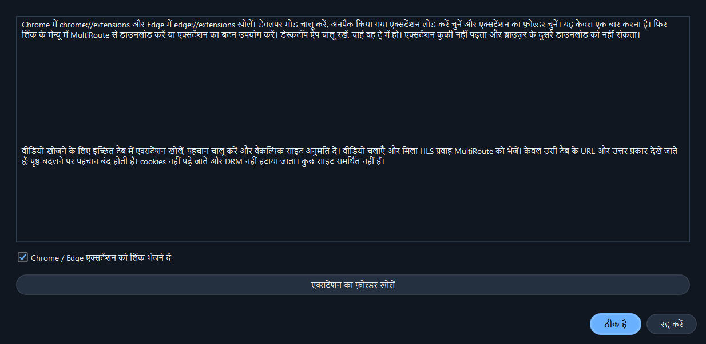
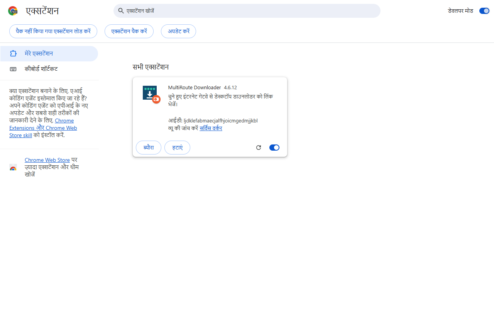
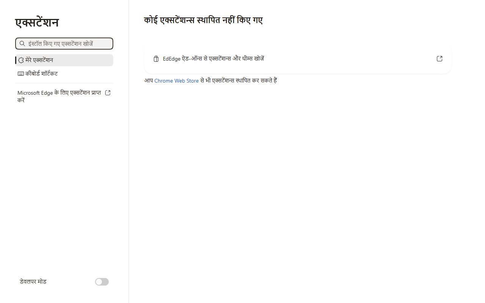
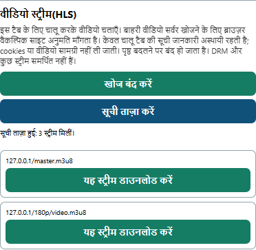
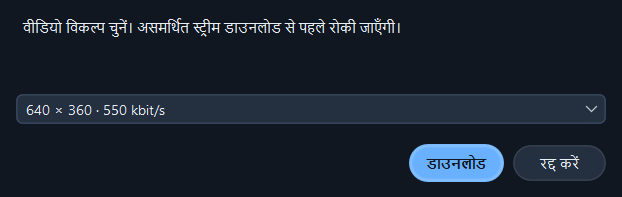
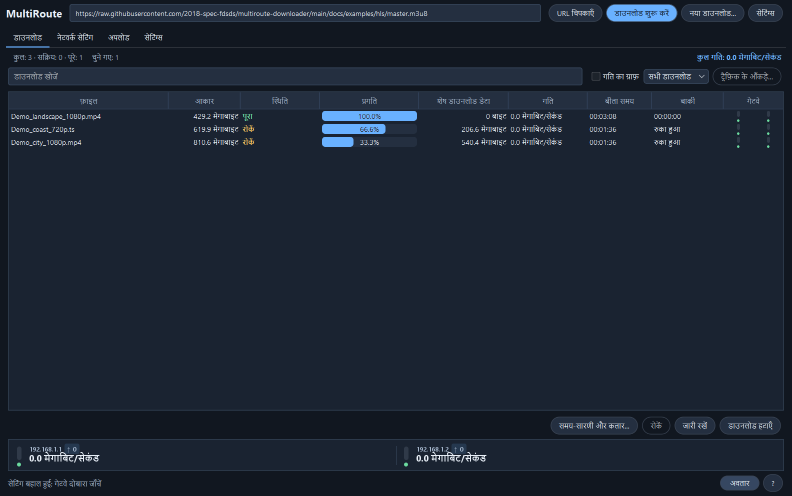

# MultiRoute, Chrome और Edge से HLS वीडियो डाउनलोड करें

<!-- hls-guide-languages:start -->
<p align="center" dir="ltr">
<a href="HLS-CHROME-EDGE.en.md">English</a> · <a href="HLS-CHROME-EDGE.ru.md">Русский</a> · <a href="HLS-CHROME-EDGE.de.md">Deutsch</a> · <a href="HLS-CHROME-EDGE.es.md">Español</a> · <a href="HLS-CHROME-EDGE.fr.md">Français</a> · <a href="HLS-CHROME-EDGE.zh.md">中文</a><br />
<a href="HLS-CHROME-EDGE.ko.md">한국어</a> · <a href="HLS-CHROME-EDGE.ar.md">العربية</a> · <a href="HLS-CHROME-EDGE.it.md">Italiano</a> · <a href="HLS-CHROME-EDGE.ja.md">日本語</a> · <strong>हिन्दी</strong> · <a href="HLS-CHROME-EDGE.vi.md">Tiếng Việt</a>
</p>
<!-- hls-guide-languages:end -->


> **MultiRoute Downloader 4.5.2 या नया** और HLS पहचान वाली एक्सटेंशन आवश्यक है। ऐप के चित्र **4.6.12** दिखाते हैं। यह गाइड पुराने इंस्टॉलर में HLS नहीं जोड़ती; अपने ऐप का संस्करण और [Releases पृष्ठ](https://github.com/2018-spec-fdsds/multiroute-downloader/releases) पर उपलब्ध पैकेज जाँचें।

HLS वीडियो एक प्लेलिस्ट और कई छोटे मीडिया खंडों से बनता है। MultiRoute आपकी अनुमति से ब्राउज़र एक्सटेंशन द्वारा प्लेलिस्ट पहचानता है, उपलब्ध गुणवत्ता चुनने देता है, चुने हुए गेटवे से खंड डाउनलोड करता है और समर्थित वीडियो फ़ाइल बनाता है। वेब पृष्ठ और प्लेलिस्ट के पते आम तौर पर अलग होते हैं।

## शुरू करने से पहले

- मेल खाने वाला डेस्कटॉप ऐप स्थापित करके चलाएँ। यह सिस्टम ट्रे में रह सकता है।
- ऐप में डाउनलोड फ़ोल्डर चुनें और चुने हुए गेटवे जाँचें। एक कार्यशील गेटवे पर्याप्त है; कई स्वतंत्र इंटरनेट कनेक्शन खंडों का डाउनलोड बाँट सकते हैं। उपलब्ध गेटवे और एक साथ डाउनलोड की संख्या स्थापित लाइसेंस पर निर्भर करती है।
- उसी कंप्यूटर पर Chrome या Chromium आधारित Microsoft Edge इस्तेमाल करें जिस पर MultiRoute चल रहा है।
- ऐप के फ़ोल्डर से मेल खाने वाली एक्सटेंशन स्थापित करें। इस प्रक्रिया में **अनपैक किया गया एक्सटेंशन लोड करें** उपयोग होता है; Chrome Web Store या Edge Add-ons सूची से स्थापना नहीं होती।
- केवल वह वीडियो चुनें जिसे सहेजने का आपको अधिकार है। वर्तमान कार्यान्वयन **निरंतर MPEG-TS या fMP4 टाइमलाइन वाला एन्क्रिप्ट न किया गया ऑन-डिमांड वीडियो** समर्थित करता है। यह सभी वीडियो वेबसाइटों के लिए सार्वभौमिक डाउनलोडर नहीं है।

## 1. डेस्कटॉप ब्रिज चालू करें

1. MultiRoute → **सेटिंग** → **Chrome / Edge…** खोलें।
2. **Chrome / Edge एक्सटेंशन को लिंक भेजने दें** चुनें और **ठीक है** दबाएँ। वास्तविक शब्द ऐप की भाषा के अनुसार होंगे।
3. इसी संवाद में **एक्सटेंशन फ़ोल्डर खोलें** दबाएँ। अगले चरण के लिए फ़ोल्डर खुला रखें।



ब्रिज ऐप के स्थानीय API पोर्ट, सामान्यतः **8765**, पर सुनता है। यह इस परियोजना की एक्सटेंशन का origin स्वीकार करता है। सार्वजनिक API पता या राउटर में पोर्ट फ़ॉरवर्डिंग आवश्यक नहीं है। इस प्रक्रिया में अलग native-messaging-host इंस्टॉलर नहीं है: डेस्कटॉप ऐप चलता रहता है और एक्सटेंशन उसके loopback ब्रिज से बात करती है।

### macOS में फ़ोल्डर खोजना

पहले **एक्सटेंशन फ़ोल्डर खोलें** इस्तेमाल करें। सामान्य स्थापना में फ़ोल्डर यहाँ मिलता है:

```text
/Applications/MultiRoute Downloader.app/Contents/app/browser-extension
```

ब्राउज़र के फ़ोल्डर चयन संवाद में **⌘⇧G** दबाएँ, यह पथ चिपकाएँ और फ़ोल्डर चुनें। दूसरा तरीका: Finder में Applications → **MultiRoute Downloader.app** पर दायाँ क्लिक → **Show Package Contents** → `Contents` → `app` → `browser-extension`। ऐप कहीं और स्थापित किया है तो उसका वास्तविक स्थान इस्तेमाल करें। `manifest.json` वाला फ़ोल्डर चुनें, पूरा `.app` बंडल नहीं।

## 2. ब्राउज़र में एक्सटेंशन लोड करें

| Chrome | Microsoft Edge |
|---|---|
| पता पट्टी में `chrome://extensions` लिखें। | पता पट्टी में `edge://extensions` लिखें। |
| **डेवलपर मोड** चालू करें। | **डेवलपर मोड** चालू करें। |
| **अनपैक किया गया एक्सटेंशन लोड करें** दबाएँ। | **अनपैक किया गया एक्सटेंशन लोड करें** दबाएँ। |
| MultiRoute द्वारा खोला गया `browser-extension` फ़ोल्डर चुनें। | वही फ़ोल्डर चुनें। |

बटन हमेशा दिखाने के लिए ब्राउज़र के एक्सटेंशन मेनू से **MultiRoute Downloader** पिन करें। इस्तेमाल किए जाने वाले हर ब्राउज़र/प्रोफ़ाइल में इसे अलग स्थापित करें। संगठन द्वारा प्रबंधित ब्राउज़र स्थानीय एक्सटेंशन सीमित कर सकते हैं; व्यवस्थापक की नीति का पालन करें।





ये [Chrome](https://developer.chrome.com/docs/extensions/get-started/tutorial/hello-world#load-unpacked) और [Microsoft Edge](https://learn.microsoft.com/en-us/microsoft-edge/extensions/getting-started/extension-sideloading) द्वारा बताई गई मानक स्थानीय स्थापना प्रक्रियाएँ हैं। Edge के चित्र में डेवलपर मोड शुरू में बंद है; उसे चालू करने पर अनपैक एक्सटेंशन लोड करने का बटन दिखाई देगा।

### पहले से स्थापित है? एक्सटेंशन स्वयं दोबारा लोड करें

ऐप अपडेट करने के बाद `chrome://extensions/` या `edge://extensions/` खोलें। **MultiRoute Downloader कार्ड** पर **↻ / फिर से लोड करें** दबाएँ। Chrome में बटन छिपा हो तो डेवलपर मोड चालू करें। एक्सटेंशन संस्करण **4.5.2 या नया** होना चाहिए; फिर वीडियो पृष्ठ पर लौटें और एक्सटेंशन के टूल दोबारा खोलें।

टूल विंडो के अंदर **सूची ताज़ा करें** केवल स्ट्रीम का मेटाडेटा ताज़ा करता है; वह अपडेट की गई एक्सटेंशन फ़ाइलें लोड नहीं करता। संस्करण पुराना ही रहे तो स्थापित एक्सटेंशन का फ़ोल्डर जाँचें। Windows का सामान्य फ़ोल्डर `%LOCALAPPDATA%\MultiRoute Downloader App\app\browser-extension` है; अपनी स्थापना का फ़ोल्डर MultiRoute सेटिंग से खोलें।

सुधार के बाद भी Chrome में पुराने त्रुटि रिकॉर्ड रह सकते हैं। `Cannot create item with duplicate id multiroute-download` फिर दिखाई दे तो लोड किया गया संस्करण जाँचें और देखें कि दोबारा लोड करने के बाद नई त्रुटि बनती है या नहीं। बार-बार मेनू पंजीकरण की समस्या 4.5.2 में सुधारी गई है।

## 3. वीडियो प्लेलिस्ट पहचानें

1. वीडियो वाला पृष्ठ सामान्य HTTP/HTTPS टैब में खोलें।
2. MultiRoute एक्सटेंशन आइकन पर दायाँ क्लिक करके **एक्सटेंशन उपकरण** चुनें। 4.6.12 में साधारण बायाँ क्लिक ऐप का फ़्लोटिंग पैनल खोलता है; HLS पहचान एक्सटेंशन की टूल विंडो में होती है।
3. **वीडियो स्ट्रीम(HLS)** में **इस टैब में खोजें** दबाएँ।
4. पहचान चाहिए तो वेबसाइट पहुँच की वैकल्पिक अनुमति दें। ब्राउज़र कई वेबसाइटों तक पहुँच का उल्लेख कर सकता है: प्लेयर के खंड किसी अन्य वीडियो/CDN होस्ट से आ सकते हैं। फिर भी एक्सटेंशन केवल उन्हीं टैब में पहचान करती है जिन्हें आपने स्पष्ट रूप से चालू किया है।
5. टूल विंडो बंद करके **वीडियो चलाएँ**। पहचान भविष्य के प्लेलिस्ट उत्तर देखती है; चालू करने से पहले लोड हो चुकी प्लेलिस्ट को पीछे से नहीं खोज सकती।
6. **एक्सटेंशन उपकरण** फिर खोलें। ज़रूरत हो तो **सूची ताज़ा करें** दबाएँ। विंडो खुली रहने पर भी सूची अपने आप ताज़ा होती है।
7. सही स्ट्रीम ढूँढ़कर **यह स्ट्रीम डाउनलोड करें** दबाएँ।

ब्राउज़र का अनुमति संवाद टूल विंडो बंद कर दे तो अनुमति देने के बाद उसे फिर खोलें। पहचान अभी भी बंद हो तो **इस टैब में खोजें** फिर दबाएँ और वीडियो चलाएँ।



पृष्ठ पहले ही प्लेलिस्ट लोड कर चुका हो तो उसे दोबारा लोड करें, टूल फिर खोलें, पहचान चालू है या नहीं जाँचें और आवश्यकता पर चालू करें, फिर वीडियो चलाएँ। **दूसरे पृष्ठ पर जाने से उस टैब की पहचान बंद हो जाती है।** टैब बंद करने से उसकी पहचान स्थिति भी मिट जाती है। अनुमति मिलने का अर्थ सभी टैब में स्वतः पहचान चालू होना नहीं है।

एक्सटेंशन सीमित मात्रा में प्लेलिस्ट मेटाडेटा अस्थायी रूप से रखती है। यह वीडियो सामग्री, ब्राउज़र कुकी या प्रमाणीकरण अनुरोध हेडर नहीं पकड़ती। सामान्य ब्राउज़र डाउनलोड स्वतः नहीं रोकती या अपने पास नहीं लेती। काम पूरा होने पर **खोज बंद करें** दबाएँ।

## 4. MultiRoute में गुणवत्ता चुनें

**यह स्ट्रीम डाउनलोड करें** दबाने के बाद डेस्कटॉप ऐप पर जाएँ। MultiRoute वर्तमान गंतव्य फ़ोल्डर, चुने हुए गेटवे और साइट प्रोफ़ाइल का उपयोग करता है। प्लेलिस्ट की जाँच के बाद गुणवत्ता चयन खुलता है।

- रिज़ॉल्यूशन/बिटरेट चुनें, जैसे `1280 × 720 · … kbit/s`, फिर शुरू करें।
- मास्टर प्लेलिस्ट में कई गुणवत्ताएँ हो सकती हैं; मीडिया प्लेलिस्ट केवल एक स्रोत दे सकती है।
- दिखने वाला बिटरेट वीडियो संस्करण का विवरण है। यह आपकी मापी गई इंटरनेट या डाउनलोड गति **नहीं** है।
- कम गुणवत्ता चुनने पर सामान्यतः डाउनलोड का आकार घटता है। MultiRoute वीडियो को upscale या transcode नहीं करता।
- सहेजी गई फ़ाइल का एक्सटेंशन समर्थित कंटेनर के अनुसार होता है: MPEG-TS के लिए `.ts`, fMP4 के लिए `.mp4`। TS फ़ाइल का नाम `.mp4` करने से रूपांतरण नहीं होता।



सीधा `.m3u8` लिंक हो तो उसे MultiRoute में चिपका सकते हैं। पहचानी गई स्ट्रीम का बटन उन HLS उत्तरों को भी पहचानता है जिनके URL `.m3u8` पर समाप्त नहीं होते। HLS एक प्लेलिस्ट है; HTML वीडियो पृष्ठ का पता अपने आप m3u8 लिंक निर्धारित नहीं करता। समर्थित वीडियो पृष्ठों को संभालना इस HLS पहचान से अलग कार्यप्रवाह है।

## 5. प्रगति देखें, रोकें, जारी रखें और जाँचें

काम **डाउनलोड** में दिखता है। चुने हुए काम पर **रोकें** और **फिर शुरू करें** इस्तेमाल करें। MultiRoute पूर्ण खंड सहेजता है और दोबारा उपयोग से पहले उनके रिकॉर्ड जाँचता है; अंतिम संयोजन प्लेलिस्ट क्रम में होता है, गेटवे पर डाउनलोड पूरा होने के क्रम में नहीं।



किसी काम की विस्तृत जानकारी के लिए उस पर दायाँ क्लिक करके उसका डाउनलोड लॉग खोलें। खंड डाउनलोड/पुनः उपयोग और त्रुटि रिकॉर्ड वहीं देखें; जाँच के लिए सामान्य ऐप लॉग ही एकमात्र जगह नहीं है। डाउनलोड पूरा होने के बाद भी लॉग उपयोगी हैं।

फिर शुरू करने के लिए वही संगत स्रोत/गुणवत्ता/प्लेलिस्ट चाहिए। साइट की प्लेलिस्ट, हस्ताक्षरित खंड URL या गुणवत्ता बदलने से सुरक्षित पुनः उपयोग संभव नहीं रह सकता। पूर्ण खंड का स्थानीय हैश सहेजे हुए खंड के पुनः उपयोग की रक्षा करता है; वेबसाइट ने प्रकाशक का checksum नहीं दिया हो तो यह उसकी जगह नहीं लेता। आगे जारी रखना हो तो काम और उसके सहेजे खंड बनाए रखें।

## समस्या निवारण

| लक्षण | क्या जाँचें |
|---|---|
| कोई वीडियो स्ट्रीम नहीं दिखती | प्लेबैक **से पहले** पहचान चालू करें। चलाएँ/दोबारा लोड करें और टूल फिर खोलें। वेबसाइट अनुमतियाँ और टैब की पहचान स्थिति जाँचें। प्लेयर MP4, DASH, cached प्लेलिस्ट या अन्य असमर्थित प्रारूप इस्तेमाल कर सकता है। |
| पहचान बंद हो गई | पृष्ठ बदलने के बाद फिर चालू करें। अनुमति देना और प्रत्येक टैब की पहचान अलग हैं। |
| टूल में केवल वीडियो पृष्ठ का URL है | वह सामान्य URL फ़ील्ड है, HLS पहचान का प्रमाण नहीं। **वीडियो स्ट्रीम(HLS)** सूची देखें। |
| “भेज नहीं सके…” | ऐप खुला रखें, Chrome/Edge ब्रिज चालू करें और **ऐप का API पोर्ट** ऐप के पोर्ट से मिलाएँ। डिफ़ॉल्ट 8765 है। |
| HTTP 401/403 या समाप्त लिंक | वेबसाइट को नया हस्ताक्षरित URL या प्रमाणीकृत अनुरोध चाहिए हो सकते हैं। अधिकृत पृष्ठ फिर खोलकर नई प्लेलिस्ट पहचानें। एक्सटेंशन ब्राउज़र कुकी **नहीं** भेजती। ऐप की साइट प्रोफ़ाइल अलग व्यवस्था है और हर साइट के साथ संगतता की गारंटी नहीं देती। |
| असमर्थित HLS प्लेलिस्ट | DRM, AES-128 सहित एन्क्रिप्टेड HLS, लाइव/कम-विलंब स्ट्रीम, टाइमलाइन discontinuities और बाहरी ऑडियो/वीडियो renditions समर्थित नहीं हैं। दोबारा कोशिश असमर्थित स्ट्रीम को समर्थित नहीं बनाती। |
| प्लेबैक चलता है, डाउनलोड नहीं | ब्राउज़र प्लेबैक और डेस्कटॉप डाउनलोड अलग credentials और संभवतः अलग गेटवे इस्तेमाल करते हैं। काम के लॉग और गेटवे उपलब्धता जाँचें। |
| डाउनलोड रुक गया | जारी रखने से पहले उस काम का लॉग, खाली संग्रहण, retry सेटिंग और चुने गेटवे जाँचें। बिना कारण नया काम न बनाएँ या खंड न मिटाएँ। |
| ऐप अपडेट के बाद भी एक्सटेंशन के पुराने नियंत्रण हैं | `chrome://extensions` या `edge://extensions` पर MultiRoute का **फिर से लोड करें** दबाएँ। वर्तमान ऐप के एक्सटेंशन फ़ोल्डर से लोड होना जाँचें और वीडियो पृष्ठ फिर खोलें। |

## तैयार GitHub उदाहरण आज़माएँ

हमारे बनाए **12 सेकंड के परीक्षण वीडियो** में कृत्रिम चित्र और एक टोन है। इसमें **180p / 300 kbit/s** तथा **360p / 550 kbit/s** विकल्प हैं। ये घोषित संस्करण बैंडविड्थ हैं, मापी गई इंटरनेट गति नहीं।

1. [इस रिपॉज़िटरी का उदाहरण खोलें](../examples/hls/README.md), या [उसका प्लेबैक पृष्ठ खोलें](https://hlsjs.video-dev.org/demo/?src=https%3A%2F%2Fraw.githubusercontent.com%2F2018-spec-fdsds%2Fmultiroute-downloader%2Fmain%2Fdocs%2Fexamples%2Fhls%2Fmaster.m3u8)। बाहरी प्लेयर आधिकारिक hls.js डेमो है; मीडिया हमारी GitHub रिपॉज़िटरी में है।
2. उस टैब के लिए MultiRoute पहचान चालू करें। manifest पहले लोड हो गया हो तो दोबारा लोड करें, पहचान जाँचें और आवश्यकता पर फिर चालू करें।
3. प्लेबैक शुरू करें, एक्सटेंशन उपकरण खोलें और **सूची ताज़ा करें** दबाएँ।
4. **master.m3u8** → **यह स्ट्रीम डाउनलोड करें** चुनें। `180p/video.m3u8` और `360p/video.m3u8` अलग संस्करण हैं; एक चुनने पर दूसरी गुणवत्ता नहीं मिलेगी।
5. MultiRoute में **320 × 180** या **640 × 360** चुनकर शुरू करें। लगभग 12 सेकंड की छोटी **.ts** फ़ाइल मिलेगी जिसमें वीडियो और ऑडियो दोनों होंगे। आकार गुणवत्ता पर निर्भर है।

एक्सटेंशन के बिना जाँचने के लिए यह सीधा प्लेलिस्ट URL MultiRoute में चिपकाएँ:

```text
https://raw.githubusercontent.com/2018-spec-fdsds/multiroute-downloader/main/docs/examples/hls/master.m3u8
```

यह प्लेलिस्ट URL है, GitHub HTML पृष्ठ नहीं। GitHub पर master.m3u8 देखना वीडियो प्लेबैक या ब्राउज़र पहचान की जाँच नहीं है। छोटा उदाहरण आपके रोकने से पहले पूरा हो सकता है; रुकावट/पुनः आरंभ का परीक्षण किसी लंबे वीडियो पर करें जिसे डाउनलोड करने का अधिकार हो।

एक्सटेंशन के चित्र इसी स्ट्रीम की स्थानीय प्रति इस्तेमाल करते हैं, इसलिए सूची में `127.0.0.1` है। आपके वीडियो का अपना होस्ट दिखेगा। MultiRoute कार्यक्षेत्र के चित्र प्रदर्शन वाले काम दिखाते हैं, निजी डाउनलोड इतिहास नहीं। ब्राउज़र के चित्र इस पृष्ठ की भाषा में हैं। Edge का चित्र बताता है कि अनपैक एक्सटेंशन लोड करने से पहले डेवलपर मोड कहाँ चालू करना है। परीक्षण मीडिया [CC0](../examples/hls/README.md#license--лицензия) के अंतर्गत है; ऐप का लाइसेंस नहीं बदलता।

## सत्यापन का दायरा

अपने परीक्षण fixture पर वास्तविक HLS वीडियो/ऑडियो प्लेबैक, एक्सटेंशन पहचान और चुने URL को अपने परीक्षण receiver तक भेजना जाँचा गया। अलग इंजन परीक्षणों ने सहेजे खंडों की जाँच/पुनः आरंभ, क्रम और TS/MP4 आउटपुट decoding जाँची। इससे हर वेबसाइट, प्रमाणीकरण प्रक्रिया या नेटवर्क गति वृद्धि की गारंटी नहीं मिलती।

प्राथमिक संदर्भ: [Chrome sideloading](https://developer.chrome.com/docs/extensions/get-started/tutorial/hello-world#load-unpacked), [Edge sideloading](https://learn.microsoft.com/en-us/microsoft-edge/extensions/getting-started/extension-sideloading), [आधिकारिक hls.js प्लेयर](https://github.com/video-dev/hls.js), [HLS / RFC 8216](https://www.rfc-editor.org/rfc/rfc8216)।
