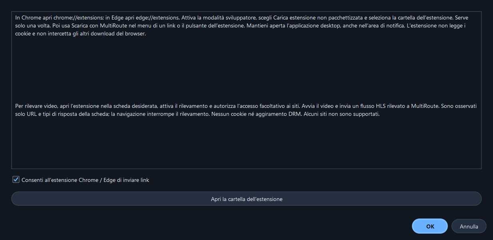
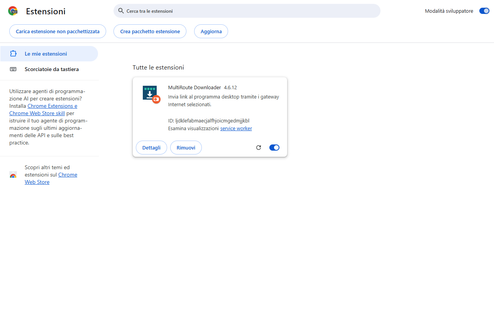
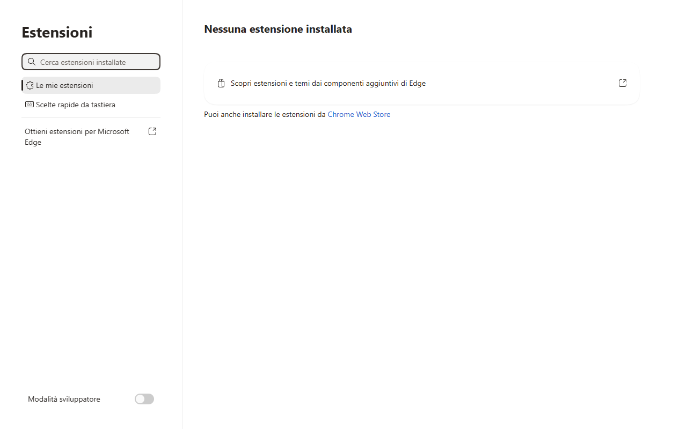
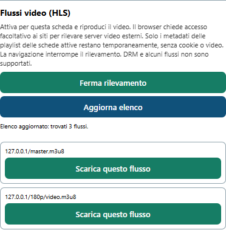
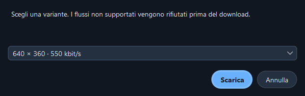
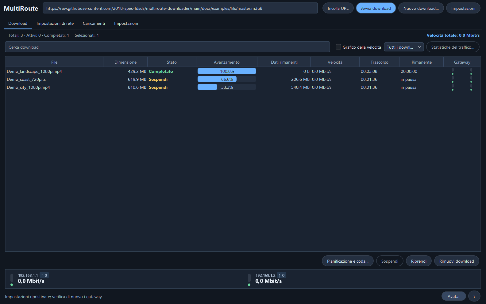

# Scaricare video HLS con MultiRoute, Chrome ed Edge

<!-- hls-guide-languages:start -->
<p align="center" dir="ltr">
<a href="HLS-CHROME-EDGE.en.md">English</a> · <a href="HLS-CHROME-EDGE.ru.md">Русский</a> · <a href="HLS-CHROME-EDGE.de.md">Deutsch</a> · <a href="HLS-CHROME-EDGE.es.md">Español</a> · <a href="HLS-CHROME-EDGE.fr.md">Français</a> · <a href="HLS-CHROME-EDGE.zh.md">中文</a><br />
<a href="HLS-CHROME-EDGE.ko.md">한국어</a> · <a href="HLS-CHROME-EDGE.ar.md">العربية</a> · <strong>Italiano</strong> · <a href="HLS-CHROME-EDGE.ja.md">日本語</a> · <a href="HLS-CHROME-EDGE.hi.md">हिन्दी</a> · <a href="HLS-CHROME-EDGE.vi.md">Tiếng Việt</a>
</p>
<!-- hls-guide-languages:end -->

> Sono necessari **MultiRoute Downloader 4.5.2 o successivo** e un’estensione con rilevamento HLS. Le illustrazioni mostrano la versione 4.6.12. Questa guida non aggiunge HLS ai vecchi programmi di installazione; controllare la versione dell’applicazione e i pacchetti nella [pagina delle versioni](https://github.com/2018-spec-fdsds/multiroute-downloader/releases).

Un video HLS è composto da una playlist e molti piccoli frammenti multimediali. MultiRoute individua la playlist tramite un’estensione del browser attivata esplicitamente dall’utente, consente di selezionare una qualità disponibile, scarica i frammenti attraverso i gateway selezionati e assembla un file video supportato. L’indirizzo della pagina web e quello della playlist sono normalmente diversi.

## Prima di iniziare

- Installare e avviare l’applicazione desktop corrispondente. Può rimanere nell’area di notifica.
- Impostare una cartella di download e verificare i gateway selezionati nell’applicazione. È sufficiente un gateway funzionante; più connessioni Internet indipendenti possono suddividersi il download dei frammenti. Il numero di gateway e di download simultanei disponibili dipende dalla licenza installata.
- Usare Chrome o Microsoft Edge basato su Chromium sullo stesso computer di MultiRoute.
- Installare l’estensione corrispondente dalla cartella dell’applicazione. Questa procedura utilizza **Carica estensione non pacchettizzata**, non una pubblicazione sul Chrome Web Store o su Edge Add-ons.
- Scegliere un video che si ha il diritto di salvare. L’implementazione attuale supporta **video on demand non cifrati con una sequenza temporale MPEG-TS o fMP4 continua**. Non è uno strumento universale per scaricare da qualsiasi sito video.

## 1. Attivare il bridge dell’applicazione desktop

1. Aprire MultiRoute → **Impostazioni** → **Chrome / Edge…**.
2. Selezionare **Consenti all’estensione Chrome / Edge di inviare collegamenti**, quindi confermare con **OK**. La dicitura esatta dipende dalla lingua dell’applicazione.
3. In questa finestra, fare clic su **Apri cartella dell’estensione**. Tenere la cartella disponibile per il passaggio successivo.



Il bridge è in ascolto sulla porta API locale dell’applicazione, normalmente **8765**. Accetta l’origine dell’estensione di questo progetto. Non richiede un indirizzo API pubblico né una regola di port forwarding sul router. Questo flusso non prevede un programma di installazione separato per un host di messaggistica nativa: l’applicazione desktop nativa rimane in esecuzione e l’estensione comunica con il suo bridge di loopback.

### Trovare la cartella su macOS

Usare prima **Apri cartella dell’estensione**. In un’installazione standard, la cartella si trova in:

```text
/Applications/MultiRoute Downloader.app/Contents/app/browser-extension
```

Nel selettore di cartelle del browser premere **⌘⇧G**, incollare questo percorso e selezionare la cartella. In alternativa, nel Finder scegliere Applicazioni → clic destro su **MultiRoute Downloader.app** → **Mostra contenuto pacchetto** → `Contents` → `app` → `browser-extension`. Se l’applicazione è stata installata altrove, usare la posizione effettiva. Selezionare la cartella contenente `manifest.json`, non l’intero pacchetto `.app`.

## 2. Caricare l’estensione nel browser

| Chrome | Microsoft Edge |
|---|---|
| Inserire `chrome://extensions` nella barra degli indirizzi. | Inserire `edge://extensions` nella barra degli indirizzi. |
| Attivare **Modalità sviluppatore**. | Attivare **Modalità sviluppatore**. |
| Fare clic su **Carica estensione non pacchettizzata**. | Fare clic su **Carica decompressa**. |
| Selezionare la cartella `browser-extension` aperta da MultiRoute. | Selezionare la stessa cartella. |

Fissare **MultiRoute Downloader** dal menu Estensioni del browser se si desidera che il suo pulsante sia sempre visibile. Installarla separatamente in ogni browser/profilo utilizzato. I browser gestiti da un’organizzazione possono limitare le estensioni locali; rispettare i criteri dell’amministratore.





La schermata di Edge mostra **Modalità sviluppatore** ancora disattivata. Attivarla per visualizzare **Carica decompressa**. Queste sono le normali procedure di installazione locale documentate da [Chrome](https://developer.chrome.com/docs/extensions/get-started/tutorial/hello-world#load-unpacked) e [Microsoft Edge](https://learn.microsoft.com/en-us/microsoft-edge/extensions/getting-started/extension-sideloading).

### Già installata? Ricaricare l’estensione stessa

Dopo aver aggiornato l’applicazione, aprire `chrome://extensions/` o `edge://extensions/`. Individuare la **scheda di MultiRoute Downloader** e fare clic sul comando **↻ / Ricarica**. In Chrome, attivare la modalità sviluppatore se l’icona è nascosta. Verificare che la versione dell’estensione sia **4.5.2 o successiva**, tornare alla pagina del video e aprire nuovamente l’estensione. Le illustrazioni attuali mostrano la versione 4.6.12.

**Aggiorna elenco nella finestra dell’estensione** aggiorna i metadati dei flussi; non carica i file aggiornati dell’estensione. Se la versione rimane vecchia, controllare la cartella dell’estensione installata. La cartella standard di Windows è `%LOCALAPPDATA%\MultiRoute Downloader App\app\browser-extension`; aprire la cartella della propria installazione dalle impostazioni di MultiRoute.

I vecchi errori registrati da Chrome possono rimanere dopo una correzione. Se compare nuovamente `Cannot create item with duplicate id multiroute-download`, verificare la versione caricata e se viene generato un nuovo errore dopo il ricaricamento. La registrazione ripetuta del menu è stata corretta nella versione 4.5.2.

## 3. Individuare la playlist del video

1. Aprire la pagina contenente il video in una normale scheda HTTP/HTTPS.
2. Fare clic destro sull’icona dell’estensione MultiRoute e scegliere **Strumenti dell’estensione**. Nella versione 4.6.12, un normale clic sinistro apre il pannello mobile dell’applicazione; il rilevamento HLS si trova nella finestra degli strumenti dell’estensione.
3. In **Flussi video (HLS)**, fare clic su **Rileva in questa scheda**.
4. Accettare l’autorizzazione facoltativa di accesso ai siti se si desidera utilizzare il rilevamento. Il browser può menzionare l’accesso a molti siti: i frammenti di un lettore possono provenire da un altro nome host video/CDN. Il rilevamento dell’estensione rimane limitato alle schede attivate esplicitamente.
5. Chiudere la finestra degli strumenti e **avviare il video**. Il rilevamento osserva le risposte future contenenti playlist; non può individuare retroattivamente una playlist caricata prima dell’attivazione.
6. Riaprire **Strumenti dell’estensione**. Fare clic su **Aggiorna elenco** se necessario. L’elenco si aggiorna anche mentre la finestra degli strumenti è aperta.
7. Individuare il flusso desiderato e fare clic su **Scarica questo flusso**.

Se la finestra delle autorizzazioni del browser chiude quella dell’estensione, riaprirla dopo aver concesso l’accesso. Se il rilevamento è ancora disattivato, fare nuovamente clic su **Rileva in questa scheda**, quindi avviare il video.



Se la pagina ha già caricato la playlist, ricaricarla, riaprire gli strumenti, verificare che il rilevamento sia ancora attivo e riattivarlo se necessario, quindi avviare il video. **La navigazione verso un’altra pagina disattiva il rilevamento per quella scheda.** Anche la chiusura della scheda cancella il relativo stato di individuazione. Non presumere che concedere l’autorizzazione attivi automaticamente tutte le schede.

L’estensione mantiene un elenco temporaneo e limitato dei metadati delle playlist. Non acquisisce contenuti video, cookie del browser o intestazioni di autenticazione delle richieste. Non intercetta automaticamente ogni normale download del browser. Al termine usare **Ferma rilevamento**.

## 4. Selezionare la qualità in MultiRoute

Dopo **Scarica questo flusso**, passare all’applicazione desktop. MultiRoute usa la cartella di destinazione, i gateway selezionati e il profilo del sito attuali. Dopo l’analisi della playlist compare un selettore della qualità.

- Scegliere una risoluzione/bitrate, ad esempio `1280 × 720 · … kbit/s`, quindi avviare.
- Una playlist master può offrire più qualità; una playlist multimediale può offrire una sola sorgente.
- Il bitrate visualizzato descrive la variante video. **Non** è la velocità misurata della connessione Internet o del download.
- Selezionare una qualità inferiore generalmente riduce la quantità da scaricare. MultiRoute non aumenta la risoluzione e non transcodifica il video.
- L’estensione del file salvato segue il contenitore supportato: `.ts` per MPEG-TS o `.mp4` per fMP4. Rinominare un download TS in `.mp4` non lo converte.



Se si dispone già di un collegamento diretto `.m3u8`, è possibile incollarlo in MultiRoute. Il pulsante dei flussi rilevati identifica anche risposte HLS il cui URL non termina con `.m3u8`. Per HLS usare l’URL della playlist. Inviare un indirizzo di pagina HTML con **Invia a MultiRoute** non identifica da solo il relativo m3u8; le pagine video supportate vengono elaborate mediante un flusso separato per scaricare pagine video.

## 5. Seguire, sospendere, riprendere e ispezionare

L’attività compare in **Download**. Usare **Pausa** e **Riprendi** per l’attività selezionata. MultiRoute conserva i frammenti completati e controlla i record dei frammenti salvati prima del riutilizzo; l’assemblaggio finale segue l’ordine della playlist, non quello di completamento dei gateway.



Per ottenere una spiegazione specifica, fare clic destro sull’attività e aprire il relativo registro di download. Esaminare qui i record di download/riutilizzo dei frammenti e gli errori; il registro generale dell’applicazione non è l’unico punto da consultare. I registri sono utili anche dopo il completamento.

La ripresa richiede la stessa sorgente/qualità/playlist compatibile. Modifiche alla playlist del sito, agli URL firmati dei frammenti o alla qualità possono impedire un riutilizzo sicuro. L’hash locale di un frammento completato protegge il riutilizzo del frammento salvato; non fornisce un checksum dell’editore se il sito non ne ha fornito uno. Conservare l’attività e i relativi dati dei frammenti se si intende continuare in seguito.

## Risoluzione dei problemi

| Sintomo | Cosa controllare |
|---|---|
| Non compaiono flussi video | Attivare il rilevamento **prima** della riproduzione. Avviare il video/ricaricare la pagina e riaprire gli strumenti. Verificare le autorizzazioni del sito e lo stato di rilevamento della scheda. Il lettore potrebbe usare MP4, DASH, una playlist nella cache o un altro formato non supportato. |
| Il rilevamento si è disattivato | Riattivarlo dopo la navigazione. La concessione dell’autorizzazione e il rilevamento per scheda sono separati. |
| La finestra mostra solo l’URL della pagina del video | È il normale campo URL, non una prova di rilevamento HLS. Usare l’elenco **Flussi video (HLS)**. |
| «Impossibile inviare…» | Tenere aperta l’applicazione, attivare il bridge Chrome/Edge e far corrispondere **Porta API dell’applicazione** alla porta dell’app. Il valore predefinito è 8765. |
| HTTP 401/403 o collegamento scaduto | Il sito potrebbe richiedere un nuovo URL firmato o richieste autenticate. Riaprire la pagina autorizzata e individuare una playlist nuova. L’estensione **non** trasferisce i cookie del browser. Il profilo del sito configurato nell’app è separato e non può garantire la compatibilità con ogni sito. |
| Playlist HLS non supportata | DRM, HLS cifrato compreso AES-128, flussi live/a bassa latenza, discontinuità e tracce audio/video esterne non rientrano nel percorso supportato. Un nuovo tentativo non converte un flusso non supportato. |
| La riproduzione funziona ma il download no | La riproduzione nel browser e il recupero dall’app desktop usano credenziali diverse e potenzialmente gateway diversi. Controllare i registri dell’attività e la disponibilità dei gateway. |
| Il download si è fermato | Esaminare il registro dell’attività, lo spazio disponibile, le impostazioni dei tentativi e i gateway selezionati prima di riprendere. Non creare una nuova attività e non eliminare frammenti inutilmente. |
| Vecchi controlli dopo un aggiornamento dell’app | Aprire `chrome://extensions` o `edge://extensions` e fare clic su **Ricarica** per MultiRoute. Verificare che punti alla cartella dell’estensione dell’app attuale, quindi riaprire la pagina del video. |

## Provare l’esempio pronto su GitHub

Il nostro **video di prova generato di 12 secondi** contiene un’immagine sintetica e un tono, con varianti **180p / 300 kbit/s** e **360p / 550 kbit/s**. Queste sono le larghezze di banda dichiarate delle varianti, non velocità Internet misurate.

1. [Aprire l’esempio in questo repository](../examples/hls/README.md) oppure [la sua pagina di riproduzione](https://hlsjs.video-dev.org/demo/?src=https%3A%2F%2Fraw.githubusercontent.com%2F2018-spec-fdsds%2Fmultiroute-downloader%2Fmain%2Fdocs%2Fexamples%2Fhls%2Fmaster.m3u8). Il lettore esterno è la demo ufficiale di hls.js; i file multimediali si trovano nel nostro repository GitHub.
2. Attivare il rilevamento MultiRoute per quella scheda. Se il manifest è stato caricato prima, ricaricare, verificare il rilevamento e riattivarlo se necessario.
3. Avviare la riproduzione, aprire gli strumenti dell’estensione e fare clic su **Aggiorna elenco**.
4. Selezionare **master.m3u8** → **Scarica questo flusso**. Le righe `180p/video.m3u8` e `360p/video.m3u8` sono singole varianti; scegliendone una non verrà proposta l’altra qualità.
5. Scegliere **320 × 180** o **640 × 360** in MultiRoute e avviare. Si otterrà un breve file **.ts** con video e audio, della durata di circa 12 secondi. La dimensione dipende dalla qualità.

Per provare senza l’estensione, incollare questo URL diretto della playlist in MultiRoute:

```text
https://raw.githubusercontent.com/2018-spec-fdsds/multiroute-downloader/main/docs/examples/hls/master.m3u8
```

Questo è l’URL di una playlist, non una pagina HTML di GitHub. Visualizzare master.m3u8 su GitHub non riproduce il video e non verifica il rilevamento del browser. Il piccolo esempio può terminare prima che sia possibile sospenderlo; provare l’interruzione e la ripresa con contenuti più lunghi che si è autorizzati a scaricare.

Le schermate dell’estensione usano una copia locale dello stesso flusso: per questo nell’elenco compare `127.0.0.1`. Il proprio video mostrerà il suo host. Le schermate dell’area di lavoro MultiRoute usano attività dimostrative, non una cronologia privata dei download. Le illustrazioni usano la stessa versione linguistica di questa pagina. La schermata Edge mostra dove attivare la modalità sviluppatore, prima che compaia «Carica decompressa». I contenuti di prova sono disponibili sotto [CC0](../examples/hls/README.md#license--лицензия), senza modificare la licenza dell’applicazione.

## Ambito della verifica

Le verifiche con dati di prova propri hanno coperto la riproduzione effettiva di video/audio HLS, il rilevamento dell’estensione e il passaggio dell’URL selezionato a un ricevitore di prova proprio. Test separati del motore hanno verificato il controllo/ripristino dei frammenti persistenti, l’ordine e la decodifica dell’output TS/MP4. Questo non garantisce la compatibilità con ogni sito, procedura di autenticazione o aumento della velocità di rete.

Riferimenti principali: [Installazione locale in Chrome](https://developer.chrome.com/docs/extensions/get-started/tutorial/hello-world#load-unpacked), [installazione locale in Edge](https://learn.microsoft.com/en-us/microsoft-edge/extensions/getting-started/extension-sideloading), [lettore ufficiale hls.js](https://github.com/video-dev/hls.js), [HLS / RFC 8216](https://www.rfc-editor.org/rfc/rfc8216).
