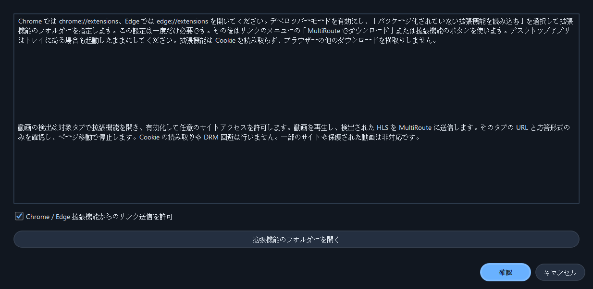
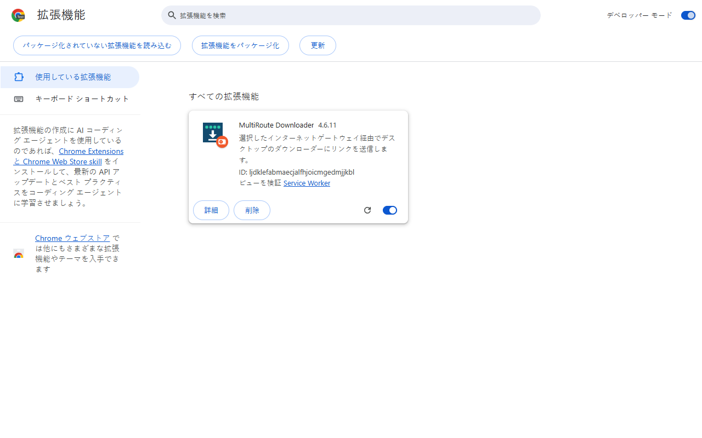
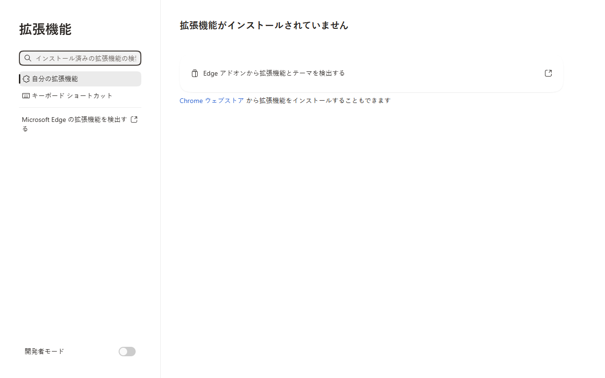
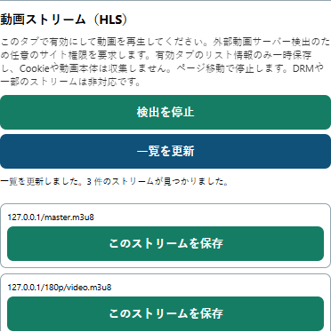
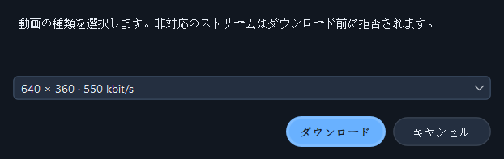
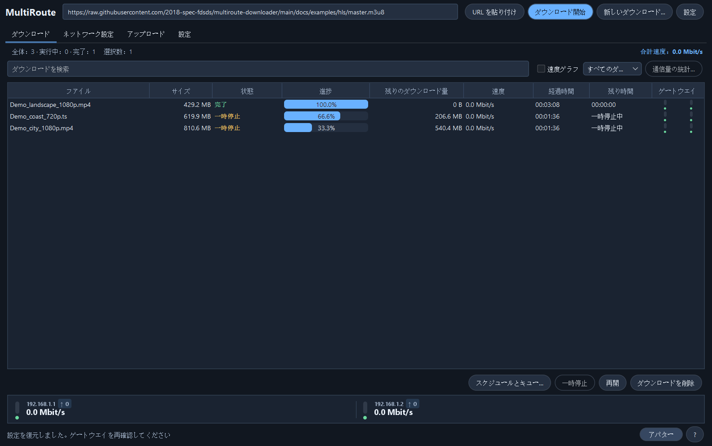

# MultiRoute、Chrome、Edge で HLS 動画をダウンロードする

<!-- hls-guide-languages:start -->
<p align="center" dir="ltr">
<a href="HLS-CHROME-EDGE.en.md">English</a> · <a href="HLS-CHROME-EDGE.ru.md">Русский</a> · <a href="HLS-CHROME-EDGE.de.md">Deutsch</a> · <a href="HLS-CHROME-EDGE.es.md">Español</a> · <a href="HLS-CHROME-EDGE.fr.md">Français</a> · <a href="HLS-CHROME-EDGE.zh.md">中文</a><br />
<a href="HLS-CHROME-EDGE.ko.md">한국어</a> · <a href="HLS-CHROME-EDGE.ar.md">العربية</a> · <a href="HLS-CHROME-EDGE.it.md">Italiano</a> · <strong>日本語</strong> · <a href="HLS-CHROME-EDGE.hi.md">हिन्दी</a> · <a href="HLS-CHROME-EDGE.vi.md">Tiếng Việt</a>
</p>
<!-- hls-guide-languages:end -->

> **MultiRoute Downloader 4.5.2 以降**と、HLS 検出に対応した拡張機能が必要です。アプリの画面例は **4.6.11** です。本ガイドによって古いインストーラーに HLS 機能が追加されるわけではありません。アプリのバージョンと[リリースページ](https://github.com/2018-spec-fdsds/multiroute-downloader/releases)の配布物を確認してください。

HLS 動画は、プレイリストと多数の小さなメディア断片で構成されます。MultiRoute は、ユーザーが有効にしたブラウザー拡張機能でプレイリストを検出し、利用可能な画質を選択して、指定したゲートウェイ経由で断片をダウンロードし、対応する動画ファイルに結合します。通常、動画ページの URL とプレイリストの URL は異なります。

## 始める前に

- 対応するデスクトップアプリをインストールし、起動してください。システムトレイで実行したままでも構いません。
- アプリで保存先を設定し、選択したゲートウェイを確認してください。動作するゲートウェイは 1 つでも十分です。複数の独立したインターネット回線があれば断片の取得を分担できます。利用できるゲートウェイ数と同時ダウンロード数は、導入したライセンスによって異なります。
- MultiRoute と同じコンピューターで Chrome または Chromium ベースの Microsoft Edge を使用してください。
- アプリのフォルダーから対応する拡張機能をインストールしてください。この手順では**パッケージ化されていない拡張機能を読み込む**機能を使います。Chrome ウェブストアや Edge アドオンからのインストールではありません。
- 保存する権利のある動画を選んでください。現在は、**暗号化されておらず、MPEG-TS または fMP4 のタイムラインが連続しているオンデマンド動画**に対応します。すべての動画サイトに対応する汎用ダウンローダーではありません。

## 1. デスクトップ連携を有効にする

1. MultiRoute → **設定** → **Chrome / Edge…** を開きます。
2. **Chrome / Edge 拡張機能からのリンク送信を許可**を選択し、**確認**で確定します。実際の表記はアプリの言語に従います。
3. このダイアログで**拡張機能のフォルダーを開く**をクリックします。次の手順で使うため、フォルダーを開いたままにしてください。



連携機能はアプリのローカル API ポート、通常は **8765** で待ち受け、本プロジェクトの拡張機能のオリジンを受け付けます。公開 API アドレスやルーターのポート転送設定は不要です。この手順に独立した native messaging host のインストーラーはありません。デスクトップアプリを起動したままにし、拡張機能がループバックの連携サービスと通信します。

### macOS でフォルダーを見つける

まず**拡張機能のフォルダーを開く**を使用してください。標準インストールでは次の場所です。

```text
/Applications/MultiRoute Downloader.app/Contents/app/browser-extension
```

ブラウザーのフォルダー選択画面で **⌘⇧G** を押し、このパスを貼り付けてフォルダーを選択します。または Finder の「アプリケーション」で **MultiRoute Downloader.app** を右クリックし、**パッケージの内容を表示** → `Contents` → `app` → `browser-extension` と進みます。別の場所にインストールした場合は、その実際の場所を指定してください。`.app` 全体ではなく、`manifest.json` が入っているフォルダーを選びます。

## 2. ブラウザーに拡張機能を読み込む

| Chrome | Microsoft Edge |
|---|---|
| アドレスバーに `chrome://extensions` を入力します。 | アドレスバーに `edge://extensions` を入力します。 |
| **デベロッパー モード**を有効にします。 | **開発者モード**を有効にします。 |
| **パッケージ化されていない拡張機能を読み込む**をクリックします。 | **展開して読み込み**をクリックします。 |
| MultiRoute で開いた `browser-extension` フォルダーを選択します。 | 同じフォルダーを選択します。 |

ボタンを常時表示したい場合は、ブラウザーの拡張機能メニューで **MultiRoute Downloader** を固定してください。使用するブラウザーやプロファイルごとに個別にインストールします。組織管理のブラウザーではローカル拡張機能が制限されることがあります。管理者のポリシーに従ってください。





Edge の画面例は、開発者モードが**オフ**の状態を示します。先にスイッチをオンにし、表示される**展開して読み込み**をクリックしてください。

これは [Chrome](https://developer.chrome.com/docs/extensions/get-started/tutorial/hello-world#load-unpacked) と [Microsoft Edge](https://learn.microsoft.com/en-us/microsoft-edge/extensions/getting-started/extension-sideloading) に記載された標準的なローカルインストール手順です。

### インストール済みの場合は拡張機能自体を再読み込みする

アプリの更新後、`chrome://extensions/` または `edge://extensions/` を開き、**MultiRoute Downloader のカード**の **↻ / 再読み込み**をクリックします。Chrome でアイコンが非表示の場合はデベロッパー モードを有効にします。拡張機能が **4.5.2 以降**であることを確認し、動画ページに戻って拡張機能ツールを開き直してください。

ツール画面の**一覧を更新**はストリームのメタデータを更新します。更新された拡張機能ファイルを読み込む操作ではありません。バージョンが古いままの場合は、インストール先を確認してください。Windows の標準フォルダーは `%LOCALAPPDATA%\MultiRoute Downloader App\app\browser-extension` です。MultiRoute の設定から実際のインストール先を開いてください。

修正後も Chrome に過去のエラーが残ることがあります。`Cannot create item with duplicate id multiroute-download` が再び表示された場合は、読み込まれているバージョンと、再読み込み後に新しいエラーが発生したかを確認します。メニューの重複登録は 4.5.2 で修正されています。

## 3. 動画のプレイリストを検出する

1. 通常の HTTP/HTTPS タブで動画のあるページを開きます。
2. MultiRoute 拡張機能のアイコンを右クリックし、**拡張機能ツール**を選択します。4.6.11 では通常の左クリックでアプリのフローティングパネルが開きます。HLS 検出は拡張機能のツール画面にあります。
3. **動画ストリーム（HLS）**の**このタブで検出**をクリックします。
4. 検出する場合は、任意のサイトアクセス権限を許可します。動画断片が別の動画サーバーや CDN から届くことがあるため、ブラウザーが多数のサイトへのアクセスを表示する場合があります。拡張機能の検出対象は、明示的に有効にしたタブだけです。
5. ツール画面を閉じて**動画を再生**します。検出は有効化後のプレイリスト応答を監視します。有効化前に読み込み済みのプレイリストを遡って見つけることはできません。
6. **拡張機能ツール**を開き直します。必要なら**一覧を更新**をクリックします。ツール画面を開いている間も一覧は更新されます。
7. 対象のストリームを見つけ、**このストリームを保存**をクリックします。

権限ダイアログによって拡張機能の画面が閉じた場合は、許可後に開き直します。検出がまだオフなら、再度**このタブで検出**をクリックしてから動画を再生してください。



すでにプレイリストを読み込んでいた場合はページを再読み込みし、ツール画面で検出が有効か確認します。必要なら再度有効にして動画を再生してください。**別のページへの移動で、そのタブの検出は無効になります。**タブを閉じても検出状態は消去されます。権限を許可しただけで全タブが有効になるとは限りません。

拡張機能が一時保存するのは、件数を制限したプレイリストのメタデータだけです。動画本体、ブラウザーの Cookie、認証用リクエストヘッダーは収集せず、通常のブラウザーダウンロードすべてを自動的に横取りすることもありません。終了時は**検出を停止**を使ってください。

## 4. MultiRoute で画質を選択する

**このストリームを保存**の後、デスクトップアプリへ切り替えます。MultiRoute は現在の保存先、選択したゲートウェイ、サイトプロファイルを使います。プレイリストの確認後に画質選択画面が表示されます。

- `1280 × 720 · … kbit/s` などの解像度とビットレートを選んで開始します。
- マスタープレイリストには複数の画質が含まれる場合があります。メディアプレイリストは 1 つのソースだけの場合があります。
- 表示ビットレートは動画の種類を示す値で、実測のインターネット速度やダウンロード速度では**ありません**。
- 低画質を選ぶと通常は取得データ量が減ります。MultiRoute は高解像度化や動画の再エンコードを行いません。
- 保存拡張子は対応するコンテナーに従い、MPEG-TS は `.ts`、fMP4 は `.mp4` です。TS を `.mp4` に改名しても形式変換にはなりません。



直接の `.m3u8` リンクがあれば、MultiRoute に貼り付けても構いません。拡張機能の検出済みストリーム用ボタンは、URL が `.m3u8` で終わらない HLS 応答も識別します。この HLS 手順にはプレイリストの URL が必要です。HTML の視聴ページの URL だけで `.m3u8` が特定されるわけではありません。対応する動画サイトのページは、別のワークフローで処理します。

## 5. 状況確認、一時停止、再開、ログ確認

タスクは**ダウンロード**に表示されます。対象を選択し、**一時停止**と**再開**を使います。MultiRoute は完了済み断片を保存し、再利用前に記録を確認します。最終結合はゲートウェイの完了順ではなく、プレイリストの順番で行います。



個別の詳しい状況を知るにはタスクを右クリックし、ダウンロードログを開きます。断片の取得、再利用、エラーをここで確認してください。アプリ全体のログだけが調査先ではありません。完了後もログは役立ちます。

再開には互換性のある同じソース、画質、プレイリストが必要です。サイト側のプレイリスト、署名付き断片 URL、画質が変わると、安全に再利用できなくなることがあります。断片のローカルハッシュは保存済み断片の再利用を保護します。サイトが提供していない発行元のチェックサムを代わりに提供するものではありません。後で再開する場合は、タスクと断片データを残してください。

## トラブルシューティング

| 症状 | 確認すること |
|---|---|
| 動画ストリームが見つからない | 再生**前**に検出を有効にします。再生またはページの再読み込み後にツールを開き直し、サイト権限とタブの検出状態を確認します。MP4、DASH、キャッシュ済みプレイリスト、未対応形式の可能性もあります。 |
| 検出がオフになった | ページ移動後に再度有効にします。権限の許可とタブごとの検出は別の操作です。 |
| 画面に視聴ページ URL しか出ない | 通常の URL 欄であり、HLS 検出の証明ではありません。**動画ストリーム（HLS）**の一覧を使用します。 |
| ストリームを送信できない | アプリを起動したままにして Chrome/Edge 連携を有効にし、**アプリ API ポート**をアプリと合わせます。標準は 8765 です。 |
| HTTP 401/403、リンクの期限切れ | 新しい署名付き URL や認証付きリクエストが必要な場合があります。許可されたページを開き直して新しいプレイリストを検出します。拡張機能はブラウザーの Cookie を**転送しません**。アプリのサイトプロファイルは別設定であり、全サイトの互換性を保証しません。 |
| 未対応の HLS プレイリスト | DRM、AES-128 を含む暗号化 HLS、ライブや低遅延ストリーム、不連続なタイムライン、外部音声・動画トラックは対応範囲外です。再試行しても未対応形式が変換されるわけではありません。 |
| 再生できるがダウンロードできない | ブラウザー再生とデスクトップ取得では認証情報やゲートウェイが異なる場合があります。タスクログとゲートウェイを確認してください。 |
| ダウンロードが止まった | 再開前にタスクログ、空き容量、再試行設定、選択ゲートウェイを確認します。むやみに別タスクを作成したり断片を削除したりしないでください。 |
| アプリ更新後も拡張機能の操作項目が古い | `chrome://extensions` または `edge://extensions` で MultiRoute を**再読み込み**します。現在のアプリの拡張機能フォルダーを指しているか確認し、動画ページを開き直します。 |

## GitHub のサンプルを試す

生成した **12 秒のテスト動画**は合成画像と音を含み、**180p / 300 kbit/s** と **360p / 550 kbit/s** の 2 種類があります。これらは公称のストリーム帯域幅であり、実測の回線速度ではありません。

1. [リポジトリー内のサンプル説明](../examples/hls/README.md)、または[再生ページ](https://hlsjs.video-dev.org/demo/?src=https%3A%2F%2Fraw.githubusercontent.com%2F2018-spec-fdsds%2Fmultiroute-downloader%2Fmain%2Fdocs%2Fexamples%2Fhls%2Fmaster.m3u8)を開きます。外部プレーヤーは公式 hls.js デモで、メディアは本 GitHub リポジトリーにあります。
2. そのタブで MultiRoute の検出を有効にします。先にマニフェストが読み込まれた場合は再読み込みし、検出状態を確認して必要なら再度有効にします。
3. 再生を開始し、**拡張機能ツール**を開いて**一覧を更新**をクリックします。
4. **master.m3u8** → **このストリームを保存**を選択します。`180p/video.m3u8` と `360p/video.m3u8` は個別の画質です。片方を選ぶともう片方の画質は選択できません。
5. MultiRoute で **320 × 180** または **640 × 360** を選んで開始します。音声と動画を含む約 12 秒の **.ts** ファイルになります。容量は画質によって変わります。

拡張機能なしで試すには、次のプレイリスト URL を MultiRoute に貼り付けます。

```text
https://raw.githubusercontent.com/2018-spec-fdsds/multiroute-downloader/main/docs/examples/hls/master.m3u8
```

これはプレイリストの URL であり、GitHub の HTML ページではありません。GitHub 上で master.m3u8 を表示しても動画の再生やブラウザー検出のテストにはなりません。小さなサンプルは一時停止前に完了する可能性があります。中断と再開は、ダウンロードする権利のある長めの動画で確認してください。

拡張機能の画面例は同じストリームのローカルコピーを使うため、一覧に `127.0.0.1` が表示されます。実際の動画ではそのホスト名が表示されます。MultiRoute の画面例はデモタスクであり、個人の履歴ではありません。本日本語ガイドのブラウザーおよびアプリ画面は日本語です。Edge の画面例で示す開発者モードを先にオンにしてから、展開して読み込みを選びます。テストメディアは [CC0](../examples/hls/README.md#license--лицензия) で提供され、アプリのライセンスは変わりません。

## 検証範囲

独自のテスト環境で、実際の HLS 動画・音声再生、拡張機能の検出、選択 URL の管理下のテスト受信側への引き渡しを確認しています。別のエンジンテストでは、保存済み断片の検証と再開、順序、TS/MP4 出力のデコードを確認しています。すべてのサイト、認証方式、ネットワーク高速化を保証するものではありません。

一次資料：[Chrome のローカル読み込み](https://developer.chrome.com/docs/extensions/get-started/tutorial/hello-world#load-unpacked)、[Edge のローカル読み込み](https://learn.microsoft.com/en-us/microsoft-edge/extensions/getting-started/extension-sideloading)、[公式 hls.js プレーヤー](https://github.com/video-dev/hls.js)、[HLS / RFC 8216](https://www.rfc-editor.org/rfc/rfc8216)。
