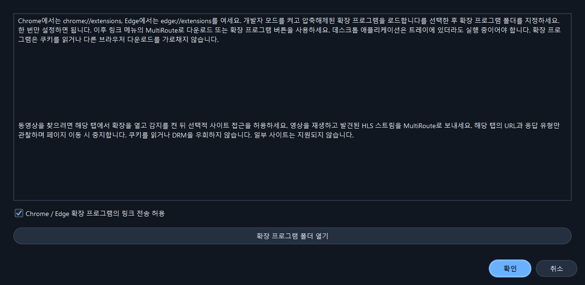
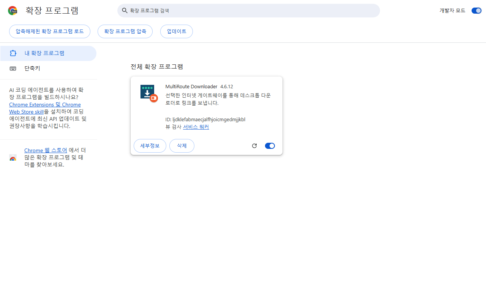
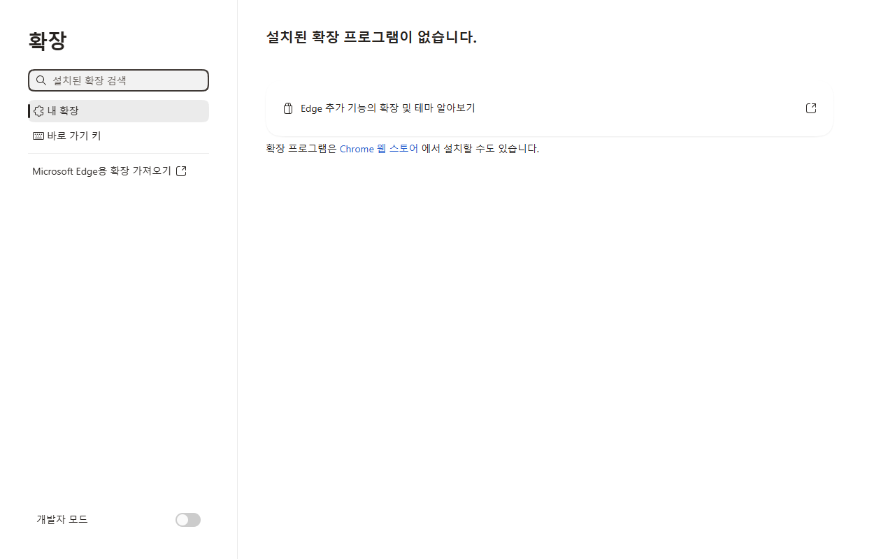
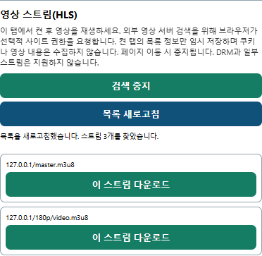
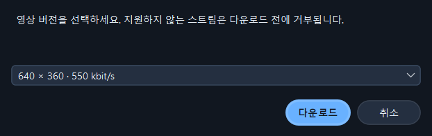
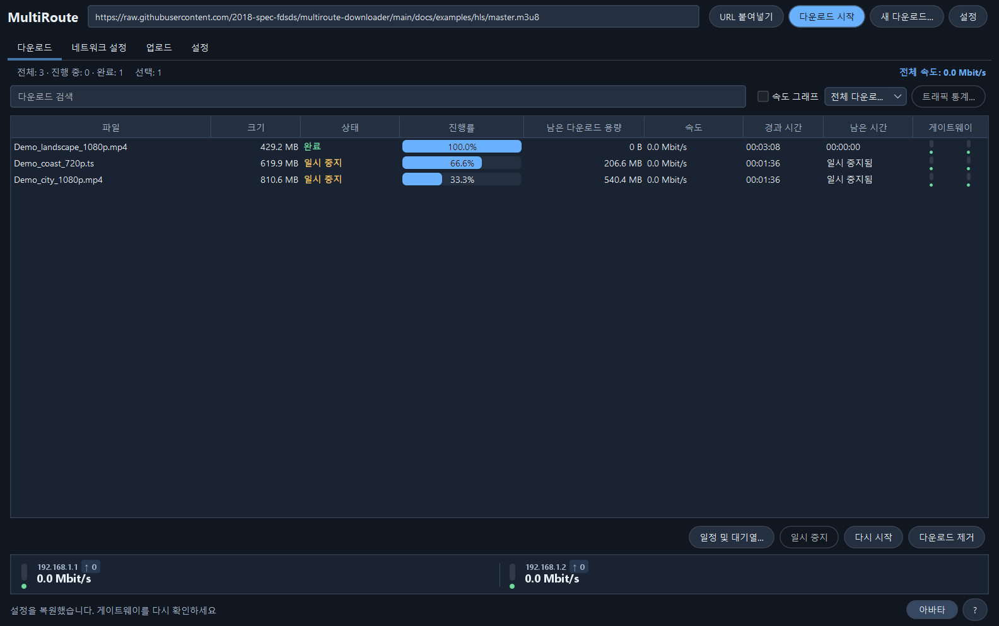

# MultiRoute, Chrome, Edge로 HLS 동영상 다운로드하기

<!-- hls-guide-languages:start -->
<p align="center" dir="ltr">
<a href="HLS-CHROME-EDGE.en.md">English</a> · <a href="HLS-CHROME-EDGE.ru.md">Русский</a> · <a href="HLS-CHROME-EDGE.de.md">Deutsch</a> · <a href="HLS-CHROME-EDGE.es.md">Español</a> · <a href="HLS-CHROME-EDGE.fr.md">Français</a> · <a href="HLS-CHROME-EDGE.zh.md">中文</a><br />
<strong>한국어</strong> · <a href="HLS-CHROME-EDGE.ar.md">العربية</a> · <a href="HLS-CHROME-EDGE.it.md">Italiano</a> · <a href="HLS-CHROME-EDGE.ja.md">日本語</a> · <a href="HLS-CHROME-EDGE.hi.md">हिन्दी</a> · <a href="HLS-CHROME-EDGE.vi.md">Tiếng Việt</a>
</p>
<!-- hls-guide-languages:end -->

> **MultiRoute Downloader 4.5.2 이상**과 HLS 감지를 지원하는 확장 프로그램이 필요합니다. 앱 화면 예시는 **4.6.12**을 사용합니다. 이 안내서를 따라도 오래된 설치 프로그램에 HLS 기능이 추가되지는 않습니다. 앱 버전과 [릴리스 페이지](https://github.com/2018-spec-fdsds/multiroute-downloader/releases)의 패키지를 확인하세요.

HLS 동영상은 재생목록과 여러 작은 미디어 조각으로 구성됩니다. MultiRoute는 사용자가 직접 켠 브라우저 확장 프로그램으로 재생목록을 감지하고, 사용 가능한 화질을 선택하도록 한 뒤, 선택한 게이트웨이로 조각을 다운로드하여 지원하는 동영상 파일로 합칩니다. 웹페이지 주소와 재생목록 주소는 보통 다릅니다.

## 시작하기 전에

- 알맞은 데스크톱 앱을 설치하고 실행하세요. 시스템 트레이에서 실행해 두어도 됩니다.
- 앱에서 다운로드 폴더를 설정하고 선택한 게이트웨이를 확인하세요. 정상 작동하는 게이트웨이 하나면 충분합니다. 독립적인 인터넷 연결이 여러 개라면 조각 다운로드를 나눌 수 있습니다. 사용 가능한 게이트웨이 수와 동시 다운로드 수는 설치한 라이선스에 따라 달라집니다.
- MultiRoute와 같은 컴퓨터에서 Chrome 또는 Chromium 기반 Microsoft Edge를 사용하세요.
- 앱 폴더에서 버전이 맞는 확장 프로그램을 설치하세요. 이 절차는 Chrome 웹 스토어나 Edge 추가 기능 스토어 대신 **압축해제된 확장 프로그램을 로드합니다** 기능을 사용합니다.
- 저장할 권리가 있는 동영상을 선택하세요. 현재는 **암호화되지 않은 주문형 동영상이며 MPEG-TS 또는 fMP4 타임라인이 연속적인 경우**를 지원합니다. 모든 동영상 사이트를 지원하는 범용 다운로더는 아닙니다.

## 1. 데스크톱 연동 켜기

1. MultiRoute → **설정** → **Chrome / Edge…**를 여세요.
2. **Chrome / Edge 확장 프로그램의 링크 전송 허용**을 선택하고 **확인**을 누르세요. 실제 문구는 앱 언어에 따라 표시됩니다.
3. 이 대화상자에서 **확장 프로그램 폴더 열기**를 클릭하세요. 다음 단계에서 사용할 수 있도록 폴더를 열어 두세요.



연동 서비스는 앱의 로컬 API 포트인 **8765**에서 기본적으로 대기하고, 이 프로젝트의 확장 프로그램 출처를 허용합니다. 공개 API 주소나 공유기 포트 전달 규칙은 필요하지 않습니다. 별도의 native messaging host 설치 프로그램도 사용하지 않습니다. 데스크톱 앱을 실행해 두면 확장 프로그램이 루프백 주소의 연동 서비스와 통신합니다.

### macOS에서 폴더 찾기

먼저 **확장 프로그램 폴더 열기**를 사용하세요. 표준 설치의 위치는 다음과 같습니다.

```text
/Applications/MultiRoute Downloader.app/Contents/app/browser-extension
```

브라우저의 폴더 선택 창에서 **⌘⇧G**를 누르고 경로를 붙여 넣은 뒤 폴더를 선택하세요. 또는 Finder의 응용 프로그램에서 **MultiRoute Downloader.app**을 오른쪽 클릭하고 **패키지 내용 보기** → `Contents` → `app` → `browser-extension`으로 이동하세요. 다른 곳에 설치했다면 실제 위치를 사용하세요. `.app` 전체가 아니라 `manifest.json`이 들어 있는 폴더를 선택해야 합니다.

## 2. 브라우저에서 확장 프로그램 로드하기

| Chrome | Microsoft Edge |
|---|---|
| 주소창에 `chrome://extensions`를 입력하세요. | 주소창에 `edge://extensions`를 입력하세요. |
| **개발자 모드**를 켜세요. | **개발자 모드**를 켜세요. |
| **압축해제된 확장 프로그램을 로드합니다**를 클릭하세요. | **압축 풀린 파일 로드**를 클릭하세요. |
| MultiRoute가 연 `browser-extension` 폴더를 선택하세요. | 같은 폴더를 선택하세요. |

버튼을 항상 표시하려면 브라우저 확장 프로그램 메뉴에서 **MultiRoute Downloader**를 고정하세요. 사용하는 브라우저와 프로필마다 따로 설치해야 합니다. 조직에서 관리하는 브라우저는 로컬 확장 프로그램을 제한할 수 있습니다. 관리자 정책을 따르세요.





Edge 화면 예시는 개발자 모드가 **꺼진 상태**의 위치를 보여 줍니다. 먼저 스위치를 켠 다음 표시되는 **압축 풀린 파일 로드** 버튼을 클릭하세요.

이는 [Chrome](https://developer.chrome.com/docs/extensions/get-started/tutorial/hello-world#load-unpacked)과 [Microsoft Edge](https://learn.microsoft.com/en-us/microsoft-edge/extensions/getting-started/extension-sideloading)의 공식 문서에 나온 표준 로컬 설치 절차입니다.

### 이미 설치했다면 확장 프로그램 자체를 다시 로드하세요

앱을 업데이트한 뒤 `chrome://extensions/` 또는 `edge://extensions/`를 여세요. **MultiRoute Downloader 카드**에서 **↻ / 새로고침**을 클릭하세요. Chrome에서 아이콘이 보이지 않으면 개발자 모드를 켜세요. 확장 프로그램 버전이 **4.5.2 이상**인지 확인하고 동영상 페이지로 돌아가 확장 프로그램 도구를 다시 여세요.

도구 창의 **목록 새로고침**은 스트림 메타데이터만 갱신하며, 업데이트된 확장 프로그램 파일을 불러오지 않습니다. 버전이 그대로라면 설치된 확장 프로그램 폴더를 확인하세요. Windows의 표준 폴더는 `%LOCALAPPDATA%\MultiRoute Downloader App\app\browser-extension`입니다. MultiRoute 설정에서 실제 설치 폴더를 여세요.

수정한 뒤에도 Chrome에 이전 오류 기록이 남을 수 있습니다. `Cannot create item with duplicate id multiroute-download`가 다시 보이면 로드된 버전과 다시 로드한 후 새 오류가 발생했는지 확인하세요. 메뉴 중복 등록 문제는 4.5.2에서 수정되었습니다.

## 3. 동영상 재생목록 감지하기

1. 일반 HTTP/HTTPS 탭에서 동영상이 포함된 페이지를 여세요.
2. MultiRoute 확장 프로그램 아이콘을 오른쪽 클릭하고 **확장 프로그램 도구**를 선택하세요. 4.6.12에서는 일반적인 왼쪽 클릭으로 앱의 플로팅 패널이 열립니다. HLS 감지는 확장 프로그램의 도구 창에 있습니다.
3. **영상 스트림(HLS)**에서 **이 탭에서 검색**을 클릭하세요.
4. 감지를 사용하려면 선택적 사이트 접근 권한을 허용하세요. 플레이어 조각이 다른 동영상 서버나 CDN 호스트에서 올 수 있어 브라우저가 여러 웹사이트 접근을 안내할 수 있습니다. 실제 확장 프로그램 감지는 직접 켠 탭으로 한정됩니다.
5. 도구 창을 닫고 **동영상을 재생**하세요. 감지는 이후에 발생하는 재생목록 응답을 관찰합니다. 켜기 전에 불러온 재생목록을 소급하여 찾지는 못합니다.
6. **확장 프로그램 도구**를 다시 여세요. 필요하면 **목록 새로고침**을 클릭하세요. 도구 창이 열린 동안에도 목록은 갱신됩니다.
7. 원하는 스트림을 찾아 **이 스트림 다운로드**를 클릭하세요.

브라우저 권한 창 때문에 확장 프로그램 창이 닫혔다면 허용한 뒤 다시 여세요. 감지가 여전히 꺼져 있다면 **이 탭에서 검색**을 다시 클릭한 다음 동영상을 재생하세요.



페이지가 이미 재생목록을 불러왔다면 페이지를 새로고침하고 도구 창을 다시 여세요. 감지가 켜져 있는지 확인하고 필요하면 다시 켠 뒤 동영상을 재생하세요. **다른 페이지로 이동하면 그 탭의 감지가 꺼집니다.** 탭을 닫아도 감지 상태가 지워집니다. 권한 허용만으로 모든 탭의 감지가 켜지는 것은 아닙니다.

확장 프로그램은 개수를 제한한 재생목록 메타데이터를 임시로 보관합니다. 동영상 본문, 브라우저 쿠키, 인증 요청 헤더를 수집하지 않으며 모든 일반 브라우저 다운로드를 자동으로 가로채지도 않습니다. 사용을 마치면 **검색 중지**를 누르세요.

## 4. MultiRoute에서 화질 선택하기

**이 스트림 다운로드**를 누른 뒤 데스크톱 앱으로 전환하세요. MultiRoute는 현재 저장 폴더, 선택한 게이트웨이, 사이트 프로필을 사용합니다. 재생목록을 확인하면 화질 선택 창이 표시됩니다.

- `1280 × 720 · … kbit/s` 같은 해상도와 비트레이트를 선택한 다음 시작하세요.
- 마스터 재생목록은 여러 화질을 제공할 수 있습니다. 미디어 재생목록은 하나의 소스만 제공할 수도 있습니다.
- 표시된 비트레이트는 동영상 버전을 설명하며 실측 인터넷 속도나 다운로드 속도가 **아닙니다**.
- 낮은 화질을 선택하면 보통 다운로드할 데이터가 줄어듭니다. MultiRoute는 업스케일이나 동영상 변환을 하지 않습니다.
- 저장 확장자는 지원하는 컨테이너에 맞춰 MPEG-TS는 `.ts`, fMP4는 `.mp4`입니다. TS 파일의 이름을 `.mp4`로 바꿔도 형식이 변환되지는 않습니다.



직접 연결되는 `.m3u8` 링크가 있다면 MultiRoute에 붙여 넣어도 됩니다. 확장 프로그램의 감지된 스트림 버튼은 URL이 `.m3u8`로 끝나지 않는 HLS 응답도 식별합니다. 이 HLS 절차에는 재생목록 주소가 필요합니다. HTML 시청 페이지 주소만으로 `.m3u8`을 알아내지는 못합니다. 지원하는 동영상 사이트 페이지의 처리는 별도 작업 흐름입니다.

## 5. 진행 확인, 일시 중지, 재개 및 로그 검사

작업은 **다운로드**에 표시됩니다. 작업을 선택하여 **일시 중지**와 **다시 시작**을 사용하세요. MultiRoute는 완료한 조각을 저장하고 재사용 전에 기록을 확인합니다. 최종 조립은 게이트웨이 완료 순서가 아니라 재생목록 순서대로 이루어집니다.



개별 작업의 자세한 설명은 작업을 오른쪽 클릭하여 다운로드 로그를 여세요. 조각 다운로드, 재사용 및 오류 기록을 확인할 수 있습니다. 앱 전체 로그만이 조사 대상은 아닙니다. 완료 후에도 로그가 도움이 됩니다.

재개하려면 호환되는 동일한 소스, 화질, 재생목록이 필요합니다. 사이트의 재생목록, 서명된 조각 URL, 화질이 바뀌면 안전한 재사용이 어려울 수 있습니다. 완료된 조각의 로컬 해시는 저장된 조각의 재사용을 보호합니다. 사이트가 배포자 체크섬을 제공하지 않았다면 이를 대신 제공하지는 않습니다. 나중에 계속하려면 작업과 저장된 조각 데이터를 유지하세요.

## 문제 해결

| 증상 | 확인할 사항 |
|---|---|
| 동영상 스트림이 없음 | 재생 **전**에 감지를 켜세요. 재생하거나 페이지를 새로고침한 뒤 도구 창을 다시 여세요. 사이트 권한과 탭 감지 상태를 확인하세요. 플레이어가 MP4, DASH, 캐시된 재생목록 또는 미지원 형식을 사용할 수 있습니다. |
| 감지가 꺼짐 | 페이지 이동 후 다시 켜세요. 권한 허용과 탭별 감지 설정은 별개입니다. |
| 창에 시청 페이지 URL만 표시됨 | 일반 URL 입력란이며 HLS 감지의 증거가 아닙니다. **영상 스트림(HLS)** 목록을 사용하세요. |
| 스트림을 보낼 수 없음 | 앱을 켜 두고 Chrome/Edge 연동을 활성화하세요. **애플리케이션 API 포트**를 앱의 포트와 맞추세요. 기본값은 8765입니다. |
| HTTP 401/403 또는 만료된 링크 | 사이트가 새 서명 URL이나 인증 요청을 요구할 수 있습니다. 접근 권한이 있는 페이지를 다시 열어 새 재생목록을 찾으세요. 확장 프로그램은 브라우저 쿠키를 **전송하지 않습니다**. 앱의 사이트 프로필은 별도 설정이며 모든 사이트의 호환성을 보장하지 않습니다. |
| 미지원 HLS 재생목록 | DRM, AES-128을 포함한 암호화 HLS, 라이브 및 저지연 스트림, 불연속 타임라인, 외부 오디오/비디오 트랙은 지원 범위 밖입니다. 재시도로 미지원 스트림이 변환되지는 않습니다. |
| 재생되지만 다운로드되지 않음 | 브라우저 재생과 데스크톱 요청은 인증 정보나 게이트웨이가 다를 수 있습니다. 작업 로그와 게이트웨이 상태를 확인하세요. |
| 다운로드 중단 | 재개하기 전에 작업 로그, 여유 공간, 재시도 설정, 선택한 게이트웨이를 확인하세요. 불필요하게 새 작업을 만들거나 조각을 삭제하지 마세요. |
| 앱 업데이트 후 확장 프로그램의 버튼이 예전 상태임 | `chrome://extensions` 또는 `edge://extensions`의 MultiRoute 카드에서 **새로고침**을 클릭하세요. 현재 앱의 확장 프로그램 폴더를 가리키는지 확인하고 동영상 페이지를 다시 여세요. |

## GitHub의 준비된 예제 시험하기

직접 생성한 **12초 테스트 동영상**은 합성 이미지와 소리로 구성되며 **180p / 300 kbit/s**, **360p / 550 kbit/s** 두 버전을 제공합니다. 이 수치는 선언된 버전 대역폭이며 실측 인터넷 속도가 아닙니다.

1. [저장소의 예제 설명](../examples/hls/README.md) 또는 [재생 페이지](https://hlsjs.video-dev.org/demo/?src=https%3A%2F%2Fraw.githubusercontent.com%2F2018-spec-fdsds%2Fmultiroute-downloader%2Fmain%2Fdocs%2Fexamples%2Fhls%2Fmaster.m3u8)를 여세요. 외부 플레이어는 공식 hls.js 데모이며, 미디어 파일은 이 GitHub 저장소에 있습니다.
2. 해당 탭의 MultiRoute 감지를 켜세요. 매니페스트가 먼저 로드됐다면 페이지를 새로고침하고 감지 상태를 확인하여 필요하면 다시 켜세요.
3. 재생을 시작하고 **확장 프로그램 도구**를 열어 **목록 새로고침**을 클릭하세요.
4. **master.m3u8** → **이 스트림 다운로드**를 선택하세요. `180p/video.m3u8`와 `360p/video.m3u8`는 개별 버전이므로 하나를 선택하면 다른 화질은 제공되지 않습니다.
5. MultiRoute에서 **320 × 180** 또는 **640 × 360**을 선택하고 시작하세요. 영상과 음성이 포함된 약 12초짜리 **.ts** 파일을 얻습니다. 파일 크기는 화질에 따라 달라집니다.

확장 프로그램 없이 시험하려면 다음 직접 재생목록 URL을 MultiRoute에 붙여 넣으세요.

```text
https://raw.githubusercontent.com/2018-spec-fdsds/multiroute-downloader/main/docs/examples/hls/master.m3u8
```

이것은 재생목록 URL이며 GitHub HTML 페이지가 아닙니다. GitHub에서 master.m3u8을 보기만 해서는 동영상이 재생되지 않고 브라우저 감지도 시험되지 않습니다. 작은 예제는 일시 중지하기 전에 완료될 수 있습니다. 중단과 재개는 다운로드할 권리가 있는 더 긴 콘텐츠로 시험하세요.

확장 프로그램 화면은 같은 스트림의 로컬 사본을 사용하므로 목록에 `127.0.0.1`이 표시됩니다. 실제 영상에서는 해당 영상의 호스트가 표시됩니다. MultiRoute 작업 화면은 개인 다운로드 기록이 아닌 시연 작업을 사용합니다. 이 한국어 안내서의 브라우저와 앱 화면은 한국어입니다. Edge 화면에서 보이는 개발자 모드를 먼저 켠 다음 압축 풀린 파일 로드를 선택하세요. 테스트 미디어는 [CC0](../examples/hls/README.md#license--лицензия)로 제공되며 앱 라이선스에는 영향을 주지 않습니다.

## 검증 범위

자체 테스트 환경에서는 실제 HLS 영상과 음성 재생, 확장 프로그램 감지, 선택한 URL을 자체 테스트 수신기로 전달하는 동작을 확인했습니다. 별도의 엔진 테스트에서는 저장된 조각 확인과 재개, 순서, TS/MP4 출력 디코딩을 확인했습니다. 모든 사이트, 인증 절차 또는 네트워크 속도 향상을 보장하지는 않습니다.

주요 공식 자료: [Chrome 로컬 로드](https://developer.chrome.com/docs/extensions/get-started/tutorial/hello-world#load-unpacked), [Edge 로컬 로드](https://learn.microsoft.com/en-us/microsoft-edge/extensions/getting-started/extension-sideloading), [공식 hls.js 플레이어](https://github.com/video-dev/hls.js), [HLS / RFC 8216](https://www.rfc-editor.org/rfc/rfc8216).
