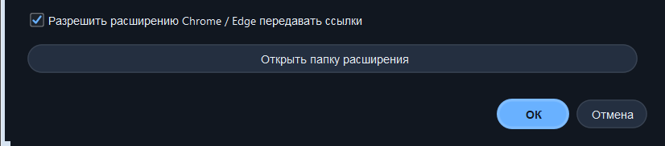
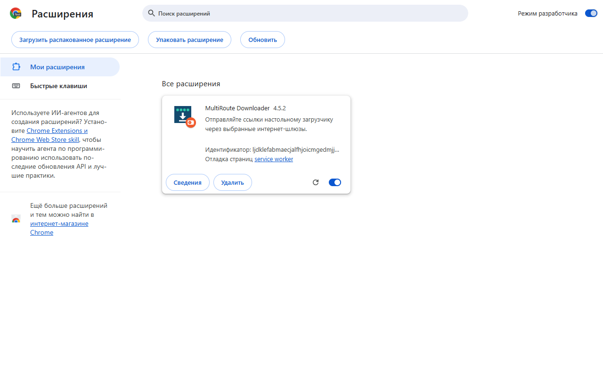
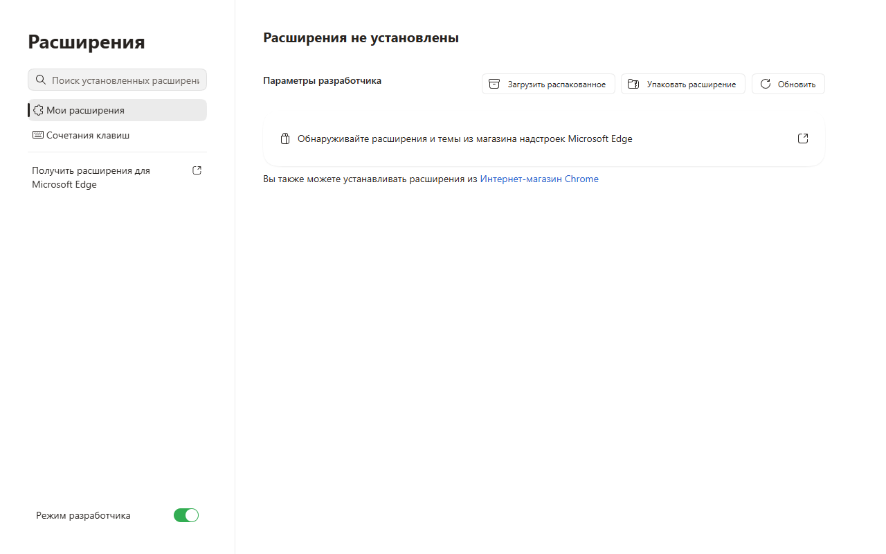
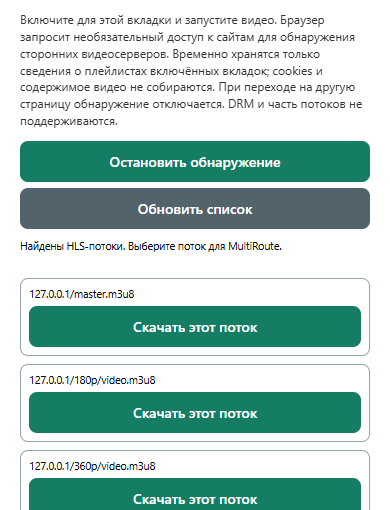
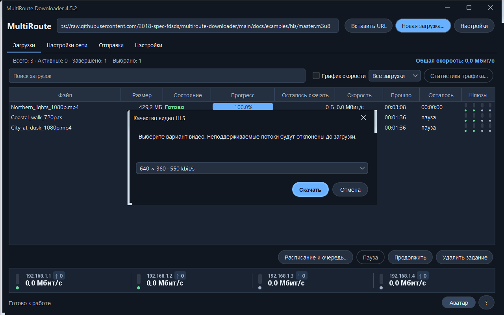
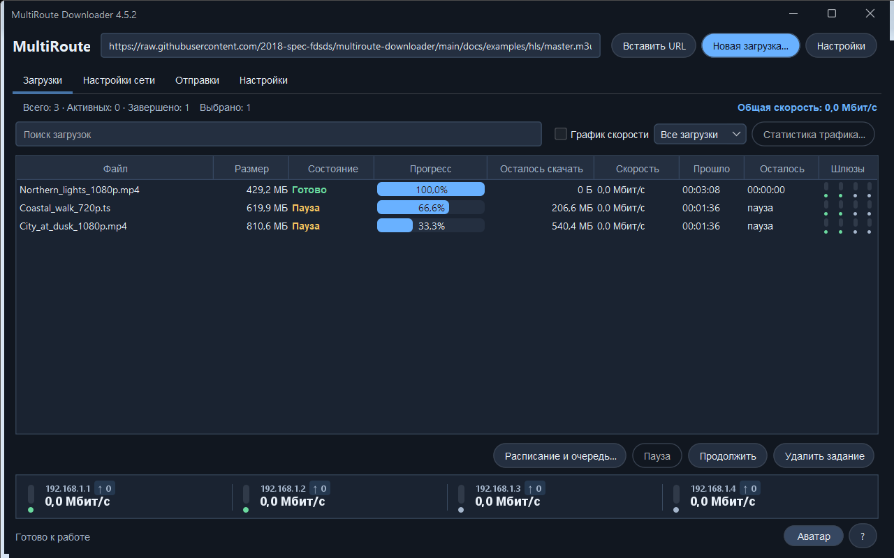

# Скачивание HLS-видео через MultiRoute, Chrome и Edge

[English](HLS-CHROME-EDGE.en.md)

> Требуется **MultiRoute Downloader 4.5.2 или новее** и расширение с обнаружением HLS. Иллюстрации интерфейса сняты в 4.5.2. Установщики старых версий не получают HLS от наличия этой инструкции; проверьте номер своего приложения и доступные пакеты на [странице релизов](https://github.com/2018-spec-fdsds/multiroute-downloader/releases).

HLS-видео состоит из плейлиста и множества небольших медиафрагментов. Расширение по вашему запросу обнаруживает плейлист, MultiRoute предлагает доступное качество, скачивает фрагменты через выбранные шлюзы и собирает поддерживаемый видеофайл. Адрес страницы с плеером обычно отличается от адреса плейлиста.

## Что потребуется

- Установленное и запущенное приложение соответствующей версии. Оно может оставаться в трее.
- Выбранная папка сохранения и проверенные шлюзы. Достаточно одного рабочего шлюза; несколько независимых подключений позволяют распределить скачивание фрагментов. Количество доступных шлюзов и одновременных закачек зависит от лицензии установки.
- Chrome или Microsoft Edge на основе Chromium на том же компьютере, где работает MultiRoute.
- Расширение из папки приложения. Здесь используется **загрузка распакованного расширения**, а не установка из Chrome Web Store или Edge Add-ons.
- Видео, которое вы вправе сохранять. Текущая реализация поддерживает **незашифрованное видео по запросу с непрерывной временной шкалой MPEG-TS или fMP4**. Поддержка HLS не означает поддержку любого видеосайта.

## 1. Разрешите передачу ссылок в приложение

1. В MultiRoute откройте вкладку **Настройки**, прокрутите вниз и нажмите **Chrome / Edge…**.
2. Отметьте **Разрешить расширению Chrome / Edge передавать ссылки** и подтвердите **OK**.
3. В этом же окне нажмите **Открыть папку расширения**. Она понадобится далее.



Расширение обращается к локальному API приложения, обычно на порту **8765**. Публичный адрес API и проброс порта на роутере не нужны. Отдельный установщик native messaging в этой схеме не требуется: настольное приложение остаётся запущенным, а расширение использует его локальный интерфейс передачи ссылок.

### Где находится папка на macOS

Сначала используйте **Открыть папку расширения**. При стандартной установке путь такой:

```text
/Applications/MultiRoute Downloader.app/Contents/app/browser-extension
```

В окне выбора папки браузера нажмите **⌘⇧G**, вставьте путь и выберите папку. Другой способ: Finder → Программы → правой кнопкой по **MultiRoute Downloader.app** → **Показать содержимое пакета** → `Contents` → `app` → `browser-extension`. Если приложение установлено в другом месте, используйте его фактический путь. Выбирать нужно папку с `manifest.json`, а не весь пакет `.app`.

## 2. Установите расширение в Chrome или Edge

| Chrome | Microsoft Edge |
|---|---|
| Введите в адресной строке `chrome://extensions`. | Введите в адресной строке `edge://extensions`. |
| Включите **Режим разработчика**. | Включите **Режим разработчика**. |
| Нажмите **Загрузить распакованное расширение**. | Нажмите **Загрузить распакованное**. |
| Выберите папку `browser-extension`, открытую из MultiRoute. | Выберите ту же папку. |

При желании закрепите кнопку **MultiRoute Downloader** через меню расширений браузера. Для каждого браузера и профиля установка выполняется отдельно. На рабочем компьютере локальные расширения могут ограничиваться политикой администратора.

На снимке Chrome включён режим разработчика; нужная кнопка — **Load unpacked / Загрузить распакованное**.



В Edge переключатель находится внизу слева; после включения сверху появляется **Загрузить распакованное**.



Это стандартная процедура локальной установки из документации [Chrome](https://developer.chrome.com/docs/extensions/get-started/tutorial/hello-world#load-unpacked) и [Microsoft Edge](https://learn.microsoft.com/en-us/microsoft-edge/extensions/getting-started/extension-sideloading).

### Если расширение уже установлено — обновите именно его

После обновления приложения откройте `chrome://extensions/` (Chrome) либо `edge://extensions/` (Edge). Найдите **карточку MultiRoute Downloader** и нажмите в ней **↻ / Перезагрузить**. В Chrome значок виден при включённом «Режиме разработчика». Проверьте версию расширения **4.5.2 или новее**, затем вернитесь на страницу с видео и откройте расширение заново.

Кнопка **«Обновить список» внутри окна расширения** перечитывает список потоков; она не загружает новую версию расширения. Если после ↻ номер версии остаётся старым, проверьте путь загруженной папки: при стандартной Windows-установке это `%LOCALAPPDATA%\MultiRoute Downloader App\app\browser-extension`; путь своей установки можно открыть из настроек MultiRoute.

Старые записи в разделе ошибок Chrome могут оставаться после исправления. Если снова появляется `Cannot create item with duplicate id multiroute-download`, проверьте номер версии и возникает ли ошибка заново после обновления; в 4.5.2 исправлена повторная регистрация этого пункта меню.

## 3. Найдите видеоплейлист

1. Откройте страницу с видео в обычной HTTP/HTTPS-вкладке.
2. Нажмите кнопку расширения MultiRoute.
3. В разделе **Видеопотоки (HLS)** нажмите **Обнаруживать в этой вкладке** (**Detect in this tab** в английском интерфейсе).
4. Подтвердите дополнительный доступ к сайтам, если хотите использовать обнаружение. Браузер может упомянуть множество сайтов: видеоплеер часто получает данные с другого домена/CDN. При этом само расширение наблюдает только вкладки, в которых вы включили обнаружение.
5. Закройте всплывающее окно и **запустите видео**. Наблюдение видит будущие ответы с плейлистами; ранее загруженный плейлист оно задним числом не обнаружит.
6. Снова откройте расширение. При необходимости нажмите **Обновить список** (**Refresh list**). Пока окно открыто, список также обновляется периодически.
7. У нужного потока нажмите **Скачать этот поток** (**Download this stream**).


Если запрос разрешения браузера закрыл окно расширения, после подтверждения откройте его снова. Если обнаружение осталось выключенным, повторно нажмите **Обнаруживать в этой вкладке**, затем запустите видео.



Если плеер успел загрузить плейлист до включения обнаружения, перезагрузите страницу, откройте расширение, проверьте состояние обнаружения и при необходимости включите его повторно, затем запустите видео. **Переход на другую страницу выключает обнаружение для этой вкладки.** Закрытие вкладки также очищает её состояние. Разрешение браузера само по себе не включает наблюдение во всех вкладках.

Расширение временно хранит ограниченный список сведений о плейлистах. Оно не захватывает содержимое видео, cookies браузера или заголовки авторизации. Оно не перехватывает автоматически все обычные скачивания браузера. Закончив, нажмите **Остановить обнаружение** (**Stop detection**).

## 4. Выберите качество в MultiRoute

После отправки потока перейдите в настольное приложение. Используются его текущие папка сохранения, выбранные шлюзы и профиль сайта. После чтения плейлиста появится выбор качества.

- Выберите разрешение и битрейт, например `1280 × 720 · … kbit/s`, и запустите закачку.
- Главный плейлист может предлагать несколько вариантов. У плейлиста отдельного качества выбор может быть единственным.
- Битрейт в списке характеризует вариант видео, а **не** измеренную скорость вашего интернет-канала.
- Меньшее качество обычно уменьшает объём скачивания. Приложение не повышает разрешение и не перекодирует видео.
- Расширение результата соответствует контейнеру: `.ts` для MPEG-TS или `.mp4` для fMP4. Переименование TS-файла в `.mp4` не преобразует его содержимое.



Если у вас уже есть прямая ссылка `.m3u8`, её можно вставить непосредственно в MultiRoute. Кнопка отправки обнаруженного потока также распознаёт HLS, если адрес не заканчивается на `.m3u8`. Отправка обычного HTML-адреса страницы просмотра через основную кнопку передачи ссылки не заставляет настольное приложение извлекать из страницы видеоплеер.

## 5. Смотрите прогресс, ставьте на паузу и продолжайте

Задание появится в разделе **Загрузки**. Для выбранного задания доступны **Пауза** и **Продолжить**. MultiRoute сохраняет готовые фрагменты и проверяет записи о них перед повторным использованием. Сборка выполняется в порядке плейлиста, а не в порядке окончания скачивания через разные шлюзы.



Чтобы понять ход конкретной закачки, нажмите по заданию правой кнопкой мыши и откройте индивидуальный лог скачивания. Там полезно смотреть записи загрузки, повторного использования фрагментов и ошибок. Лог доступен и после завершения задания.


Для докачки необходимы совместимые исходный плейлист и выбранное качество. Изменение плейлиста, подписанных адресов фрагментов или качества может помешать безопасному повторному использованию данных. Локальные хеши фрагментов проверяют сохранённые части, но не заменяют контрольную сумму издателя, если сайт её не публикует. Сохраняйте само задание и его фрагменты, если планируете продолжение.

## Если не получилось

| Что происходит | Что проверить |
|---|---|
| Список потоков пуст | Включите обнаружение до воспроизведения, запустите или перезагрузите видео, снова откройте расширение. Проверьте разрешения и состояние вкладки. Возможно, используется MP4, DASH, кешированный плейлист или другой формат. |
| Обнаружение выключилось | Включите повторно после перехода на другую страницу. Разрешение браузера и наблюдение за конкретной вкладкой — отдельные состояния. |
| В поле ссылки только адрес страницы | Это обычное поле URL, а не подтверждение обнаружения HLS. Нужен список видеопотоков HLS ниже. |
| Не удалось передать ссылку | Запустите MultiRoute, разрешите Chrome/Edge-интеграцию и проверьте совпадение порта API. По умолчанию это 8765. |
| HTTP 401/403 или ссылка устарела | Сайту может требоваться свежая подписанная ссылка или авторизация. Откройте разрешённую страницу повторно и обнаружьте новый плейлист. Cookies браузера не передаются. Профиль сайта в приложении настраивается отдельно и не гарантирует совместимость с любым сайтом. |
| Неподдерживаемый HLS-плейлист | DRM, шифрование HLS, включая AES-128, прямые эфиры/LL-HLS, разрывы временной шкалы и внешние аудио-/видеодорожки в текущий поддерживаемый сценарий не входят. Повтор не преобразует неподдерживаемый формат. |
| В браузере играет, приложение не скачивает | У браузера и приложения разные данные авторизации и, возможно, разные шлюзы. Проверьте индивидуальный лог и доступность шлюзов. |
| Загрузка остановилась | Сначала проверьте лог задания, свободное место, настройки повторов и шлюзы. Без необходимости не создавайте новое задание и не удаляйте фрагменты. |
| После обновления старые кнопки расширения | На странице `chrome://extensions` или `edge://extensions` нажмите перезагрузку расширения MultiRoute. Убедитесь, что выбрана папка текущей версии приложения. Затем снова откройте видеостраницу. |

## Повторите на готовом примере с GitHub

Мы подготовили **12-секундный тестовый ролик** с синтетической картинкой и тональным звуком. Два варианта: **180p / 300 кбит/с** и **360p / 550 кбит/с**. Это объявленная пропускная способность варианта, не измерение скорости Интернета.

1. [Откройте пример в репозитории](../examples/hls/README.md) либо сразу [его страницу воспроизведения](https://hlsjs.video-dev.org/demo/?src=https%3A%2F%2Fraw.githubusercontent.com%2F2018-spec-fdsds%2Fmultiroute-downloader%2Fmain%2Fdocs%2Fexamples%2Fhls%2Fmaster.m3u8). Внешний проигрыватель — официальный пример проекта hls.js, а медиафайлы размещены в нашем GitHub.
2. После открытия страницы включите обнаружение MultiRoute именно для этой вкладки. Если плейлист успел загрузиться раньше — обновите страницу, проверьте состояние обнаружения и включите его снова при необходимости.
3. Запустите воспроизведение. Откройте расширение и нажмите **Обновить список**.
4. Выберите строку **master.m3u8** → **Скачать этот поток**. Строки `180p/video.m3u8` и `360p/video.m3u8` — отдельные варианты; выбор одного из них не предложит другое качество.
5. В MultiRoute выберите **320 × 180** или **640 × 360** и начните загрузку. Ожидаемый результат этого примера — короткий файл **.ts**, с изображением и звуком, длительностью около 12 секунд. Размер зависит от качества.

Для проверки без расширения скопируйте прямую ссылку и вставьте в MultiRoute:

```text
https://raw.githubusercontent.com/2018-spec-fdsds/multiroute-downloader/main/docs/examples/hls/master.m3u8
```

Это ссылка на **плейлист**, а не HTML-страницу GitHub. Просмотр файла `master.m3u8` на странице репозитория не запускает видео и сам по себе не проверяет обнаружение браузером. Короткий пример может завершиться до того, как вы нажмёте паузу; проверяйте паузу/докачку на более длинном разрешённом вам видео.

Скриншоты расширения сделаны на локальной копии этого же тестового потока; поэтому в списке виден `127.0.0.1`. Ваша страница покажет адрес своего видеосервера. Изображения рабочего пространства MultiRoute содержат демонстрационные задания, не пользовательскую историю. Подписи браузера зависят от его языка. Наш пример можно использовать для тестирования по [CC0](../examples/hls/README.md#license--лицензия); это не меняет лицензию приложения.

## Что именно проверено

На собственных данных проверены воспроизведение HLS с картинкой и звуком, обнаружение плейлистов расширением и передача выбранной ссылки тестовому приёмнику. В отдельной проверке движка — сохранение и сверка фрагментов при продолжении, их порядок и корректное декодирование TS/MP4. Это не обещание совместимости любого сайта, прохождения его авторизации или ускорения на любой сети.

Первоисточники: [локальная установка Chrome](https://developer.chrome.com/docs/extensions/get-started/tutorial/hello-world#load-unpacked), [локальная установка Edge](https://learn.microsoft.com/en-us/microsoft-edge/extensions/getting-started/extension-sideloading), [официальный проигрыватель hls.js](https://github.com/video-dev/hls.js), [HLS / RFC 8216](https://www.rfc-editor.org/rfc/rfc8216).
