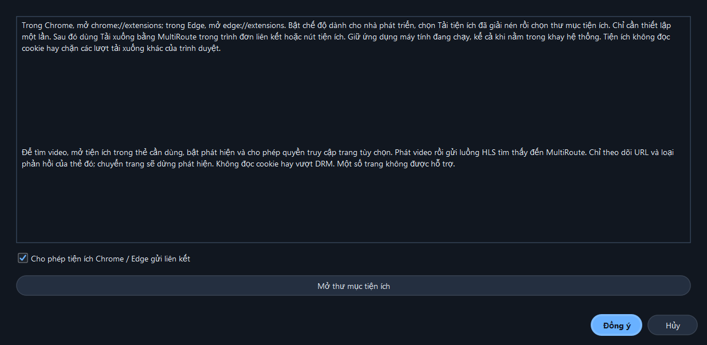
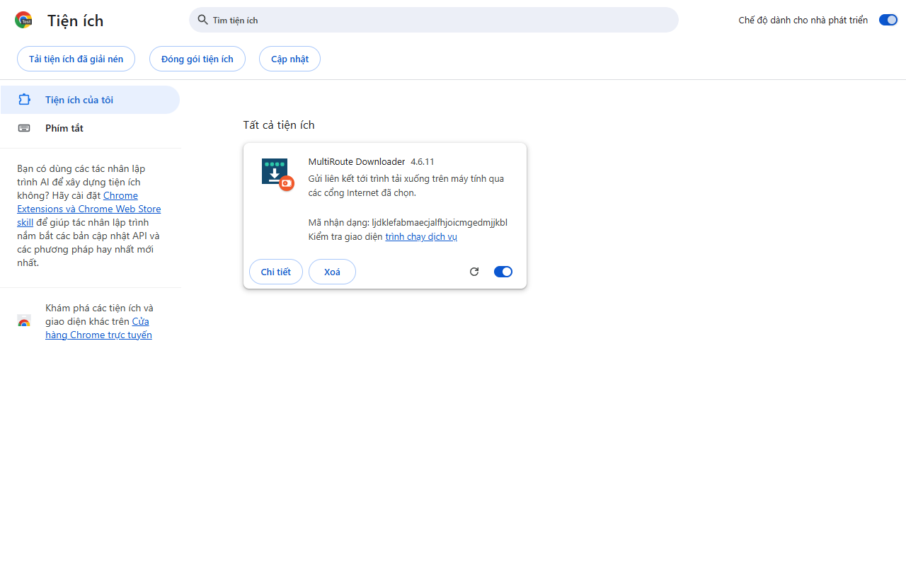
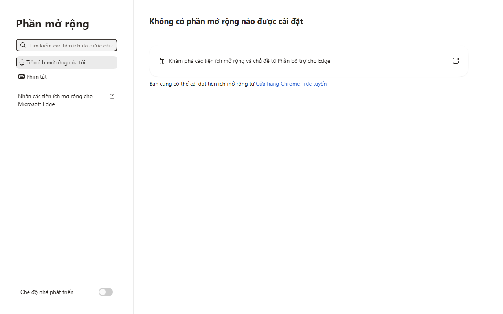
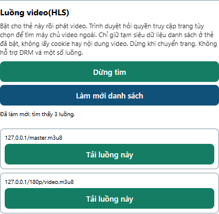
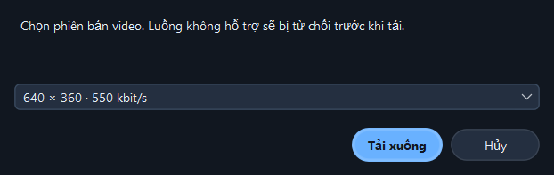
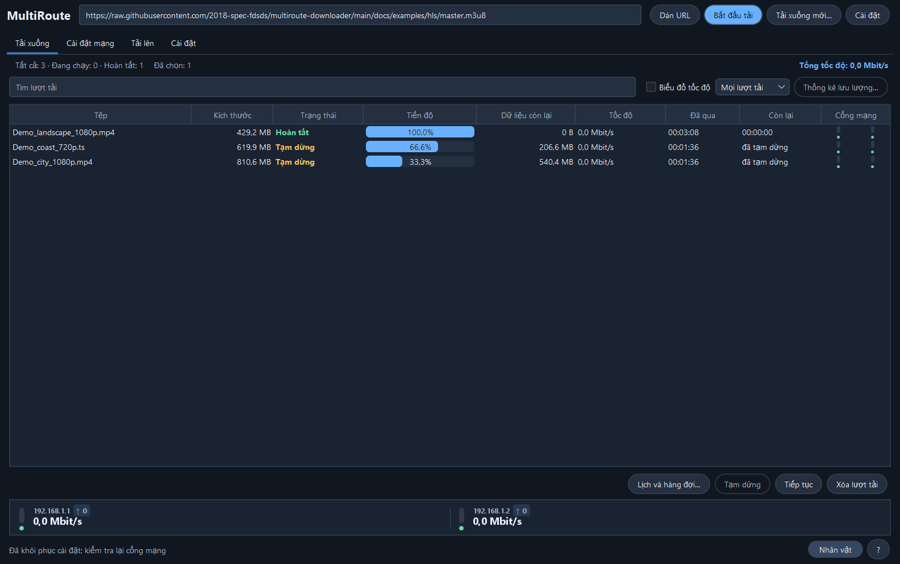

# Tải video HLS bằng MultiRoute, Chrome và Edge

<!-- hls-guide-languages:start -->
<p align="center" dir="ltr">
<a href="HLS-CHROME-EDGE.en.md">English</a> · <a href="HLS-CHROME-EDGE.ru.md">Русский</a> · <a href="HLS-CHROME-EDGE.de.md">Deutsch</a> · <a href="HLS-CHROME-EDGE.es.md">Español</a> · <a href="HLS-CHROME-EDGE.fr.md">Français</a> · <a href="HLS-CHROME-EDGE.zh.md">中文</a><br />
<a href="HLS-CHROME-EDGE.ko.md">한국어</a> · <a href="HLS-CHROME-EDGE.ar.md">العربية</a> · <a href="HLS-CHROME-EDGE.it.md">Italiano</a> · <a href="HLS-CHROME-EDGE.ja.md">日本語</a> · <a href="HLS-CHROME-EDGE.hi.md">हिन्दी</a> · <strong>Tiếng Việt</strong>
</p>
<!-- hls-guide-languages:end -->


> Cần **MultiRoute Downloader 4.5.2 trở lên** cùng tiện ích có chức năng phát hiện HLS. Hình minh họa ứng dụng dùng bản **4.6.11**. Hướng dẫn này không bổ sung HLS cho các bộ cài cũ; hãy kiểm tra phiên bản ứng dụng và các gói trên [trang phát hành](https://github.com/2018-spec-fdsds/multiroute-downloader/releases).

Video HLS gồm một danh sách phát và nhiều đoạn dữ liệu phương tiện nhỏ. MultiRoute phát hiện danh sách qua tiện ích trình duyệt khi bạn chủ động bật chức năng này, cho phép chọn chất lượng sẵn có, tải các đoạn qua những cổng mạng đã chọn rồi ghép thành tệp video thuộc định dạng được hỗ trợ. Địa chỉ trang web thường khác với địa chỉ danh sách phát.

## Trước khi bắt đầu

- Cài đặt và chạy ứng dụng máy tính tương ứng. Ứng dụng có thể nằm trong khay hệ thống.
- Chọn thư mục tải xuống và kiểm tra các cổng mạng đã chọn trong ứng dụng. Một cổng hoạt động là đủ; nhiều kết nối Internet độc lập có thể chia sẻ việc tải các đoạn. Số cổng mạng và số lượt tải đồng thời phụ thuộc giấy phép đã cài.
- Dùng Chrome hoặc Microsoft Edge dựa trên Chromium trên cùng máy tính chạy MultiRoute.
- Cài tiện ích tương ứng từ thư mục ứng dụng. Quy trình này dùng **Tải tiện ích đã giải nén**, không cài qua danh mục Chrome Web Store hay Edge Add-ons.
- Chọn video mà bạn có quyền lưu. Bản triển khai hiện tại hỗ trợ **video theo yêu cầu không mã hóa, có dòng thời gian MPEG-TS hoặc fMP4 liên tục**. Đây không phải công cụ tải được mọi trang video.

## 1. Bật cầu nối của ứng dụng máy tính

1. Mở MultiRoute → **Cài đặt** → **Chrome / Edge…**.
2. Đánh dấu **Cho phép tiện ích Chrome / Edge gửi liên kết**, sau đó nhấn **OK**. Câu chữ thực tế thay đổi theo ngôn ngữ ứng dụng.
3. Trong hộp thoại đó, nhấn **Mở thư mục tiện ích**. Giữ thư mục sẵn để dùng ở bước tiếp theo.



Cầu nối lắng nghe trên cổng API cục bộ của ứng dụng, thường là **8765**, và chấp nhận origin của tiện ích thuộc dự án này. Không cần địa chỉ API công cộng hay quy tắc chuyển tiếp cổng trên bộ định tuyến. Quy trình này không có bộ cài native-messaging-host riêng: ứng dụng máy tính tiếp tục chạy và tiện ích giao tiếp với cầu nối loopback của nó.

### Tìm thư mục trên macOS

Trước hết dùng **Mở thư mục tiện ích**. Với cách cài đặt thông thường, thư mục nằm tại:

```text
/Applications/MultiRoute Downloader.app/Contents/app/browser-extension
```

Trong hộp chọn thư mục của trình duyệt, nhấn **⌘⇧G**, dán đường dẫn rồi chọn thư mục. Hoặc trong Finder chọn Applications → nhấp chuột phải vào **MultiRoute Downloader.app** → **Show Package Contents** → `Contents` → `app` → `browser-extension`. Nếu cài ứng dụng nơi khác, dùng vị trí thực tế. Chọn thư mục chứa `manifest.json`, không chọn toàn bộ gói `.app`.

## 2. Nạp tiện ích vào trình duyệt

| Chrome | Microsoft Edge |
|---|---|
| Nhập `chrome://extensions` vào thanh địa chỉ. | Nhập `edge://extensions` vào thanh địa chỉ. |
| Bật **Chế độ dành cho nhà phát triển**. | Bật **Chế độ nhà phát triển**. |
| Nhấn **Tải tiện ích đã giải nén**. | Nhấn **Tải tiện ích đã giải nén**. |
| Chọn thư mục `browser-extension` do MultiRoute mở. | Chọn cùng thư mục đó. |

Ghim **MultiRoute Downloader** từ menu Tiện ích của trình duyệt nếu muốn nút luôn hiện. Cài riêng trong từng trình duyệt/hồ sơ bạn sử dụng. Trình duyệt do tổ chức quản lý có thể hạn chế tiện ích cục bộ; hãy tuân theo chính sách quản trị viên.





Đây là các quy trình cài cục bộ tiêu chuẩn được [Chrome](https://developer.chrome.com/docs/extensions/get-started/tutorial/hello-world#load-unpacked) và [Microsoft Edge](https://learn.microsoft.com/en-us/microsoft-edge/extensions/getting-started/extension-sideloading) hướng dẫn. Hình Edge chụp khi chế độ nhà phát triển còn tắt; bật chế độ đó để nút tải tiện ích đã giải nén xuất hiện.

### Đã cài trước đó? Tải lại chính tiện ích

Sau khi cập nhật ứng dụng, mở `chrome://extensions/` hoặc `edge://extensions/`. Tìm **thẻ MultiRoute Downloader** và nhấn **↻ / Tải lại**. Trong Chrome, bật chế độ nhà phát triển nếu biểu tượng bị ẩn. Xác nhận tiện ích có phiên bản **4.5.2 trở lên**, trở lại trang video rồi mở lại công cụ tiện ích.

**Làm mới danh sách bên trong cửa sổ công cụ** chỉ cập nhật siêu dữ liệu luồng; nó không nạp các tệp tiện ích mới. Nếu phiên bản vẫn cũ, kiểm tra thư mục tiện ích đang được nạp. Thư mục Windows thông thường là `%LOCALAPPDATA%\MultiRoute Downloader App\app\browser-extension`; hãy mở thư mục cài đặt thực tế từ cài đặt MultiRoute.

Chrome có thể giữ lại bản ghi lỗi cũ sau khi lỗi đã được sửa. Nếu lại thấy `Cannot create item with duplicate id multiroute-download`, hãy kiểm tra phiên bản đang nạp và xem có lỗi mới phát sinh sau khi tải lại hay không. Việc đăng ký menu lặp đã được sửa trong 4.5.2.

## 3. Phát hiện danh sách phát video

1. Mở trang chứa video trong một thẻ HTTP/HTTPS thông thường.
2. Nhấp chuột phải vào biểu tượng tiện ích MultiRoute và chọn **Công cụ tiện ích**. Trong 4.6.11, nhấp trái thông thường mở bảng nổi của ứng dụng; chức năng phát hiện HLS nằm trong cửa sổ công cụ tiện ích.
3. Trong **Luồng video(HLS)**, nhấn **Tìm trong thẻ này**.
4. Chấp nhận quyền truy cập website tùy chọn nếu muốn phát hiện luồng. Trình duyệt có thể nhắc đến quyền truy cập nhiều website vì các đoạn của trình phát có thể đến từ máy chủ video/CDN khác. Tuy nhiên, tiện ích chỉ phát hiện trong những thẻ bạn đã bật rõ ràng.
5. Đóng cửa sổ công cụ rồi **phát video**. Chức năng này theo dõi các phản hồi danh sách phát trong tương lai; không thể phát hiện ngược một danh sách đã được nạp trước khi bạn bật nó.
6. Mở lại **Công cụ tiện ích**. Nhấn **Làm mới danh sách** nếu cần. Danh sách cũng tự cập nhật khi cửa sổ đang mở.
7. Tìm luồng phù hợp và nhấn **Tải luồng này**.

Nếu hộp thoại xin quyền của trình duyệt đóng cửa sổ công cụ, hãy mở lại sau khi cấp quyền. Nếu phát hiện vẫn tắt, nhấn **Tìm trong thẻ này** lần nữa rồi phát video.



Nếu trang đã nạp danh sách phát, hãy tải lại trang, mở lại công cụ, kiểm tra chức năng phát hiện còn bật hay không và bật lại nếu cần, sau đó phát video. **Điều hướng sang trang khác sẽ tắt phát hiện cho thẻ đó.** Đóng thẻ cũng xóa trạng thái phát hiện. Đừng cho rằng việc cấp quyền sẽ tự bật tất cả các thẻ.

Tiện ích chỉ giữ tạm một danh sách siêu dữ liệu danh sách phát có giới hạn. Nó không thu nội dung video, cookie trình duyệt hoặc các tiêu đề xác thực của yêu cầu. Nó không tự chặn mọi lượt tải thông thường trong trình duyệt. Dùng **Dừng tìm** khi hoàn tất.

## 4. Chọn chất lượng trong MultiRoute

Sau khi nhấn **Tải luồng này**, chuyển sang ứng dụng máy tính. MultiRoute dùng thư mục đích, các cổng mạng và hồ sơ website hiện tại. Bộ chọn chất lượng xuất hiện sau khi danh sách phát được kiểm tra.

- Chọn độ phân giải/tốc độ bit, chẳng hạn `1280 × 720 · … kbit/s`, rồi bắt đầu.
- Danh sách phát chính có thể cung cấp nhiều chất lượng; danh sách phát phương tiện có thể chỉ có một nguồn.
- Tốc độ bit hiển thị mô tả biến thể video. Nó **không phải** tốc độ Internet/tải xuống đã đo của bạn.
- Chọn chất lượng thấp hơn thường giảm lượng dữ liệu cần tải. MultiRoute không nâng độ phân giải hay chuyển mã video.
- Phần mở rộng tệp theo loại vùng chứa được hỗ trợ: `.ts` với MPEG-TS hoặc `.mp4` với fMP4. Đổi tên tệp TS thành `.mp4` không thực hiện chuyển đổi.



Nếu đã có liên kết `.m3u8` trực tiếp, bạn có thể dán vào MultiRoute. Nút tải luồng đã phát hiện cũng nhận diện phản hồi HLS có URL không kết thúc bằng `.m3u8`. HLS là danh sách phát; bản thân địa chỉ trang xem HTML không xác định liên kết m3u8. Việc xử lý những trang video được hỗ trợ thuộc một quy trình riêng, khác với phát hiện HLS này.

## 5. Theo dõi, tạm dừng, tiếp tục và kiểm tra

Tác vụ xuất hiện trong **Tải xuống**. Dùng **Tạm dừng** và **Tiếp tục** cho tác vụ được chọn. MultiRoute lưu các đoạn đã hoàn tất và kiểm tra bản ghi đoạn trước khi dùng lại; bước ghép cuối tuân theo thứ tự danh sách phát thay vì thứ tự hoàn thành trên các cổng mạng.



Để xem chi tiết riêng, nhấp chuột phải vào tác vụ và mở nhật ký tải xuống của nó. Kiểm tra các bản ghi tải/tái sử dụng đoạn và lỗi tại đó; nhật ký ứng dụng chung không phải nơi duy nhất để điều tra. Nhật ký cũng hữu ích sau khi tải xong.

Việc tiếp tục yêu cầu cùng nguồn/chất lượng/danh sách phát tương thích. Thay đổi danh sách của website, URL đoạn có chữ ký hoặc chất lượng có thể khiến không thể tái sử dụng an toàn. Hàm băm cục bộ của đoạn đã hoàn tất bảo vệ việc tái sử dụng dữ liệu lưu; nó không cung cấp checksum của nhà phát hành nếu website chưa công bố. Giữ tác vụ và dữ liệu đoạn đã lưu nếu định tiếp tục sau này.

## Khắc phục sự cố

| Triệu chứng | Nội dung cần kiểm tra |
|---|---|
| Không có luồng video | Bật phát hiện **trước khi** phát. Phát/tải lại và mở lại công cụ. Xác nhận quyền website và trạng thái phát hiện của thẻ. Trình phát có thể dùng MP4, DASH, danh sách đã lưu đệm hoặc định dạng chưa hỗ trợ. |
| Phát hiện bị tắt | Bật lại sau khi chuyển trang. Quyền truy cập và việc phát hiện theo từng thẻ là hai việc riêng. |
| Công cụ chỉ hiện URL trang xem | Đó là ô URL thông thường, không chứng minh đã phát hiện HLS. Dùng danh sách **Luồng video(HLS)**. |
| “Không thể gửi…” | Để ứng dụng mở, bật cầu nối Chrome/Edge và đặt **Cổng API của ứng dụng** trùng với cổng của ứng dụng. Mặc định là 8765. |
| HTTP 401/403 hoặc liên kết hết hạn | Website có thể yêu cầu URL có chữ ký mới hoặc yêu cầu đã xác thực. Mở lại trang được cấp quyền và phát hiện danh sách mới. Tiện ích **không** chuyển cookie trình duyệt. Hồ sơ website trong ứng dụng là cấu hình riêng, không đảm bảo tương thích với mọi website. |
| Danh sách HLS không được hỗ trợ | DRM, HLS mã hóa gồm AES-128, luồng trực tiếp/độ trễ thấp, gián đoạn dòng thời gian và các bản âm thanh/video bên ngoài nằm ngoài phạm vi hỗ trợ. Thử lại không chuyển đổi được luồng không tương thích. |
| Phát được nhưng không tải được | Phát trong trình duyệt và tải bằng ứng dụng máy tính dùng thông tin xác thực khác nhau, có thể cả cổng mạng khác nhau. Kiểm tra nhật ký tác vụ và khả năng hoạt động của cổng. |
| Tải xuống dừng | Trước khi tiếp tục, xem nhật ký riêng của tác vụ, dung lượng lưu trữ, thiết lập thử lại và các cổng mạng đã chọn. Đừng tạo tác vụ mới hay xóa đoạn khi không cần thiết. |
| Tiện ích vẫn có điều khiển cũ sau khi cập nhật ứng dụng | Mở `chrome://extensions` hoặc `edge://extensions` rồi nhấn **Tải lại** trên MultiRoute. Xác nhận nó trỏ tới thư mục tiện ích của ứng dụng hiện tại, sau đó mở lại trang video. |

## Thử ví dụ GitHub có sẵn

**Video thử nghiệm 12 giây** do chúng tôi tạo chứa hình tổng hợp và âm đơn, với các biến thể **180p / 300 kbit/s** và **360p / 550 kbit/s**. Đây là băng thông được công bố cho biến thể, không phải tốc độ Internet đo thực tế.

1. [Mở ví dụ trong kho này](../examples/hls/README.md), hoặc [mở trang phát của nó](https://hlsjs.video-dev.org/demo/?src=https%3A%2F%2Fraw.githubusercontent.com%2F2018-spec-fdsds%2Fmultiroute-downloader%2Fmain%2Fdocs%2Fexamples%2Fhls%2Fmaster.m3u8). Trình phát bên ngoài là bản demo hls.js chính thức; dữ liệu phương tiện nằm trong kho GitHub của chúng tôi.
2. Bật phát hiện MultiRoute cho thẻ đó. Nếu manifest được nạp trước, hãy tải lại, kiểm tra phát hiện và bật lại nếu cần.
3. Bắt đầu phát, mở công cụ tiện ích và nhấn **Làm mới danh sách**.
4. Chọn **master.m3u8** → **Tải luồng này**. Các hàng `180p/video.m3u8` và `360p/video.m3u8` là những biến thể riêng; chọn một hàng sẽ không cung cấp chất lượng còn lại.
5. Chọn **320 × 180** hoặc **640 × 360** trong MultiRoute rồi bắt đầu. Kết quả là một tệp **.ts** ngắn có hình và tiếng, dài khoảng 12 giây. Kích thước phụ thuộc chất lượng.

Để thử mà không dùng tiện ích, dán URL danh sách trực tiếp này vào MultiRoute:

```text
https://raw.githubusercontent.com/2018-spec-fdsds/multiroute-downloader/main/docs/examples/hls/master.m3u8
```

Đây là URL danh sách phát, không phải trang HTML của GitHub. Xem master.m3u8 trên GitHub không phát video hoặc kiểm tra phát hiện của trình duyệt. Ví dụ nhỏ có thể hoàn tất trước khi bạn kịp tạm dừng; kiểm tra ngắt/tiếp tục với nội dung dài hơn mà bạn có quyền tải.

Hình tiện ích dùng bản sao cục bộ của cùng luồng này, nên danh sách hiện `127.0.0.1`. Video của bạn sẽ hiện máy chủ riêng của nó. Hình không gian làm việc MultiRoute dùng các tác vụ minh họa, không phải lịch sử tải riêng tư. Hình trình duyệt dùng ngôn ngữ của trang này. Hình Edge chỉ vị trí bật chế độ nhà phát triển trước khi tải tiện ích đã giải nén. Phương tiện thử nghiệm được cung cấp theo [CC0](../examples/hls/README.md#license--лицензия), không thay đổi giấy phép ứng dụng.

## Phạm vi xác minh

Các kiểm tra trên fixture do chúng tôi sở hữu bao gồm phát HLS hình/tiếng thực tế, phát hiện bằng tiện ích và chuyển URL đã chọn tới bộ nhận thử nghiệm riêng. Các kiểm tra động cơ riêng bao gồm xác minh/tiếp tục các đoạn đã lưu, thứ tự và giải mã đầu ra TS/MP4. Điều này không đảm bảo mọi website, quy trình xác thực hay mức tăng tốc mạng đều hoạt động.

Tài liệu gốc: [Chrome sideloading](https://developer.chrome.com/docs/extensions/get-started/tutorial/hello-world#load-unpacked), [Edge sideloading](https://learn.microsoft.com/en-us/microsoft-edge/extensions/getting-started/extension-sideloading), [trình phát hls.js chính thức](https://github.com/video-dev/hls.js), [HLS / RFC 8216](https://www.rfc-editor.org/rfc/rfc8216).
