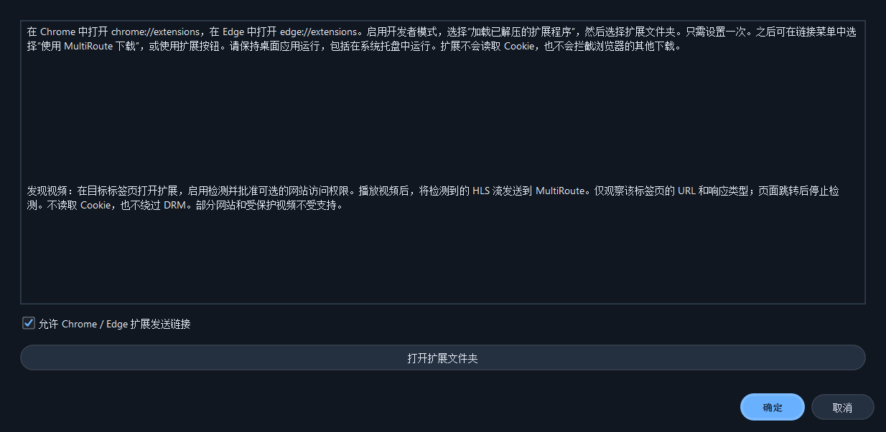
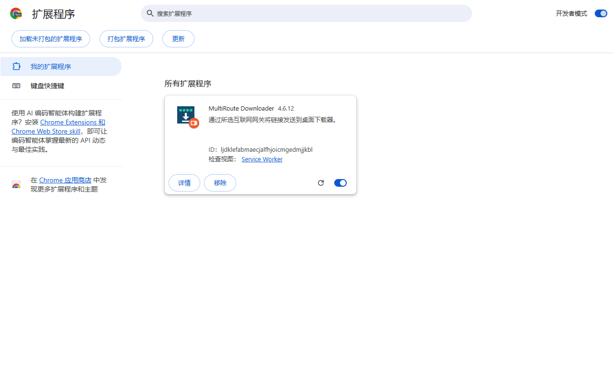
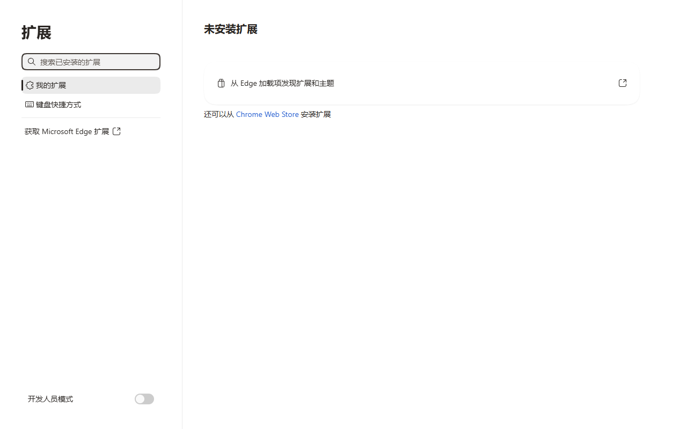
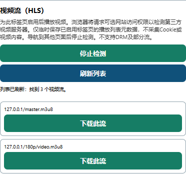
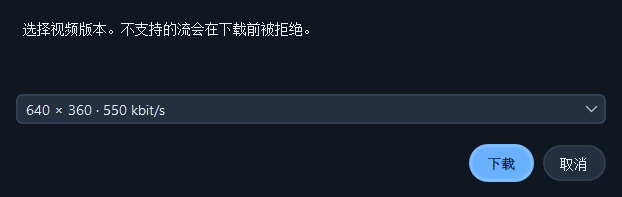
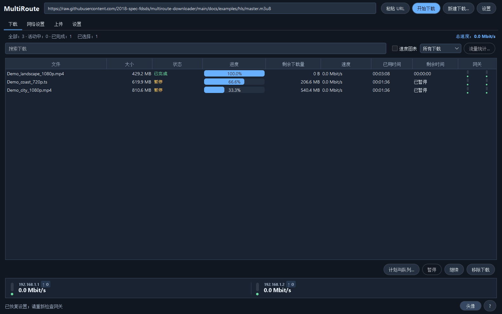

# 使用 MultiRoute、Chrome 和 Edge 下载 HLS 视频

<!-- hls-guide-languages:start -->
<p align="center" dir="ltr">
<a href="HLS-CHROME-EDGE.en.md">English</a> · <a href="HLS-CHROME-EDGE.ru.md">Русский</a> · <a href="HLS-CHROME-EDGE.de.md">Deutsch</a> · <a href="HLS-CHROME-EDGE.es.md">Español</a> · <a href="HLS-CHROME-EDGE.fr.md">Français</a> · <strong>中文</strong><br />
<a href="HLS-CHROME-EDGE.ko.md">한국어</a> · <a href="HLS-CHROME-EDGE.ar.md">العربية</a> · <a href="HLS-CHROME-EDGE.it.md">Italiano</a> · <a href="HLS-CHROME-EDGE.ja.md">日本語</a> · <a href="HLS-CHROME-EDGE.hi.md">हिन्दी</a> · <a href="HLS-CHROME-EDGE.vi.md">Tiếng Việt</a>
</p>
<!-- hls-guide-languages:end -->

> 需要 **MultiRoute Downloader 4.5.2 或更高版本**，以及支持 HLS 检测的扩展程序。应用截图使用 **4.6.12**。本指南不会为旧安装包添加 HLS 功能；请核对应用版本和[发布页面](https://github.com/2018-spec-fdsds/multiroute-downloader/releases)上的安装包。

HLS 视频由播放列表和许多小型媒体分片组成。MultiRoute 通过您主动启用的浏览器扩展检测播放列表，让您选择可用画质，再通过选定的网关下载分片并合成为受支持的视频文件。网页地址通常不同于播放列表地址。

## 开始之前

- 安装并启动配套桌面应用。应用可以保持在系统托盘中运行。
- 在应用中设置下载文件夹并检查所选网关。一个正常工作的网关就足够；多个独立互联网连接可以分担分片下载。可用网关数和同时下载数取决于已安装的许可证。
- 在运行 MultiRoute 的同一台计算机上使用 Chrome 或基于 Chromium 的 Microsoft Edge。
- 从应用文件夹安装配套扩展。本流程使用**加载已解压的扩展程序**，不是 Chrome 网上应用店或 Edge 加载项商店的安装流程。
- 选择您有权保存的视频。目前支持**未加密的点播视频，且 MPEG-TS 或 fMP4 时间轴必须连续**。这不是适用于所有视频网站的通用下载器。

## 1. 启用桌面桥接

1. 打开 MultiRoute → **设置** → **Chrome / Edge…**。
2. 勾选**允许 Chrome / Edge 扩展发送链接**，然后点击**确定**。实际文字随应用语言变化。
3. 在此对话框点击**打开扩展文件夹**，为下一步保留该文件夹。



桥接服务监听应用的本地 API 端口，通常是 **8765**，并接受本项目扩展的来源。无需公开 API 地址或配置路由器端口转发。本流程没有单独的 native messaging host 安装程序：桌面应用保持运行，扩展与其回环地址桥接服务通信。

### 在 macOS 中查找文件夹

请优先使用**打开扩展文件夹**。标准安装的位置为：

```text
/Applications/MultiRoute Downloader.app/Contents/app/browser-extension
```

在浏览器的文件夹选择窗口中按 **⌘⇧G**，粘贴该路径并选择文件夹。也可以在 Finder 中打开“应用程序”，右键点击 **MultiRoute Downloader.app** → **显示包内容** → `Contents` → `app` → `browser-extension`。如果安装在其他位置，请使用实际路径。选择包含 `manifest.json` 的文件夹，而不是整个 `.app` 应用包。

## 2. 在浏览器中加载扩展

| Chrome | Microsoft Edge |
|---|---|
| 在地址栏输入 `chrome://extensions`。 | 在地址栏输入 `edge://extensions`。 |
| 开启**开发者模式**。 | 开启**开发人员模式**。 |
| 点击**加载已解压的扩展程序**。 | 点击**加载解压缩的扩展**。 |
| 选择 MultiRoute 打开的 `browser-extension` 文件夹。 | 选择同一个文件夹。 |

如需始终显示按钮，请在浏览器的扩展菜单中固定 **MultiRoute Downloader**。每个浏览器和个人资料都需要单独安装。组织管理的浏览器可能限制本地扩展，请遵循管理员的策略。





Edge 截图展示的是开发人员模式**尚未开启**的位置。先开启该开关，然后点击出现的**加载解压缩的扩展**按钮。

这是 [Chrome](https://developer.chrome.com/docs/extensions/get-started/tutorial/hello-world#load-unpacked) 和 [Microsoft Edge](https://learn.microsoft.com/en-us/microsoft-edge/extensions/getting-started/extension-sideloading) 文档所述的标准本地安装流程。

### 已经安装？请重新加载扩展本身

更新应用后，打开 `chrome://extensions/` 或 `edge://extensions/`，找到 **MultiRoute Downloader 卡片**并点击 **↻ / 重新加载**。如果 Chrome 隐藏此图标，请先开启开发者模式。确认扩展版本为 **4.5.2 或更高版本**，然后返回视频页面，重新打开扩展程序工具。

工具窗口内的**刷新列表**只更新视频流元数据，不会加载更新后的扩展文件。如果版本仍旧，请检查扩展安装文件夹。Windows 标准位置为 `%LOCALAPPDATA%\MultiRoute Downloader App\app\browser-extension`；请从 MultiRoute 设置打开实际安装文件夹。

修复后，Chrome 仍可能保留旧的错误记录。如果再次看到 `Cannot create item with duplicate id multiroute-download`，请检查已加载版本，以及重新加载后是否产生了新的错误。重复注册菜单的问题已在 4.5.2 中修复。

## 3. 检测视频播放列表

1. 在普通 HTTP/HTTPS 标签页打开包含视频的网页。
2. 右键点击 MultiRoute 扩展图标，选择**扩展程序工具**。在 4.6.12 中，普通左键点击会打开应用的浮动面板；HLS 检测位于扩展的工具窗口中。
3. 在**视频流（HLS）**下点击**检测此标签页**。
4. 如需检测，请接受可选的网站访问权限。浏览器可能提示访问多个网站，因为播放器的分片可能来自其他视频服务器或 CDN 域名。扩展仍只检测您明确启用的标签页。
5. 关闭工具窗口并**播放视频**。检测只观察之后出现的播放列表响应，无法追溯发现启用之前已经加载的列表。
6. 重新打开**扩展程序工具**。如有需要，点击**刷新列表**。工具窗口打开期间，列表也会自动刷新。
7. 找到相应视频流，点击**下载此流**。

如果浏览器权限对话框关闭了扩展窗口，请在授权后重新打开。如果检测仍关闭，再点击**检测此标签页**，然后播放视频。



如果网页已经加载了播放列表，请重新加载网页、打开工具窗口并检查检测状态；必要时再次启用，然后播放视频。**导航到其他页面会关闭该标签页的检测。**关闭标签页也会清除其检测状态。授权并不代表自动启用所有标签页。

扩展仅临时保存数量有限的播放列表元数据，不采集视频正文、浏览器 Cookie 或认证请求头，也不会自动接管所有普通浏览器下载。完成后点击**停止检测**。

## 4. 在 MultiRoute 中选择画质

点击**下载此流**后切换到桌面应用。MultiRoute 使用当前目标文件夹、所选网关和网站配置。检查播放列表后会显示画质选择窗口。

- 选择分辨率和码率，例如 `1280 × 720 · … kbit/s`，然后开始下载。
- 主播放列表可能提供多个画质；媒体播放列表可能只有一个来源。
- 显示的码率描述视频版本，**不是**测得的互联网或下载速度。
- 较低画质通常减少下载数据量。MultiRoute 不会提高分辨率或转码视频。
- 保存的扩展名与受支持的容器对应：MPEG-TS 为 `.ts`，fMP4 为 `.mp4`。将 TS 文件改名为 `.mp4` 不会完成格式转换。



如果已有直接的 `.m3u8` 链接，也可以直接粘贴到 MultiRoute。扩展的已检测视频流按钮还可以识别 URL 不以 `.m3u8` 结尾的 HLS 响应。此 HLS 流程需要播放列表地址；单凭 HTML 观看页面地址不能确定其中的 `.m3u8`。受支持视频网站页面的处理属于另一个工作流程。

## 5. 查看、暂停、继续和检查

任务显示在**下载**中。选择任务后使用**暂停**和**继续**。MultiRoute 会保存已完成分片，并在再次使用前检查保存记录；最终合并按播放列表顺序进行，不按各网关完成顺序进行。



如需了解单个任务，请右键点击任务并打开下载日志。在其中查看分片下载、复用和错误记录，不必只查看应用的全局日志。任务完成后，日志也仍有参考价值。

继续下载需要兼容且一致的来源、画质和播放列表。网站更改播放列表、分片签名 URL 或画质可能导致无法安全复用。已完成分片的本地哈希用于保护复用过程；如果网站未提供发布者校验和，本地哈希并不等于发布者校验和。如准备稍后继续，请保留任务及其已保存分片。

## 故障排查

| 现象 | 检查项目 |
|---|---|
| 没有视频流 | 在播放**之前**开启检测。播放或重新加载网页并打开工具窗口。确认网站权限和标签页检测状态。播放器可能使用 MP4、DASH、缓存播放列表或其他不支持的格式。 |
| 检测变为关闭 | 页面导航后重新开启。网站授权与各标签页的检测开关是两个独立操作。 |
| 窗口只显示观看页面 URL | 这是普通 URL 输入框，不代表已检测到 HLS。请查看**视频流（HLS）**列表。 |
| 无法发送视频流 | 保持应用运行，启用 Chrome/Edge 桥接，并使**应用 API 端口**与桌面应用一致。默认端口是 8765。 |
| HTTP 401/403 或链接过期 | 网站可能需要新的签名 URL 或带认证的请求。重新打开已授权页面并检测新播放列表。扩展**不会**传送浏览器 Cookie。应用中单独配置的网站资料不能保证兼容所有网站。 |
| 不支持的 HLS 播放列表 | DRM、包括 AES-128 在内的加密 HLS、直播或低延迟流、时间轴不连续以及外置音视频轨道均不在受支持的流程内。重试不会转换不支持的流。 |
| 能播放但不能下载 | 浏览器播放和桌面请求使用不同的凭据，也可能使用不同网关。请检查任务日志及网关可用性。 |
| 下载停止 | 继续前检查单个任务日志、剩余空间、重试设置和所选网关。不要无故新建任务或删除分片。 |
| 应用更新后扩展仍显示旧控件 | 在 `chrome://extensions` 或 `edge://extensions` 的 MultiRoute 卡片上点击**重新加载**。确认指向当前应用的扩展文件夹，然后重新打开视频页面。 |

## 试用 GitHub 上的现成示例

我们生成的 **12 秒测试视频**包含合成图像和音调，提供 **180p / 300 kbit/s** 与 **360p / 550 kbit/s** 两个版本。这些是播放列表声明的版本带宽，不是测得的网速。

1. [打开仓库中的示例说明](../examples/hls/README.md)，或[打开播放页面](https://hlsjs.video-dev.org/demo/?src=https%3A%2F%2Fraw.githubusercontent.com%2F2018-spec-fdsds%2Fmultiroute-downloader%2Fmain%2Fdocs%2Fexamples%2Fhls%2Fmaster.m3u8)。外部播放器为官方 hls.js 演示，媒体文件保存在本 GitHub 仓库。
2. 对该标签页启用 MultiRoute 检测。如果清单已提前加载，请重新加载网页，检查并按需重新启用检测。
3. 开始播放，打开**扩展程序工具**并点击**刷新列表**。
4. 选择 **master.m3u8** → **下载此流**。`180p/video.m3u8` 和 `360p/video.m3u8` 是单独的视频版本，选择其中之一不会再提供另一种画质。
5. 在 MultiRoute 中选择 **320 × 180** 或 **640 × 360** 并开始下载。应得到一个约 12 秒、含视频与音频的 **.ts** 文件；大小取决于画质。

不用扩展测试时，可将以下直接播放列表 URL 粘贴到 MultiRoute：

```text
https://raw.githubusercontent.com/2018-spec-fdsds/multiroute-downloader/main/docs/examples/hls/master.m3u8
```

这是播放列表 URL，不是 GitHub HTML 页面。在 GitHub 中查看 master.m3u8 不会播放视频，也不能验证浏览器检测。小型示例可能在您暂停前就已完成；请使用更长且您有权下载的内容测试中断和继续。

扩展截图使用同一视频流的本地副本，因此列表中显示 `127.0.0.1`。您自己的视频会显示相应主机。MultiRoute 工作区截图使用演示任务，不是私人下载记录。本中文指南的浏览器和应用截图均使用中文。Edge 截图显示开发人员模式关闭时的位置；先开启，再选择加载解压缩的扩展。测试媒体以 [CC0](../examples/hls/README.md#license--лицензия) 提供，不改变应用许可证。

## 验证范围

自有测试环境检查了真实的 HLS 音视频播放、扩展检测，以及向自有测试接收器交接所选 URL。另行进行的引擎测试覆盖了已保存分片校验、继续下载、顺序及 TS/MP4 输出解码。这不保证支持所有网站、认证流程或网络加速效果。

一手参考资料：[Chrome 本地加载](https://developer.chrome.com/docs/extensions/get-started/tutorial/hello-world#load-unpacked)、[Edge 本地加载](https://learn.microsoft.com/en-us/microsoft-edge/extensions/getting-started/extension-sideloading)、[官方 hls.js 播放器](https://github.com/video-dev/hls.js)、[HLS / RFC 8216](https://www.rfc-editor.org/rfc/rfc8216)。
