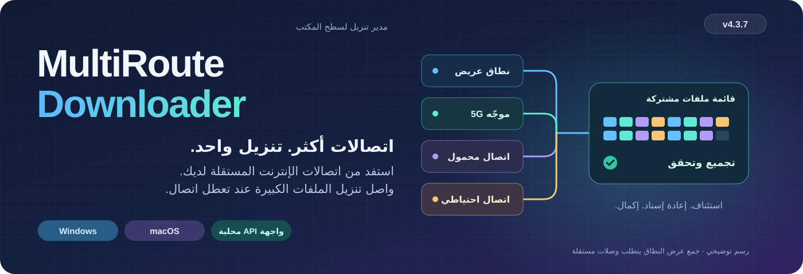

# MultiRoute Downloader

<!-- product-languages:start -->
<p align="center" dir="ltr">
<a href="../../README.md">English</a> · <a href="../../README.ru.md">Русский</a> · <a href="de.md">Deutsch</a> · <a href="es.md">Español</a> · <a href="fr.md">Français</a> · <a href="zh.md">中文</a><br />
<a href="ko.md">한국어</a> · <strong>العربية</strong> · <a href="it.md">Italiano</a> · <a href="ja.md">日本語</a> · <a href="hi.md">हिन्दी</a> · <a href="vi.md">Tiếng Việt</a>
</p>
<!-- product-languages:end -->

<div dir="rtl">

<p align="center"></p>

<p align="center"><strong>نزّل الملفات الكبيرة بالاتصالات المتاحة لديك.</strong><br />اجمع بوابات النطاق العريض والاتصال المحمول المستقلة لتنزيل الملفات الكبيرة، واحفظ التقدم القابل للاستئناف، وتحقق من الملف المكتمل.</p>

<p align="center">
  <a href="https://github.com/2018-spec-fdsds/multiroute-downloader/releases/tag/v4.3.9"><strong>تنزيل 4.3.9</strong></a> ·
  <a href="../../downloads/README.md">التنزيلات الحالية</a> ·
  <a href="../ar.md">دليل المستخدم</a> ·
  <a href="../../API.ru.txt">مرجع API</a> ·
  <a href="../../README.ru.md">Русский</a>
</p>

## لماذا أُنشئ MultiRoute

نشأت الفكرة من مشكلة مألوفة في الشبكات المنزلية: كان اتصال النطاق العريض السلكي والموجّه المحمول واتصال الإنترنت الاحتياطي متاحين جميعًا، لكن تنزيل ملف كبير ظل يستخدم البوابة الافتراضية للحاسوب وحدها. وعندما تباطأ ذلك الاتصال أو تعطل، لم تستطع الوصلات الأخرى المساعدة.

يجمع MultiRoute هذه الوصلات المستقلة في مساحة عمل واحدة للتنزيل. تأخذ البوابات المتاحة مقاطع الملفات من قائمة انتظار مشتركة؛ فتتولى البوابات الأسرع عملًا أكثر، ويمكن إعادة إسناد المقاطع غير المكتملة من الاتصال المتوقف. يحفظ التطبيق التقدم حيث يكون الاستئناف مدعومًا، ويجمع النتيجة، ويقارنها بقيمة تحقق مرجعية متاحة.

- **عرض نطاق أكبر لملف واحد.** تجلب وصلات الإنترنت المستقلة أجزاء مختلفة بالتزامن. ويمكن لسعتها المجمعة تقليص مدة تنزيل ملف كبير عندما يستطيع المصدر والشبكة المحلية مواكبة النقل.
- **تقدم رغم الانقطاعات.** تُحفظ الأجزاء المكتملة، وتواصل البوابات العاملة التنزيل، ويمكن إعادة المقاطع المتوقفة إلى مجموعة المهام المشتركة.
- **تحكم واضح.** تابع السرعة الإجمالية وسرعة كل بوابة، وغيّر البوابات المحددة أثناء النقل، وشاهد مساهمة كل اتصال.
- **سير عمل قابل للتكرار.** أعد استخدام ملفات تعريف المواقع، وأضف قوائم الروابط إلى قائمة الانتظار، أو أرسل عمليات النقل إلى واجهة API المحلية من البرامج النصية وأدوات التطوير.

يتوقف التحسن الفعلي على استقلال وصلات الإنترنت وحدود المصدر والشبكة المحلية. ولا تضاعف الموجّهات التي تشترك في اتصال إنترنت واحد عرض نطاق ذلك الاتصال.


### مفيد أيضًا مع اتصال واحد

استخدم الاستئناف المدعوم، ومقارنة قيم التحقق المنشورة، وDNS المحمي، وقوائم الانتظار المجمعة، والجداول الزمنية، وملفات تعريف المواقع، والرفع، وواجهة API المحلية. ابدأ ببوابة واحدة وأضف غيرها عند توفرها.

## التنزيل والتثبيت

**الإصدار الحالي: 4.3.9.** تتضمن حزم التثبيت الأصلية بيئة Java 21 خاصة بالتطبيق ومكوّن الشبكة الخاص بالمنصة. افتح التطبيق من أيقونته المعتادة.

| حاسوبك | حزمة تثبيت في ملف واحد |
| --- | --- |
| **Windows 11 · x64** | [Windows Setup EXE](https://github.com/2018-spec-fdsds/multiroute-downloader/releases/download/v4.3.9/MultiRoute-Downloader-4.3.9-Windows-x64-Setup.exe) |
| **Mac · Apple Silicon · macOS 26+** | [Apple Silicon PKG](https://github.com/2018-spec-fdsds/multiroute-downloader/releases/download/v4.3.9/MultiRoute-Downloader-4.3.9-macOS-arm64.pkg) |
| **Mac · Intel · macOS 15+** | [Intel PKG](https://github.com/2018-spec-fdsds/multiroute-downloader/releases/download/v4.3.9/MultiRoute-Downloader-4.3.9-macOS-x86_64.pkg) |

[التكامل مع Chrome / Edge](../ar.md#chrome-and-edge-integration) · [قيم التحقق والتقرير](../../downloads/v4.3.9/README.md) · [تفاصيل التنزيل](../../downloads/README.md)

يعمل Windows Setup باللغة الإنجليزية وينشئ اختصارًا على سطح المكتب. يُفحص Npcap بشكل منفصل، ويُعرض مثبّته الرسمي عند الحاجة؛ ويستخدم macOS مكتبة libpcap الخاصة بالنظام. راجع الدليل بلغتك لمعرفة خطوات التثبيت وتأكيدات الأمان. تتوفر حزم التثبيت الأصلية العامة لنظامي Windows وmacOS؛ ولا تتضمن هذه الصفحة مثبّت Linux 4.x.

**Free / Pro في 4.3.9:** يتيح Free استخدام ما يصل إلى **بوابتين (2)**، و**3 تنزيلات متزامنة**، وإنشاء **3 ملفات تعريف للمواقع**، مع مظهري Graphite/System. وتتيح إمكانات Pro المقابلة استخدام ما يصل إلى **8 بوابات**، و**32 تنزيلًا متزامنًا**، وملفات تعريف إضافية، وأولويات، وسجل البوابات وتقاريرها، وعمليات مجمعة، وواجهة API خارجية، وأنماط مظهر إضافية. لا يحدّ Free سرعة التنزيل عمدًا. [التفاصيل الكاملة للإمكانات](../licensing.en.md).


## الجديد في 4.3.9

- **ردود بوابات Mac مع عنوان يدوي.** صُحح إعداد الالتقاط في POSIX ليستخدم العنوان اليدوي للتطبيق وDHCP وضع استقبال الردود الموجهة إلى MAC الخاص بالتطبيق، كما كان في Windows. نجاح ping النظام يختبر اتصال الكمبيوتر نفسه ولا يثبت استقبال الردود على العنوان الافتراضي للتطبيق.

- تحتفظ رسائل DHCP بصياغتها في اثنتي عشرة لغة بدل استبدالها بخطأ عام. لا يتغير سلوك التفويض الحالي: تعيد فحوص الشبكة العادية استخدام المكوّن المُجهز. لا تتغير نقاط API أو عناصر الواجهة أو مسارات النظام أو MAC البطاقة الفعلية. قد يظل أول وصول ذي صلاحيات إلى Ethernet BPF بحاجة إلى تأكيد المسؤول المعتاد.

يُصلح ذلك اختلافًا محددًا في وضع الالتقاط وليس جميع أسباب تعذر الوصول إلى البوابة. تبقى فحوص العنوان المتاح والشبكة الفرعية وإيجار وتعارض DHCP فعالة. لا تزال عمليات نقل Mac بعنوان يدوي بحاجة إلى تحقق على جهاز فعلي؛ ويظل Ethernet السلكي مطلوبًا.

### أدوات التحكم في النقل

- **بدء Mac وإعداد البوابات بصورة أكثر موثوقية.** يتعرف التشغيل الأصلي على Mac على المسار الافتراضي النسبي القديم، حتى عند غياب الشرطة المائلة الأولى، ويستخدم ملف إعدادات موجودًا تم التحقق منه أو مجلدًا افتراضيًا فارغًا يملكه المستخدم. تبقى المواقع المخصصة الملتبسة بحاجة إلى اختيار صريح بدل التخمين.

- إذا فشل إعداد بوابة أو أُلغي، تتوقف البوابات الأخرى والفحوص الخلفية عن تكرار طلبات التفويض إلى أن تعيد إعداد الشبكة صراحة. قد يظل التشغيل الأول بصلاحيات مرتفعة بحاجة إلى تأكيد مسؤول macOS المعتاد لفتح جهاز Ethernet BPF.

- يتعامل مكوّن شبكة Mac 4.3.2 مع إخفاء macOS لعنوان MAC الخاص بالمحوّل مع إبقاء فحوص حماية البطاقة الفعلية. يحتفظ التطبيق بعنوان MAC الخاص به ولا يغيّر مسارات النظام أو MAC البطاقة. تتوافق أيقونة Mac واسمه مع هوية MultiRoute على Windows. أغلق التطبيق قبل تحديث PKG. لا يزال اسم طالب التفويض في الحوار الحقيقي ونقل LAN/DHCP بحاجة إلى تحقق على جهاز فعلي؛ ويظل هذا النقل متطلبًا Ethernet سلكيًا.


- **البيانات المتبقية للتنزيل.** أصبح جدول التنزيل يتضمن عمود **البيانات المتبقية**. يعرض عدد البايتات التي لم تُنزّل بعد بصورة مستقلة عن الوقت المتبقي المتوقع، ويدعم الفرز الرقمي. يحتسب التقدم المحفوظ والجاري ولا يقل عن الصفر؛ وتظهر شرطة عندما يكون الحجم الكلي غير معروف.


- **حدّد أفضلية البوابات.** تظهر الأولويات من 0 إلى 1000 بجوار المؤشرات. تفضّل القيم الأعلى الملفات الصغيرة وتتلقى مقاطع متوازية أكثر للملفات الكبيرة، مع استمرار البوابات السليمة الأخرى في المساعدة. يلزم حق Pro المستقل <span dir="ltr">`gateway_priorities`</span>.

- **افهم سبب الانقطاع.** افتح سجل الملف الفردي من القائمة حتى بعد اكتماله، أو دليل الأخطاء القابل للبحث ذي 25 موضوعًا في الإعدادات. يُوضّح امتلاء القرص ويظهر مكان الحفظ المساحة الحرة بالغيغابايت.

- **تحكّم في الطابور.** اضبط عدد التنزيلات المتزامنة ضمن الترخيص والمحاولات التلقائية. انسخ أسماء الملفات المحددة وأوقف أو استأنف المهام المناسبة؛ يفتح النقر المزدوج المجلد. يبقى الجزء الأول المحفوظ في التقدم أثناء انتظار البيانات بعد الاستئناف.


## تابع عمليات النقل بوضوح

تضع مساحة العمل في 4.3.9 ملفاتك في صلب الاهتمام: عمودان منفصلان للاسم والحجم، وتقدم لكل ملف، والسرعة الإجمالية وسرعة كل بوابة، ورسم بياني للسرعة، وتفاصيل الملفات. يتضمن Free مظهري Graphite وSystem؛ وتتطلب الأنماط الإضافية مثل Rose إمكانية Pro المقابلة.


*واجهة التطبيق الحالية على Windows، ملتقطة بملف تعريف تجريبي معزول. توضح الملفات والتقدم والسرعات المعروضة على سبيل المثال، والشاشات التي تتيحها إمكانات Pro، عناصر التحكم ولا تمثل قياسات للأداء.*

<details>
<summary><strong>إعدادات الشبكة وسجل السرعة</strong></summary>


</details>


## اختر مظهرك

اختر من تسعة أنماط للمظهر: Graphite وNordic وStreams Studio وNeon وCommunity وChat وStudio وRose وSystem. المظهر الافتراضي هو Graphite. يتضمن Free نمطي Graphite وSystem؛ وتتطلب الخيارات الأخرى إمكانية المظهر المقابلة في Pro. افتح الإعدادات → المظهر لتغيير النمط وعناصر التحكم المستديرة. تواصل التنزيلات عملها أثناء الاختيار.

<table>
<tr>
<td width="50%" valign="top"><strong>Graphite</strong><br /><a href="../images/v4.3.7/downloads-en-ae5b55131583.png"></a></td>
<td width="50%" valign="top"><strong>Nordic</strong><br /><a href="../images/v4.3.7/skin-nordic-a4e8d79666e0.png"></a></td>
</tr>
<tr>
<td width="50%" valign="top"><strong>Streams Studio</strong><br /><a href="../images/v4.3.7/skin-streams-b2f3be388bda.png"></a></td>
<td width="50%" valign="top"><strong>Neon</strong><br /><a href="../images/v4.3.7/skin-neon-6b0c1d2da5f8.png"></a></td>
</tr>
<tr>
<td width="50%" valign="top"><strong>Community</strong><br /><a href="../images/v4.3.7/skin-community-9763964c8f12.png"></a></td>
<td width="50%" valign="top"><strong>Chat</strong><br /><a href="../images/v4.3.7/skin-chat-221a28cc76f4.png"></a></td>
</tr>
<tr>
<td width="50%" valign="top"><strong>Studio</strong><br /><a href="../images/v4.3.7/skin-studio-094e14ba38ea.png"></a></td>
<td width="50%" valign="top"><strong>Rose</strong><br /><a href="../images/v4.3.7/skin-rose-02646e7f35bf.png"></a></td>
</tr>
<tr>
<td width="50%" valign="top"><strong>System</strong><br /><a href="../images/v4.3.7/skin-system-c148099984c6.png"></a></td>
<td width="50%" valign="top"></td>
</tr>
</table>

## مندوب يرافق تنزيلاتك

يحوّل مندوب سطح المكتب الاختياري تقدم التنزيل إلى حمولة مرئية. اختر الرجل أو المرأة من إعدادات المظهر واضبط الحجم من 40% إلى 100%. يعرض الكيس مجموع البيانات المتبقية المعروفة للتنزيلات النشطة، ويصغر مع وصول البايتات. تتبع الحركة سرعة تنزيلها الإجمالية؛ وعندما تصبح السرعة صفرًا يقف المندوب ساكنًا. تُحمل الحمولات الصغيرة على الكتف، وتُسحب الحمولات الأكبر، ويظهر جهد أكبر مع الحمولات الكبيرة جدًا.

استخدم زر الصورة الرمزية لإظهار المندوب أو إخفائه. اسحبه لنقله، أو انقر عليه نقرتين بزر الفأرة الأيسر لإظهار التطبيق، أو انقر بزر الفأرة الأيمن لعرض خياراته. إنه رفيق بصري؛ وتبقى الملفات في مجلداتها المختارة.

عند اكتمال تنزيل، يضع عامل التوصيل الحمولة المسلّمة ويتلاشى تدريجيًا. وإذا استمر العمل، يعود بالبيانات المتبقية.

### حمولة متبقية صغيرة · 768 MB

<table>
<tr>
<td width="50%" valign="top"><strong>مندوب توصيل</strong><br /><a href="../images/v4.3.7/avatar-man-shoulder-eeeb879d0240.png"></a></td>
<td width="50%" valign="top"><strong>مندوبة توصيل</strong><br /><a href="../images/v4.3.7/avatar-woman-shoulder-5682615d5576.png"></a></td>
</tr>
</table>

### حمولة متبقية متوسطة · 7 GB

<table>
<tr>
<td width="50%" valign="top"><strong>مندوب توصيل</strong><br /><a href="../images/v4.3.7/avatar-man-drag-a3dc0a3ed22c.png"></a></td>
<td width="50%" valign="top"><strong>مندوبة توصيل</strong><br /><a href="../images/v4.3.7/avatar-woman-drag-48d8ee0fa4d1.png"></a></td>
</tr>
</table>

### حمولة متبقية كبيرة · 18 GB

<table>
<tr>
<td width="50%" valign="top"><strong>مندوب توصيل</strong><br /><a href="../images/v4.3.7/avatar-man-heavy-649f17608748.png"></a></td>
<td width="50%" valign="top"><strong>مندوبة توصيل</strong><br /><a href="../images/v4.3.7/avatar-woman-heavy-d445fdb37867.png"></a></td>
</tr>
</table>

## الإعدادات في لمحة

حدّد مجلد التنزيل وملفات تعريف المواقع واللغة، ثم اضبط المظهر وحجم المندوب وأصوات الاكتمال. تجمع إعدادات الشبكة عنوان التطبيق وMAC والبوابات وDNS في مكان واحد. يمكن للأصوات الاختيارية التمييز بين اكتمال ملف واحد واكتمال قائمة الانتظار، باستخدام ألحان مدمجة أو مقاطع MP3/WAV من اختيارك لا تتجاوز 10 ثوانٍ.

<table>
<tr>
<td width="50%" valign="top"><strong>إعدادات التطبيق</strong><br /><a href="../images/v4.3.7/settings-8abcb12a782d.png"></a></td>
<td width="50%" valign="top"><strong>المظهر والمندوب والأصوات</strong><br /><a href="../images/v4.3.7/appearance-cebf121d5de7.png"></a></td>
</tr>
<tr>
<td width="50%" valign="top"><strong>عنوان التطبيق وDNS المحمي</strong><br /><a href="../images/v4.3.7/network-dns-e29dfdba1007.png"></a></td>
<td width="50%" valign="top"><strong>اختيار البوابات واختبارات السرعة</strong><br /><a href="../images/v4.3.7/network-gateways-aee0a7897f48.png"></a></td>
</tr>
</table>

<details>
<summary><strong>مساحتا عمل التنزيل والرفع</strong></summary>

<table>
<tr>
<td width="50%" valign="top"><strong>إنشاء تنزيل</strong><br /><a href="../images/v4.3.7/new-download-dcb720c7769d.png"></a></td>
<td width="50%" valign="top"><strong>مساحة عمل الرفع</strong><br /><a href="../images/v4.3.7/uploads-31c63833de2e.png"></a></td>
</tr>
</table>

</details>

## من الاحتياجات اليومية إلى التحكم العملي

| ما تريد فعله… | ما يقدمه MultiRoute |
| --- | --- |
| **استخدام الاتصالات المتاحة** | قائمة انتظار مشتركة لمقاطع HTTP، و1–8 ملفات تعريف قابلة للتعديل للبوابات، وإمكانية اختيار بوابة واحدة أو عدة بوابات أو جميعها أثناء العمل. |
| **حفظ الملفات الكبيرة والتحقق منها** | استئناف مدعوم، وأجزاء محفوظة، وتجميع تلقائي، وتحقق باستخدام MD5 أو SHA-256 أو SHA-512 مقارنةً بالقيم المرجعية من الناشر. |
| **حماية طلبات DNS** | DoH/DoT مشفّر، ومزوّدون مُعدّون مسبقًا أو مخصصون، وDNSSEC محلي، دون تغيير إعدادات DNS أو المسارات في نظام التشغيل. |
| **تنظيم تنزيلات متعددة** | إدخال روابط دفعة واحدة، وأولويات، وفترات يومية، وبدء مؤجل، وحدود للسرعة وعدد المهام، وإحصاءات لكل بوابة، ورسوم بيانية، وسجل مؤرّخ. |
| **إعادة استخدام المواقع المألوفة** | ملفات تعريف محفوظة، وتصفح المجلدات البعيدة، ورفع عبر FTP/FTPS/SFTP، ومعاينة الأرشيفات. |
| **التوافق مع سير عملك** | إرسال الروابط من المتصفح، وواجهة API محلية، واثنتا عشرة لغة، وسمات فاتحة وداكنة ومتوافقة مع النظام، ولصق بلوحة المفاتيح، ونوافذ النظام لاختيار المجلدات، ومؤشر سرعة في منطقة الإعلام، وتشغيل اختياري عند تسجيل الدخول. |

| النقل | الخيارات المدعومة |
| --- | --- |
| **التنزيل** | HTTP/HTTPS وFTP وexplicit FTPS وSFTP وWebDAV وMetalink وBitTorrent وmagnet؛ وروابط Hugging Face واختيار ملفات المستودعات. |
| **الرفع** | FTP وexplicit FTPS وSFTP، مع ملفات تعريف المواقع والتحقق باستخدام SHA-256 عبر إعادة قراءة الملف البعيد. |
| **معاينة الأرشيفات** | عرض قوائم محتويات ZIP وTAR و7Z وRAR قبل التنزيل الكامل، عند توفر نطاقات البايت والترويسات المدعومة. |

### اعرف ما جرى التحقق منه

تقارن عمليات فحص الملفات البيانات المجمعة بمرجع موثوق عند توفره؛ ولا تثبت قيمة تجزئة محلية وحدها هوية الناشر. يشفّر DoH/DoT نقل DNS؛ ويتحقق DNSSEC بشكل مستقل من صحة بيانات DNS الموقّعة. ولا تثبت هذه الفحوص أن المحتوى المنزّل خالٍ من الضرر.

## واجهة API لتطبيقاتك وسير عمل البرمجة بالذكاء الاصطناعي

يمكن للبرامج النصية وتطبيقات الجهات الخارجية ووكلاء البرمجة بالذكاء الاصطناعي طلب تنزيل أوزان النماذج ومجموعات البيانات والمكتبات والموارد ومخرجات المشاريع اللازمة للتطوير عبر MultiRoute. يتلقى الطرف المستدعي معلومات التقدم والإكمال ونتائج قيم التحقق، ويمكنه التحكم في قائمة الانتظار بينما يتولى MultiRoute إدارة البوابات وإعادة المحاولة والاستئناف المدعوم.

تعمل واجهة API محليًا على <span dir="ltr">**`http://127.0.0.1:8765/api/v1`**</span>. على سبيل المثال، أرسل JSON التالي إلى <span dir="ltr">**`POST /api/v1/jobs`**</span> مع <span dir="ltr">`Content-Type: application/json`</span>:

<div dir="ltr">

```json
{
  "url": "https://example.org/model.bin",
  "directory": "C:/Users/YOUR_USER/Downloads",
  "routes": [
    {"type": "gateway", "gateway": "192.168.1.1", "enabled": true}
  ]
}
```

</div>

تتطلب الإدارة العامة عبر واجهة API الخارجية إمكانية Pro المقابلة؛ وتُفحص صلاحية إنشاء المهام المجمعة وحدود البوابات بشكل منفصل. استبدل URL والمجلد والبوابة بقيمك، واضبط الشبكة أولًا. حدّد المسارات صراحةً: لا تُنسخ مربعات الاختيار في الواجهة إلى طلبات API. تعني <span dir="ltr">`201`</span> إنشاء المهمة؛ احتفظ بـ<span dir="ltr">`id`</span> واقرأ <span dir="ltr">`GET /jobs/{id}`</span> لمتابعة التقدم وحالة <span dir="ltr">`complete`/`failed`</span> وتفاصيل قيم التحقق. المثال توضيحي ولا يرسل طلب تنزيل.

[مرجع API](../../API.ru.txt) · [مخطط OpenAPI](../../openapi.yaml) · [دليل التكامل](../ar.md#multiroute-api)

## ابدأ في أربع خطوات

1. **ثبّت** حزمة منصتك واتبع دليلها.
2. **اختر إعدادات الشبكة:** Ethernet سلكي، وبوابات على شبكة LAN IPv4 نفسها، وعنوان افتراضي غير مستخدم للتطبيق. يترك ذلك مسارات نظام التشغيل الخاصة بالتطبيقات الأخرى دون تغيير.
3. **اختر البوابات واختبرها.** القيم الافتراضية هي <span dir="ltr">`192.168.1.1`–`192.168.1.4`</span>، مع العنوان الافتراضي <span dir="ltr">`192.168.1.70`</span>؛ عدّلها بما يناسب شبكتك.
4. **الصق رابطًا أو قائمة، واختر مجلدًا، وابدأ.** تابع مساهمة كل بوابة والتحقق النهائي.

<details>
<summary><strong>المتطلبات وتفاصيل النقل</strong></summary>

- يدعم النقل عبر بوابات متعددة عناوين IPv4 العامة على Ethernet سلكي؛ ولا يشمل هذا الوضع المحوّلات التي تعمل عبر Wi-Fi فقط أو VPN فقط، أو المصادر التي تدعم IPv6 فقط، أو أقران torrent داخل شبكة LAN المحلية.
- يتطلب استئناف المقاطع دعم النطاقات وثبات هوية المصدر. الحجم الافتراضي لمقاطع HTTP هو 20 MiB؛ ويمكن إعادة إسناد العمل المتوقف بعد 60 ثانية دون بيانات، بمجرد إغلاق مكوّن الكتابة الخاص به. يبدأ تنزيل HTTP الذي لا يدعم الاستئناف من جديد بعد الانقطاع. وتستخدم قطع torrent قيم التجزئة الموجودة في البيانات الوصفية.
- يستخدم ملف رفع واحد بوابة واحدة؛ ويمكن لعدة ملفات استخدام بوابات مختلفة. يستهلك التحقق بإعادة القراءة عرض نطاق، ويتطلب صلاحيات القراءة والكتابة وإعادة التسمية عن بُعد. وتخضع معاينة الأرشيفات لحدود البيانات الوصفية والترويسات.
- تتطلب الجداول الزمنية أن يكون التطبيق قيد التشغيل والحاسوب مستيقظًا؛ فهي لا توقظ الحاسوب ولا تجدول قائمة انتظار الرفع المنفصلة.
- يتبع DNS الخاص بالنظام سياسة نظام التشغيل/VPN. وتُحدّث مرتكزات الثقة الجذرية لـDNSSEC مع الإصدارات. ولا يشفّر DNS المشفّر بحد ذاته محتويات ملفات HTTP/FTP.
- حزم التثبيت غير موقّعة؛ وحزم macOS غير موقّعة بشهادة Developer ID وغير موثّقة لدى Apple. اتبع التأكيدات المعتادة في الأدلة دون تعطيل وسائل حماية النظام. يتضمن كل إصدار تقرير التحقق منه والقيود المتبقية.

</details>

## أدلة باثنتي عشرة لغة

[English](../en.md) · [Русский](../ru.md) · [Deutsch](../de.md) · [Español](../es.md) · [Français](../fr.md) · [中文](../zh.md)<br />
[한국어](../ko.md) · [العربية](../ar.md) · [Italiano](../it.md) · [日本語](../ja.md) · [हिन्दी](../hi.md) · [Tiếng Việt](../vi.md)


<a name="application-virtual-ip"></a>

### عنوان التطبيق والحزم الحالية

يستخدم التطبيق عنوان IPv4 محليًا خاصًا به وعنوان MAC خاصًا بالتطبيق، لتعمل البوابات المحددة باستقلال عن البوابة الافتراضية لنظام التشغيل، دون تغيير مسارات النظام أو عنوان MAC للمحوّل الفعلي. استخدم عنوانًا شاغرًا في الشبكة الفرعية الفعلية نفسها. أبقِ العنوان اليدوي خارج نطاق تخصيص DHCP التلقائي، أو احجزه/استثنه على خوادم DHCP في شبكة LAN؛ ثم استخدم **Check and apply** (التحقق والتطبيق) في إعدادات الشبكة. [اختيار العنوان والتحقق منه](../ar.md#application-virtual-ip).

اجتازت حزم Windows الحالية للإصدار 4.3.9 فحص الترقية والتشغيل المحلي؛ واجتازت حزم macOS اختبارات المكوّنات الأصلية وبيئة تشغيل Java على أجهزة CI المستهدفة. ولا تزال عمليات النقل عبر بوابات LAN/DHCP على أجهزة Mac الفعلية تحتاج إلى تحقق على العتاد. [تقرير التحقق](../../NATIVE-INSTALLER-TESTS.json).

## المالك والترخيص

أنشأه **[2018-spec-fdsds](https://github.com/2018-spec-fdsds)**. يشمل الاستخدام المجاني الاستخدام الشخصي والاستخدام في المؤسسات والأعمال التجارية. ويتطلب بيع التطبيق الأصلي أو تقاضي رسوم لترخيصه أو إعادة توزيعه بمقابل إذنًا كتابيًا منفصلًا. لا تُمنح حقوق عامة للتعديل أو إعادة التوزيع؛ وتظل شروط الجهات الخارجية سارية.

[الترخيص](../../LICENSE.txt) · [ملخص الترخيص](../../LICENSING.md) · [إشعارات الجهات الخارجية](../../THIRD-PARTY-NOTICES.txt)

تضم منطقة التوزيع هذه حزم تثبيت الإصدار الحالي 4.3.9 ووثائق المستخدم.

</div>
