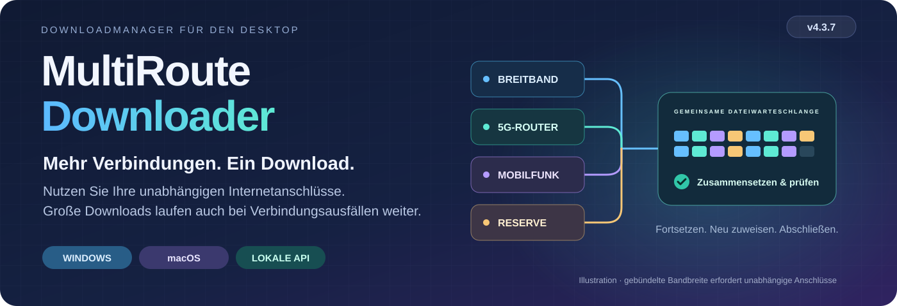

# MultiRoute Downloader
<!-- product-languages:start -->
<p align="center" dir="ltr">
<a href="../../README.md">English</a> · <a href="../../README.ru.md">Русский</a> · <strong>Deutsch</strong> · <a href="es.md">Español</a> · <a href="fr.md">Français</a> · <a href="zh.md">中文</a><br />
<a href="ko.md">한국어</a> · <a href="ar.md">العربية</a> · <a href="it.md">Italiano</a> · <a href="ja.md">日本語</a> · <a href="hi.md">हिन्दी</a> · <a href="vi.md">Tiếng Việt</a>
</p>
<!-- product-languages:end -->

<p align="center"></p>

<p align="center"><strong>Laden Sie große Dateien mit den Verbindungen herunter, die Sie bereits haben.</strong><br />Kombinieren Sie unabhängige Breitband- und Mobilfunk-Gateways für große Downloads, bewahren Sie den Fortschritt fortsetzbarer Übertragungen und prüfen Sie die fertige Datei.</p>

<p align="center">
  <a href="https://github.com/2018-spec-fdsds/multiroute-downloader/releases/tag/v4.3.9"><strong>4.3.9 herunterladen</strong></a> ·
  <a href="../../downloads/README.md">Aktuelle Downloads</a> ·
  <a href="../de.md">Benutzerhandbuch</a> ·
  <a href="../../API.ru.txt">API-Referenz</a> ·
  <a href="../../README.ru.md">Русский</a>
</p>

## Warum es MultiRoute gibt

Die Idee entstand aus einem vertrauten Problem im Heimnetz: Ein kabelgebundener Breitbandanschluss, ein Mobilfunkrouter und eine Reserveverbindung ins Internet waren verfügbar, doch ein großer Download nutzte weiterhin nur das Standardgateway des Computers. Wenn diese Verbindung langsamer wurde oder ausfiel, konnten die anderen Anschlüsse nicht helfen.

MultiRoute vereint diese unabhängigen Anschlüsse in einem gemeinsamen Download-Arbeitsbereich. Verfügbare Gateways übernehmen Dateisegmente aus einer gemeinsamen Warteschlange; schnellere Gateways erledigen mehr Arbeit, und unfertige Segmente einer stockenden Verbindung können neu zugewiesen werden. Die Anwendung erhält den Fortschritt, soweit Fortsetzen unterstützt wird, setzt das Ergebnis zusammen und vergleicht es mit einer verfügbaren Referenzprüfsumme.

- **Mehr Bandbreite für eine Datei.** Unabhängige Internetanschlüsse laden verschiedene Teile gleichzeitig herunter. Ihre gebündelte Kapazität kann einen großen Download verkürzen, wenn die Quelle und das lokale Netz mithalten können.
- **Fortschritt trotz Unterbrechungen.** Fertige Teile werden gespeichert; funktionierende Gateways laden weiter herunter, und stockende Segmente können in den gemeinsamen Pool zurückkehren.
- **Sichtbare Kontrolle.** Verfolgen Sie die Gesamtgeschwindigkeit und die Geschwindigkeit je Gateway, ändern Sie die Gateway-Auswahl während einer Übertragung und sehen Sie, was jede Verbindung beiträgt.
- **Wiederverwendbare Abläufe.** Nutzen Sie Website-Profile erneut, stellen Sie Linklisten in die Warteschlange oder übergeben Sie Übertragungen aus Skripten und Entwicklungswerkzeugen an die lokale API.

Der tatsächliche Gewinn hängt von unabhängigen Internetanschlüssen, den Grenzen der Quelle und dem lokalen Netz ab. Router, die denselben übergeordneten Internetanschluss nutzen, vervielfachen dessen Bandbreite nicht.


### Auch mit einer einzigen Verbindung nützlich

Nutzen Sie unterstütztes Fortsetzen, den Vergleich veröffentlichter Prüfsummen, geschütztes DNS, Stapelwarteschlangen, Zeitpläne, Website-Profile, Uploads und die lokale API. Beginnen Sie mit einem Gateway und ergänzen Sie weitere, sobald sie verfügbar sind.

## Herunterladen und installieren

**Aktuelle Version: 4.3.9.** Native Installationspakete enthalten eine eigene Java-21-Laufzeit und die Netzwerkkomponente der jeweiligen Plattform. Öffnen Sie die Anwendung über ihr normales Symbol.

| Ihr Computer | Installer als Einzeldatei |
| --- | --- |
| **Windows 11 · x64** | [Windows Setup EXE](https://github.com/2018-spec-fdsds/multiroute-downloader/releases/download/v4.3.9/MultiRoute-Downloader-4.3.9-Windows-x64-Setup.exe) |
| **Mac · Apple Silicon · macOS 26+** | [Apple Silicon PKG](https://github.com/2018-spec-fdsds/multiroute-downloader/releases/download/v4.3.9/MultiRoute-Downloader-4.3.9-macOS-arm64.pkg) |
| **Mac · Intel · macOS 15+** | [Intel PKG](https://github.com/2018-spec-fdsds/multiroute-downloader/releases/download/v4.3.9/MultiRoute-Downloader-4.3.9-macOS-x86_64.pkg) |

[Chrome-/Edge-Integration](../de.md#chrome-and-edge-integration) · [Prüfsummen und Bericht](../../downloads/v4.3.9/README.md) · [Download-Details](../../downloads/README.md)

Windows Setup ist englischsprachig und erstellt eine Desktop-Verknüpfung. Npcap wird separat geprüft; bei Bedarf wird der offizielle Installer angeboten. macOS verwendet das systemeigene libpcap. Hinweise zur Installation und zu Sicherheitsbestätigungen finden Sie im Handbuch Ihrer Sprache. Öffentliche native Installationspakete gibt es für Windows und macOS; ein Linux-Installer für 4.x ist hier nicht enthalten.

**Free / Pro in 4.3.9:** Free nutzt bis zu **2 Gateways**, **3 gleichzeitige Downloads** und erlaubt das Anlegen von **3 Website-Profilen**, mit Graphite-/Systemdarstellung. Die entsprechenden Pro-Funktionen erlauben bis zu **8 Gateways**, **32 gleichzeitige Downloads**, zusätzliche Profile, Prioritäten, Gateway-Verlauf und -Berichte, Stapelaktionen, die externe API und weitere Designs. Free drosselt die Download-Geschwindigkeit nicht absichtlich. [Alle Funktionsdetails](../licensing.en.md).


## Neu in 4.3.9

- **Mac-Gateway-Antworten mit manueller Adresse.** Die POSIX-Erfassung wird korrigiert: Manuelle Anwendungsadresse und DHCP verwenden beide einen Empfangsmodus für Antworten an die eigene Anwendungs-MAC, entsprechend dem bisherigen Windows-Verhalten. Ein erfolgreicher System-Ping prüft die Verbindung des Computers, nicht den Empfang an der virtuellen Anwendungsadresse.

- DHCP-Diagnosen behalten ihre Formulierungen in zwölf Sprachen statt einer allgemeinen Fehlermeldung. Die bisherige Autorisierung bleibt unverändert: Normale Netzwerkprüfungen verwenden die vorbereitete Komponente erneut. API-Endpunkte, Bedienelemente, OS-Routen und physische Adapter-MAC bleiben unverändert. Der erste privilegierte Ethernet-BPF-Zugriff kann weiterhin die normale Administratorbestätigung verlangen.

Dies behebt einen Unterschied im Erfassungsmodus, nicht jede Ursache unerreichbarer Gateways. Adress-, Subnetz- und DHCP-Lease/Konfliktprüfungen bleiben aktiv. Manuelle Mac-Übertragungen müssen noch auf Hardware bestätigt werden; kabelgebundenes Ethernet bleibt erforderlich.

### Übertragungen steuern

- **Sichererer Mac-Start und Gateway-Einrichtung.** Der native Mac-Start erkennt den alten relativen Standardpfad, auch ohne führenden Schrägstrich. Er verwendet ein bestätigtes vorhandenes Profil oder einen leeren Standardordner des Benutzers. Mehrdeutige benutzerdefinierte Pfade erfordern weiterhin eine ausdrückliche Auswahl.

- Nach fehlgeschlagener oder abgebrochener Gateway-Vorbereitung wiederholen weitere Gateways und Hintergrundprüfungen die Autorisierungsanfrage erst nach einer ausdrücklichen Wiederholung der Netzwerkeinrichtung. Beim ersten privilegierten Start kann macOS weiterhin die normale Administratorbestätigung für das Ethernet-BPF-Gerät verlangen.

- Die Mac-Netzwerkkomponente 4.3.2 berücksichtigt eine von macOS ausgeblendete Adapter-MAC und behält Schutzprüfungen für den physischen Adapter bei. Eigene Anwendungs-MAC, unveränderte OS-Routen und unveränderte physische MAC bleiben erhalten. Mac-Symbol und App-Name entsprechen der MultiRoute-Identität unter Windows. Beenden Sie die App vor dem PKG-Update. Der Aufrufername im realen Systemdialog sowie LAN/DHCP-Übertragungen müssen noch auf Hardware geprüft werden; dieser Transport benötigt weiterhin kabelgebundenes Ethernet.


- **Verbleibende Download-Daten.** Die Download-Tabelle enthält eine eigene Spalte **Restdaten**. Sie zeigt die noch zu ladende Datenmenge unabhängig von der verbleibenden Zeit und wird numerisch sortiert. Gespeicherter und laufender Fortschritt werden berücksichtigt; der Wert wird nie negativ. Bei unbekannter Gesamtgröße erscheint ein Gedankenstrich.


- **Gateways bevorzugen.** Prioritäten von 0–1000 erscheinen neben den Anzeigen: höhere Werte bevorzugen kleine Dateien und erhalten mehr parallele Segmente großer Dateien. Andere funktionierende Gateways helfen weiter. Dafür ist das separate Pro-Recht `gateway_priorities` erforderlich.

- **Unterbrechungen verstehen.** Öffnen Sie das individuelle Dateiprotokoll im Kontextmenü, auch nach Abschluss, oder die durchsuchbare Hilfe mit 25 Fehlerthemen in den Einstellungen. Ein voller Datenträger wird ausdrücklich gemeldet; Speicherorte zeigen freien Platz in GB.

- **Die Warteschlange steuern.** Gleichzeitige Downloads innerhalb der Lizenzgrenze und automatische Wiederholungen sind einstellbar. Kopieren Sie Dateinamen, pausieren/setzen Sie geeignete ausgewählte Aufträge fort. Ein Doppelklick öffnet den Ordner. Beim Warten nach dem Fortsetzen bleibt der gespeicherte Präfix im Fortschritt sichtbar.


## Ihre Übertragungen im Blick

Der Arbeitsbereich von 4.3.9 stellt Ihre Dateien in den Mittelpunkt: getrennte Spalten für Name und Größe, individueller Fortschritt, Gesamtgeschwindigkeit und Geschwindigkeit je Gateway, ein Geschwindigkeitsdiagramm und Dateidetails. Graphite und System sind in Free enthalten; zusätzliche Designs wie Rose erfordern die entsprechende Pro-Funktion.


*Aktuelle Windows-Oberfläche, aufgenommen mit einem isolierten Demoprofil. Beispieldateien, Fortschritt, Geschwindigkeiten und mit Pro freigeschaltete Ansichten veranschaulichen die Bedienelemente und sind keine Leistungsmessungen.*

<details>
<summary><strong>Netzwerkeinstellungen und Geschwindigkeitsverlauf</strong></summary>


</details>


## Wählen Sie Ihre Darstellung

Wählen Sie aus neun Darstellungen: Graphite, Nordic, Streams Studio, Neon, Community, Chat, Studio, Rose und System. Graphite ist die Standardeinstellung. Graphite und System sind in Free enthalten; die anderen Optionen erfordern das entsprechende Pro-Recht für die Darstellung. Öffnen Sie Einstellungen → Darstellung, um den Stil und abgerundete Bedienelemente anzupassen. Ihre Downloads laufen während der Auswahl weiter.

<table>
<tr>
<td width="50%" valign="top"><strong>Graphite</strong><br /><a href="../images/v4.3.7/downloads-en-ae5b55131583.png"></a></td>
<td width="50%" valign="top"><strong>Nordic</strong><br /><a href="../images/v4.3.7/skin-nordic-a4e8d79666e0.png"></a></td>
</tr>
<tr>
<td width="50%" valign="top"><strong>Streams Studio</strong><br /><a href="../images/v4.3.7/skin-streams-b2f3be388bda.png"></a></td>
<td width="50%" valign="top"><strong>Neon</strong><br /><a href="../images/v4.3.7/skin-neon-6b0c1d2da5f8.png"></a></td>
</tr>
<tr>
<td width="50%" valign="top"><strong>Community</strong><br /><a href="../images/v4.3.7/skin-community-9763964c8f12.png"></a></td>
<td width="50%" valign="top"><strong>Chat</strong><br /><a href="../images/v4.3.7/skin-chat-221a28cc76f4.png"></a></td>
</tr>
<tr>
<td width="50%" valign="top"><strong>Studio</strong><br /><a href="../images/v4.3.7/skin-studio-094e14ba38ea.png"></a></td>
<td width="50%" valign="top"><strong>Rose</strong><br /><a href="../images/v4.3.7/skin-rose-02646e7f35bf.png"></a></td>
</tr>
<tr>
<td width="50%" valign="top"><strong>System</strong><br /><a href="../images/v4.3.7/skin-system-c148099984c6.png"></a></td>
<td width="50%" valign="top"></td>
</tr>
</table>

## Ein Kurier, der Ihren Downloads folgt

Der optionale Desktop-Kurier stellt den Downloadfortschritt als sichtbare Last dar. Wählen Sie in den Darstellungseinstellungen den Mann oder die Frau und stellen Sie die Größe von 40% bis 100% ein. Der Sack zeigt die Summe der bekannten Restdatenmengen aktiver Downloads und schrumpft, während Bytes ankommen. Die Bewegung folgt ihrer Gesamtgeschwindigkeit; bei null steht der Kurier still. Kleine Lasten werden auf der Schulter getragen, größere gezogen; bei sehr großen Lasten ist die Anstrengung deutlicher sichtbar.

Mit der Schaltfläche Avatar zeigen oder verbergen Sie den Kurier. Ziehen Sie ihn an die gewünschte Position, doppelklicken Sie mit der linken Maustaste, um die Anwendung anzuzeigen, oder klicken Sie mit der rechten Maustaste für seine Optionen. Der Kurier ist ein visueller Begleiter: Dateien bleiben in den gewählten Ordnern.

Nach Abschluss legt der Kurier die gelieferte Last ab und blendet sich aus. Laufen Downloads weiter, kehrt er mit den verbleibenden Daten zurück.

### Kleine Restdatenmenge · 768 MB

<table>
<tr>
<td width="50%" valign="top"><strong>Kurier</strong><br /><a href="../images/v4.3.7/avatar-man-shoulder-eeeb879d0240.png"></a></td>
<td width="50%" valign="top"><strong>Kurierin</strong><br /><a href="../images/v4.3.7/avatar-woman-shoulder-5682615d5576.png"></a></td>
</tr>
</table>

### Mittlere Restdatenmenge · 7 GB

<table>
<tr>
<td width="50%" valign="top"><strong>Kurier</strong><br /><a href="../images/v4.3.7/avatar-man-drag-a3dc0a3ed22c.png"></a></td>
<td width="50%" valign="top"><strong>Kurierin</strong><br /><a href="../images/v4.3.7/avatar-woman-drag-48d8ee0fa4d1.png"></a></td>
</tr>
</table>

### Große Restdatenmenge · 18 GB

<table>
<tr>
<td width="50%" valign="top"><strong>Kurier</strong><br /><a href="../images/v4.3.7/avatar-man-heavy-649f17608748.png"></a></td>
<td width="50%" valign="top"><strong>Kurierin</strong><br /><a href="../images/v4.3.7/avatar-woman-heavy-d445fdb37867.png"></a></td>
</tr>
</table>

## Einstellungen im Überblick

Legen Sie Downloadordner, Website-Profile und Sprache fest und passen Sie anschließend Darstellung, Kuriergröße und Abschlusssignale an. Die Netzwerkeinstellungen vereinen Anwendungsadresse, MAC, Gateways und DNS. Optionale Klänge können zwischen einer fertig geladenen Datei und einer vollständig abgeschlossenen Warteschlange unterscheiden: mit integrierten Melodien oder eigenen MP3/WAV-Ausschnitten von bis zu 10 Sekunden.

<table>
<tr>
<td width="50%" valign="top"><strong>Anwendungseinstellungen</strong><br /><a href="../images/v4.3.7/settings-8abcb12a782d.png"></a></td>
<td width="50%" valign="top"><strong>Darstellung, Kurier und Klänge</strong><br /><a href="../images/v4.3.7/appearance-cebf121d5de7.png"></a></td>
</tr>
<tr>
<td width="50%" valign="top"><strong>Anwendungsadresse und geschütztes DNS</strong><br /><a href="../images/v4.3.7/network-dns-e29dfdba1007.png"></a></td>
<td width="50%" valign="top"><strong>Gateway-Auswahl und Geschwindigkeitstests</strong><br /><a href="../images/v4.3.7/network-gateways-aee0a7897f48.png"></a></td>
</tr>
</table>

<details>
<summary><strong>Arbeitsbereiche für Downloads und Uploads</strong></summary>

<table>
<tr>
<td width="50%" valign="top"><strong>Download erstellen</strong><br /><a href="../images/v4.3.7/new-download-dcb720c7769d.png"></a></td>
<td width="50%" valign="top"><strong>Upload-Arbeitsbereich</strong><br /><a href="../images/v4.3.7/uploads-31c63833de2e.png"></a></td>
</tr>
</table>

</details>

## Vom täglichen Bedarf zur praktischen Steuerung

| Sie möchten … | Das bietet MultiRoute |
| --- | --- |
| **Verfügbare Verbindungen nutzen** | Eine gemeinsame HTTP-Segmentwarteschlange, 1–8 bearbeitbare Gateway-Profile und die laufende Auswahl eines, mehrerer oder aller Gateways. |
| **Große Dateien behalten und prüfen** | Unterstütztes Fortsetzen, gespeicherte Teile, automatisches Zusammensetzen und Abgleich mit Referenzwerten des Herausgebers per MD5, SHA-256 oder SHA-512. |
| **DNS-Anfragen schützen** | Verschlüsseltes DoH/DoT, voreingestellte oder eigene Anbieter und lokales DNSSEC, ohne DNS-Einstellungen oder Routen des Betriebssystems zu ändern. |
| **Mehrere Downloads organisieren** | Linklisten, Prioritäten, tägliche Zeitfenster, verzögerter Start, Geschwindigkeits- und Auftragslimits, Statistiken je Gateway, Diagramme und Verlauf mit Datum. |
| **Vertraute Websites wiederverwenden** | Gespeicherte Profile, Durchsuchen entfernter Ordner, FTP-/FTPS-/SFTP-Uploads und Archivvorschauen. |
| **Die Anwendung in Ihren Arbeitsablauf einpassen** | Linkübergabe aus dem Browser, lokale API, zwölf Sprachen, helle/dunkle/System-Designs, Einfügen per Tastatur, Systemdialoge zur Ordnerauswahl, Geschwindigkeitsanzeige im Infobereich und optionaler Start bei der Anmeldung. |

| Übertragung | Unterstützte Optionen |
| --- | --- |
| **Download** | HTTP/HTTPS, FTP, explizites FTPS, SFTP, WebDAV, Metalink, BitTorrent und Magnet-Links; Hugging-Face-Links und Dateiauswahl aus Repositories. |
| **Upload** | FTP, explizites FTPS und SFTP, mit Website-Profilen und SHA-256-Prüfung durch erneutes Lesen. |
| **Archivvorschau** | Inhaltslisten von ZIP, TAR, 7Z und RAR vor dem vollständigen Download, sofern Byte-Bereiche und unterstützte Header verfügbar sind. |

### Wissen, was geprüft wurde

Dateiprüfungen vergleichen die zusammengesetzten Daten mit einer vertrauenswürdigen Referenz, sofern verfügbar; ein lokaler Hash allein bestätigt nicht die Identität des Herausgebers. DoH/DoT verschlüsseln den DNS-Transport; DNSSEC validiert davon getrennt signierte DNS-Daten. Diese Prüfungen belegen nicht, dass heruntergeladene Inhalte ungefährlich sind.

## Eine API für Ihre Anwendungen und die KI-gestützte Entwicklung

Skripte, Drittanbieteranwendungen und KI-Coding-Agenten können MultiRoute auffordern, Modellgewichte, Datensätze, Bibliotheken, Medien und Projektartefakte für die Entwicklung abzurufen. Der Aufrufer erhält Angaben zu Fortschritt, Abschluss und Prüfsummen und kann die Warteschlange steuern, während MultiRoute Gateways, Wiederholungsversuche und unterstütztes Fortsetzen übernimmt.

Die API läuft lokal unter **`http://127.0.0.1:8765/api/v1`**. Senden Sie beispielsweise dieses JSON mit `Content-Type: application/json` an **`POST /api/v1/jobs`**:

```json
{
  "url": "https://example.org/model.bin",
  "directory": "C:/Users/YOUR_USER/Downloads",
  "routes": [
    {"type": "gateway", "gateway": "192.168.1.1", "enabled": true}
  ]
}
```

Die allgemeine Steuerung über die externe API erfordert die entsprechende Pro-Funktion; Stapelerstellung und Gateway-Limits werden separat geprüft. Ersetzen Sie URL, Ordner und Gateway durch Ihre Werte und konfigurieren Sie zuerst das Netzwerk. Geben Sie Routen ausdrücklich an: Auswahlkästchen der Oberfläche werden nicht in API-Anfragen übernommen. `201` bedeutet, dass der Auftrag erstellt wurde; bewahren Sie `id` auf und lesen Sie `GET /jobs/{id}` für Fortschritt, den Status `complete`/`failed` und Prüfsummendetails. Das Beispiel dient der Veranschaulichung und startet keinen Download.

[API-Referenz](../../API.ru.txt) · [OpenAPI-Schema](../../openapi.yaml) · [Integrationshandbuch](../de.md#multiroute-api)

## In vier Schritten starten

1. **Installieren** Sie das Paket für Ihre Plattform und folgen Sie dem Handbuch.
2. **Netzwerkeinstellungen wählen:** kabelgebundenes Ethernet, Gateways im selben IPv4-LAN und eine ungenutzte virtuelle Adresse für die Anwendung. Die Betriebssystemrouten anderer Anwendungen bleiben unverändert.
3. **Gateways auswählen und testen.** Die Vorgaben sind `192.168.1.1`–`192.168.1.4` mit der virtuellen Adresse `192.168.1.70`; passen Sie sie an Ihr Netzwerk an.
4. **Link oder Liste einfügen, Ordner wählen und starten.** Verfolgen Sie den Beitrag jedes Gateways und die abschließende Prüfung.

<details>
<summary><strong>Anforderungen und Übertragungsdetails</strong></summary>

- Der Transport über mehrere Gateways unterstützt öffentliches IPv4 über kabelgebundenes Ethernet; reine WLAN-/VPN-Adapter, reine IPv6-Quellen und lokale Torrent-Peers im LAN fallen nicht unter diesen Modus.
- Segmentiertes Fortsetzen benötigt Bereichsunterstützung und eine stabile Identität der Quelle. HTTP-Segmente sind standardmäßig 20 MiB groß; nach 60 Sekunden ohne Daten kann stockende Arbeit neu zugewiesen werden, sobald der zugehörige Schreibvorgang geschlossen ist. Nicht fortsetzbare HTTP-Übertragungen starten nach einer Unterbrechung neu. Torrent-Teile nutzen Hashes aus den Metadaten.
- Eine Upload-Datei nutzt ein Gateway; mehrere Dateien können unterschiedliche Gateways nutzen. Die Prüfung durch erneutes Lesen benötigt Bandbreite sowie entfernte Lese-, Schreib- und Umbenennungsrechte. Die Archivvorschau unterliegt Metadaten- und Header-Grenzen.
- Zeitpläne erfordern eine laufende Anwendung und einen wachen Computer; sie wecken ihn nicht und planen die separate Upload-Warteschlange nicht.
- System-DNS folgt den Vorgaben des Betriebssystems/VPNs. DNSSEC-Vertrauensanker der Root-Zone werden mit den Releases aktualisiert. Verschlüsseltes DNS verschlüsselt die HTTP-/FTP-Dateiinhalte selbst nicht.
- Die Installer sind unsigniert; macOS-Pakete sind weder mit einer Developer ID signiert noch notarisiert. Folgen Sie den üblichen Bestätigungen im Handbuch, ohne Systemschutzfunktionen zu deaktivieren. Jedes Release enthält einen Prüfbericht und die verbleibenden Einschränkungen.

</details>

## Handbücher in zwölf Sprachen

[English](../en.md) · [Русский](../ru.md) · [Deutsch](../de.md) · [Español](../es.md) · [Français](../fr.md) · [中文](../zh.md)<br />
[한국어](../ko.md) · [العربية](../ar.md) · [Italiano](../it.md) · [日本語](../ja.md) · [हिन्दी](../hi.md) · [Tiếng Việt](../vi.md)


<a name="application-virtual-ip"></a>

### Anwendungsadresse und aktuelle Pakete

Die Anwendung nutzt eine eigene lokale IPv4-Adresse und eine eigene Anwendungs-MAC-Adresse, damit die ausgewählten Gateways unabhängig vom Standardgateway des Betriebssystems arbeiten können, ohne Betriebssystemrouten oder die MAC-Adresse des physischen Adapters zu ändern. Verwenden Sie eine freie Adresse im tatsächlich genutzten Subnetz. Wählen Sie bei manueller Vergabe eine Adresse außerhalb des automatischen DHCP-Bereichs oder reservieren Sie sie auf den DHCP-Servern des LANs bzw. schließen Sie sie von deren Vergabe aus; nutzen Sie anschließend **Prüfen und anwenden** in den Netzwerkeinstellungen. [Adressauswahl und Prüfungen](../de.md#application-virtual-ip).

Die aktuellen Windows-Pakete der Version 4.3.9 haben einen lokalen Upgrade- und Starttest bestanden; die macOS-Pakete haben Prüfungen der nativen Komponenten und der Java-Laufzeit auf den vorgesehenen CI-Runnern bestanden. Gateway-Übertragungen über physische Mac-LAN-/DHCP-Konfigurationen müssen noch auf Hardware validiert werden. [Prüfbericht](../../NATIVE-INSTALLER-TESTS.json).

## Urheber und Lizenz

Erstellt von **[2018-spec-fdsds](https://github.com/2018-spec-fdsds)**. Die kostenlose Nutzung umfasst persönliche sowie organisatorische/geschäftliche Zwecke. Der Verkauf der Originalanwendung, das Erheben einer Lizenzgebühr oder die entgeltliche Weiterverteilung erfordern eine separate schriftliche Genehmigung. Allgemeine Änderungs- oder Weiterverteilungsrechte werden nicht eingeräumt; die Bedingungen Dritter gelten weiterhin.

[Lizenz](../../LICENSE.txt) · [Lizenzübersicht](../../LICENSING.md) · [Hinweise zu Drittanbietern](../../THIRD-PARTY-NOTICES.txt)

Dieser Distributionsbereich enthält die aktuellen Installer der Version 4.3.9 und die Benutzerdokumentation.
