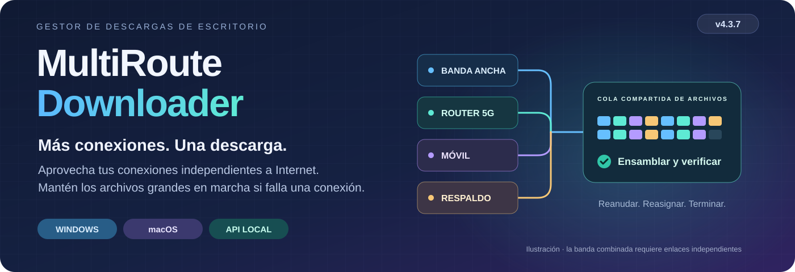
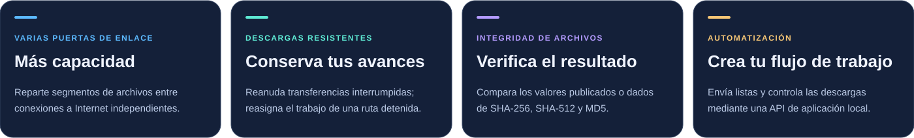

# MultiRoute Downloader
<!-- product-languages:start -->
<p align="center" dir="ltr">
<a href="../../README.md">English</a> · <a href="../../README.ru.md">Русский</a> · <a href="de.md">Deutsch</a> · <strong>Español</strong> · <a href="fr.md">Français</a> · <a href="zh.md">中文</a><br />
<a href="ko.md">한국어</a> · <a href="ar.md">العربية</a> · <a href="it.md">Italiano</a> · <a href="ja.md">日本語</a> · <a href="hi.md">हिन्दी</a> · <a href="vi.md">Tiếng Việt</a>
</p>
<!-- product-languages:end -->

<p align="center"></p>

<p align="center"><strong>Descarga archivos grandes con las conexiones que ya tienes.</strong><br />Combina puertas de enlace independientes de banda ancha y móviles para descargar archivos grandes, conserva el progreso de las transferencias reanudables y comprueba el archivo terminado.</p>

<p align="center">
  <a href="https://github.com/2018-spec-fdsds/multiroute-downloader/releases/tag/v4.3.9"><strong>Descargar 4.3.9</strong></a> ·
  <a href="../../downloads/README.md">Descargas actuales</a> ·
  <a href="../es.md">Guía de usuario</a> ·
  <a href="../../API.ru.txt">Referencia de la API</a> ·
  <a href="../../README.ru.md">Русский</a>
</p>

## Por qué existe MultiRoute

La idea surgió de un problema habitual en las redes domésticas: había una conexión de banda ancha por cable, un router móvil y una conexión a Internet de respaldo, pero una descarga grande seguía utilizando solo la puerta de enlace predeterminada del ordenador. Cuando esa conexión se ralentizaba o fallaba, los demás enlaces no podían ayudar.

MultiRoute reúne esos enlaces independientes en un único espacio de trabajo para descargas. Las puertas de enlace disponibles toman segmentos de archivos de una cola compartida; las más rápidas asumen más trabajo y los segmentos incompletos de una conexión detenida pueden reasignarse. La aplicación conserva el progreso cuando se admite la reanudación, ensambla el resultado y lo compara con una suma de verificación de referencia disponible.

- **Más ancho de banda para un archivo.** Los enlaces independientes descargan distintas partes al mismo tiempo. Su capacidad combinada puede acortar una descarga grande si el origen y la red local pueden mantener el ritmo.
- **Progreso pese a las interrupciones.** Las partes completadas se guardan; las puertas de enlace que funcionan siguen descargando y los segmentos detenidos pueden volver al conjunto compartido de tareas.
- **Control visible.** Sigue la velocidad total y la de cada puerta de enlace, cambia la selección de puertas de enlace durante una transferencia y observa cómo contribuye cada conexión.
- **Flujos de trabajo repetibles.** Reutiliza perfiles de sitios, añade listas de enlaces a la cola o envía transferencias a la API local desde scripts y herramientas de desarrollo.

La mejora real depende de que los enlaces sean independientes, de los límites del origen y de la red local. Varios routers que comparten una misma conexión de salida no multiplican su ancho de banda.



### También es útil con una sola conexión

Utiliza la reanudación compatible, la comparación con sumas de verificación publicadas, el DNS protegido, las colas por lotes, los horarios, los perfiles de sitios, las subidas y la API local. Empieza con una puerta de enlace y añade otras cuando estén disponibles.

## Descarga e instalación

**Versión actual: 4.3.9.** Los instaladores nativos incluyen un entorno Java 21 propio y el componente de red de la plataforma. Abre la aplicación desde su icono habitual.

| Tu ordenador | Instalador en un solo archivo |
| --- | --- |
| **Windows 11 · x64** | [Windows Setup EXE](https://github.com/2018-spec-fdsds/multiroute-downloader/releases/download/v4.3.9/MultiRoute-Downloader-4.3.9-Windows-x64-Setup.exe) |
| **Mac · Apple Silicon · macOS 26+** | [Apple Silicon PKG](https://github.com/2018-spec-fdsds/multiroute-downloader/releases/download/v4.3.9/MultiRoute-Downloader-4.3.9-macOS-arm64.pkg) |
| **Mac · Intel · macOS 15+** | [Intel PKG](https://github.com/2018-spec-fdsds/multiroute-downloader/releases/download/v4.3.9/MultiRoute-Downloader-4.3.9-macOS-x86_64.pkg) |

[Integración con Chrome / Edge](../es.md#chrome-and-edge-integration) · [Sumas de verificación e informe](../../downloads/v4.3.9/README.md) · [Detalles de descarga](../../downloads/README.md)

El instalador de Windows está en inglés y crea un acceso directo en el escritorio. Npcap se comprueba por separado y, si hace falta, se ofrece su instalador oficial; macOS utiliza libpcap del sistema. Consulta la guía de tu idioma para la instalación y las confirmaciones de seguridad. Hay instaladores nativos públicos para Windows y macOS; aquí no se incluye un instalador de Linux 4.x.

**Free / Pro en 4.3.9:** Free permite usar hasta **2 puertas de enlace**, **3 descargas simultáneas** y crear **3 perfiles de sitios**, con apariencia Graphite/Sistema. Las funciones Pro correspondientes permiten hasta **8 puertas de enlace**, **32 descargas simultáneas**, perfiles adicionales, prioridades, historial e informes de puertas de enlace, operaciones por lotes, la API externa y estilos adicionales. Free no limita deliberadamente la velocidad de descarga. [Detalles completos de las funciones](../licensing.en.md).


## Novedades de 4.3.9

- **Respuestas de las puertas de Mac con dirección manual.** Se corrige la captura POSIX para que tanto la dirección manual de la aplicación como DHCP reciban respuestas dirigidas a la MAC propia, como ya sucede en Windows. Un ping del sistema correcto comprueba la conexión del equipo, no la recepción en la dirección virtual de la aplicación.

- Los diagnósticos DHCP conservan su texto en doce idiomas en vez de un error genérico. La autorización existente no cambia: las comprobaciones normales reutilizan el componente preparado. No cambian los endpoints API, controles, rutas del sistema ni MAC física. El primer acceso privilegiado a Ethernet BPF aún puede requerir la confirmación normal de administrador.

Se corrige una diferencia del modo de captura, no todas las causas de una puerta inaccesible. Siguen activas las comprobaciones de dirección libre, subred y concesiones/conflictos DHCP. Las transferencias Mac con dirección manual aún necesitan confirmación en hardware; sigue siendo necesario Ethernet por cable.

### Controles de transferencia

- **Inicio de Mac y configuración de puertas más fiables.** El inicio nativo de Mac reconoce la antigua ruta predeterminada relativa, incluso si falta la barra inicial. Usa un perfil existente verificado o una carpeta predeterminada vacía del usuario. Las ubicaciones personalizadas ambiguas requieren una elección explícita.

- Si la preparación de una puerta falla o se cancela, las otras puertas y las comprobaciones en segundo plano dejan de repetir la autorización hasta que reintentes la configuración de red explícitamente. El primer inicio privilegiado aún puede requerir la confirmación normal de administrador de macOS para abrir el dispositivo BPF de Ethernet.

- El componente de red Mac 4.3.2 admite que macOS oculte la MAC del adaptador y conserva las comprobaciones que protegen la tarjeta física. Se mantiene la MAC propia de la aplicación, sin cambiar las rutas del sistema ni la MAC física. El icono y nombre de Mac usan la misma identidad MultiRoute que Windows. Cierra la aplicación antes de actualizar con PKG. El nombre del solicitante en el diálogo real y las transferencias LAN/DHCP aún necesitan prueba en hardware; este transporte sigue requiriendo Ethernet por cable.


- **Datos que faltan por descargar.** La tabla incluye la columna **Datos restantes**. Muestra los bytes pendientes por separado del tiempo estimado y se ordena numéricamente. Incluye el progreso guardado y en curso, nunca baja de cero y muestra un guion mientras se desconoce el tamaño total.


- **Dé preferencia a sus puertas de enlace.** Las prioridades 0–1000 se muestran junto a los indicadores: los valores mayores favorecen archivos pequeños y reciben más segmentos paralelos de archivos grandes. Las demás puertas operativas siguen ayudando. Requiere el permiso Pro independiente `gateway_priorities`.

- **Entienda las interrupciones.** Abra el registro individual desde el menú contextual, también tras completar el archivo, o la guía de errores con búsqueda y 25 temas en los ajustes. La falta de espacio se indica claramente y el destino muestra espacio libre en GB.

- **Controle la cola.** Configure descargas simultáneas dentro de la licencia y reintentos automáticos. Copie nombres, pause/reanude tareas seleccionadas compatibles y abra la carpeta con doble clic. El prefijo guardado sigue visible en el progreso mientras una reanudación espera datos.


## Tus transferencias, a la vista

El espacio de trabajo de 4.3.9 pone tus archivos en el centro: columnas separadas de nombre y tamaño, progreso individual, velocidad total y por puerta de enlace, una gráfica de velocidad y detalles de los archivos. Graphite y System están incluidos en Free; los estilos adicionales, como Rose, requieren la función Pro correspondiente.


*Interfaz actual de Windows, capturada con un perfil de demostración aislado. Los archivos de ejemplo, el progreso, las velocidades y las vistas habilitadas con Pro ilustran los controles y no son mediciones de rendimiento.*

<details>
<summary><strong>Ajustes de red e historial de velocidad</strong></summary>


</details>


## Elige tu apariencia

Elige entre nueve apariencias: Graphite, Nordic, Streams Studio, Neon, Community, Chat, Studio, Rose y System. Graphite es la predeterminada. Graphite y System están incluidos en Free; las demás opciones requieren la función Pro de apariencia correspondiente. Abre Ajustes → Apariencia para cambiar el estilo y los controles redondeados. Tus descargas continúan mientras eliges.

<table>
<tr>
<td width="50%" valign="top"><strong>Graphite</strong><br /><a href="../images/v4.3.7/downloads-en-ae5b55131583.png"></a></td>
<td width="50%" valign="top"><strong>Nordic</strong><br /><a href="../images/v4.3.7/skin-nordic-a4e8d79666e0.png"></a></td>
</tr>
<tr>
<td width="50%" valign="top"><strong>Streams Studio</strong><br /><a href="../images/v4.3.7/skin-streams-b2f3be388bda.png"></a></td>
<td width="50%" valign="top"><strong>Neon</strong><br /><a href="../images/v4.3.7/skin-neon-6b0c1d2da5f8.png"></a></td>
</tr>
<tr>
<td width="50%" valign="top"><strong>Community</strong><br /><a href="../images/v4.3.7/skin-community-9763964c8f12.png"></a></td>
<td width="50%" valign="top"><strong>Chat</strong><br /><a href="../images/v4.3.7/skin-chat-221a28cc76f4.png"></a></td>
</tr>
<tr>
<td width="50%" valign="top"><strong>Studio</strong><br /><a href="../images/v4.3.7/skin-studio-094e14ba38ea.png"></a></td>
<td width="50%" valign="top"><strong>Rose</strong><br /><a href="../images/v4.3.7/skin-rose-02646e7f35bf.png"></a></td>
</tr>
<tr>
<td width="50%" valign="top"><strong>System</strong><br /><a href="../images/v4.3.7/skin-system-c148099984c6.png"></a></td>
<td width="50%" valign="top"></td>
</tr>
</table>

## Un mensajero que sigue tus descargas

El mensajero de escritorio opcional convierte el progreso de las descargas en una carga visible. Elige al hombre o a la mujer en los ajustes de apariencia y establece el tamaño entre el 40% y el 100%. El saco muestra el total de datos restantes conocidos de las descargas activas y se reduce a medida que llegan los bytes. El movimiento sigue su velocidad de descarga combinada; a velocidad cero, el mensajero permanece quieto. Las cargas pequeñas se llevan al hombro, las mayores se arrastran y las muy grandes muestran más esfuerzo.

Usa el botón Avatar para mostrar u ocultar al mensajero. Arrástralo para moverlo, haz doble clic con el botón izquierdo del ratón para mostrar la aplicación o haz clic con el botón derecho para ver sus opciones. Es un acompañante visual: los archivos permanecen en las carpetas seleccionadas.

Al terminar una descarga, el mensajero deja la carga entregada y se desvanece. Si quedan descargas activas, regresa con los datos restantes.

### Carga restante pequeña · 768 MB

<table>
<tr>
<td width="50%" valign="top"><strong>Mensajero</strong><br /><a href="../images/v4.3.7/avatar-man-shoulder-eeeb879d0240.png"></a></td>
<td width="50%" valign="top"><strong>Mensajera</strong><br /><a href="../images/v4.3.7/avatar-woman-shoulder-5682615d5576.png"></a></td>
</tr>
</table>

### Carga restante media · 7 GB

<table>
<tr>
<td width="50%" valign="top"><strong>Mensajero</strong><br /><a href="../images/v4.3.7/avatar-man-drag-a3dc0a3ed22c.png"></a></td>
<td width="50%" valign="top"><strong>Mensajera</strong><br /><a href="../images/v4.3.7/avatar-woman-drag-48d8ee0fa4d1.png"></a></td>
</tr>
</table>

### Carga restante grande · 18 GB

<table>
<tr>
<td width="50%" valign="top"><strong>Mensajero</strong><br /><a href="../images/v4.3.7/avatar-man-heavy-649f17608748.png"></a></td>
<td width="50%" valign="top"><strong>Mensajera</strong><br /><a href="../images/v4.3.7/avatar-woman-heavy-d445fdb37867.png"></a></td>
</tr>
</table>

## Ajustes de un vistazo

Configura la carpeta de descarga, los perfiles de sitios y el idioma; después ajusta la apariencia, el tamaño del mensajero y los sonidos de finalización. Los ajustes de red reúnen la dirección de la aplicación, la MAC, las puertas de enlace y el DNS. Los sonidos opcionales permiten distinguir entre un archivo completado y toda la cola terminada, con melodías integradas o tus propios clips MP3/WAV de hasta 10 segundos.

<table>
<tr>
<td width="50%" valign="top"><strong>Ajustes de la aplicación</strong><br /><a href="../images/v4.3.7/settings-8abcb12a782d.png"></a></td>
<td width="50%" valign="top"><strong>Apariencia, mensajero y sonidos</strong><br /><a href="../images/v4.3.7/appearance-cebf121d5de7.png"></a></td>
</tr>
<tr>
<td width="50%" valign="top"><strong>Dirección de la aplicación y DNS protegido</strong><br /><a href="../images/v4.3.7/network-dns-e29dfdba1007.png"></a></td>
<td width="50%" valign="top"><strong>Selección de puertas de enlace y pruebas de velocidad</strong><br /><a href="../images/v4.3.7/network-gateways-aee0a7897f48.png"></a></td>
</tr>
</table>

<details>
<summary><strong>Espacios de trabajo de descargas y subidas</strong></summary>

<table>
<tr>
<td width="50%" valign="top"><strong>Crear una descarga</strong><br /><a href="../images/v4.3.7/new-download-dcb720c7769d.png"></a></td>
<td width="50%" valign="top"><strong>Espacio de trabajo de subidas</strong><br /><a href="../images/v4.3.7/uploads-31c63833de2e.png"></a></td>
</tr>
</table>

</details>

## De las necesidades diarias al control práctico

| Quieres… | MultiRoute ofrece |
| --- | --- |
| **Aprovechar las conexiones disponibles** | Una cola compartida de segmentos HTTP, de 1 a 8 perfiles de puertas de enlace editables y selección en directo de una, varias o todas las puertas de enlace. |
| **Conservar y comprobar archivos grandes** | Reanudación compatible, partes guardadas, ensamblado automático y comprobaciones con referencias del editor mediante MD5, SHA-256 o SHA-512. |
| **Proteger las consultas DNS** | DoH/DoT cifrado, proveedores predefinidos o personalizados y DNSSEC local, sin cambiar los ajustes DNS ni las rutas del sistema operativo. |
| **Organizar varias descargas** | Listas de enlaces, prioridades, franjas horarias diarias, inicios diferidos, límites de velocidad y de tareas, estadísticas por puerta de enlace, gráficas e historial con fechas. |
| **Reutilizar sitios habituales** | Perfiles guardados, exploración de carpetas remotas, subidas por FTP/FTPS/SFTP y vistas previas de archivos comprimidos. |
| **Adaptar la aplicación a tu forma de trabajar** | Envío de enlaces desde el navegador, API local, doce idiomas, temas claro/oscuro/del sistema, pegado con el teclado, diálogos del sistema para carpetas, indicador de velocidad en la bandeja del sistema e inicio opcional al iniciar sesión. |

| Transferencia | Opciones compatibles |
| --- | --- |
| **Descarga** | HTTP/HTTPS, FTP, FTPS explícito, SFTP, WebDAV, Metalink, BitTorrent y enlaces magnet; enlaces de Hugging Face y selección de archivos de repositorios. |
| **Subida** | FTP, FTPS explícito y SFTP, con perfiles de sitios y verificación SHA-256 mediante lectura posterior. |
| **Vista previa de archivos comprimidos** | Listado del contenido de ZIP, TAR, 7Z y RAR antes de la descarga completa, cuando hay rangos de bytes y cabeceras compatibles disponibles. |

### Saber qué se ha verificado

Las comprobaciones de archivos comparan los datos ensamblados con una referencia fiable cuando está disponible; un hash local por sí solo no acredita la identidad del editor. DoH/DoT cifra el transporte DNS; DNSSEC valida por separado los datos DNS firmados. Estas comprobaciones no demuestran que el contenido descargado sea inocuo.

## Una API para tus aplicaciones y tu flujo de desarrollo con IA

Los scripts, las aplicaciones de terceros y los agentes de programación con IA pueden pedir a MultiRoute que descargue pesos de modelos, conjuntos de datos, bibliotecas, recursos y artefactos de proyecto necesarios para el desarrollo. Quien realiza la llamada recibe el progreso, la finalización y los resultados de las sumas de verificación, y puede controlar la cola mientras MultiRoute se ocupa de las puertas de enlace, los reintentos y la reanudación compatible.

La API se ejecuta localmente en **`http://127.0.0.1:8765/api/v1`**. Por ejemplo, envía este JSON a **`POST /api/v1/jobs`** con `Content-Type: application/json`:

```json
{
  "url": "https://example.org/model.bin",
  "directory": "C:/Users/YOUR_USER/Downloads",
  "routes": [
    {"type": "gateway", "gateway": "192.168.1.1", "enabled": true}
  ]
}
```

La gestión general mediante la API externa requiere la función Pro correspondiente; la creación por lotes y los límites de puertas de enlace se comprueban por separado. Sustituye la URL, la carpeta y la puerta de enlace por tus valores y configura primero la red. Indica las rutas expresamente: las casillas de la interfaz no se copian a las solicitudes de la API. `201` significa que se ha creado la tarea; conserva `id` y consulta `GET /jobs/{id}` para obtener el progreso, el estado `complete`/`failed` y los detalles de las sumas de verificación. El ejemplo es ilustrativo y no envía ninguna descarga.

[Referencia de la API](../../API.ru.txt) · [Esquema OpenAPI](../../openapi.yaml) · [Guía de integración](../es.md#multiroute-api)

## Empieza en cuatro pasos

1. **Instala** el paquete de tu plataforma y sigue su guía.
2. **Elige los ajustes de red:** Ethernet por cable, puertas de enlace en la misma LAN IPv4 y una dirección virtual libre para la aplicación. Así se mantienen las rutas del sistema operativo de las demás aplicaciones.
3. **Selecciona y prueba las puertas de enlace.** Los valores predeterminados son `192.168.1.1`–`192.168.1.4`, con la dirección virtual `192.168.1.70`; adáptalos a tu red.
4. **Pega un enlace o una lista, elige una carpeta e inicia la descarga.** Sigue la aportación de cada puerta de enlace y la verificación final.

<details>
<summary><strong>Requisitos y detalles de las transferencias</strong></summary>

- El transporte con varias puertas de enlace admite IPv4 público a través de Ethernet por cable; los adaptadores que solo utilizan Wi-Fi/VPN, los orígenes que solo tienen IPv6 y los pares torrent de la LAN local quedan fuera de este modo.
- La reanudación por segmentos requiere compatibilidad con rangos y una identidad estable del origen. Los segmentos HTTP son de 20 MiB por defecto; el trabajo detenido puede reasignarse tras 60 segundos sin datos, una vez que se cierra su proceso de escritura. Las transferencias HTTP que no admiten reanudación vuelven a empezar después de una interrupción. Las piezas torrent utilizan los hashes de los metadatos.
- Cada archivo de subida utiliza una puerta de enlace; varios archivos pueden utilizar distintas puertas de enlace. La verificación mediante lectura posterior consume ancho de banda y requiere permisos remotos de lectura, escritura y cambio de nombre. La vista previa de archivos comprimidos tiene límites de metadatos y cabeceras.
- Los horarios requieren que la aplicación esté en ejecución y el ordenador esté activo; no lo despiertan ni programan la cola de subida independiente.
- El DNS del sistema sigue la política del sistema operativo/VPN. Los anclajes de confianza raíz de DNSSEC se actualizan con las versiones. El DNS cifrado no cifra por sí mismo el contenido de los archivos HTTP/FTP.
- Los instaladores no están firmados; los paquetes de macOS no están firmados con Developer ID ni notarizados. Sigue las confirmaciones normales de las guías sin desactivar las protecciones del sistema. Cada versión incluye su informe de verificación y las limitaciones pendientes.

</details>

## Guías en doce idiomas

[English](../en.md) · [Русский](../ru.md) · [Deutsch](../de.md) · [Español](../es.md) · [Français](../fr.md) · [中文](../zh.md)<br />
[한국어](../ko.md) · [العربية](../ar.md) · [Italiano](../it.md) · [日本語](../ja.md) · [हिन्दी](../hi.md) · [Tiếng Việt](../vi.md)


<a name="application-virtual-ip"></a>

### Dirección de la aplicación y paquetes actuales

La aplicación utiliza su propia dirección IPv4 local y una dirección MAC de aplicación para que las puertas de enlace seleccionadas funcionen con independencia de la puerta de enlace predeterminada del sistema operativo, sin cambiar las rutas del sistema ni la MAC del adaptador físico. Utiliza una dirección libre en la subred real correspondiente. Mantén la dirección manual fuera de la asignación automática de DHCP, o resérvala/exclúyela en los servidores DHCP de la LAN; después utiliza **Comprobar y aplicar** en los ajustes de red. [Selección y comprobación de la dirección](../es.md#application-virtual-ip).

Los paquetes actuales de Windows 4.3.9 superaron una comprobación local de actualización y arranque; los paquetes de macOS superaron las comprobaciones de los componentes nativos y del entorno Java en los ejecutores de CI de destino. Las transferencias mediante puertas de enlace con LAN/DHCP en un Mac físico aún necesitan validación en hardware. [Informe de verificación](../../NATIVE-INSTALLER-TESTS.json).

## Autor y licencia

Creado por **[2018-spec-fdsds](https://github.com/2018-spec-fdsds)**. El uso gratuito incluye el uso personal y el de organizaciones/empresas. Vender la aplicación original, cobrar por su licencia o redistribuirla a cambio de un pago requiere una autorización escrita por separado. No se conceden derechos generales de modificación o redistribución; siguen siendo aplicables las condiciones de terceros.

[Licencia](../../LICENSE.txt) · [Resumen de la licencia](../../LICENSING.md) · [Avisos de terceros](../../THIRD-PARTY-NOTICES.txt)

Esta área de distribución contiene los instaladores actuales de la versión 4.3.9 y la documentación de usuario.
