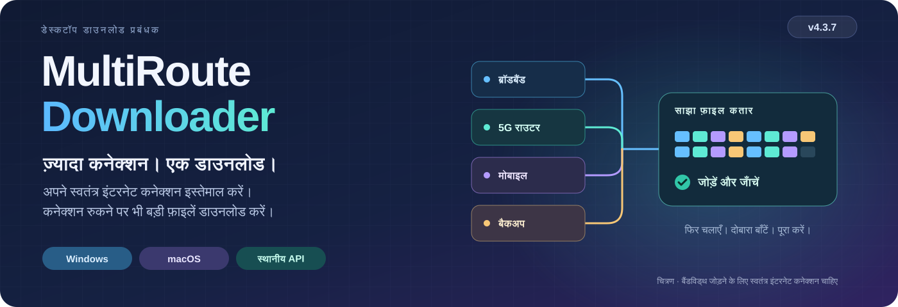

# MultiRoute Downloader

<!-- product-languages:start -->
<p align="center" dir="ltr">
<a href="../../README.md">English</a> · <a href="../../README.ru.md">Русский</a> · <a href="de.md">Deutsch</a> · <a href="es.md">Español</a> · <a href="fr.md">Français</a> · <a href="zh.md">中文</a><br />
<a href="ko.md">한국어</a> · <a href="ar.md">العربية</a> · <a href="it.md">Italiano</a> · <a href="ja.md">日本語</a> · <strong>हिन्दी</strong> · <a href="vi.md">Tiếng Việt</a>
</p>
<!-- product-languages:end -->

<p align="center"></p>

<p align="center"><strong>अपने मौजूदा कनेक्शन से बड़ी फ़ाइलें डाउनलोड करें।</strong><br />बड़ी फ़ाइलें डाउनलोड करने के लिए स्वतंत्र ब्रॉडबैंड और मोबाइल गेटवे जोड़ें, फिर से शुरू किए जा सकने वाले डाउनलोड की प्रगति सहेजें और पूरी हुई फ़ाइल जाँचें।</p>

<p align="center">
  <a href="https://github.com/2018-spec-fdsds/multiroute-downloader/releases/tag/v4.3.9"><strong>4.3.9 डाउनलोड करें</strong></a> ·
  <a href="../../downloads/README.md">मौजूदा डाउनलोड</a> ·
  <a href="../hi.md">उपयोगकर्ता मार्गदर्शिका</a> ·
  <a href="../../API.ru.txt">API संदर्भ</a> ·
  <a href="../../README.ru.md">Русский</a>
</p>

## MultiRoute क्यों बनाया गया

इसका विचार घरेलू नेटवर्क की एक आम समस्या से आया: तार वाला ब्रॉडबैंड, मोबाइल राउटर और बैकअप इंटरनेट कनेक्शन, सब उपलब्ध थे, लेकिन बड़ी फ़ाइल डाउनलोड करने में कंप्यूटर का डिफ़ॉल्ट गेटवे ही इस्तेमाल होता था। वह कनेक्शन धीमा होने या रुकने पर दूसरे कनेक्शन मदद नहीं कर पाते थे।

MultiRoute इन स्वतंत्र कनेक्शन को डाउनलोड के एक ही कार्यक्षेत्र में लाता है। उपलब्ध गेटवे साझा कतार से फ़ाइल के हिस्से लेते हैं; तेज़ गेटवे ज़्यादा काम लेते हैं और रुके कनेक्शन के अधूरे हिस्से दूसरे गेटवे को सौंपे जा सकते हैं। ऐप जहाँ समर्थित हो वहाँ डाउनलोड फिर से शुरू करने के लिए प्रगति सहेजता है, हिस्से जोड़ता है और उपलब्ध संदर्भ चेकसम से परिणाम की तुलना करता है।

- **एक फ़ाइल के लिए ज़्यादा बैंडविड्थ।** स्वतंत्र इंटरनेट कनेक्शन एक ही समय में अलग-अलग हिस्से लाते हैं। स्रोत और स्थानीय नेटवर्क पर्याप्त गति दे सकें, तो इनकी संयुक्त क्षमता से बड़ी फ़ाइल डाउनलोड होने में कम समय लग सकता है।
- **रुकावट के बावजूद प्रगति।** पूरे हुए हिस्से सहेजे जाते हैं; काम कर रहे गेटवे डाउनलोड जारी रखते हैं और रुके हुए हिस्से साझा कार्य-समूह में लौट सकते हैं।
- **स्पष्ट नियंत्रण।** कुल गति और हर गेटवे की गति देखें, ट्रांसफ़र के दौरान गेटवे का चयन बदलें और जानें कि हर कनेक्शन कितना योगदान दे रहा है।
- **दोबारा इस्तेमाल योग्य कार्यप्रवाह।** साइट प्रोफ़ाइल फिर इस्तेमाल करें, लिंक की सूचियाँ कतार में जोड़ें या स्क्रिप्ट और विकास टूल से ट्रांसफ़र स्थानीय API को सौंपें।

वास्तविक लाभ स्वतंत्र इंटरनेट कनेक्शन, स्रोत की सीमाओं और स्थानीय नेटवर्क पर निर्भर करता है। एक ही बाहरी इंटरनेट कनेक्शन साझा करने वाले राउटर उसकी बैंडविड्थ को कई गुना नहीं करते।


### एक कनेक्शन के साथ भी उपयोगी

जहाँ समर्थित हो वहाँ डाउनलोड फिर से शुरू करें, प्रकाशित चेकसम से तुलना करें और सुरक्षित DNS, सामूहिक कतारें, समय-सारणी, साइट प्रोफ़ाइल, अपलोड तथा स्थानीय API का इस्तेमाल करें। एक गेटवे से शुरू करें; दूसरे उपलब्ध होने पर जोड़ें।

## डाउनलोड और इंस्टॉल करें

**मौजूदा संस्करण: 4.3.9।** नेटिव इंस्टॉलर में ऐप के लिए अलग Java 21 और प्लेटफ़ॉर्म का नेटवर्क घटक शामिल है। ऐप को उसके सामान्य आइकन से खोलें।

| आपका कंप्यूटर | एक फ़ाइल वाला इंस्टॉलर |
| --- | --- |
| **Windows 11 · x64** | [Windows Setup EXE](https://github.com/2018-spec-fdsds/multiroute-downloader/releases/download/v4.3.9/MultiRoute-Downloader-4.3.9-Windows-x64-Setup.exe) |
| **Mac · Apple Silicon · macOS 26+** | [Apple Silicon PKG](https://github.com/2018-spec-fdsds/multiroute-downloader/releases/download/v4.3.9/MultiRoute-Downloader-4.3.9-macOS-arm64.pkg) |
| **Mac · Intel · macOS 15+** | [Intel PKG](https://github.com/2018-spec-fdsds/multiroute-downloader/releases/download/v4.3.9/MultiRoute-Downloader-4.3.9-macOS-x86_64.pkg) |

[Chrome / Edge एकीकरण](../hi.md#chrome-and-edge-integration) · [चेकसम और रिपोर्ट](../../downloads/v4.3.9/README.md) · [डाउनलोड का विवरण](../../downloads/README.md)

Windows Setup अंग्रेज़ी में है और डेस्कटॉप शॉर्टकट बनाता है। Npcap की जाँच अलग से होती है और ज़रूरत पड़ने पर उसका आधिकारिक इंस्टॉलर दिया जाता है; macOS सिस्टम के libpcap का इस्तेमाल करता है। इंस्टॉलेशन और सुरक्षा संबंधी पुष्टियों के लिए अपनी भाषा की मार्गदर्शिका देखें। सार्वजनिक नेटिव इंस्टॉलर Windows और macOS के लिए उपलब्ध हैं; यहाँ Linux 4.x का इंस्टॉलर शामिल नहीं है।

**4.3.9 में Free / Pro:** Free में अधिकतम **2 गेटवे**, **3 एक साथ डाउनलोड** और **3 साइट प्रोफ़ाइल** बनाने की सुविधा है, साथ में Graphite/System रूप-रंग मिलता है। संबंधित Pro सुविधाएँ अधिकतम **8 गेटवे**, **32 एक साथ डाउनलोड**, अतिरिक्त प्रोफ़ाइल, प्राथमिकताएँ, गेटवे इतिहास/रिपोर्ट, सामूहिक कार्रवाइयाँ, बाहरी API और अतिरिक्त शैलियाँ देती हैं। Free जानबूझकर डाउनलोड की गति सीमित नहीं करता। [सुविधाओं का पूरा विवरण](../licensing.en.md)।


## 4.3.9 में नया

- **Mac के मैनुअल पते पर गेटवे उत्तर.** POSIX कैप्चर सुधारा गया है ताकि मैनुअल ऐप पता और DHCP दोनों ऐप के अपने MAC पर आने वाले उत्तर प्राप्त करने का मोड इस्तेमाल करें, जैसा Windows में पहले से होता है। सफल सिस्टम ping केवल कंप्यूटर का अपना कनेक्शन जाँचता है, ऐप के वर्चुअल पते पर उत्तर मिलने का प्रमाण नहीं है।

- DHCP निदान सामान्य त्रुटि के बजाय बारह भाषाओं का स्पष्ट पाठ बनाए रखते हैं। मौजूदा प्राधिकरण व्यवहार नहीं बदलता: सामान्य नेटवर्क जाँच तैयार घटक का पुनः उपयोग करती है। API एंडपॉइंट, इंटरफ़ेस नियंत्रण, OS रूट और भौतिक MAC नहीं बदलते। पहले विशेषाधिकार वाले Ethernet BPF प्रवेश में सामान्य प्रशासक पुष्टि अभी भी माँगी जा सकती है।

यह एक कैप्चर मोड का अंतर ठीक करता है, गेटवे तक न पहुँच पाने के हर कारण को नहीं। खाली पता, सबनेट तथा DHCP लीज़ और टकराव की जाँच सक्रिय रहती हैं। Mac पर मैनुअल पते से स्थानांतरण की हार्डवेयर पुष्टि अभी आवश्यक है; तार वाला Ethernet जरूरी है।

### स्थानांतरण नियंत्रण

- **Mac का अधिक विश्वसनीय आरंभ और गेटवे सेटअप.** Mac का मूल आरंभ पुराने सापेक्ष डिफ़ॉल्ट पथ को पहचानता है, जिसमें शुरुआती स्लैश गायब होने की स्थिति भी शामिल है। यह सत्यापित मौजूदा प्रोफ़ाइल या उपयोगकर्ता के खाली डिफ़ॉल्ट फ़ोल्डर का उपयोग करता है। अस्पष्ट कस्टम स्थान के लिए अनुमान लगाने के बजाय स्पष्ट चयन माँगा जाता है।

- गेटवे तैयारी विफल या रद्द होने पर अन्य गेटवे और पृष्ठभूमि जाँच प्राधिकरण अनुरोध दोहराना बंद करती हैं, जब तक आप नेटवर्क सेटअप फिर से स्पष्ट रूप से न करें। Ethernet BPF उपकरण खोलने के लिए पहली विशेषाधिकार वाली शुरुआत में सामान्य macOS प्रशासक पुष्टि अभी भी माँगी जा सकती है।

- Mac नेटवर्क घटक 4.3.2, macOS द्वारा छिपाए गए अडैप्टर MAC को संभालते हुए भौतिक अडैप्टर की सुरक्षा जाँच बनाए रखता है। ऐप अपना MAC रखता है और OS रूट या भौतिक MAC नहीं बदलता। Mac आइकन और ऐप नाम Windows जैसी MultiRoute पहचान अपनाते हैं। PKG अपडेट से पहले ऐप बंद करें। वास्तविक सिस्टम संवाद में अनुरोधकर्ता का नाम तथा LAN/DHCP स्थानांतरण अभी हार्डवेयर पुष्टि माँगते हैं; इस परिवहन के लिए तार वाला Ethernet आवश्यक है।


- **डाउनलोड का बचा डेटा.** डाउनलोड तालिका में अलग **शेष डाउनलोड डेटा** कॉलम है। यह अनुमानित बचे समय से अलग शेष बाइट दिखाता है और संख्यात्मक क्रम में लगाया जा सकता है। इसमें सहेजी गई और जारी प्रगति शामिल होती है, मान शून्य से कम नहीं होता और कुल आकार अज्ञात होने पर डैश दिखता है।


- **गेटवे की पसंद तय करें।** 0–1000 प्राथमिकताएँ संकेतकों के पास दिखती हैं। बड़ा मान छोटे फ़ाइलों के लिए पसंदीदा होता है और बड़ी फ़ाइलों के अधिक समानांतर खंड लेता है; अन्य काम करने वाले गेटवे भी सहयोग करते हैं। अलग Pro अधिकार `gateway_priorities` चाहिए।

- **रुकने का कारण समझें।** पूरा होने के बाद भी संदर्भ मेनू से फ़ाइल का अलग लॉग खोलें या सेटिंग में 25 विषयों वाली खोज योग्य त्रुटि सहायता देखें। डिस्क भरने की स्पष्ट सूचना और सहेजने की जगह में खाली GB दिखते हैं।

- **कतार पर नियंत्रण रखें।** लाइसेंस सीमा में एक साथ डाउनलोड और स्वचालित पुनः प्रयास चुनें। चुने फ़ाइल नाम कॉपी करें, उपयुक्त कार्य रोकें/जारी करें और दोहरे क्लिक से फ़ोल्डर खोलें। फिर शुरू होने के बाद डेटा की प्रतीक्षा में भी सहेजा आरंभिक भाग प्रगति में बना रहता है।


## अपने ट्रांसफ़र साफ़ तौर पर देखें

4.3.9 का कार्यक्षेत्र आपकी फ़ाइलों को केंद्र में रखता है: नाम और आकार के अलग कॉलम, हर फ़ाइल की प्रगति, कुल और हर गेटवे की गति, गति का ग्राफ़ और फ़ाइल का विवरण। Graphite और System, Free में शामिल हैं; Rose जैसी अतिरिक्त शैलियों के लिए संबंधित Pro सुविधा चाहिए।


*Windows पर ऐप का मौजूदा इंटरफ़ेस, जिसे अलग डेमो प्रोफ़ाइल में कैप्चर किया गया है। दिखाई गई फ़ाइलें, प्रगति, गति और Pro सुविधाओं से उपलब्ध स्क्रीन केवल नियंत्रणों को समझाने के उदाहरण हैं; ये प्रदर्शन के माप नहीं हैं।*

<details>
<summary><strong>नेटवर्क सेटिंग और गति का इतिहास</strong></summary>


</details>


## अपना रूप-रंग चुनें

नौ शैलियों में से चुनें: Graphite, Nordic, Streams Studio, Neon, Community, Chat, Studio, Rose और System। Graphite डिफ़ॉल्ट है। Graphite और System, Free में शामिल हैं; बाकी विकल्पों के लिए संबंधित Pro रूप-रंग सुविधा चाहिए। शैली और गोल कोनों वाले नियंत्रण बदलने के लिए सेटिंग → रूप-रंग खोलें। आपके चुनने के दौरान डाउनलोड चलते रहते हैं।

<table>
<tr>
<td width="50%" valign="top"><strong>Graphite</strong><br /><a href="../images/v4.3.7/downloads-en-ae5b55131583.png"></a></td>
<td width="50%" valign="top"><strong>Nordic</strong><br /><a href="../images/v4.3.7/skin-nordic-a4e8d79666e0.png"></a></td>
</tr>
<tr>
<td width="50%" valign="top"><strong>Streams Studio</strong><br /><a href="../images/v4.3.7/skin-streams-b2f3be388bda.png"></a></td>
<td width="50%" valign="top"><strong>Neon</strong><br /><a href="../images/v4.3.7/skin-neon-6b0c1d2da5f8.png"></a></td>
</tr>
<tr>
<td width="50%" valign="top"><strong>Community</strong><br /><a href="../images/v4.3.7/skin-community-9763964c8f12.png"></a></td>
<td width="50%" valign="top"><strong>Chat</strong><br /><a href="../images/v4.3.7/skin-chat-221a28cc76f4.png"></a></td>
</tr>
<tr>
<td width="50%" valign="top"><strong>Studio</strong><br /><a href="../images/v4.3.7/skin-studio-094e14ba38ea.png"></a></td>
<td width="50%" valign="top"><strong>Rose</strong><br /><a href="../images/v4.3.7/skin-rose-02646e7f35bf.png"></a></td>
</tr>
<tr>
<td width="50%" valign="top"><strong>System</strong><br /><a href="../images/v4.3.7/skin-system-c148099984c6.png"></a></td>
<td width="50%" valign="top"></td>
</tr>
</table>

## आपके डाउनलोड के साथ चलता कुरियर

वैकल्पिक डेस्कटॉप कुरियर डाउनलोड की प्रगति को दिखाई देने वाले भार में बदलता है। रूप-रंग की सेटिंग में पुरुष या महिला चुनें और आकार 40% से 100% तक रखें। बोरी सक्रिय डाउनलोड के ज्ञात बचे हुए डेटा का कुल आकार दिखाती है और बाइट आने के साथ छोटी होती जाती है। उसकी चाल इन डाउनलोड की कुल गति पर निर्भर करती है; गति शून्य होने पर कुरियर स्थिर खड़ा रहता है। छोटा भार कंधे पर उठाया जाता है, बड़ा भार खींचा जाता है और बहुत बड़े भार पर अधिक मेहनत दिखाई देती है।

कुरियर दिखाने या छिपाने के लिए अवतार बटन इस्तेमाल करें। उसे खींचकर उसकी जगह बदलें, ऐप दिखाने के लिए बाएँ माउस बटन से दो बार क्लिक करें या उसके विकल्पों के लिए दाएँ बटन से क्लिक करें। यह एक दृश्य साथी है; फ़ाइलें अपने चुने हुए फ़ोल्डरों में रहती हैं।

डाउनलोड पूरा होने पर कूरियर पहुँचाया गया बोझ नीचे रखता है और धीरे-धीरे गायब हो जाता है। अगर डाउनलोड जारी हैं, तो वह बाकी डेटा के साथ लौटता है।

### कम शेष भार · 768 MB

<table>
<tr>
<td width="50%" valign="top"><strong>पुरुष कुरियर</strong><br /><a href="../images/v4.3.7/avatar-man-shoulder-eeeb879d0240.png"></a></td>
<td width="50%" valign="top"><strong>महिला कुरियर</strong><br /><a href="../images/v4.3.7/avatar-woman-shoulder-5682615d5576.png"></a></td>
</tr>
</table>

### मध्यम शेष भार · 7 GB

<table>
<tr>
<td width="50%" valign="top"><strong>पुरुष कुरियर</strong><br /><a href="../images/v4.3.7/avatar-man-drag-a3dc0a3ed22c.png"></a></td>
<td width="50%" valign="top"><strong>महिला कुरियर</strong><br /><a href="../images/v4.3.7/avatar-woman-drag-48d8ee0fa4d1.png"></a></td>
</tr>
</table>

### अधिक शेष भार · 18 GB

<table>
<tr>
<td width="50%" valign="top"><strong>पुरुष कुरियर</strong><br /><a href="../images/v4.3.7/avatar-man-heavy-649f17608748.png"></a></td>
<td width="50%" valign="top"><strong>महिला कुरियर</strong><br /><a href="../images/v4.3.7/avatar-woman-heavy-d445fdb37867.png"></a></td>
</tr>
</table>

## एक नज़र में सेटिंग

डाउनलोड फ़ोल्डर, साइट प्रोफ़ाइल और भाषा तय करें, फिर रूप-रंग, कुरियर का आकार और पूरा होने की धुनें बदलें। नेटवर्क सेटिंग में ऐप का पता, MAC, गेटवे और DNS एक ही जगह मिलते हैं। वैकल्पिक धुनें एक फ़ाइल पूरी होने और पूरी कतार पूरी होने में अंतर बता सकती हैं; पहले से मौजूद धुनें या अपनी MP3/WAV क्लिप इस्तेमाल करें, जिनकी अवधि अधिकतम 10 सेकंड हो।

<table>
<tr>
<td width="50%" valign="top"><strong>ऐप की सेटिंग</strong><br /><a href="../images/v4.3.7/settings-8abcb12a782d.png"></a></td>
<td width="50%" valign="top"><strong>रूप-रंग, कुरियर और ध्वनियाँ</strong><br /><a href="../images/v4.3.7/appearance-cebf121d5de7.png"></a></td>
</tr>
<tr>
<td width="50%" valign="top"><strong>ऐप का पता और सुरक्षित DNS</strong><br /><a href="../images/v4.3.7/network-dns-e29dfdba1007.png"></a></td>
<td width="50%" valign="top"><strong>गेटवे का चयन और गति की जाँच</strong><br /><a href="../images/v4.3.7/network-gateways-aee0a7897f48.png"></a></td>
</tr>
</table>

<details>
<summary><strong>डाउनलोड और अपलोड के कार्यक्षेत्र</strong></summary>

<table>
<tr>
<td width="50%" valign="top"><strong>डाउनलोड बनाएँ</strong><br /><a href="../images/v4.3.7/new-download-dcb720c7769d.png"></a></td>
<td width="50%" valign="top"><strong>अपलोड कार्यक्षेत्र</strong><br /><a href="../images/v4.3.7/uploads-31c63833de2e.png"></a></td>
</tr>
</table>

</details>

## रोज़मर्रा की ज़रूरतों से व्यावहारिक नियंत्रण तक

| आप क्या करना चाहते हैं… | MultiRoute क्या देता है |
| --- | --- |
| **उपलब्ध कनेक्शन इस्तेमाल करना** | HTTP हिस्सों की साझा कतार, संपादन योग्य 1–8 गेटवे प्रोफ़ाइल और काम के दौरान एक, कई या सभी गेटवे चुनने की सुविधा। |
| **बड़ी फ़ाइलें सहेजना और जाँचना** | जहाँ समर्थित हो वहाँ डाउनलोड फिर से शुरू करना, सहेजे हुए हिस्से, अपने आप फ़ाइल जोड़ना और प्रकाशक के संदर्भ मानों से MD5, SHA-256 या SHA-512 की जाँच। |
| **DNS अनुरोध सुरक्षित रखना** | एन्क्रिप्टेड DoH/DoT, पहले से तय या अपने चुने प्रदाता और स्थानीय DNSSEC, बिना OS की DNS सेटिंग या रूट बदले। |
| **कई डाउनलोड व्यवस्थित करना** | एक साथ कई लिंक जोड़ना, प्राथमिकताएँ, रोज़ के समय-अंतराल, देर से शुरू करना, गति/कार्यों की सीमाएँ, हर गेटवे के आँकड़े, ग्राफ़ और तारीख़वार इतिहास। |
| **परिचित साइटें दोबारा इस्तेमाल करना** | सहेजी हुई प्रोफ़ाइल, दूरस्थ फ़ोल्डर ब्राउज़ करना, FTP/FTPS/SFTP अपलोड और आर्काइव का पूर्वावलोकन। |
| **अपने काम के तरीके के अनुसार ढालना** | ब्राउज़र से लिंक भेजना, स्थानीय API, बारह भाषाएँ, हल्की/गहरी/सिस्टम थीम, कीबोर्ड से पेस्ट करना, सिस्टम के फ़ोल्डर संवाद, ट्रे में गति का संकेतक और साइन-इन पर वैकल्पिक शुरुआत। |

| ट्रांसफ़र | समर्थित विकल्प |
| --- | --- |
| **डाउनलोड** | HTTP/HTTPS, FTP, explicit FTPS, SFTP, WebDAV, Metalink, BitTorrent और magnet; Hugging Face लिंक और रिपॉज़िटरी से फ़ाइलें चुनना। |
| **अपलोड** | FTP, explicit FTPS और SFTP, साइट प्रोफ़ाइल तथा फ़ाइल वापस पढ़कर SHA-256 सत्यापन के साथ। |
| **आर्काइव पूर्वावलोकन** | बाइट रेंज और समर्थित हेडर उपलब्ध होने पर पूरी फ़ाइल डाउनलोड करने से पहले ZIP, TAR, 7Z और RAR की सामग्री की सूची। |

### जानें कि किस चीज़ का सत्यापन हुआ

जब भरोसेमंद संदर्भ उपलब्ध हो, तो फ़ाइल की जाँच में जुड़े हुए डेटा की उससे तुलना की जाती है; केवल स्थानीय हैश से प्रकाशक की पहचान प्रमाणित नहीं होती। DoH/DoT DNS के संचार को एन्क्रिप्ट करते हैं; DNSSEC अलग से हस्ताक्षरित DNS डेटा को सत्यापित करता है। ये जाँच यह प्रमाणित नहीं करतीं कि डाउनलोड की गई सामग्री हानिरहित है।

## आपके ऐप और AI कोडिंग कार्यप्रवाह के लिए API

स्क्रिप्ट, अन्य ऐप और AI कोडिंग एजेंट MultiRoute से विकास के लिए ज़रूरी मॉडल वेट, डेटासेट, लाइब्रेरी, संसाधन और परियोजना के आर्टिफ़ैक्ट डाउनलोड करने को कह सकते हैं। अनुरोध भेजने वाले को प्रगति, पूर्णता और चेकसम के परिणाम मिलते हैं तथा वह कतार को नियंत्रित कर सकता है, जबकि MultiRoute गेटवे, दोबारा प्रयास और समर्थित डाउनलोड पुनरारंभ संभालता है।

API स्थानीय रूप से **`http://127.0.0.1:8765/api/v1`** पर चलता है। उदाहरण के लिए, `Content-Type: application/json` के साथ यह JSON **`POST /api/v1/jobs`** पर भेजें:

```json
{
  "url": "https://example.org/model.bin",
  "directory": "C:/Users/YOUR_USER/Downloads",
  "routes": [
    {"type": "gateway", "gateway": "192.168.1.1", "enabled": true}
  ]
}
```

बाहरी API से सामान्य प्रबंधन के लिए संबंधित Pro सुविधा चाहिए; सामूहिक कार्य निर्माण और गेटवे की सीमाएँ अलग से जाँची जाती हैं। URL, फ़ोल्डर और गेटवे की जगह अपने मान डालें; पहले नेटवर्क कॉन्फ़िगर करें। रूट स्पष्ट रूप से दें: UI के चेकबॉक्स API अनुरोधों में कॉपी नहीं होते। `201` का अर्थ कार्य बनाया जाना है; `id` सहेजें और प्रगति, `complete`/`failed` स्थिति तथा चेकसम के विवरण के लिए `GET /jobs/{id}` पढ़ें। यह उदाहरण केवल समझाने के लिए है और कोई डाउनलोड जमा नहीं करता।

[API संदर्भ](../../API.ru.txt) · [OpenAPI स्कीमा](../../openapi.yaml) · [एकीकरण मार्गदर्शिका](../hi.md#multiroute-api)

## चार चरणों में शुरुआत करें

1. अपने प्लेटफ़ॉर्म का पैकेज **इंस्टॉल करें** और उसकी मार्गदर्शिका का पालन करें।
2. **नेटवर्क सेटिंग चुनें:** तार वाला Ethernet, उसी IPv4 LAN के गेटवे और ऐप का कोई खाली वर्चुअल पता। इससे दूसरे ऐप के OS रूट नहीं बदलते।
3. **गेटवे चुनें और जाँचें।** डिफ़ॉल्ट गेटवे `192.168.1.1`–`192.168.1.4` हैं और वर्चुअल पता `192.168.1.70` है; इन्हें अपने नेटवर्क के अनुसार बदलें।
4. **लिंक या सूची पेस्ट करें, फ़ोल्डर चुनें और शुरू करें।** हर गेटवे के योगदान और अंतिम सत्यापन को देखें।

<details>
<summary><strong>ज़रूरतें और ट्रांसफ़र का विवरण</strong></summary>

- कई गेटवे वाला ट्रांसपोर्ट तार वाले Ethernet पर सार्वजनिक IPv4 का समर्थन करता है; केवल Wi-Fi/VPN वाले अडैप्टर, केवल IPv6 वाले स्रोत और स्थानीय LAN के torrent पीयर इस मोड में शामिल नहीं हैं।
- हिस्सों में डाउनलोड फिर से शुरू करने के लिए रेंज समर्थन और स्रोत की स्थिर पहचान चाहिए। HTTP हिस्सों का डिफ़ॉल्ट आकार 20 MiB है; डेटा न मिलने के 60 सेकंड बाद रुका हुआ काम दूसरे गेटवे को दिया जा सकता है, बशर्ते उसका लिखने वाला भाग बंद हो चुका हो। फिर से शुरू न हो सकने वाला HTTP डाउनलोड रुकावट के बाद शुरुआत से चलता है। Torrent हिस्से मेटाडेटा के हैश इस्तेमाल करते हैं।
- अपलोड की एक फ़ाइल एक गेटवे इस्तेमाल करती है; अलग-अलग फ़ाइलें अलग गेटवे इस्तेमाल कर सकती हैं। वापस पढ़कर सत्यापन करने में बैंडविड्थ लगती है और दूरस्थ पढ़ने/लिखने/नाम बदलने की अनुमतियाँ चाहिए। आर्काइव पूर्वावलोकन पर मेटाडेटा/हेडर की सीमाएँ हैं।
- समय-सारणी के लिए ऐप चलना और कंप्यूटर जागा हुआ होना ज़रूरी है; वह कंप्यूटर को नहीं जगाती और अलग अपलोड कतार को शेड्यूल नहीं करती।
- सिस्टम DNS, OS/VPN की नीति का पालन करता है। DNSSEC के रूट ट्रस्ट एंकर रिलीज़ के साथ अपडेट होते हैं। एन्क्रिप्टेड DNS अपने आप HTTP/FTP फ़ाइलों की सामग्री एन्क्रिप्ट नहीं करता।
- इंस्टॉलर हस्ताक्षरित नहीं हैं; macOS पैकेज पर Developer ID के हस्ताक्षर या notarization नहीं है। सिस्टम सुरक्षा बंद किए बिना मार्गदर्शिकाओं में दी गई सामान्य पुष्टियों का पालन करें। हर रिलीज़ में उसकी सत्यापन रिपोर्ट और बाकी सीमाएँ शामिल हैं।

</details>

## बारह भाषाओं में मार्गदर्शिकाएँ

[English](../en.md) · [Русский](../ru.md) · [Deutsch](../de.md) · [Español](../es.md) · [Français](../fr.md) · [中文](../zh.md)<br />
[한국어](../ko.md) · [العربية](../ar.md) · [Italiano](../it.md) · [日本語](../ja.md) · [हिन्दी](../hi.md) · [Tiếng Việt](../vi.md)


<a name="application-virtual-ip"></a>

### ऐप का पता और मौजूदा पैकेज

ऐप अपना अलग स्थानीय IPv4 पता और ऐप का MAC इस्तेमाल करता है, ताकि चुने हुए गेटवे OS के डिफ़ॉल्ट गेटवे से स्वतंत्र रूप से काम कर सकें, बिना OS रूट या भौतिक अडैप्टर का MAC बदले। उसी वास्तविक सबनेट में कोई खाली पता चुनें। मैनुअल पता स्वचालित DHCP आवंटन से बाहर रखें या LAN के DHCP सर्वर पर उसे रिज़र्व/आवंटन से बाहर करें; फिर नेटवर्क सेटिंग में **Check and apply** (जाँचें और लागू करें) इस्तेमाल करें। [पता चुनना और जाँचना](../hi.md#application-virtual-ip)।

मौजूदा 4.3.9 Windows पैकेज स्थानीय अपग्रेड/शुरुआत की जाँच में सफल रहे; macOS पैकेज लक्षित CI रनर पर नेटिव और Java रनटाइम की जाँच में सफल रहे। वास्तविक Mac पर LAN/DHCP गेटवे से ट्रांसफ़र के लिए अभी हार्डवेयर सत्यापन चाहिए। [सत्यापन रिपोर्ट](../../NATIVE-INSTALLER-TESTS.json)।

## स्वामी और लाइसेंस

**[2018-spec-fdsds](https://github.com/2018-spec-fdsds)** द्वारा बनाया गया। मुफ़्त इस्तेमाल में व्यक्तिगत तथा संगठनात्मक/व्यावसायिक उपयोग शामिल है। मूल ऐप बेचने, उसके लाइसेंस के लिए शुल्क लेने या भुगतान के बदले पुनर्वितरण के लिए अलग लिखित अनुमति चाहिए। सामान्य संशोधन/पुनर्वितरण अधिकार नहीं दिए गए हैं; तीसरे पक्ष की शर्तें लागू रहती हैं।

[लाइसेंस](../../LICENSE.txt) · [लाइसेंस का सारांश](../../LICENSING.md) · [तीसरे पक्ष की सूचनाएँ](../../THIRD-PARTY-NOTICES.txt)

इस वितरण क्षेत्र में मौजूदा 4.3.9 इंस्टॉलर और उपयोगकर्ता दस्तावेज़ हैं।
