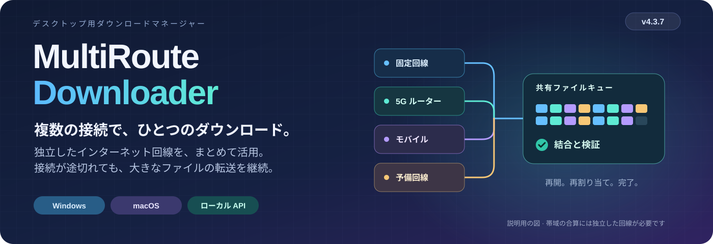

# MultiRoute Downloader
<!-- product-languages:start -->
<p align="center" dir="ltr">
<a href="../../README.md">English</a> · <a href="../../README.ru.md">Русский</a> · <a href="de.md">Deutsch</a> · <a href="es.md">Español</a> · <a href="fr.md">Français</a> · <a href="zh.md">中文</a><br />
<a href="ko.md">한국어</a> · <a href="ar.md">العربية</a> · <a href="it.md">Italiano</a> · <strong>日本語</strong> · <a href="hi.md">हिन्दी</a> · <a href="vi.md">Tiếng Việt</a>
</p>
<!-- product-languages:end -->

<p align="center"></p>

<p align="center"><strong>いまあるインターネット接続で、大きなファイルをダウンロード。</strong><br />独立した固定回線とモバイル回線のゲートウェイを組み合わせて大きなファイルをダウンロードし、再開に対応した転送の進行状況を保持して、完成したファイルを検証します。</p>

<p align="center">
  <a href="https://github.com/2018-spec-fdsds/multiroute-downloader/releases/tag/v4.3.9"><strong>4.3.9 をダウンロード</strong></a> ·
  <a href="../../downloads/README.md">現在のダウンロード</a> ·
  <a href="../ja.md">ユーザーガイド</a> ·
  <a href="../../API.ru.txt">API リファレンス</a> ·
  <a href="../../README.ru.md">Русский</a>
</p>

## MultiRoute が必要な理由

このアイデアは、家庭のネットワークでよくある問題から生まれました。有線ブロードバンド、モバイルルーター、予備のインターネット接続がすべて使えるのに、大きなファイルのダウンロードはコンピューターのデフォルトゲートウェイしか使いません。その接続が遅くなったり途切れたりしても、ほかの回線は助けになりませんでした。

MultiRoute は、これらの独立した回線をひとつのダウンロード用ワークスペースにまとめます。使用可能なゲートウェイが共有キューからファイルのセグメントを受け取り、速いゲートウェイほど多くのタスクを担当します。停滞した接続に残った未完了のセグメントは、再割り当てできます。アプリは再開に対応した転送の進行状況を保持し、結果を結合して、利用可能な参照チェックサムと照合します。

- **ひとつのファイルに、より多くの帯域を。** 独立した上り回線が異なる部分を同時に取得します。配信元とローカルネットワークに十分な余裕があれば、回線の帯域を合わせることで大きなファイルのダウンロード時間を短縮できます。
- **中断しても進行状況を保持。** 完了したパーツは保存されます。動作中のゲートウェイはダウンロードを続け、停滞したセグメントは共有タスクプールに戻せます。
- **見ながら制御。** 全体とゲートウェイ別の速度を確認し、転送中にゲートウェイの選択を変更して、各接続の働きを把握できます。
- **繰り返し使える作業手順。** サイトプロファイルの再利用、リンク一覧のキューへの追加、スクリプトや開発ツールからローカル API への転送依頼に対応します。

実際の効果は、回線の独立性、配信元の制限、ローカルネットワークによって変わります。同じ上流回線を共有するルーターを増やしても、その回線の帯域は増えません。


### 接続がひとつでも便利です

対応する転送の再開、公開チェックサムとの照合、保護された DNS、一括キュー、スケジュール、サイトプロファイル、アップロード、ローカル API を利用できます。まずはゲートウェイひとつで始め、ほかのゲートウェイが使えるようになったら追加できます。

## ダウンロードとインストール

**現在のバージョン：4.3.9。** ネイティブインストーラーには、アプリ専用の Java 21 とプラットフォームのネットワークコンポーネントが含まれています。通常のアプリアイコンから起動してください。

| お使いのコンピューター | 単一ファイルのインストーラー |
| --- | --- |
| **Windows 11 · x64** | [Windows セットアップ EXE](https://github.com/2018-spec-fdsds/multiroute-downloader/releases/download/v4.3.9/MultiRoute-Downloader-4.3.9-Windows-x64-Setup.exe) |
| **Mac · Apple Silicon · macOS 26+** | [Apple Silicon PKG](https://github.com/2018-spec-fdsds/multiroute-downloader/releases/download/v4.3.9/MultiRoute-Downloader-4.3.9-macOS-arm64.pkg) |
| **Mac · Intel · macOS 15+** | [Intel PKG](https://github.com/2018-spec-fdsds/multiroute-downloader/releases/download/v4.3.9/MultiRoute-Downloader-4.3.9-macOS-x86_64.pkg) |

[Chrome / Edge 連携](../ja.md#chrome-and-edge-integration) · [チェックサムとレポート](../../downloads/v4.3.9/README.md) · [ダウンロードの詳細](../../downloads/README.md)

Windows セットアップは英語で表示され、デスクトップにショートカットを作成します。Npcap は別途確認され、必要に応じて公式インストーラーが案内されます。macOS はシステムの libpcap を使用します。インストールとセキュリティ確認の手順は、各言語のガイドを参照してください。公開ネイティブインストーラーは Windows と macOS 向けで、ここには Linux 4.x インストーラーは含まれていません。

**4.3.9 の Free / Pro：** Free は最大 **2 つのゲートウェイ**、**3 件の同時ダウンロード**に対応し、**3 つのサイトプロファイル**を作成できます。外観は Graphite（グラファイト）/System（システム設定）を利用できます。対応する Pro 機能では、最大 **8 つのゲートウェイ**、**32 件の同時ダウンロード**、追加のプロファイル、優先度、ゲートウェイの履歴/レポート、一括操作、外部 API、追加の外観スタイルを利用できます。Free がダウンロード速度を意図的に制限することはありません。[機能の詳細](../licensing.en.md)。


## 4.3.9 の新機能

- **Mac の手動アドレスでのゲートウェイ応答.** POSIX のキャプチャ設定を修正し、手動のアプリアドレスと DHCP の両方でアプリ独自の MAC 宛ての応答を受信できるモードを使います。既存の Windows 動作と同じです。システム ping の成功はコンピューター自身の接続確認であり、アプリの仮想アドレスへの応答受信を証明しません。

- DHCP の診断は一般的なエラーに置き換えず、十二言語の具体的な説明を維持します。既存の認証動作は変わりません。通常のネットワーク確認は準備済み部品を再利用します。API、画面の操作項目、OS の経路や物理 MAC は変更しません。最初の特権 Ethernet BPF アクセスでは通常の管理者確認が必要な場合があります。

これは一つのキャプチャモードの差の修正であり、すべてのゲートウェイ接続障害を解決するものではありません。アドレス空き、サブネット、DHCP リースと競合の確認は維持します。Mac の手動アドレス転送は実機での確認が引き続き必要で、有線 Ethernet が必要です。

### 転送を管理

- **Mac の起動とゲートウェイ設定をより確実に.** Mac のネイティブ起動では、先頭のスラッシュがない場合を含む旧来の相対既定パスを認識し、確認済みの既存プロファイルまたはユーザー所有の空の既定フォルダーを使います。曖昧なカスタム場所は推測せず、明示的な選択を求めます。

- ゲートウェイの準備が失敗またはキャンセルされた後は、ネットワーク設定を明示的に再試行するまで、他のゲートウェイやバックグラウンド確認が認証要求を繰り返しません。最初の特権起動では Ethernet BPF デバイスを開くため、通常の macOS 管理者確認が必要な場合があります。

- Mac ネットワーク部品 4.3.2 は macOS がアダプターの MAC を隠す場合に対応し、物理アダプターの保護確認を維持します。アプリ独自の MAC を使い、OS の経路や物理 MAC を変更しません。Mac のアイコンと名前は Windows と同じ MultiRoute の識別に統一されます。PKG 更新前にアプリを終了してください。実際の認証画面の要求元名と LAN/DHCP 転送は引き続き実機での確認が必要で、この転送には有線 Ethernet が必要です。


- **残りのダウンロードデータ.** ダウンロード一覧に **残りのダウンロード量** 列を追加しました。残り時間の予測とは別に、未ダウンロードのバイト数を表示し、数値順で並べ替えられます。保存済みと受信中の進捗を反映し、ゼロ未満にはなりません。合計サイズが不明な場合はダッシュを表示します。


- **ゲートウェイの優先設定。** 0～1000 の優先度を表示の横に示します。高い値は小さいファイルで優先され、大きいファイルの並列セグメントも多く受け取ります。他の正常なゲートウェイも協力します。個別の Pro 権限 `gateway_priorities` が必要です。

- **中断の理由を確認。** 完了後も右クリックメニューから個別ログを開けます。設定には 25 項目の検索可能なエラーガイドがあります。ディスク容量不足を明示し、保存先に空き容量を GB 単位で表示します。

- **キューを管理。** ライセンス範囲内の同時ダウンロード数と自動再試行を設定します。選択したファイル名のコピー、対応タスクの一時停止・再開ができ、ダブルクリックでフォルダーが開きます。再開後のデータ待機中も保存済みの先頭部分を進捗に保持します。


## 転送の状況をわかりやすく

4.3.9 のワークスペースはファイルが中心です。名前とサイズの独立した列、ファイルごとの進行状況、全体とゲートウェイ別の速度、速度グラフ、ファイルの詳細を表示します。Free には Graphite と System の外観が含まれます。Rose などの追加スタイルには、対応する Pro 機能が必要です。


*独立したデモプロファイルで撮影した、現在の Windows 画面です。ファイル、進行状況、速度、Pro 機能を有効にした表示は操作説明用の例であり、性能の測定結果ではありません。*

<details>
<summary><strong>ネットワーク設定と速度の履歴</strong></summary>


</details>


## 好みの外観を選ぶ

Graphite、Nordic、Streams Studio、Neon、Community、Chat、Studio、Rose、System の9種類から選べます。既定の外観は Graphite です。Free には Graphite と System が含まれ、他の選択肢には対応する Pro の外観機能が必要です。「設定 → 外観」でスタイルや操作部品の角丸を変更できます。選択中もダウンロードは継続します。

<table>
<tr>
<td width="50%" valign="top"><strong>Graphite</strong><br /><a href="../images/v4.3.7/downloads-en-ae5b55131583.png"></a></td>
<td width="50%" valign="top"><strong>Nordic</strong><br /><a href="../images/v4.3.7/skin-nordic-a4e8d79666e0.png"></a></td>
</tr>
<tr>
<td width="50%" valign="top"><strong>Streams Studio</strong><br /><a href="../images/v4.3.7/skin-streams-b2f3be388bda.png"></a></td>
<td width="50%" valign="top"><strong>Neon</strong><br /><a href="../images/v4.3.7/skin-neon-6b0c1d2da5f8.png"></a></td>
</tr>
<tr>
<td width="50%" valign="top"><strong>Community</strong><br /><a href="../images/v4.3.7/skin-community-9763964c8f12.png"></a></td>
<td width="50%" valign="top"><strong>Chat</strong><br /><a href="../images/v4.3.7/skin-chat-221a28cc76f4.png"></a></td>
</tr>
<tr>
<td width="50%" valign="top"><strong>Studio</strong><br /><a href="../images/v4.3.7/skin-studio-094e14ba38ea.png"></a></td>
<td width="50%" valign="top"><strong>Rose</strong><br /><a href="../images/v4.3.7/skin-rose-02646e7f35bf.png"></a></td>
</tr>
<tr>
<td width="50%" valign="top"><strong>System</strong><br /><a href="../images/v4.3.7/skin-system-c148099984c6.png"></a></td>
<td width="50%" valign="top"></td>
</tr>
</table>

## ダウンロードの進行に寄り添う配達員

任意で表示できるデスクトップの配達員が、ダウンロードの進行状況を目に見える荷物で表現します。外観設定で男性または女性を選び、サイズを 40%～100% に設定してください。袋には、進行中のダウンロードのうち残量がわかるデータの合計を表示し、バイトを受信するにつれて小さくなります。動きはこれらのダウンロードの合計速度に連動し、速度がゼロになると配達員は立ち止まります。少ない荷物は肩に担ぎ、多い荷物は引きずり、非常に多い荷物ではさらに力を込めて運びます。

「アバター」ボタンで配達員の表示・非表示を切り替えます。ドラッグで移動し、マウスの左ボタンでダブルクリックするとアプリを表示、右クリックするとオプションを開きます。これは視覚的な演出であり、ファイルはそれぞれ選択したフォルダーに残ります。

ダウンロードが完了すると、配達員は届けた荷物を置いて徐々に消えます。ダウンロードが続いていれば、残りのデータを持って戻ります。

### 残りの荷物が少ない · 768 MB

<table>
<tr>
<td width="50%" valign="top"><strong>男性の配達員</strong><br /><a href="../images/v4.3.7/avatar-man-shoulder-eeeb879d0240.png"></a></td>
<td width="50%" valign="top"><strong>女性の配達員</strong><br /><a href="../images/v4.3.7/avatar-woman-shoulder-5682615d5576.png"></a></td>
</tr>
</table>

### 残りの荷物が中程度 · 7 GB

<table>
<tr>
<td width="50%" valign="top"><strong>男性の配達員</strong><br /><a href="../images/v4.3.7/avatar-man-drag-a3dc0a3ed22c.png"></a></td>
<td width="50%" valign="top"><strong>女性の配達員</strong><br /><a href="../images/v4.3.7/avatar-woman-drag-48d8ee0fa4d1.png"></a></td>
</tr>
</table>

### 残りの荷物が多い · 18 GB

<table>
<tr>
<td width="50%" valign="top"><strong>男性の配達員</strong><br /><a href="../images/v4.3.7/avatar-man-heavy-649f17608748.png"></a></td>
<td width="50%" valign="top"><strong>女性の配達員</strong><br /><a href="../images/v4.3.7/avatar-woman-heavy-d445fdb37867.png"></a></td>
</tr>
</table>

## 設定をひと目で

ダウンロード先のフォルダー、サイトプロファイル、言語を設定し、外観、配達員のサイズ、完了音を調整できます。ネットワーク設定にはアプリのアドレス、MAC、ゲートウェイ、DNS をまとめています。任意の通知音でファイルひとつの完了とキュー全体の完了を区別でき、内蔵メロディーまたは10秒以内の独自の MP3/WAV 音声を使用できます。

<table>
<tr>
<td width="50%" valign="top"><strong>アプリの設定</strong><br /><a href="../images/v4.3.7/settings-8abcb12a782d.png"></a></td>
<td width="50%" valign="top"><strong>外観、配達員、サウンド</strong><br /><a href="../images/v4.3.7/appearance-cebf121d5de7.png"></a></td>
</tr>
<tr>
<td width="50%" valign="top"><strong>アプリのアドレスと保護された DNS</strong><br /><a href="../images/v4.3.7/network-dns-e29dfdba1007.png"></a></td>
<td width="50%" valign="top"><strong>ゲートウェイの選択と速度確認</strong><br /><a href="../images/v4.3.7/network-gateways-aee0a7897f48.png"></a></td>
</tr>
</table>

<details>
<summary><strong>ダウンロードとアップロードのワークスペース</strong></summary>

<table>
<tr>
<td width="50%" valign="top"><strong>ダウンロードを作成</strong><br /><a href="../images/v4.3.7/new-download-dcb720c7769d.png"></a></td>
<td width="50%" valign="top"><strong>アップロードのワークスペース</strong><br /><a href="../images/v4.3.7/uploads-31c63833de2e.png"></a></td>
</tr>
</table>

</details>

## 日常のニーズに応える操作機能

| やりたいこと | MultiRoute の機能 |
| --- | --- |
| **使える接続を活用する** | 共有 HTTP セグメントキュー、編集可能な 1–8 個のゲートウェイプロファイル、ひとつ・複数・すべてのゲートウェイのリアルタイム選択。 |
| **大きなファイルを保持して検証する** | 対応する転送の再開、パーツの保存、自動結合、MD5・SHA-256・SHA-512 による公開元の参照値との照合。 |
| **DNS リクエストを保護する** | 暗号化された DoH/DoT、プリセットまたはカスタムプロバイダー、ローカル DNSSEC。OS の DNS 設定やルートは変更しません。 |
| **複数のダウンロードを整理する** | リンクの一括入力、優先度、毎日の実行時間帯、開始の遅延、速度/ジョブ数の制限、ゲートウェイ別の統計、グラフ、日付付き履歴。 |
| **よく使うサイトを再利用する** | 保存済みプロファイル、リモートフォルダーの参照、FTP/FTPS/SFTP アップロード、アーカイブのプレビュー。 |
| **作業の流れに合わせる** | ブラウザーからのリンク送信、ローカル API、12 言語、ライト/ダーク/システムテーマ、キーボードでの貼り付け、システムのフォルダーダイアログ、トレイの速度表示、任意のサインイン時起動。 |

| 転送機能 | 対応する方式 |
| --- | --- |
| **ダウンロード** | HTTP/HTTPS、FTP、明示的 FTPS、SFTP、WebDAV、Metalink、BitTorrent、magnet。Hugging Face リンクとリポジトリ内のファイル選択。 |
| **アップロード** | FTP、明示的 FTPS、SFTP。サイトプロファイルと SHA-256 による再読み取り検証に対応。 |
| **アーカイブのプレビュー** | バイト範囲リクエストと対応するヘッダーを利用できる場合、全体をダウンロードする前に ZIP、TAR、7Z、RAR の内容一覧を表示。 |

### 検証でわかる範囲

信頼できる参照値がある場合、ファイル検証は結合したデータをその値と照合します。ローカルでハッシュを計算するだけでは、公開元の身元は確認できません。DoH/DoT は DNS の通信経路を暗号化し、DNSSEC は別途、署名された DNS データを検証します。これらの確認は、ダウンロードした内容が無害であることを保証するものではありません。

## アプリや AI コーディングの作業に使える API

スクリプト、サードパーティーのアプリ、AI コーディングエージェントから、開発に必要なモデルの重み、データセット、ライブラリー、アセット、プロジェクトの成果物の取得を MultiRoute に依頼できます。呼び出し元は進行状況、完了状態、チェックサムの結果を受け取り、キューを制御できます。ゲートウェイ、再試行、対応する転送の再開は MultiRoute が処理します。

API はローカルの **`http://127.0.0.1:8765/api/v1`** で動作します。たとえば、`Content-Type: application/json` を指定して、次の JSON を **`POST /api/v1/jobs`** に送信します。

```json
{
  "url": "https://example.org/model.bin",
  "directory": "C:/Users/YOUR_USER/Downloads",
  "routes": [
    {"type": "gateway", "gateway": "192.168.1.1", "enabled": true}
  ]
}
```

外部 API による一般的な管理には、対応する Pro 機能が必要です。一括作成とゲートウェイ数の制限は別途確認されます。URL、フォルダー、ゲートウェイを実際の値に置き換え、先にネットワークを設定してください。routes は明示的に指定します。UI のチェックボックスの状態は API リクエストにはコピーされません。`201` はジョブの作成を意味します。`id` を保持し、`GET /jobs/{id}` で進行状況、`complete`/`failed` の状態、チェックサムの詳細を確認してください。この例は説明用で、ダウンロードは送信しません。

[API リファレンス](../../API.ru.txt) · [OpenAPI スキーマ](../../openapi.yaml) · [連携ガイド](../ja.md#multiroute-api)

## 4 ステップで開始

1. お使いのプラットフォームのパッケージを**インストール**し、ガイドに従います。
2. **ネットワークを設定：** 有線 Ethernet、同じ IPv4 LAN 内のゲートウェイ、未使用のアプリ仮想アドレスを選びます。他のアプリが使う OS のルートは変わりません。
3. **ゲートウェイを選んでテスト。** 既定値は `192.168.1.1`–`192.168.1.4`、仮想アドレスは `192.168.1.70` です。実際のネットワークに合わせて変更してください。
4. **リンクまたは一覧を貼り付け、フォルダーを選んで開始。** 各ゲートウェイの転送量と最終検証の結果を確認します。

<details>
<summary><strong>要件と転送の詳細</strong></summary>

- マルチゲートウェイ転送は、有線 Ethernet 経由のパブリック IPv4 に対応します。Wi-Fi 専用/VPN 専用のアダプター、IPv6 のみの配信元、ローカル LAN 内の torrent ピアは、このモードの対象外です。
- セグメント単位の再開には、範囲リクエストへの対応と配信元の識別情報の安定性が必要です。HTTP セグメントの既定サイズは 20 MiB です。60 秒間データが届かないタスクは、書き込み処理が閉じた後に再割り当てできます。再開に対応しない HTTP ダウンロードは中断後に最初からやり直します。Torrent のピースにはメタデータのハッシュを使用します。
- アップロードするファイルひとつにつき、ゲートウェイをひとつ使用します。複数のファイルでは異なるゲートウェイを使用できます。再読み取り検証は帯域を消費し、リモートでの読み取り/書き込み/名前変更の権限が必要です。アーカイブのプレビューにはメタデータ/ヘッダーの制限があります。
- スケジュールの実行には、アプリが起動し、コンピューターがスリープしていない必要があります。コンピューターのスリープ解除や、独立したアップロードキューのスケジュール実行は行いません。
- システム DNS は OS/VPN のポリシーに従います。DNSSEC のルートトラストアンカーはリリースとともに更新されます。暗号化 DNS 自体が HTTP/FTP のファイル内容を暗号化するわけではありません。
- インストーラーは未署名で、macOS パッケージは Developer ID による署名も公証も受けていません。システム保護を無効にせず、ガイドにある通常の確認手順に従ってください。各リリースには検証レポートと残っている制限事項が付属します。

</details>

## 12 言語のガイド

[English](../en.md) · [Русский](../ru.md) · [Deutsch](../de.md) · [Español](../es.md) · [Français](../fr.md) · [中文](../zh.md)<br />
[한국어](../ko.md) · [العربية](../ar.md) · [Italiano](../it.md) · [日本語](../ja.md) · [हिन्दी](../hi.md) · [Tiếng Việt](../vi.md)


<a name="application-virtual-ip"></a>

### アプリのアドレスと現在のパッケージ

アプリは独自のローカル IPv4 アドレスとアプリ用 MAC を使用します。これにより、OS のルートや物理アダプターの MAC を変更せず、選択したゲートウェイを OS のデフォルトゲートウェイから独立して動作させます。実際に接続している同じサブネット内の空きアドレスを使用してください。手動アドレスは DHCP の自動割り当て範囲から外すか、LAN の DHCP サーバーで予約/除外し、ネットワーク設定で **Check and apply（確認して適用）** を実行します。[アドレスの選択と確認](../ja.md#application-virtual-ip)。

現在の 4.3.9 Windows パッケージは、ローカルでのアップグレード/起動確認を通過しています。macOS パッケージは、対象の CI ランナーでネイティブコンポーネントと Java ランタイムの検査を通過しています。実機 Mac の LAN/DHCP ゲートウェイ経由の転送には、引き続きハードウェア検証が必要です。[検証レポート](../../NATIVE-INSTALLER-TESTS.json)。

## 所有者とライセンス

**[2018-spec-fdsds](https://github.com/2018-spec-fdsds)** が制作しています。無料での利用には、個人および組織/業務での利用が含まれます。元のアプリの販売、ライセンス料金の請求、有料での再配布には、別途書面による許可が必要です。一般的な改変/再配布の権利は付与されていません。サードパーティーの条件は引き続き適用されます。

[ライセンス](../../LICENSE.txt) · [ライセンスの概要](../../LICENSING.md) · [サードパーティーの告知](../../THIRD-PARTY-NOTICES.txt)

この配布エリアには、現在の 4.3.9 インストーラーとユーザードキュメントが含まれています。
