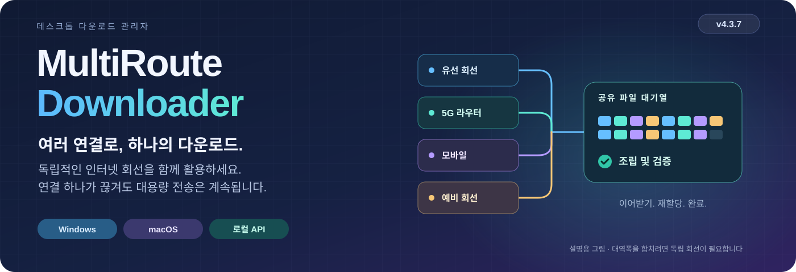

# MultiRoute Downloader
<!-- product-languages:start -->
<p align="center" dir="ltr">
<a href="../../README.md">English</a> · <a href="../../README.ru.md">Русский</a> · <a href="de.md">Deutsch</a> · <a href="es.md">Español</a> · <a href="fr.md">Français</a> · <a href="zh.md">中文</a><br />
<strong>한국어</strong> · <a href="ar.md">العربية</a> · <a href="it.md">Italiano</a> · <a href="ja.md">日本語</a> · <a href="hi.md">हिन्दी</a> · <a href="vi.md">Tiếng Việt</a>
</p>
<!-- product-languages:end -->

<p align="center"></p>

<p align="center"><strong>이미 보유한 인터넷 연결로 대용량 파일을 다운로드하세요.</strong><br />독립적인 유선 인터넷과 모바일 게이트웨이를 함께 활용해 대용량 파일을 다운로드하고, 지원되는 이어받기 진행 상황을 보존하며, 완료된 파일을 검증하세요.</p>

<p align="center">
  <a href="https://github.com/2018-spec-fdsds/multiroute-downloader/releases/tag/v4.3.9"><strong>4.3.9 다운로드</strong></a> ·
  <a href="../../downloads/README.md">현재 다운로드</a> ·
  <a href="../ko.md">사용자 가이드</a> ·
  <a href="../../API.ru.txt">API 참조</a> ·
  <a href="../../README.ru.md">Русский</a>
</p>

## MultiRoute가 필요한 이유

이 아이디어는 익숙한 가정용 네트워크의 문제에서 출발했습니다. 유선 인터넷, 모바일 라우터와 예비 인터넷 연결을 모두 사용할 수 있었지만, 대용량 다운로드는 여전히 컴퓨터의 기본 게이트웨이만 사용했습니다. 그 연결이 느려지거나 끊겨도 다른 회선은 도움이 되지 못했습니다.

MultiRoute는 이러한 독립적인 회선을 하나의 다운로드 작업 공간으로 모읍니다. 사용 가능한 게이트웨이는 공유 대기열에서 파일 세그먼트를 가져옵니다. 빠른 게이트웨이가 더 많은 작업을 맡고, 정체된 연결에서 완료되지 않은 세그먼트는 재할당할 수 있습니다. 앱은 지원되는 이어받기의 진행 상황을 보존하고, 결과를 조립한 뒤 사용 가능한 기준 체크섬과 비교합니다.

- **파일 하나에 더 많은 대역폭을.** 독립적인 업링크가 서로 다른 부분을 동시에 가져옵니다. 원본 서버와 로컬 네트워크가 뒷받침하면 합쳐진 대역폭으로 대용량 파일의 다운로드 시간을 줄일 수 있습니다.
- **중단에도 이어지는 진행 상황.** 완료된 세그먼트는 저장됩니다. 정상 게이트웨이는 다운로드를 계속하고 정체된 세그먼트는 공유 작업 풀로 돌아갈 수 있습니다.
- **보면서 제어하세요.** 전체 및 게이트웨이별 속도를 확인하고, 전송 중 게이트웨이 선택을 바꾸며, 각 연결의 기여도를 살펴보세요.
- **반복해서 쓰는 작업 흐름.** 사이트 프로필을 재사용하고, 링크 목록을 대기열에 넣거나, 스크립트와 개발 도구에서 로컬 API로 전송 작업을 맡기세요.

실제 개선 폭은 업링크의 독립성, 원본 서버의 제한, 로컬 네트워크에 따라 달라집니다. 하나의 상위 회선을 공유하는 라우터 여러 대가 그 회선의 대역폭을 늘려 주지는 않습니다.


### 연결이 하나여도 유용합니다

지원되는 이어받기, 공개된 체크섬과의 비교, 보호된 DNS, 일괄 대기열, 일정, 사이트 프로필, 업로드, 로컬 API를 활용하세요. 게이트웨이 하나로 시작하고 다른 게이트웨이를 사용할 수 있게 되면 추가하면 됩니다.

## 다운로드 및 설치

**현재 버전: 4.3.9.** 네이티브 설치 프로그램에는 앱 전용 Java 21과 플랫폼별 네트워크 구성 요소가 포함되어 있습니다. 일반 앱 아이콘으로 실행하세요.

| 컴퓨터 | 단일 파일 설치 프로그램 |
| --- | --- |
| **Windows 11 · x64** | [Windows 설치 EXE](https://github.com/2018-spec-fdsds/multiroute-downloader/releases/download/v4.3.9/MultiRoute-Downloader-4.3.9-Windows-x64-Setup.exe) |
| **Mac · Apple Silicon · macOS 26+** | [Apple Silicon PKG](https://github.com/2018-spec-fdsds/multiroute-downloader/releases/download/v4.3.9/MultiRoute-Downloader-4.3.9-macOS-arm64.pkg) |
| **Mac · Intel · macOS 15+** | [Intel PKG](https://github.com/2018-spec-fdsds/multiroute-downloader/releases/download/v4.3.9/MultiRoute-Downloader-4.3.9-macOS-x86_64.pkg) |

[Chrome / Edge 연동](../ko.md#chrome-and-edge-integration) · [체크섬 및 보고서](../../downloads/v4.3.9/README.md) · [다운로드 상세 정보](../../downloads/README.md)

Windows 설치 프로그램은 영어로 표시되며 바탕 화면 바로 가기를 만듭니다. Npcap은 별도로 확인하고 필요하면 공식 설치 프로그램을 안내합니다. macOS는 시스템 libpcap을 사용합니다. 설치 방법과 보안 확인 절차는 해당 언어의 가이드를 참조하세요. 공개 네이티브 설치 프로그램은 Windows와 macOS용이며, 여기에는 Linux 4.x 설치 프로그램이 포함되어 있지 않습니다.

**4.3.9의 Free / Pro:** Free는 최대 **게이트웨이 2개**, **동시 다운로드 3개**를 사용하고 **사이트 프로필 3개**를 만들 수 있으며, Graphite(흑연색)/System(시스템 설정) 외관을 제공합니다. 해당 Pro 기능은 최대 **게이트웨이 8개**, **동시 다운로드 32개**, 추가 프로필, 우선순위, 게이트웨이 기록/보고서, 일괄 작업, 외부 API와 추가 스타일을 지원합니다. Free는 다운로드 속도를 의도적으로 제한하지 않습니다. [전체 기능 상세 정보](../licensing.en.md).


## 4.3.9의 새로운 기능

- **Mac 수동 주소의 게이트웨이 응답.** POSIX 캡처 설정을 수정하여 수동 앱 주소와 DHCP 모두 앱 자체 MAC으로 오는 응답을 받도록 했습니다. 기존 Windows 동작과 같습니다. 시스템 ping 성공은 컴퓨터의 연결만 확인하며 앱 가상 주소의 게이트웨이 응답 수신을 증명하지 않습니다.

- DHCP 진단은 일반 오류로 대체되지 않고 열두 언어의 구체적인 문구를 유지합니다. 기존 권한 동작은 유지됩니다. 일반 네트워크 검사는 준비된 구성 요소를 재사용합니다. API 엔드포인트, 화면 컨트롤, OS 경로와 물리 MAC은 바뀌지 않습니다. 최초 Ethernet BPF 권한 접근에는 일반 관리자 확인이 필요할 수 있습니다.

이 수정은 하나의 캡처 모드 차이를 해결하며 모든 게이트웨이 연결 문제를 해결한다는 뜻은 아닙니다. 주소 사용 여부, 서브넷 및 DHCP 임대·충돌 검사는 유지됩니다. Mac 수동 주소 전송은 실제 하드웨어 확인이 더 필요하고 유선 Ethernet이 계속 필요합니다.

### 전송 제어 한눈에 보기

- **더 안정적인 Mac 시작과 게이트웨이 설정.** Mac 기본 실행은 처음 슬래시가 빠진 경우를 포함한 이전 상대 기본 경로를 인식합니다. 확인된 기존 프로필 또는 사용자의 빈 기본 폴더를 사용합니다. 모호한 사용자 지정 위치는 추측하지 않고 명시적 선택을 요구합니다.

- 게이트웨이 준비가 실패하거나 취소되면 다른 게이트웨이와 백그라운드 검사는 사용자가 네트워크 설정을 명시적으로 다시 시도할 때까지 권한 요청을 반복하지 않습니다. 최초 권한 실행에서는 Ethernet BPF 장치를 열기 위한 일반 macOS 관리자 확인이 필요할 수 있습니다.

- Mac 네트워크 구성 요소 4.3.2은 macOS가 어댑터 MAC을 숨기는 경우를 처리하면서 물리 어댑터 보호 검사를 유지합니다. 앱 자체 MAC을 사용하며 OS 경로나 물리 MAC을 바꾸지 않습니다. Mac 아이콘과 앱 이름은 Windows의 MultiRoute와 통일됩니다. PKG 업데이트 전에 앱을 종료하세요. 실제 시스템 대화상자의 요청자 이름과 LAN/DHCP 전송은 하드웨어 확인이 더 필요하며 이 전송 방식은 계속 유선 Ethernet을 요구합니다.


- **남은 다운로드 데이터.** 다운로드 표에 **남은 다운로드 용량** 열이 추가되었습니다. 예상 남은 시간과 별도로 아직 받을 바이트를 표시하고 숫자로 정렬합니다. 저장된 진행 상황과 수신 중인 진행 상황을 반영하며 0보다 작아지지 않습니다. 전체 크기를 모르면 대시가 표시됩니다.


- **게이트웨이 선호도 설정.** 0~1000 우선순위가 표시 옆에 나타납니다. 높은 값은 작은 파일에 우선 사용되고 큰 파일의 병렬 세그먼트를 더 받으며 다른 정상 게이트웨이도 참여합니다. 별도의 Pro 권한 `gateway_priorities`가 필요합니다.

- **중단 원인 확인.** 완료 후에도 상황에 맞는 메뉴에서 개별 파일 로그를 열 수 있으며 설정에는 25개 주제의 검색 가능한 오류 안내서가 있습니다. 디스크 공간 부족을 명확히 알리고 저장 위치에 여유 공간(GB)을 표시합니다.

- **대기열 관리.** 라이선스 범위 내 동시 다운로드 수와 자동 재시도를 설정합니다. 선택한 파일 이름 복사 및 지원 작업 일시 중지/계속이 가능하고 두 번 클릭하면 폴더가 열립니다. 재개 후 데이터를 기다릴 때도 저장된 접두 부분을 진행률에 유지합니다.


## 전송 상황을 한눈에 확인하세요

4.3.9 작업 공간은 파일을 중심으로 구성됩니다. 이름과 크기를 별도 열로 표시하고, 파일별 진행 상황, 전체 및 게이트웨이별 속도, 속도 그래프와 파일 상세 정보를 제공합니다. Free에는 Graphite와 System 외관이 포함됩니다. Rose 같은 추가 스타일에는 해당 Pro 기능이 필요합니다.


*별도의 데모 프로필에서 캡처한 현재 Windows 화면입니다. 예제 파일, 진행 상황, 속도와 Pro 기능을 활성화한 화면은 조작 방법을 설명하기 위한 것이며 성능 측정값이 아닙니다.*

<details>
<summary><strong>네트워크 설정과 속도 기록</strong></summary>


</details>


## 원하는 모양을 고르세요

Graphite, Nordic, Streams Studio, Neon, Community, Chat, Studio, Rose, System의 아홉 가지 모양 중에서 선택하세요. 기본값은 Graphite입니다. Free에는 Graphite와 System이 포함되며 나머지는 해당 Pro 외관 기능이 필요합니다. 설정 → 모양에서 스타일과 둥근 컨트롤을 바꿀 수 있습니다. 선택하는 동안에도 다운로드는 계속됩니다.

<table>
<tr>
<td width="50%" valign="top"><strong>Graphite</strong><br /><a href="../images/v4.3.7/downloads-en-ae5b55131583.png"></a></td>
<td width="50%" valign="top"><strong>Nordic</strong><br /><a href="../images/v4.3.7/skin-nordic-a4e8d79666e0.png"></a></td>
</tr>
<tr>
<td width="50%" valign="top"><strong>Streams Studio</strong><br /><a href="../images/v4.3.7/skin-streams-b2f3be388bda.png"></a></td>
<td width="50%" valign="top"><strong>Neon</strong><br /><a href="../images/v4.3.7/skin-neon-6b0c1d2da5f8.png"></a></td>
</tr>
<tr>
<td width="50%" valign="top"><strong>Community</strong><br /><a href="../images/v4.3.7/skin-community-9763964c8f12.png"></a></td>
<td width="50%" valign="top"><strong>Chat</strong><br /><a href="../images/v4.3.7/skin-chat-221a28cc76f4.png"></a></td>
</tr>
<tr>
<td width="50%" valign="top"><strong>Studio</strong><br /><a href="../images/v4.3.7/skin-studio-094e14ba38ea.png"></a></td>
<td width="50%" valign="top"><strong>Rose</strong><br /><a href="../images/v4.3.7/skin-rose-02646e7f35bf.png"></a></td>
</tr>
<tr>
<td width="50%" valign="top"><strong>System</strong><br /><a href="../images/v4.3.7/skin-system-c148099984c6.png"></a></td>
<td width="50%" valign="top"></td>
</tr>
</table>

## 다운로드 진행 상황을 따라가는 배달원

선택적으로 표시하는 데스크톱 배달원은 다운로드 진행 상황을 눈에 보이는 짐으로 표현합니다. 모양 설정에서 남성 또는 여성을 선택하고 크기를 40%에서 100% 사이로 설정하세요. 자루는 활성 다운로드 중 크기를 알 수 있는 남은 데이터의 합계를 표시하며, 바이트를 받을수록 작아집니다. 움직임은 이 다운로드들의 합산 속도를 따르고 속도가 0이면 배달원이 서서 멈춥니다. 작은 짐은 어깨에 메고, 큰 짐은 끌며, 아주 큰 짐은 더 힘들게 옮깁니다.

아바타 버튼으로 배달원을 표시하거나 숨기세요. 드래그하여 위치를 옮기고, 마우스 왼쪽 버튼으로 두 번 클릭해 앱을 표시하거나, 오른쪽 버튼을 클릭해 옵션을 여세요. 시각적 동반자이며 파일은 선택한 각 폴더에 그대로 남습니다.

다운로드가 끝나면 배달원이 전달한 짐을 내려놓고 서서히 사라집니다. 다운로드가 계속되면 남은 데이터를 가지고 돌아옵니다.

### 남은 데이터 적음 · 768 MB

<table>
<tr>
<td width="50%" valign="top"><strong>남성 배달원</strong><br /><a href="../images/v4.3.7/avatar-man-shoulder-eeeb879d0240.png"></a></td>
<td width="50%" valign="top"><strong>여성 배달원</strong><br /><a href="../images/v4.3.7/avatar-woman-shoulder-5682615d5576.png"></a></td>
</tr>
</table>

### 남은 데이터 보통 · 7 GB

<table>
<tr>
<td width="50%" valign="top"><strong>남성 배달원</strong><br /><a href="../images/v4.3.7/avatar-man-drag-a3dc0a3ed22c.png"></a></td>
<td width="50%" valign="top"><strong>여성 배달원</strong><br /><a href="../images/v4.3.7/avatar-woman-drag-48d8ee0fa4d1.png"></a></td>
</tr>
</table>

### 남은 데이터 많음 · 18 GB

<table>
<tr>
<td width="50%" valign="top"><strong>남성 배달원</strong><br /><a href="../images/v4.3.7/avatar-man-heavy-649f17608748.png"></a></td>
<td width="50%" valign="top"><strong>여성 배달원</strong><br /><a href="../images/v4.3.7/avatar-woman-heavy-d445fdb37867.png"></a></td>
</tr>
</table>

## 설정을 한눈에

다운로드 폴더, 사이트 프로필과 언어를 설정한 뒤 모양, 배달원 크기와 완료 알림음을 조정하세요. 네트워크 설정에서는 앱 주소, MAC, 게이트웨이와 DNS를 한곳에서 관리합니다. 선택적인 알림음으로 파일 하나의 완료와 대기열 전체의 완료를 구분할 수 있으며, 기본 멜로디 또는 최대 10초의 MP3/WAV 오디오를 사용할 수 있습니다.

<table>
<tr>
<td width="50%" valign="top"><strong>앱 설정</strong><br /><a href="../images/v4.3.7/settings-8abcb12a782d.png"></a></td>
<td width="50%" valign="top"><strong>모양, 배달원과 소리</strong><br /><a href="../images/v4.3.7/appearance-cebf121d5de7.png"></a></td>
</tr>
<tr>
<td width="50%" valign="top"><strong>앱 주소와 보호된 DNS</strong><br /><a href="../images/v4.3.7/network-dns-e29dfdba1007.png"></a></td>
<td width="50%" valign="top"><strong>게이트웨이 선택과 속도 확인</strong><br /><a href="../images/v4.3.7/network-gateways-aee0a7897f48.png"></a></td>
</tr>
</table>

<details>
<summary><strong>다운로드 및 업로드 작업 공간</strong></summary>

<table>
<tr>
<td width="50%" valign="top"><strong>다운로드 만들기</strong><br /><a href="../images/v4.3.7/new-download-dcb720c7769d.png"></a></td>
<td width="50%" valign="top"><strong>업로드 작업 공간</strong><br /><a href="../images/v4.3.7/uploads-31c63833de2e.png"></a></td>
</tr>
</table>

</details>

## 일상적인 요구를 실제 제어 기능으로

| 원하는 작업 | MultiRoute가 제공하는 기능 |
| --- | --- |
| **사용 가능한 연결 활용** | 공유 HTTP 세그먼트 대기열, 편집 가능한 게이트웨이 프로필 1–8개, 하나·여러 개·전체 게이트웨이의 실시간 선택. |
| **대용량 파일 보존 및 검증** | 지원되는 이어받기, 세그먼트 저장, 자동 조립, MD5·SHA-256·SHA-512로 게시자가 제공한 기준값과 비교. |
| **DNS 요청 보호** | 암호화된 DoH/DoT, 기본 제공 또는 사용자 지정 제공업체, 로컬 DNSSEC. OS의 DNS 설정이나 경로를 변경하지 않습니다. |
| **여러 다운로드 관리** | 링크 일괄 입력, 우선순위, 매일 실행 시간대, 지연 시작, 속도/작업 수 제한, 게이트웨이별 통계, 그래프, 날짜별 기록. |
| **자주 쓰는 사이트 재사용** | 저장된 프로필, 원격 폴더 탐색, FTP/FTPS/SFTP 업로드 및 압축 파일 미리보기. |
| **작업 흐름에 맞춰 사용** | 브라우저에서 링크 전달, 로컬 API, 12개 언어, 밝게/어둡게/시스템 테마, 키보드 붙여넣기, 시스템 폴더 대화 상자, 트레이 속도 표시, 선택적인 로그인 시 시작. |

| 전송 기능 | 지원 옵션 |
| --- | --- |
| **다운로드** | HTTP/HTTPS, FTP, 명시적 FTPS, SFTP, WebDAV, Metalink, BitTorrent 및 magnet. Hugging Face 링크와 저장소 파일 선택. |
| **업로드** | FTP, 명시적 FTPS 및 SFTP. 사이트 프로필과 SHA-256 재읽기 검증 지원. |
| **압축 파일 미리보기** | 바이트 범위 요청과 지원되는 헤더를 사용할 수 있는 경우, 전체 다운로드 전에 ZIP, TAR, 7Z 및 RAR 파일 목록 확인. |

### 무엇을 검증했는지 확인하세요

신뢰할 수 있는 기준값이 있으면 파일 검증은 조립된 데이터를 해당 값과 비교합니다. 로컬 해시만으로는 게시자의 신원을 입증할 수 없습니다. DoH/DoT는 DNS 전송을 암호화하고, DNSSEC는 별도로 서명된 DNS 데이터의 유효성을 검증합니다. 이러한 검사가 다운로드한 콘텐츠의 무해함을 보장하지는 않습니다.

## 애플리케이션과 AI 코딩 작업 흐름을 위한 API

스크립트, 타사 애플리케이션과 AI 코딩 에이전트는 MultiRoute에 개발에 필요한 모델 가중치, 데이터 세트, 라이브러리, 리소스와 프로젝트 산출물을 가져오도록 요청할 수 있습니다. 호출자는 진행 상황, 완료 여부와 체크섬 결과를 받고 대기열을 제어할 수 있으며, MultiRoute가 게이트웨이, 재시도와 지원되는 이어받기를 처리합니다.

API는 로컬의 **`http://127.0.0.1:8765/api/v1`** 에서 실행됩니다. 예를 들어 `Content-Type: application/json`으로 다음 JSON을 **`POST /api/v1/jobs`** 에 전송합니다.

```json
{
  "url": "https://example.org/model.bin",
  "directory": "C:/Users/YOUR_USER/Downloads",
  "routes": [
    {"type": "gateway", "gateway": "192.168.1.1", "enabled": true}
  ]
}
```

외부 API를 통한 일반적인 관리에는 해당 Pro 기능이 필요하며, 일괄 생성과 게이트웨이 제한은 별도로 확인됩니다. URL, 폴더와 게이트웨이를 실제 값으로 바꾸고 먼저 네트워크를 설정하세요. routes를 명시적으로 지정해야 합니다. UI의 체크박스 상태는 API 요청에 복사되지 않습니다. `201`은 작업 생성을 뜻합니다. `id`를 보관하고 `GET /jobs/{id}`로 진행 상황, `complete`/`failed` 상태와 체크섬 상세 정보를 확인하세요. 이 예시는 설명용이며 다운로드를 제출하지 않습니다.

[API 참조](../../API.ru.txt) · [OpenAPI 스키마](../../openapi.yaml) · [연동 가이드](../ko.md#multiroute-api)

## 네 단계로 시작하기

1. 해당 플랫폼의 패키지를 **설치**하고 가이드를 따릅니다.
2. **네트워크 설정 선택:** 유선 이더넷, 동일한 IPv4 LAN의 게이트웨이, 사용 중이지 않은 앱 가상 주소를 사용합니다. 다른 애플리케이션에 적용되는 OS 경로는 변경되지 않습니다.
3. **게이트웨이 선택 및 테스트.** 기본값은 `192.168.1.1`–`192.168.1.4`이며 가상 주소는 `192.168.1.70`입니다. 실제 네트워크에 맞게 수정하세요.
4. **링크나 목록을 붙여넣고 폴더를 선택한 뒤 시작합니다.** 각 게이트웨이의 기여도와 최종 검증 결과를 확인하세요.

<details>
<summary><strong>요구 사항 및 전송 상세 정보</strong></summary>

- 다중 게이트웨이 전송은 유선 이더넷을 통한 공인 IPv4를 지원합니다. Wi-Fi 전용/VPN 전용 어댑터, IPv6 전용 원본과 로컬 LAN의 토렌트 피어는 이 모드의 지원 범위에 포함되지 않습니다.
- 세그먼트 이어받기에는 범위 요청 지원과 안정적인 원본 식별 정보가 필요합니다. HTTP 세그먼트의 기본 크기는 20 MiB입니다. 60초 동안 데이터를 받지 못한 정체 작업은 해당 쓰기 작업이 닫힌 뒤 재할당할 수 있습니다. 이어받기를 지원하지 않는 HTTP 다운로드는 중단 후 처음부터 다시 시작합니다. 토렌트 조각은 메타데이터의 해시를 사용합니다.
- 업로드 파일 하나는 게이트웨이 하나를 사용하며, 여러 파일은 서로 다른 게이트웨이를 사용할 수 있습니다. 재읽기 검증은 대역폭을 사용하며 원격 읽기/쓰기/이름 변경 권한이 필요합니다. 압축 파일 미리보기에는 메타데이터/헤더 제한이 있습니다.
- 일정 실행에는 앱이 실행 중이고 컴퓨터가 깨어 있어야 합니다. 컴퓨터를 깨우거나 별도의 업로드 대기열에 일정을 적용하지는 않습니다.
- 시스템 DNS는 OS/VPN 정책을 따릅니다. DNSSEC 루트 신뢰 앵커는 릴리스와 함께 갱신됩니다. 암호화된 DNS 자체가 HTTP/FTP 파일 내용을 암호화하지는 않습니다.
- 설치 프로그램에는 서명이 없으며, macOS 패키지는 Developer ID 서명이나 공증을 받지 않았습니다. 시스템 보호 기능을 끄지 말고 가이드의 일반적인 확인 절차를 따르세요. 각 릴리스에는 검증 보고서와 남아 있는 제한 사항이 포함됩니다.

</details>

## 12개 언어의 가이드

[English](../en.md) · [Русский](../ru.md) · [Deutsch](../de.md) · [Español](../es.md) · [Français](../fr.md) · [中文](../zh.md)<br />
[한국어](../ko.md) · [العربية](../ar.md) · [Italiano](../it.md) · [日本語](../ja.md) · [हिन्दी](../hi.md) · [Tiếng Việt](../vi.md)


<a name="application-virtual-ip"></a>

### 앱 주소와 현재 패키지

앱은 자체 로컬 IPv4 주소와 앱 MAC을 사용합니다. 따라서 선택한 게이트웨이가 OS 기본 게이트웨이와 독립적으로 작동하며, OS 경로나 물리 어댑터의 MAC을 변경하지 않습니다. 실제로 연결된 동일 서브넷에서 비어 있는 주소를 사용하세요. 수동 주소를 DHCP 자동 할당 범위 밖에 두거나 LAN DHCP 서버에서 예약/제외한 뒤, 네트워크 설정에서 **Check and apply(확인 및 적용)** 를 사용하세요. [주소 선택 및 확인](../ko.md#application-virtual-ip).

현재 4.3.9 Windows 패키지는 로컬 업그레이드/시작 검사를 통과했습니다. macOS 패키지는 대상 CI 실행기에서 네이티브 구성 요소 및 Java 런타임 검사를 통과했습니다. 실제 Mac에서 LAN/DHCP 게이트웨이를 통한 전송은 아직 하드웨어 검증이 필요합니다. [검증 보고서](../../NATIVE-INSTALLER-TESTS.json).

## 소유자와 라이선스

**[2018-spec-fdsds](https://github.com/2018-spec-fdsds)** 가 제작했습니다. 무료 사용에는 개인 및 조직/업무 용도가 포함됩니다. 원본 애플리케이션 판매, 라이선스 요금 청구 또는 유료 재배포에는 별도의 서면 허가가 필요합니다. 일반적인 수정/재배포 권한은 부여되지 않으며, 타사 약관은 계속 적용됩니다.

[라이선스](../../LICENSE.txt) · [라이선스 요약](../../LICENSING.md) · [타사 고지](../../THIRD-PARTY-NOTICES.txt)

이 배포 영역에는 현재 4.3.9 설치 프로그램과 사용자 문서가 포함되어 있습니다.
