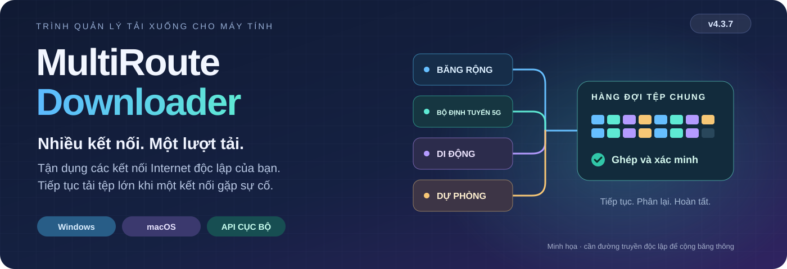

# MultiRoute Downloader

<!-- product-languages:start -->
<p align="center" dir="ltr">
<a href="../../README.md">English</a> · <a href="../../README.ru.md">Русский</a> · <a href="de.md">Deutsch</a> · <a href="es.md">Español</a> · <a href="fr.md">Français</a> · <a href="zh.md">中文</a><br />
<a href="ko.md">한국어</a> · <a href="ar.md">العربية</a> · <a href="it.md">Italiano</a> · <a href="ja.md">日本語</a> · <a href="hi.md">हिन्दी</a> · <strong>Tiếng Việt</strong>
</p>
<!-- product-languages:end -->

<p align="center"></p>

<p align="center"><strong>Tải tệp lớn bằng những kết nối bạn đã có.</strong><br />Kết hợp các cổng mạng băng rộng và di động độc lập để tải tệp lớn, giữ lại tiến độ khi được hỗ trợ tiếp tục tải và kiểm tra tệp đã hoàn tất.</p>

<p align="center">
  <a href="https://github.com/2018-spec-fdsds/multiroute-downloader/releases/tag/v4.3.9"><strong>Tải 4.3.9</strong></a> ·
  <a href="../../downloads/README.md">Bản tải xuống hiện hành</a> ·
  <a href="../vi.md">Hướng dẫn sử dụng</a> ·
  <a href="../../API.ru.txt">Tài liệu API</a> ·
  <a href="../../README.ru.md">Русский</a>
</p>

## Vì sao có MultiRoute

Ý tưởng xuất phát từ một vấn đề quen thuộc trong mạng gia đình: đã có sẵn băng rộng có dây, bộ định tuyến di động và một kết nối Internet dự phòng, nhưng lượt tải tệp lớn vẫn chỉ dùng cổng mạng mặc định của máy tính. Khi kết nối đó chậm lại hoặc gặp sự cố, các đường truyền còn lại không thể hỗ trợ.

MultiRoute đưa các đường truyền độc lập ấy vào một không gian tải xuống chung. Các cổng mạng sẵn sàng nhận phân đoạn tệp từ một hàng đợi chung; cổng nhanh hơn nhận nhiều việc hơn, còn các phân đoạn chưa hoàn tất từ kết nối bị kẹt có thể được giao lại. Ứng dụng giữ lại tiến độ khi nguồn hỗ trợ tiếp tục tải, ghép kết quả và so sánh với mã kiểm tra tham chiếu khi có.

- **Thêm băng thông cho một tệp.** Các đường Internet độc lập tải đồng thời những phần khác nhau. Tổng dung lượng đường truyền có thể rút ngắn thời gian tải tệp lớn khi nguồn và mạng cục bộ đáp ứng kịp.
- **Duy trì tiến độ khi gián đoạn.** Các phần đã hoàn tất được lưu lại; cổng mạng đang hoạt động tiếp tục tải và các phân đoạn bị kẹt có thể trở về nhóm công việc chung.
- **Điều khiển rõ ràng.** Theo dõi tốc độ tổng và tốc độ từng cổng mạng, thay đổi lựa chọn cổng ngay khi đang truyền và xem đóng góp của mỗi kết nối.
- **Quy trình có thể dùng lại.** Dùng lại hồ sơ trang, đưa danh sách liên kết vào hàng đợi hoặc chuyển việc tải cho API cục bộ từ tập lệnh và công cụ phát triển.

Mức cải thiện thực tế phụ thuộc vào các đường truyền độc lập, giới hạn của nguồn và mạng cục bộ. Các bộ định tuyến dùng chung một đường truyền ra Internet không làm tăng bội số băng thông của đường truyền đó.


### Vẫn hữu ích khi chỉ có một kết nối

Dùng tính năng tiếp tục tải khi được hỗ trợ, so sánh mã kiểm tra đã công bố, DNS được bảo vệ, hàng đợi theo lô, lịch chạy, hồ sơ trang, tải lên và API cục bộ. Bắt đầu với một cổng mạng; thêm các cổng khác khi có.

## Tải xuống và cài đặt

**Phiên bản hiện hành: 4.3.9.** Trình cài đặt gốc bao gồm Java 21 riêng cho ứng dụng và thành phần mạng của nền tảng. Mở ứng dụng bằng biểu tượng thông thường.

| Máy tính của bạn | Trình cài đặt một tệp |
| --- | --- |
| **Windows 11 · x64** | [Windows Setup EXE](https://github.com/2018-spec-fdsds/multiroute-downloader/releases/download/v4.3.9/MultiRoute-Downloader-4.3.9-Windows-x64-Setup.exe) |
| **Mac · Apple Silicon · macOS 26+** | [Apple Silicon PKG](https://github.com/2018-spec-fdsds/multiroute-downloader/releases/download/v4.3.9/MultiRoute-Downloader-4.3.9-macOS-arm64.pkg) |
| **Mac · Intel · macOS 15+** | [Intel PKG](https://github.com/2018-spec-fdsds/multiroute-downloader/releases/download/v4.3.9/MultiRoute-Downloader-4.3.9-macOS-x86_64.pkg) |

[Tích hợp Chrome / Edge](../vi.md#chrome-and-edge-integration) · [Mã kiểm tra và báo cáo](../../downloads/v4.3.9/README.md) · [Chi tiết bản tải xuống](../../downloads/README.md)

Windows Setup dùng tiếng Anh và tạo lối tắt trên màn hình nền. Npcap được kiểm tra riêng và trình cài đặt chính thức sẽ được đề xuất khi cần; macOS dùng libpcap của hệ thống. Xem hướng dẫn bằng ngôn ngữ của bạn để biết cách cài đặt và xác nhận bảo mật. Trình cài đặt gốc công khai hỗ trợ Windows và macOS; ở đây không có trình cài đặt Linux 4.x.

**Free / Pro trong 4.3.9:** Free dùng tối đa **2 cổng mạng**, **3 lượt tải đồng thời** và tạo **3 hồ sơ trang**, với giao diện Graphite/System. Các khả năng Pro tương ứng cho phép tối đa **8 cổng mạng**, **32 lượt tải đồng thời**, thêm hồ sơ, mức ưu tiên, lịch sử/báo cáo cổng mạng, thao tác theo lô, API bên ngoài và các kiểu giao diện bổ sung. Free không cố ý giới hạn tốc độ tải xuống. [Chi tiết đầy đủ về các khả năng](../licensing.en.md).


## Điểm mới trong 4.3.9

- **Phản hồi cổng mạng Mac với địa chỉ thủ công.** Thiết lập bắt gói POSIX được sửa để địa chỉ thủ công của ứng dụng và DHCP đều nhận phản hồi gửi đến MAC riêng của ứng dụng, giống hành vi Windows hiện có. Ping hệ thống thành công chỉ kiểm tra kết nối của máy tính, không chứng minh địa chỉ ảo của ứng dụng nhận được phản hồi.

- Chẩn đoán DHCP giữ lời giải thích cụ thể bằng mười hai ngôn ngữ thay vì lỗi chung. Hành vi cấp quyền hiện có không đổi: kiểm tra mạng thông thường tái sử dụng thành phần đã chuẩn bị. API, điều khiển giao diện, tuyến hệ điều hành và MAC vật lý không thay đổi. Lần truy cập Ethernet BPF đặc quyền đầu tiên vẫn có thể cần xác nhận quản trị thông thường.

Đây là sửa một khác biệt của chế độ bắt gói, không phải mọi nguyên nhân cổng mạng không truy cập được. Kiểm tra địa chỉ trống, mạng con và thuê/xung đột DHCP vẫn hoạt động. Truyền Mac với địa chỉ thủ công còn cần xác nhận trên phần cứng; vẫn cần Ethernet có dây.

### Điều khiển truyền tải

- **Khởi động Mac và thiết lập cổng mạng tin cậy hơn.** Khởi động gốc trên Mac nhận ra đường dẫn mặc định tương đối cũ, kể cả khi thiếu dấu gạch chéo đầu, và dùng hồ sơ hiện có đã xác minh hoặc thư mục mặc định trống thuộc người dùng. Vị trí tùy chỉnh mơ hồ vẫn yêu cầu chọn rõ ràng thay vì đoán.

- Sau khi chuẩn bị cổng mạng thất bại hoặc bị hủy, các cổng còn lại và kiểm tra nền dừng lặp yêu cầu cấp quyền cho đến khi bạn chủ động thử lại thiết lập mạng. Lần khởi chạy đặc quyền đầu tiên vẫn có thể cần xác nhận quản trị macOS thông thường để mở thiết bị Ethernet BPF.

- Thành phần mạng Mac 4.3.2 xử lý MAC bộ điều hợp bị macOS ẩn và vẫn giữ kiểm tra bảo vệ card vật lý. Ứng dụng dùng MAC riêng, không đổi tuyến hệ điều hành hoặc MAC vật lý. Biểu tượng và tên Mac thống nhất với nhận diện MultiRoute trên Windows. Hãy thoát ứng dụng trước khi cập nhật PKG. Tên bên yêu cầu trong hộp thoại thật và truyền LAN/DHCP vẫn cần xác nhận trên phần cứng; cách truyền này vẫn yêu cầu Ethernet có dây.


- **Dữ liệu còn phải tải.** Bảng tải xuống có cột **Dữ liệu còn lại** riêng. Cột này hiển thị số byte còn phải tải, tách biệt với thời gian ước tính và được sắp xếp theo số. Giá trị tính cả tiến độ đã lưu và đang nhận, không xuống dưới 0 và hiển thị dấu gạch ngang khi chưa biết tổng kích thước.


- **Đặt mức ưu tiên cổng mạng.** Giá trị 0–1000 hiện cạnh chỉ báo: mức cao hơn được ưu tiên cho tệp nhỏ và nhận thêm phân đoạn song song của tệp lớn. Các cổng hoạt động khác vẫn hỗ trợ. Cần quyền Pro độc lập `gateway_priorities`.

- **Hiểu nguyên nhân gián đoạn.** Mở nhật ký riêng từ menu chuột phải, kể cả sau khi hoàn tất, hoặc hướng dẫn lỗi có tìm kiếm với 25 chủ đề trong cài đặt. Đĩa đầy được báo rõ và vị trí lưu cho biết dung lượng trống theo GB.

- **Kiểm soát hàng đợi.** Đặt số lượt tải đồng thời trong giấy phép và lần thử lại tự động. Sao chép tên đã chọn, tạm dừng/tiếp tục tác vụ phù hợp và mở thư mục bằng nhấp đúp. Phần đầu đã lưu vẫn tính vào tiến độ khi chờ dữ liệu sau khi tiếp tục.


## Theo dõi rõ ràng các lượt truyền

Không gian làm việc 4.3.9 lấy tệp làm trung tâm: cột tên và kích thước riêng biệt, tiến độ từng tệp, tốc độ tổng và từng cổng mạng, biểu đồ tốc độ cùng thông tin chi tiết về tệp. Graphite và System có trong Free; các kiểu giao diện bổ sung như Rose cần khả năng Pro tương ứng.


*Giao diện hiện hành trên Windows, được chụp với hồ sơ minh họa riêng biệt. Tệp, tiến độ, tốc độ mẫu và các màn hình có tính năng Pro minh họa các điều khiển, không phải số đo hiệu năng.*

<details>
<summary><strong>Thiết lập mạng và lịch sử tốc độ</strong></summary>


</details>


## Chọn giao diện của bạn

Chọn trong chín kiểu giao diện: Graphite, Nordic, Streams Studio, Neon, Community, Chat, Studio, Rose và System. Graphite là mặc định. Graphite và System có trong Free; các lựa chọn còn lại cần khả năng giao diện Pro tương ứng. Mở Cài đặt → Giao diện để đổi kiểu và các điều khiển bo góc. Việc tải xuống vẫn tiếp tục trong lúc bạn chọn.

<table>
<tr>
<td width="50%" valign="top"><strong>Graphite</strong><br /><a href="../images/v4.3.7/downloads-en-ae5b55131583.png"></a></td>
<td width="50%" valign="top"><strong>Nordic</strong><br /><a href="../images/v4.3.7/skin-nordic-a4e8d79666e0.png"></a></td>
</tr>
<tr>
<td width="50%" valign="top"><strong>Streams Studio</strong><br /><a href="../images/v4.3.7/skin-streams-b2f3be388bda.png"></a></td>
<td width="50%" valign="top"><strong>Neon</strong><br /><a href="../images/v4.3.7/skin-neon-6b0c1d2da5f8.png"></a></td>
</tr>
<tr>
<td width="50%" valign="top"><strong>Community</strong><br /><a href="../images/v4.3.7/skin-community-9763964c8f12.png"></a></td>
<td width="50%" valign="top"><strong>Chat</strong><br /><a href="../images/v4.3.7/skin-chat-221a28cc76f4.png"></a></td>
</tr>
<tr>
<td width="50%" valign="top"><strong>Studio</strong><br /><a href="../images/v4.3.7/skin-studio-094e14ba38ea.png"></a></td>
<td width="50%" valign="top"><strong>Rose</strong><br /><a href="../images/v4.3.7/skin-rose-02646e7f35bf.png"></a></td>
</tr>
<tr>
<td width="50%" valign="top"><strong>System</strong><br /><a href="../images/v4.3.7/skin-system-c148099984c6.png"></a></td>
<td width="50%" valign="top"></td>
</tr>
</table>

## Người giao hàng đồng hành cùng lượt tải

Người giao hàng tùy chọn trên màn hình máy tính biến tiến độ tải thành một khối lượng có thể nhìn thấy. Chọn nhân vật nam hoặc nữ trong Cài đặt giao diện và đặt kích thước từ 40% đến 100%. Túi thể hiện tổng lượng dữ liệu còn lại đã biết của các lượt tải đang hoạt động và nhỏ dần khi nhận thêm byte. Chuyển động phụ thuộc vào tổng tốc độ tải của chúng; khi tốc độ bằng không, nhân vật đứng yên. Với lượng dữ liệu ít, nhân vật vác túi trên vai; lượng lớn hơn thì kéo túi, và lượng rất lớn khiến nhân vật gắng sức hơn.

Dùng nút Nhân vật để hiện hoặc ẩn người giao hàng. Kéo để di chuyển, nhấp đúp chuột trái để hiện ứng dụng hoặc nhấp chuột phải để mở các tùy chọn. Đây là người bạn đồng hành trực quan; tệp vẫn nằm trong các thư mục đã chọn.

Khi một lượt tải hoàn tất, người giao hàng đặt phần dữ liệu đã giao xuống rồi mờ dần. Nếu việc tải vẫn tiếp tục, nhân vật quay lại với lượng dữ liệu còn lại.

### Khối lượng còn lại nhỏ · 768 MB

<table>
<tr>
<td width="50%" valign="top"><strong>Người giao hàng nam</strong><br /><a href="../images/v4.3.7/avatar-man-shoulder-eeeb879d0240.png"></a></td>
<td width="50%" valign="top"><strong>Người giao hàng nữ</strong><br /><a href="../images/v4.3.7/avatar-woman-shoulder-5682615d5576.png"></a></td>
</tr>
</table>

### Khối lượng còn lại vừa · 7 GB

<table>
<tr>
<td width="50%" valign="top"><strong>Người giao hàng nam</strong><br /><a href="../images/v4.3.7/avatar-man-drag-a3dc0a3ed22c.png"></a></td>
<td width="50%" valign="top"><strong>Người giao hàng nữ</strong><br /><a href="../images/v4.3.7/avatar-woman-drag-48d8ee0fa4d1.png"></a></td>
</tr>
</table>

### Khối lượng còn lại lớn · 18 GB

<table>
<tr>
<td width="50%" valign="top"><strong>Người giao hàng nam</strong><br /><a href="../images/v4.3.7/avatar-man-heavy-649f17608748.png"></a></td>
<td width="50%" valign="top"><strong>Người giao hàng nữ</strong><br /><a href="../images/v4.3.7/avatar-woman-heavy-d445fdb37867.png"></a></td>
</tr>
</table>

## Nhìn nhanh các thiết lập

Đặt thư mục tải xuống, hồ sơ trang và ngôn ngữ, rồi chỉnh giao diện, kích thước người giao hàng và âm báo hoàn tất. Thiết lập mạng tập hợp địa chỉ ứng dụng, MAC, cổng mạng và DNS ở cùng một nơi. Âm báo tùy chọn có thể phân biệt một tệp hoàn tất với cả hàng đợi hoàn tất, bằng giai điệu có sẵn hoặc đoạn âm thanh MP3/WAV của bạn dài tối đa 10 giây.

<table>
<tr>
<td width="50%" valign="top"><strong>Thiết lập ứng dụng</strong><br /><a href="../images/v4.3.7/settings-8abcb12a782d.png"></a></td>
<td width="50%" valign="top"><strong>Giao diện, người giao hàng và âm thanh</strong><br /><a href="../images/v4.3.7/appearance-cebf121d5de7.png"></a></td>
</tr>
<tr>
<td width="50%" valign="top"><strong>Địa chỉ ứng dụng và DNS được bảo vệ</strong><br /><a href="../images/v4.3.7/network-dns-e29dfdba1007.png"></a></td>
<td width="50%" valign="top"><strong>Chọn cổng mạng và kiểm tra tốc độ</strong><br /><a href="../images/v4.3.7/network-gateways-aee0a7897f48.png"></a></td>
</tr>
</table>

<details>
<summary><strong>Không gian tải xuống và tải lên</strong></summary>

<table>
<tr>
<td width="50%" valign="top"><strong>Tạo lượt tải xuống</strong><br /><a href="../images/v4.3.7/new-download-dcb720c7769d.png"></a></td>
<td width="50%" valign="top"><strong>Không gian tải lên</strong><br /><a href="../images/v4.3.7/uploads-31c63833de2e.png"></a></td>
</tr>
</table>

</details>

## Từ nhu cầu hằng ngày đến khả năng điều khiển thiết thực

| Bạn muốn… | MultiRoute cung cấp |
| --- | --- |
| **Tận dụng các kết nối sẵn có** | Hàng đợi phân đoạn HTTP dùng chung, 1–8 hồ sơ cổng mạng có thể chỉnh sửa và khả năng chọn trực tiếp một, nhiều hoặc tất cả cổng mạng khi ứng dụng đang hoạt động. |
| **Lưu và kiểm tra tệp lớn** | Tiếp tục tải khi được hỗ trợ, lưu các phần đã tải, tự động ghép tệp và kiểm tra theo giá trị tham chiếu của bên phát hành bằng MD5, SHA-256 hoặc SHA-512. |
| **Bảo vệ truy vấn DNS** | DoH/DoT được mã hóa, nhà cung cấp đặt sẵn hoặc tùy chọn và DNSSEC cục bộ, không thay đổi thiết lập DNS hay định tuyến của hệ điều hành. |
| **Sắp xếp nhiều lượt tải** | Thêm nhiều liên kết, mức ưu tiên, khung giờ hằng ngày, bắt đầu trễ, giới hạn tốc độ/số tác vụ, thống kê từng cổng mạng, biểu đồ và lịch sử theo ngày. |
| **Dùng lại các trang quen thuộc** | Hồ sơ đã lưu, duyệt thư mục từ xa, tải lên qua FTP/FTPS/SFTP và xem trước nội dung tệp nén. |
| **Phù hợp với quy trình làm việc** | Gửi liên kết từ trình duyệt, API cục bộ, mười hai ngôn ngữ, giao diện sáng/tối/theo hệ thống, dán bằng bàn phím, hộp thoại thư mục của hệ thống, chỉ báo tốc độ ở khay hệ thống và tùy chọn khởi động khi đăng nhập. |

| Truyền tệp | Các tùy chọn được hỗ trợ |
| --- | --- |
| **Tải xuống** | HTTP/HTTPS, FTP, explicit FTPS, SFTP, WebDAV, Metalink, BitTorrent và magnet; liên kết Hugging Face và chọn tệp trong kho lưu trữ. |
| **Tải lên** | FTP, explicit FTPS và SFTP, với hồ sơ trang và xác minh SHA-256 bằng cách đọc lại tệp từ xa. |
| **Xem trước tệp nén** | Danh sách nội dung ZIP, TAR, 7Z và RAR trước khi tải toàn bộ, khi nguồn hỗ trợ phạm vi byte và các tiêu đề cần thiết. |

### Hiểu rõ nội dung đã được xác minh

Việc kiểm tra tệp so sánh dữ liệu đã ghép với một giá trị tham chiếu đáng tin cậy khi có; chỉ riêng mã băm cục bộ không chứng minh danh tính bên phát hành. DoH/DoT mã hóa đường truyền DNS; DNSSEC xác thực riêng dữ liệu DNS có chữ ký. Những kiểm tra này không chứng minh rằng nội dung tải xuống là vô hại.

## API cho ứng dụng và quy trình lập trình với AI của bạn

Tập lệnh, ứng dụng bên thứ ba và tác nhân lập trình AI có thể yêu cầu MultiRoute tải trọng số mô hình, tập dữ liệu, thư viện, tài nguyên và sản phẩm đầu ra của dự án cần cho việc phát triển. Bên gọi nhận được tiến độ, trạng thái hoàn tất và kết quả mã kiểm tra, đồng thời có thể điều khiển hàng đợi trong khi MultiRoute xử lý cổng mạng, thử lại và tiếp tục tải khi được hỗ trợ.

API chạy cục bộ tại **`http://127.0.0.1:8765/api/v1`**. Ví dụ, gửi JSON sau đến **`POST /api/v1/jobs`** với `Content-Type: application/json`:

```json
{
  "url": "https://example.org/model.bin",
  "directory": "C:/Users/YOUR_USER/Downloads",
  "routes": [
    {"type": "gateway", "gateway": "192.168.1.1", "enabled": true}
  ]
}
```

Quản lý tổng quát qua API bên ngoài cần khả năng Pro tương ứng; việc tạo tác vụ theo lô và giới hạn cổng mạng được kiểm tra riêng. Thay URL, thư mục và cổng mạng bằng giá trị của bạn; thiết lập mạng trước. Chỉ định tuyến một cách tường minh: các ô chọn trong giao diện không được sao chép vào yêu cầu API. `201` nghĩa là đã tạo tác vụ; giữ lại `id` và đọc `GET /jobs/{id}` để lấy tiến độ, trạng thái `complete`/`failed` và chi tiết mã kiểm tra. Ví dụ chỉ nhằm minh họa và không gửi yêu cầu tải xuống.

[Tài liệu API](../../API.ru.txt) · [Lược đồ OpenAPI](../../openapi.yaml) · [Hướng dẫn tích hợp](../vi.md#multiroute-api)

## Bắt đầu qua bốn bước

1. **Cài đặt** gói dành cho nền tảng của bạn và làm theo hướng dẫn.
2. **Chọn thiết lập mạng:** Ethernet có dây, các cổng mạng trong cùng mạng LAN IPv4 và một địa chỉ ảo chưa được sử dụng cho ứng dụng. Định tuyến của hệ điều hành dành cho các ứng dụng khác được giữ nguyên.
3. **Chọn và kiểm tra cổng mạng.** Giá trị mặc định là `192.168.1.1`–`192.168.1.4`, với địa chỉ ảo `192.168.1.70`; hãy chỉnh cho phù hợp với mạng của bạn.
4. **Dán một liên kết hoặc danh sách, chọn thư mục rồi bắt đầu.** Theo dõi đóng góp của từng cổng mạng và kết quả xác minh cuối cùng.

<details>
<summary><strong>Yêu cầu và chi tiết truyền tệp</strong></summary>

- Chế độ truyền qua nhiều cổng mạng hỗ trợ IPv4 công khai qua Ethernet có dây; bộ điều hợp chỉ có Wi-Fi/VPN, nguồn chỉ có IPv6 và các peer torrent trong mạng LAN cục bộ nằm ngoài chế độ này.
- Tiếp tục tải theo phân đoạn cần nguồn hỗ trợ phạm vi và có định danh ổn định. Phân đoạn HTTP mặc định là 20 MiB; công việc bị kẹt có thể được chuyển sang cổng khác sau 60 giây không nhận dữ liệu, khi thành phần ghi dữ liệu đã đóng. HTTP không hỗ trợ tiếp tục tải sẽ bắt đầu lại từ đầu sau gián đoạn. Các mảnh torrent dùng mã băm trong siêu dữ liệu.
- Một tệp tải lên dùng một cổng mạng; nhiều tệp có thể dùng các cổng khác nhau. Xác minh bằng cách đọc lại tiêu tốn băng thông và cần quyền đọc/ghi/đổi tên từ xa. Xem trước tệp nén có giới hạn về siêu dữ liệu/tiêu đề.
- Lịch chạy yêu cầu ứng dụng đang mở và máy tính đang thức; lịch không đánh thức máy hoặc lên lịch cho hàng đợi tải lên riêng.
- DNS hệ thống tuân theo chính sách của hệ điều hành/VPN. Các điểm neo tin cậy gốc của DNSSEC được cập nhật theo bản phát hành. DNS mã hóa tự nó không mã hóa nội dung tệp HTTP/FTP.
- Trình cài đặt chưa được ký; các gói macOS chưa được ký bằng Developer ID hoặc công chứng. Làm theo các bước xác nhận thông thường trong hướng dẫn mà không tắt cơ chế bảo vệ hệ thống. Mỗi bản phát hành đều có báo cáo xác minh và các giới hạn còn lại.

</details>

## Hướng dẫn bằng mười hai ngôn ngữ

[English](../en.md) · [Русский](../ru.md) · [Deutsch](../de.md) · [Español](../es.md) · [Français](../fr.md) · [中文](../zh.md)<br />
[한국어](../ko.md) · [العربية](../ar.md) · [Italiano](../it.md) · [日本語](../ja.md) · [हिन्दी](../hi.md) · [Tiếng Việt](../vi.md)


<a name="application-virtual-ip"></a>

### Địa chỉ ứng dụng và các gói hiện hành

Ứng dụng dùng địa chỉ IPv4 cục bộ riêng và MAC của ứng dụng để các cổng mạng đã chọn hoạt động độc lập với cổng mạng mặc định của hệ điều hành, không thay đổi định tuyến của hệ điều hành hoặc MAC của bộ điều hợp vật lý. Dùng một địa chỉ còn trống trong đúng mạng con thực tế. Giữ địa chỉ đặt thủ công ngoài phạm vi cấp phát DHCP tự động, hoặc dành riêng/loại trừ địa chỉ đó trên các máy chủ DHCP trong LAN; sau đó dùng **Check and apply** (Kiểm tra và áp dụng) trong Thiết lập mạng. [Chọn và kiểm tra địa chỉ](../vi.md#application-virtual-ip).

Các gói Windows 4.3.9 hiện hành đã vượt qua kiểm tra nâng cấp/khởi động cục bộ; các gói macOS đã vượt qua kiểm tra thành phần gốc và môi trường chạy Java trên các máy chạy CI mục tiêu. Truyền dữ liệu qua cổng mạng LAN/DHCP trên Mac thật vẫn cần xác minh bằng phần cứng. [Báo cáo xác minh](../../NATIVE-INSTALLER-TESTS.json).

## Chủ sở hữu và giấy phép

Được tạo bởi **[2018-spec-fdsds](https://github.com/2018-spec-fdsds)**. Quyền sử dụng miễn phí bao gồm sử dụng cá nhân và sử dụng trong tổ chức/doanh nghiệp. Bán ứng dụng gốc, thu phí giấy phép hoặc phân phối lại có thu phí cần được cho phép riêng bằng văn bản. Không cấp quyền sửa đổi/phân phối lại nói chung; điều khoản của bên thứ ba vẫn áp dụng.

[Giấy phép](../../LICENSE.txt) · [Tóm tắt giấy phép](../../LICENSING.md) · [Thông báo của bên thứ ba](../../THIRD-PARTY-NOTICES.txt)

Khu vực phân phối này chứa trình cài đặt 4.3.9 hiện hành và tài liệu sử dụng.
