# MultiRoute Downloader
<!-- product-languages:start -->
<p align="center" dir="ltr">
<a href="../../README.md">English</a> · <a href="../../README.ru.md">Русский</a> · <a href="de.md">Deutsch</a> · <a href="es.md">Español</a> · <a href="fr.md">Français</a> · <strong>中文</strong><br />
<a href="ko.md">한국어</a> · <a href="ar.md">العربية</a> · <a href="it.md">Italiano</a> · <a href="ja.md">日本語</a> · <a href="hi.md">हिन्दी</a> · <a href="vi.md">Tiếng Việt</a>
</p>
<!-- product-languages:end -->

<p align="center"></p>

<p align="center"><strong>利用现有的网络连接下载大文件。</strong><br />汇集独立的宽带与移动网络网关来下载大文件，保留受支持的断点续传进度，并校验完成后的文件。</p>

<p align="center">
  <a href="https://github.com/2018-spec-fdsds/multiroute-downloader/releases/tag/v4.3.9"><strong>下载 4.3.9</strong></a> ·
  <a href="../../downloads/README.md">当前下载</a> ·
  <a href="../zh.md">用户指南</a> ·
  <a href="../../API.ru.txt">API 参考</a> ·
  <a href="../../README.ru.md">Русский</a>
</p>

## 为什么需要 MultiRoute

这一想法源于一个常见的家庭网络问题：有线宽带、移动路由器和备用互联网连接都已具备，但大文件下载仍只使用计算机的默认网关。当这条连接变慢或中断时，其他连接却帮不上忙。

MultiRoute 将这些独立连接汇入同一个下载工作区。可用网关从共享队列领取文件分段；速度更快的网关承担更多任务，停滞连接上未完成的分段可以重新分配。应用会保留受支持的断点续传进度，合并结果，并在有参考校验值时进行比对。

- **让一个文件用上更多带宽。** 独立的上行链路并行获取不同部分。在下载源和本地网络能够跟上的情况下，汇集的带宽可以缩短大文件的下载时间。
- **中断后仍保留进度。** 已完成的分段会保存下来；正常工作的网关继续下载，停滞分段可以返回共享任务池。
- **看得见，也能掌控。** 查看总速度和各网关速度，在传输过程中更改网关选择，了解每条连接的贡献。
- **可复用的工作流程。** 复用站点配置、将链接列表加入队列，或通过脚本和开发工具调用本地 API 来交付传输任务。

实际提升取决于上行链路是否独立、下载源限制和本地网络。共享同一条上游连接的路由器不会使其带宽成倍增加。


### 只有一条连接，也同样实用

使用受支持的断点续传、与公开校验值比对、受保护的 DNS、批量队列、计划任务、站点配置、上传和本地 API。先从一个网关开始，之后有其他网关时再添加。

## 下载与安装

**当前版本：4.3.9。** 原生安装包包含专用 Java 21 运行时和对应平台的网络组件。通过应用的常规图标即可启动。

| 你的计算机 | 单文件安装包 |
| --- | --- |
| **Windows 11 · x64** | [Windows 安装程序 EXE](https://github.com/2018-spec-fdsds/multiroute-downloader/releases/download/v4.3.9/MultiRoute-Downloader-4.3.9-Windows-x64-Setup.exe) |
| **Mac · Apple Silicon · macOS 26+** | [Apple Silicon PKG](https://github.com/2018-spec-fdsds/multiroute-downloader/releases/download/v4.3.9/MultiRoute-Downloader-4.3.9-macOS-arm64.pkg) |
| **Mac · Intel · macOS 15+** | [Intel PKG](https://github.com/2018-spec-fdsds/multiroute-downloader/releases/download/v4.3.9/MultiRoute-Downloader-4.3.9-macOS-x86_64.pkg) |

[Chrome / Edge 集成](../zh.md#chrome-and-edge-integration) · [校验值与报告](../../downloads/v4.3.9/README.md) · [下载详情](../../downloads/README.md)

Windows 安装程序使用英语，并创建桌面快捷方式。Npcap 会单独检查，必要时提供其官方安装程序；macOS 使用系统 libpcap。安装步骤和安全确认操作请参阅对应语言的指南。此处公开的原生安装包覆盖 Windows 和 macOS；不包含 Linux 4.x 安装包。

**4.3.9 中的 Free / Pro：** Free 最多使用 **2 个网关**、**3 个同时下载任务**，并可创建 **3 个站点配置**，支持 Graphite（石墨色）/System（跟随系统）外观。相应 Pro 功能支持最多 **8 个网关**、**32 个同时下载任务**、更多站点配置、优先级、网关历史记录/报告、批量操作、外部 API 和更多外观样式。Free 不会刻意限制下载速度。[完整功能说明](../licensing.en.md)。


## 4.3.9 新功能

- **Mac 手动地址的网关回复.** 修正 POSIX 捕获设置，让手动应用地址与 DHCP 都能接收发往应用自身 MAC 的回复，与现有 Windows 行为一致。系统 ping 成功只证明电脑自身的连接正常，不能证明应用虚拟地址能收到网关回复。

- DHCP 诊断保留十二种语言的具体说明，不再被通用错误替代。现有授权行为不变：普通网络检查复用已准备好的组件。API 接口、界面控件、系统路由和物理网卡 MAC 均不改变。首次以特权访问 Ethernet BPF 仍可能需要正常的管理员确认。

这修正了一种捕获模式差异，并不涵盖网关不可达的所有原因。地址空闲、子网以及 DHCP 租约和冲突检查仍然有效。Mac 手动地址传输仍需实际硬件验证；仍要求有线以太网。

### 传输控制一览

- **更可靠的 Mac 启动和网关设置.** Mac 原生启动可识别旧版相对默认路径，包括缺少开头斜杠的情况，并使用已验证的现有配置，或初始化用户拥有的空默认目录。存在歧义的自定义位置仍需用户明确选择，不会盲目猜测。

- 网关准备失败或被取消后，其余网关和后台检查不会反复申请授权，直到用户明确重试网络设置。首次以特权启动组件时，macOS 仍可能要求正常的管理员确认，以打开以太网 BPF 设备。

- Mac 网络组件 4.3.2 可处理被 macOS 隐藏的网卡 MAC，同时保留保护物理网卡的检查。应用继续使用自己的 MAC，不修改系统路由或物理网卡 MAC。Mac 图标和应用名称采用与 Windows 一致的 MultiRoute 标识。运行 PKG 更新前请退出应用。真实系统授权窗口中的调用者名称和实际 LAN/DHCP 传输仍需硬件确认；此传输方式仍要求有线以太网。


- **剩余下载数据.** 下载列表新增独立的 **剩余下载量** 列。它显示尚需下载的字节数，与预计剩余时间分开，并支持按数值排序。该值包含已保存和正在接收的进度，不会小于零；总大小未知时显示短横线。


- **设置网关偏好。** 0–1000 的优先级显示在网关指示器旁。数值较高的网关优先处理小文件，并获得更多大文件并行分段；其他正常网关仍会协助。需要独立的 Pro 权限 `gateway_priorities`。

- **看清中断原因。** 右键菜单可打开单独的文件日志，完成后也可查看；设置中还提供含 25 个主题的可搜索错误指南。磁盘已满会明确提示，保存位置显示可用空间（GB）。

- **管理繁忙队列。** 可在许可范围内设置同时下载数量及自动重试。支持复制所选文件名、暂停或继续适用任务；双击打开文件夹。恢复后等待数据时，已保存前缀仍计入进度。


## 清晰掌握传输状态

4.3.9 工作区以文件为中心：独立的名称与大小列、各文件进度、总速度和各网关速度、速度图表及文件详情。Free 包含 Graphite 和 System 外观；Rose 等其他样式需要相应的 Pro 功能。

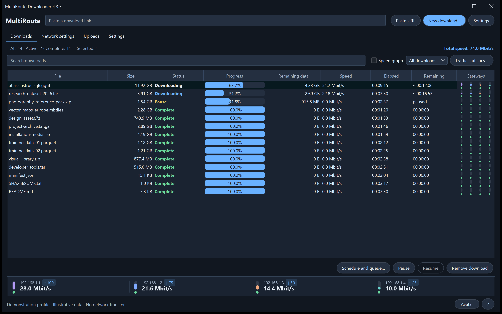

*当前 Windows 界面，使用独立演示配置截取。示例文件、进度、速度及已启用 Pro 功能的视图用于说明各项控件，并非性能测量结果。*

<details>
<summary><strong>网络设置与速度历史记录</strong></summary>

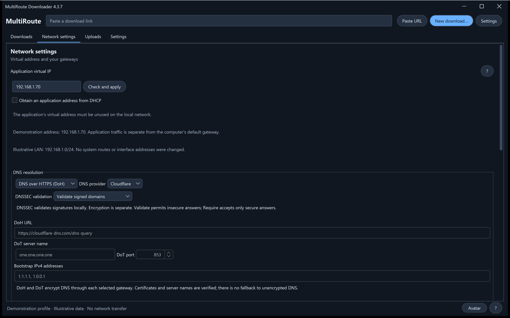

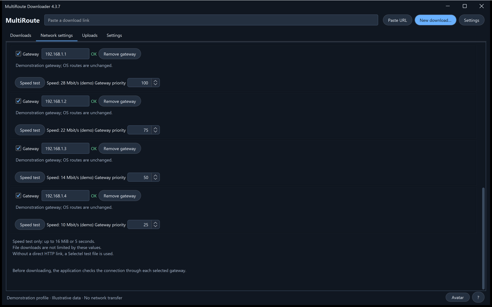

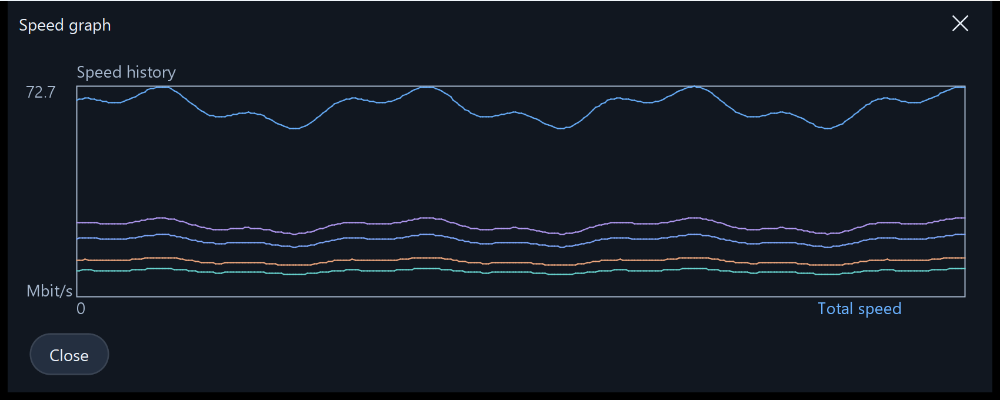

</details>


## 选择你喜欢的外观

九种外观可供选择：Graphite、Nordic、Streams Studio、Neon、Community、Chat、Studio、Rose 和 System。默认为 Graphite。Free 包含 Graphite 和 System；其余样式需要对应的 Pro 外观功能。打开“设置 → 外观”即可更改样式和控件圆角。选择外观时，下载会继续进行。

<table>
<tr>
<td width="50%" valign="top"><strong>Graphite</strong><br /><a href="../images/v4.3.7/downloads-en-ae5b55131583.png"></a></td>
<td width="50%" valign="top"><strong>Nordic</strong><br /><a href="../images/v4.3.7/skin-nordic-a4e8d79666e0.png">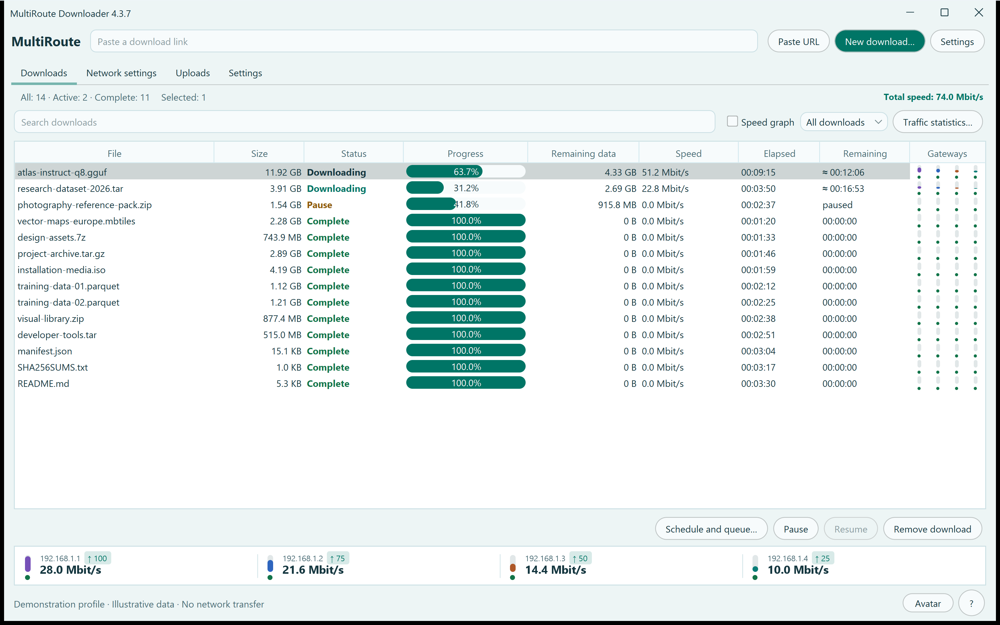</a></td>
</tr>
<tr>
<td width="50%" valign="top"><strong>Streams Studio</strong><br /><a href="../images/v4.3.7/skin-streams-b2f3be388bda.png">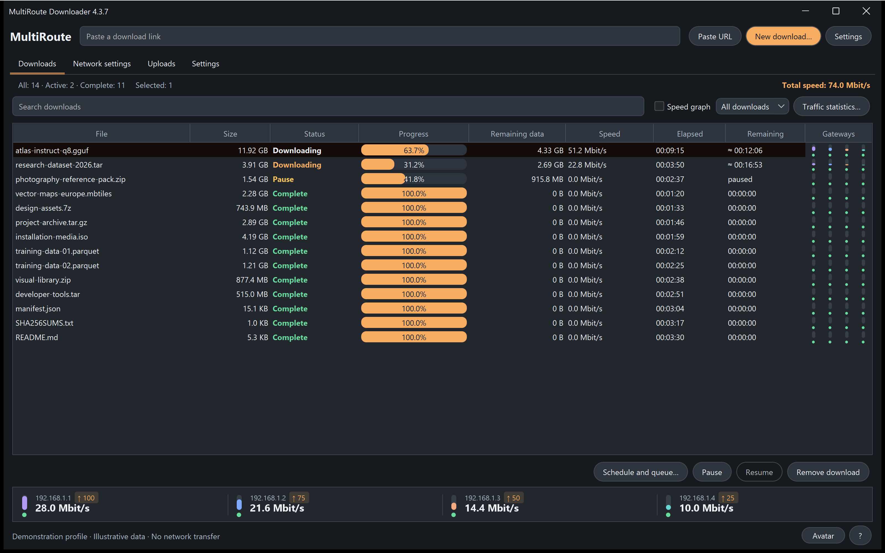</a></td>
<td width="50%" valign="top"><strong>Neon</strong><br /><a href="../images/v4.3.7/skin-neon-6b0c1d2da5f8.png">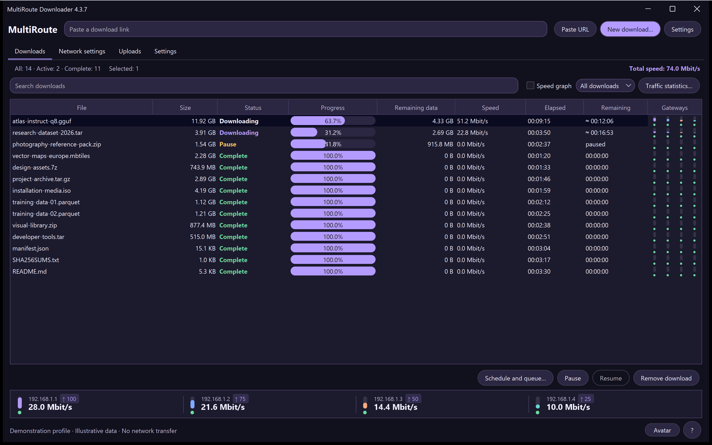</a></td>
</tr>
<tr>
<td width="50%" valign="top"><strong>Community</strong><br /><a href="../images/v4.3.7/skin-community-9763964c8f12.png">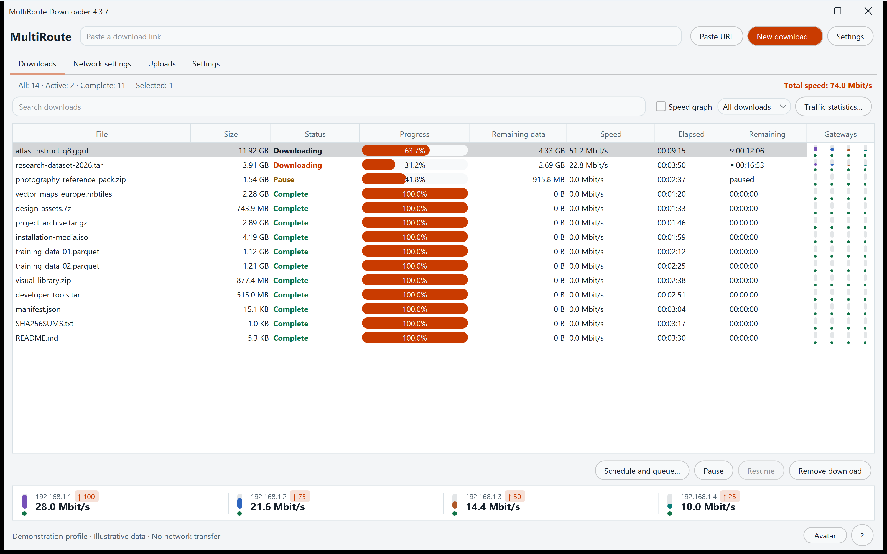</a></td>
<td width="50%" valign="top"><strong>Chat</strong><br /><a href="../images/v4.3.7/skin-chat-221a28cc76f4.png">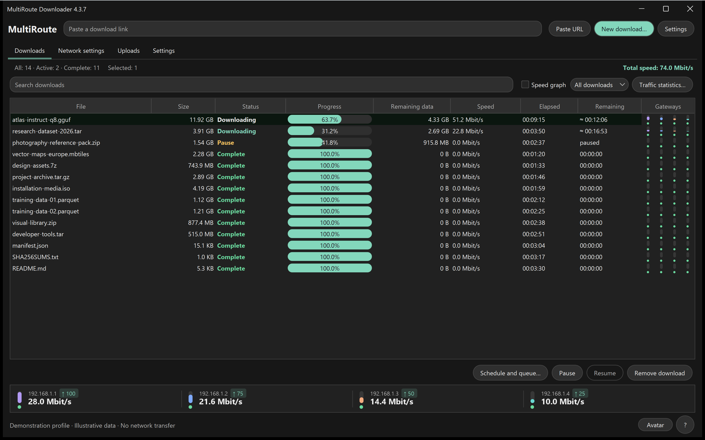</a></td>
</tr>
<tr>
<td width="50%" valign="top"><strong>Studio</strong><br /><a href="../images/v4.3.7/skin-studio-094e14ba38ea.png">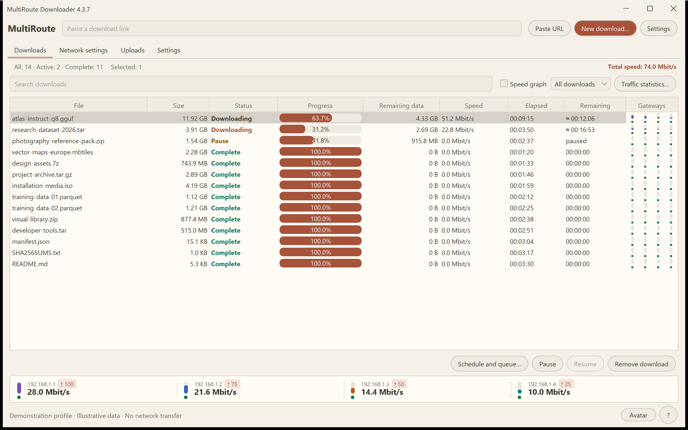</a></td>
<td width="50%" valign="top"><strong>Rose</strong><br /><a href="../images/v4.3.7/skin-rose-02646e7f35bf.png">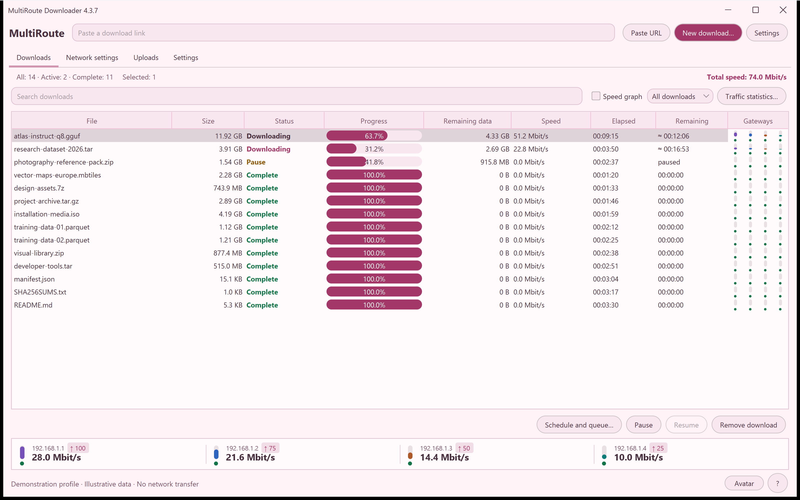</a></td>
</tr>
<tr>
<td width="50%" valign="top"><strong>System</strong><br /><a href="../images/v4.3.7/skin-system-c148099984c6.png">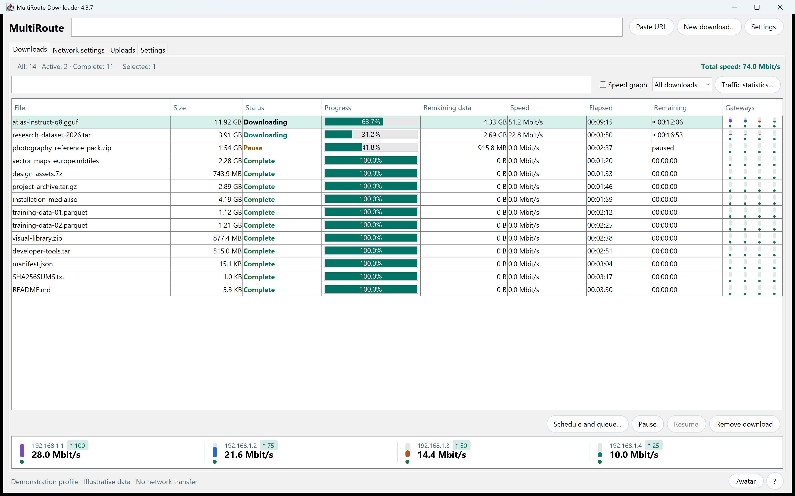</a></td>
<td width="50%" valign="top"></td>
</tr>
</table>

## 跟随下载进度的快递员

可选的桌面快递员将下载进度变成看得见的负重。在外观设置中选择男性或女性，并将大小设为 40% 至 100%。袋子显示活动下载中已知的剩余数据总量，随着字节接收而缩小。动作速度随这些下载的总速度变化；速度为零时，快递员站立不动。数据量较小时将袋子扛在肩上，较大时拖行，非常大时则更加吃力。

使用“虚拟形象”按钮显示或隐藏快递员。拖动即可移动位置，双击鼠标左键可显示应用，右键单击可打开选项。这是一位视觉伙伴；文件仍保存在各自选定的文件夹中。

下载完成后，快递员放下已送达的包裹并逐渐消失。如果仍有下载任务，他会带着剩余数据返回。

### 少量剩余数据 · 768 MB

<table>
<tr>
<td width="50%" valign="top"><strong>男性快递员</strong><br /><a href="../images/v4.3.7/avatar-man-shoulder-eeeb879d0240.png"></a></td>
<td width="50%" valign="top"><strong>女性快递员</strong><br /><a href="../images/v4.3.7/avatar-woman-shoulder-5682615d5576.png"></a></td>
</tr>
</table>

### 中等剩余数据量 · 7 GB

<table>
<tr>
<td width="50%" valign="top"><strong>男性快递员</strong><br /><a href="../images/v4.3.7/avatar-man-drag-a3dc0a3ed22c.png"></a></td>
<td width="50%" valign="top"><strong>女性快递员</strong><br /><a href="../images/v4.3.7/avatar-woman-drag-48d8ee0fa4d1.png"></a></td>
</tr>
</table>

### 大量剩余数据 · 18 GB

<table>
<tr>
<td width="50%" valign="top"><strong>男性快递员</strong><br /><a href="../images/v4.3.7/avatar-man-heavy-649f17608748.png"></a></td>
<td width="50%" valign="top"><strong>女性快递员</strong><br /><a href="../images/v4.3.7/avatar-woman-heavy-d445fdb37867.png"></a></td>
</tr>
</table>

## 设置一览

设置下载文件夹、站点配置和语言，再调整外观、快递员大小与完成提示音。网络设置将应用地址、MAC、网关和 DNS 集中在同一处。可选的提示音能区分单个文件完成与整个队列完成，可使用内置旋律，或最长 10 秒的自定义 MP3/WAV 音频片段。

<table>
<tr>
<td width="50%" valign="top"><strong>应用设置</strong><br /><a href="../images/v4.3.7/settings-8abcb12a782d.png">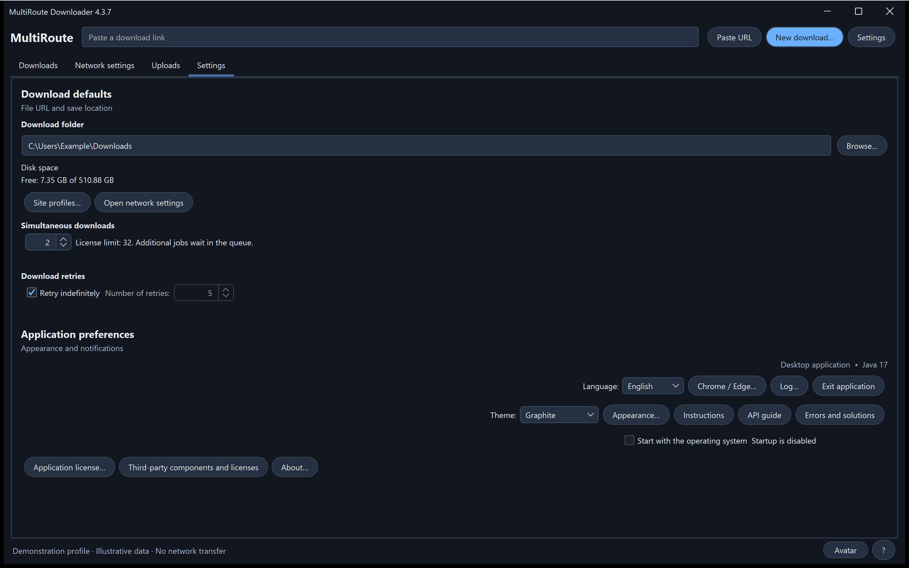</a></td>
<td width="50%" valign="top"><strong>外观、快递员与声音</strong><br /><a href="../images/v4.3.7/appearance-cebf121d5de7.png">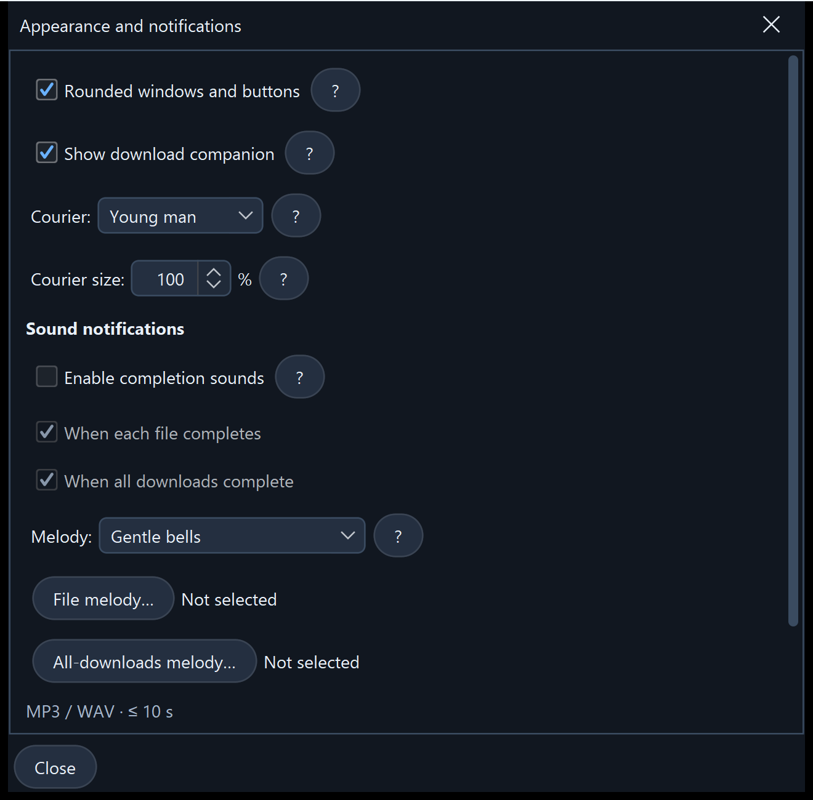</a></td>
</tr>
<tr>
<td width="50%" valign="top"><strong>应用地址与受保护的 DNS</strong><br /><a href="../images/v4.3.7/network-dns-e29dfdba1007.png"></a></td>
<td width="50%" valign="top"><strong>网关选择与速度检查</strong><br /><a href="../images/v4.3.7/network-gateways-aee0a7897f48.png"></a></td>
</tr>
</table>

<details>
<summary><strong>下载与上传工作区</strong></summary>

<table>
<tr>
<td width="50%" valign="top"><strong>创建下载任务</strong><br /><a href="../images/v4.3.7/new-download-dcb720c7769d.png">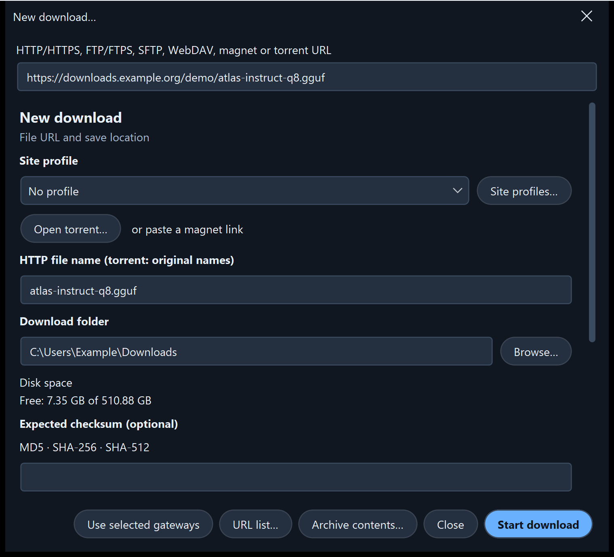</a></td>
<td width="50%" valign="top"><strong>上传工作区</strong><br /><a href="../images/v4.3.7/uploads-31c63833de2e.png">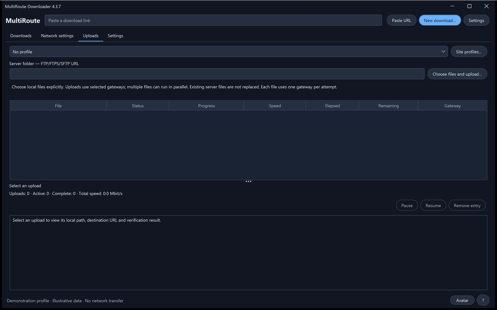</a></td>
</tr>
</table>

</details>

## 从日常需求到实用控制

| 你想要…… | MultiRoute 提供 |
| --- | --- |
| **利用可用的连接** | 共享 HTTP 分段队列、1–8 个可编辑网关配置，并可实时选择一个、多个或全部网关。 |
| **保留并校验大文件** | 受支持的断点续传、分段保存、自动合并，以及使用 MD5、SHA-256 或 SHA-512 与发布者提供的参考值进行比对。 |
| **保护 DNS 请求** | 加密 DoH/DoT、预设或自定义服务提供商，以及本地 DNSSEC，无需更改操作系统的 DNS 设置或路由。 |
| **管理多个下载任务** | 批量链接、优先级、每日运行时段、延迟启动、速度/任务数限制、各网关统计、图表和带日期的历史记录。 |
| **复用常用站点** | 已保存的配置、远程文件夹浏览、FTP/FTPS/SFTP 上传和压缩包预览。 |
| **融入你的工作流程** | 浏览器链接传递、本地 API、十二种语言、浅色/深色/跟随系统主题、键盘粘贴、系统文件夹对话框、托盘速度显示，以及可选的登录时启动。 |

| 传输功能 | 支持的选项 |
| --- | --- |
| **下载** | HTTP/HTTPS、FTP、显式 FTPS、SFTP、WebDAV、Metalink、BitTorrent 和 magnet；Hugging Face 链接和仓库文件选择。 |
| **上传** | FTP、显式 FTPS 和 SFTP，支持站点配置及 SHA-256 回读校验。 |
| **压缩包预览** | 在支持字节范围请求且可读取受支持文件头时，无需下载完整文件即可查看 ZIP、TAR、7Z 和 RAR 的文件列表。 |

### 了解校验能证明什么

有可信参考值时，文件校验会将合并后的数据与其比对；仅计算本地哈希值并不能确认发布者身份。DoH/DoT 加密 DNS 传输；DNSSEC 则独立验证带签名的 DNS 数据。这些检查并不能证明下载内容无害。

## 面向应用和 AI 编程工作流的 API

脚本、第三方应用和 AI 编程代理可以请求 MultiRoute 获取开发所需的模型权重、数据集、库、资源和项目产物。调用方可获得进度、完成状态和校验结果，并控制队列；网关管理、重试和受支持的断点续传由 MultiRoute 负责。

API 在本机 **`http://127.0.0.1:8765/api/v1`** 运行。例如，以 `Content-Type: application/json` 向 **`POST /api/v1/jobs`** 发送以下 JSON：

```json
{
  "url": "https://example.org/model.bin",
  "directory": "C:/Users/YOUR_USER/Downloads",
  "routes": [
    {"type": "gateway", "gateway": "192.168.1.1", "enabled": true}
  ]
}
```

通过外部 API 进行常规管理需要相应 Pro 功能；批量创建和网关数量限制会单独检查。将 URL、文件夹和网关替换为你的实际值；请先配置网络。务必明确设置 routes：界面中的复选框状态不会自动复制到 API 请求。`201` 表示任务已创建；请保留 `id`，并通过 `GET /jobs/{id}` 获取进度、`complete`/`failed` 状态和校验详情。本示例仅作说明，不会提交下载任务。

[API 参考](../../API.ru.txt) · [OpenAPI 模式](../../openapi.yaml) · [集成指南](../zh.md#multiroute-api)

## 四步开始

1. **安装** 对应平台的安装包，并按照指南操作。
2. **选择网络设置：** 使用有线以太网、同一 IPv4 局域网中的网关，以及一个未使用的应用虚拟地址。其他应用使用的操作系统路由保持不变。
3. **选择并测试网关。** 默认值为 `192.168.1.1`–`192.168.1.4`，虚拟地址为 `192.168.1.70`；请根据实际网络修改。
4. **粘贴链接或链接列表，选择文件夹并开始。** 查看各网关的贡献和最终校验结果。

<details>
<summary><strong>要求与传输细节</strong></summary>

- 多网关传输模式支持通过有线以太网访问公网 IPv4；仅 Wi-Fi/仅 VPN 的适配器、仅 IPv6 的下载源和局域网内的 torrent 对等节点不在此模式支持范围内。
- 分段续传需要下载源支持范围请求，且资源标识保持稳定。HTTP 分段默认大小为 20 MiB；某个分段连续 60 秒未收到数据时，在其写入器关闭后，可将停滞任务重新分配。不支持续传的 HTTP 下载在中断后会从头开始。Torrent 分块使用元数据中的哈希值。
- 单个上传文件使用一个网关；多个文件可以使用不同网关。回读校验会消耗带宽，且需要远程读取/写入/重命名权限。压缩包预览受元数据和文件头支持范围限制。
- 计划任务需要应用正在运行且计算机保持唤醒；不会唤醒计算机，也不会调度独立的上传队列。
- 系统 DNS 遵循操作系统/VPN 策略。DNSSEC 根信任锚随版本更新。加密 DNS 本身不会加密 HTTP/FTP 的文件内容。
- 安装程序未签名；macOS 安装包未使用 Developer ID 签名，也未经公证。请按照指南完成常规确认，不要禁用系统防护。每个版本均附带验证报告和仍然存在的限制。

</details>

## 十二种语言的指南

[English](../en.md) · [Русский](../ru.md) · [Deutsch](../de.md) · [Español](../es.md) · [Français](../fr.md) · [中文](../zh.md)<br />
[한국어](../ko.md) · [العربية](../ar.md) · [Italiano](../it.md) · [日本語](../ja.md) · [हिन्दी](../hi.md) · [Tiếng Việt](../vi.md)


<a name="application-virtual-ip"></a>

### 应用地址与当前安装包

应用使用自己的本地 IPv4 地址和应用 MAC，使所选网关能够独立于操作系统默认网关运行，无需更改操作系统路由或物理适配器的 MAC。请在实际所在的同一子网中选择一个空闲地址。手动指定的地址应位于 DHCP 自动分配范围之外，或者在局域网 DHCP 服务器上为其保留/排除；然后在“网络设置”中使用 **Check and apply（检查并应用）**。[地址选择与检查](../zh.md#application-virtual-ip)。

当前 4.3.9 Windows 安装包已通过本地升级/启动检查；macOS 安装包已在目标 CI 运行器上通过原生组件和 Java 运行时检查。实体 Mac 上经由局域网/DHCP 网关的传输仍需硬件验证。[验证报告](../../NATIVE-INSTALLER-TESTS.json)。

## 所有者与许可

由 **[2018-spec-fdsds](https://github.com/2018-spec-fdsds)** 创建。免费使用范围包括个人及组织/商业用途。销售原版应用、收取许可费用或付费再分发，均须另行获得书面许可。未授予一般性的修改/再分发权利；第三方条款仍然适用。

[许可](../../LICENSE.txt) · [许可摘要](../../LICENSING.md) · [第三方声明](../../THIRD-PARTY-NOTICES.txt)

此分发区域提供当前 4.3.9 安装程序和用户文档。
