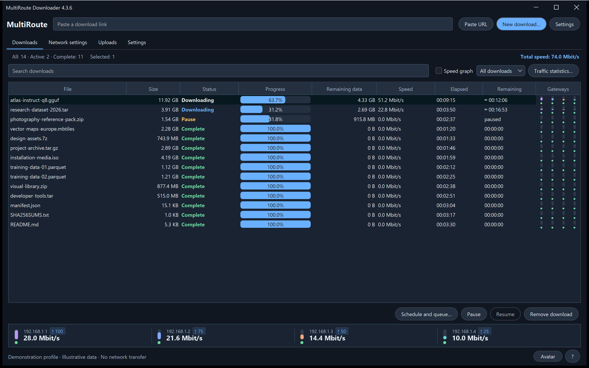

# MultiRoute Downloader 4.3.6

[Full product presentation](../../README.md) · [Русский](4.3.6.ru.md) · [Downloads and verification](../../downloads/v4.3.6/README.md)

## Safer Mac startup and gateway setup

Native Mac startup recovers the recognizable legacy relative default, including a missing leading slash, using a verified existing profile or an empty user-owned default. Ambiguous custom locations still require an explicit choice instead of guessing.

After gateway preparation fails or is cancelled, remaining gateways and background checks stop repeating authorization requests until you explicitly retry network setup. The first privileged start may still require the normal macOS administrator confirmation to open the Ethernet BPF device.

The Mac network component 4.3.1 handles an adapter MAC hidden by macOS while retaining checks that protect the physical adapter. The application keeps its own MAC; OS routes and the physical adapter MAC are not changed. Mac icon and application name now use the same MultiRoute identity as Windows. Exit the app before running the PKG updater. The caller label of a real authorization dialog and physical LAN/DHCP transfers still require hardware confirmation; wired Ethernet remains required for this transport.

Keep the existing application data and downloaded parts. Before updating, finish active transfers and checks, then exit MultiRoute from its tray menu. The Mac PKG refuses installation while the app is in use; it does not forcibly stop the app. Native helpers are installed under `/Library/PrivilegedHelperTools/MultiRouteResume/4.3.1/`. The first privileged Ethernet BPF start may still require the normal system administrator confirmation. There is no new Wi-Fi transport.

Final installer checksums and platform results are published with the release; physical LAN/DHCP performance and the real system-dialog caller label are not established by automated fixtures.
