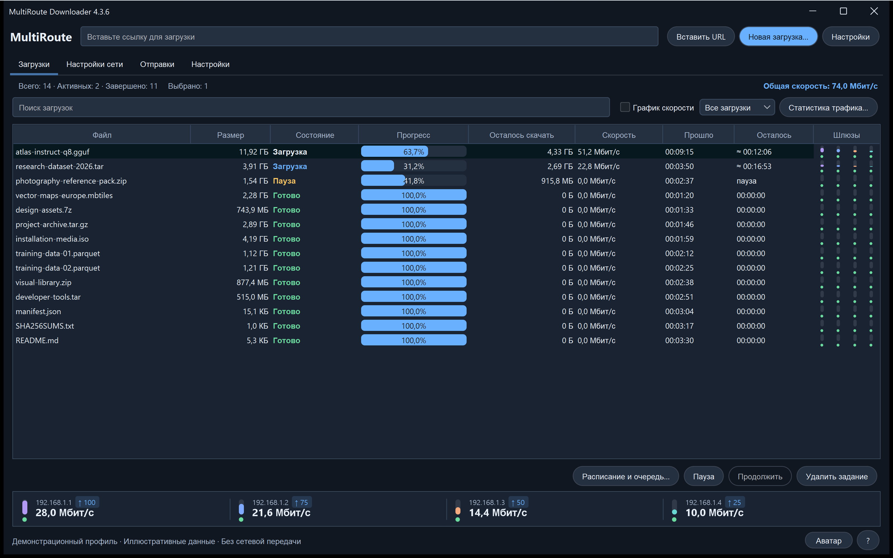

# MultiRoute Downloader 4.3.6

[Полное описание продукта](../../README.ru.md) · [English](4.3.6.en.md) · [Файлы и проверка](../../downloads/v4.3.6/README.ru.md)

## Надёжнее запуск Mac и настройка шлюзов

При нативном запуске Mac распознаётся старый относительный путь по умолчанию, в том числе без начального слеша: используется подтверждённый существующий профиль или пустая папка по умолчанию в учётной записи. Для неоднозначного пользовательского пути требуется явный выбор, а не догадка.

После ошибки или отмены подготовки шлюза остальные шлюзы и фоновые проверки не повторяют запросы прав до явной повторной настройки сети. Первый привилегированный запуск по-прежнему может потребовать обычного подтверждения администратора macOS для открытия Ethernet-устройства BPF.

Сетевой компонент Mac 4.3.1 учитывает скрытый системой MAC адаптера, сохраняя проверки защиты физической карты. У приложения остаётся собственный MAC; маршруты ОС и MAC физической карты не меняются. Значок и имя Mac-приложения приведены к идентичности MultiRoute в Windows. Перед обновлением через PKG закройте приложение. Имя инициатора в реальном системном диалоге и передачи LAN/DHCP ещё требуют проверки на оборудовании; для этого транспорта по-прежнему нужен проводной Ethernet.

Сохраняйте данные приложения и скачанные части. Перед обновлением завершите передачи и проверки, затем выйдите из MultiRoute через меню трея. PKG отказывается от установки, пока приложение используется, и сам не завершает его. Нативные компоненты находятся в `/Library/PrivilegedHelperTools/MultiRouteResume/4.3.1/`. Первый привилегированный запуск Ethernet BPF по-прежнему может запросить обычное подтверждение администратора. Новый транспорт Wi-Fi не добавлен.

Итоговые контрольные суммы и результаты платформенных проверок публикуются с релизом; автоматические фикстуры не подтверждают физические LAN/DHCP и имя инициатора в реальном системном окне.
