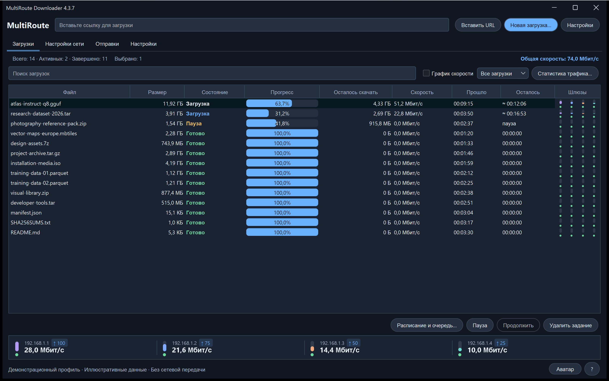

# MultiRoute Downloader 4.3.7

[Полное описание продукта](../../README.ru.md) · [English](4.3.7.en.md) · [Файлы и проверка](../../downloads/v4.3.7/README.ru.md)

## Ответы шлюзов Mac при ручном адресе

Настройка захвата POSIX исправлена: и ручной адрес приложения, и DHCP используют режим приёма ответов на собственный MAC приложения, как уже было в Windows. Успешный системный ping проверяет соединение самого компьютера и не подтверждает приём ответов шлюза виртуальным адресом приложения.

Диагностика DHCP сохраняет формулировки на двенадцати языках вместо замены общим сообщением. Поведение авторизации остаётся прежним: обычные проверки сети повторно используют подготовленный компонент. Методы API, элементы интерфейса, маршруты ОС и MAC физической карты не меняются. Первый привилегированный доступ к Ethernet BPF по-прежнему может запросить обычное подтверждение администратора.

Исправляется конкретное различие режима захвата, а не все причины недоступности шлюза. Проверки свободного адреса, подсети и аренды/конфликтов DHCP остаются активны. Передачи Mac с ручным адресом ещё требуют проверки на оборудовании; проводной Ethernet по-прежнему необходим.

Используйте полный установщик с сетевым компонентом Mac 4.3.2. Завершите передачи и проверки, выйдите из приложения перед обновлением и сохраняйте данные и скачанные части. Существующие права Free/Pro и API не меняются. Проверки и их границы публикуются вместе с итоговыми установщиками.
