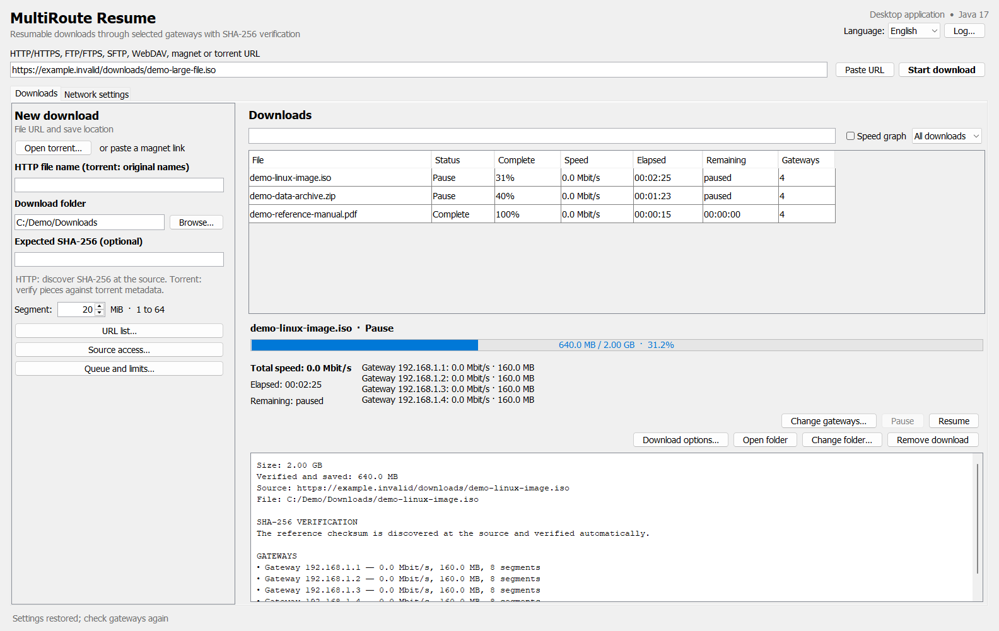
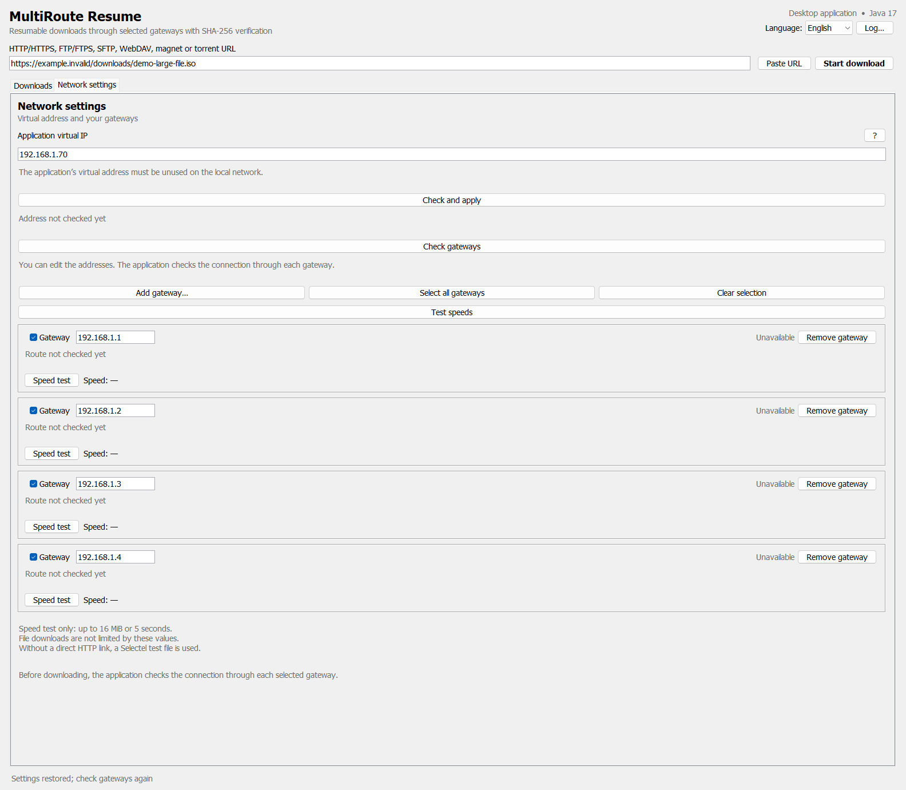
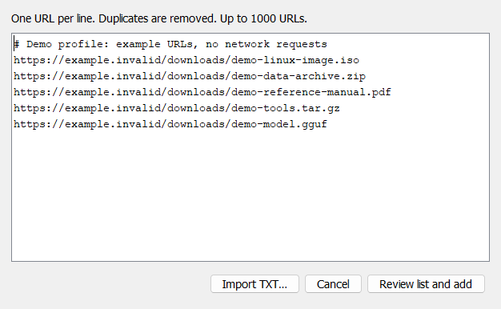

# MultiRoute Downloader 4.0 — Инструкция на русском

[English](en.md) · **Русский** · [Deutsch](de.md) · [Español](es.md) · [Français](fr.md) · [Главная](../README.md) · [中文](zh.md) · [한국어](ko.md) · [العربية](ar.md) · [Italiano](it.md) · [日本語](ja.md) · [हिन्दी](hi.md) · [Tiếng Việt](vi.md)

MultiRoute Downloader — настольное приложение на Java для скачивания через один или несколько **шлюзов** вашей локальной сети. Оно выдаёт доступные части шлюзам, сохраняет проверенные данные и собирает итоговый файл. Локальный API позволяет создавать и управлять загрузками из других приложений. Окно программы — отдельный настольный интерфейс.

Владелец проекта: [2018-spec-fdsds](https://github.com/2018-spec-fdsds).

## Для чего нужно приложение

При нескольких независимых интернет-подключениях в вашей сети, например проводной линии и мобильного роутера 4G/5G, приложение использует их пропускную способность одновременно. Компьютер обращается к шлюзам через общую локальную Ethernet-сеть.

- **Увеличение общей скорости:** все выбранные доступные шлюзы параллельно скачивают части файлов из общей очереди; более быстрые шлюзы могут получать больше частей.
- **Отказоустойчивость:** при отказе одного шлюза остальные продолжают сегментированную загрузку. Незавершённые части возвращаются в очередь для другого шлюза, а проверенные данные сохраняются.
- **Групповая загрузка:** добавляйте список ссылок, управляйте очередью нескольких файлов или создавайте группу загрузок через локальный API.

Прирост скорости зависит от независимости внешних подключений и ограничений сервера. Докачка и перераспределение частей требуют поддержки безопасного возобновления передачи источником и протоколом.

**Только portable ZIP 3.0:** скачайте пакет своей платформы из [GitHub Releases](https://github.com/2018-spec-fdsds/multiroute-downloader/releases) и распакуйте **его целиком**. JAR, библиотеки, файлы запуска и сетевой компонент должны находиться вместе. Архив «Source code» на GitHub содержит исходники: сначала соберите их либо используйте готовый дистрибутив. Установщик сообщает об отсутствии компонентов самого приложения до скачивания зависимостей.

## Скриншоты

Настоящий настольный интерфейс на английском языке, отрисованный из отдельного **демонстрационного профиля**. Задания и счётчики показаны для примера: это не реальные скачивания и не измеренные скорости Интернета.



<details>
<summary>Настройки сети и групповая загрузка</summary>

Четыре выбранных шлюза и виртуальный адрес приложения. В этом примере проверки шлюзов и скорости не выполняются.



Групповой импорт: одна ссылка в строке, проверка списка перед добавлением.



</details>

## 1. Нужное окружение

Новые установщики Windows/macOS, описанные ниже, включают Java и готовый сетевой компонент. Выбор Java, скачивание отдельного окружения и требования локальной компиляции в этом разделе относятся к **portable ZIP 3.0 и развёртыванию Linux**. Npcap в Windows по-прежнему требуется отдельно. Для новых macOS-пакетов действует более строгий минимум 26+/15+, указанный ниже.

| Платформа | Система и процессор | Java и дополнительные компоненты |
| --- | --- | --- |
| Windows | Windows 11, 64 бита, обычный x86-64 | Полное окружение Java 17+ x64; драйвер захвата Npcap. В комплекте сетевой компонент Windows x64; Windows ARM64 не включён. |
| Linux | Дистрибутив с glibc, x86-64 или ARM64/aarch64; **glibc 2.38+ для torrent/magnet** | Java 17+ соответствующей архитектуры; `sudo`; компилятор C, binutils, pkg-config и файлы разработки libpcap. Для окна: X11 либо Wayland с XWayland, библиотеки X11 и шрифтов. Alpine/musl не включён. |
| macOS | Установщик поддерживает macOS 11+, Intel x86-64 и Apple Silicon ARM64. **Torrent/magnet: macOS 15+ на Intel, macOS 26+ на Apple Silicon** — требования включённой библиотеки JNI. | Java 17+ соответствующей архитектуры; Apple Command Line Tools; системная libpcap; доступ BPF через компонент, получающий разрешение `sudo`. Homebrew и полный Xcode не нужны. |

Нужен **полный JRE или JDK** с модулями `java.desktop`, `java.net.http`, `jdk.httpserver`, `java.xml`. Режим `--headless` убирает окно, но эти модули всё равно нужны. Сильно сокращённое окружение Java может не подойти. Файлы запуска проверяют архитектуру и наличие модулей.

Требования torrent-библиотеки строже требований Java и установщика. Её файлы проверены без загрузки библиотеки: нужны версии glibc/macOS, указанные выше. У HTTP и сетевого компонента, компилируемого на компьютере, другие требования; совместимость со всеми старыми системами и дистрибутивами не подтверждена. Установщик предупреждает о несовместимой torrent-библиотеке, но **не обновляет ОС и не заменяет glibc**. Для torrent на несовместимом компьютере установите поддерживаемую ОС обычным способом обновления. Включённые Linux JNI не требуют динамически `libstdc++.so.6` или версий `GLIBCXX`/`CXXABI`; у других компонентов вашего дистрибутива могут быть свои зависимости.

Общие требования:

- Активный **проводной Ethernet** в одной подсети IPv4 со всеми выбранными шлюзами. Каждый роутер должен предоставлять рабочий выход в Интернет для виртуального адреса приложения. Для увеличения общей скорости нужна независимая доступная пропускная способность выходов WAN: общий вышестоящий канал или ограничение сервера могут не дать прироста.
- Свободный адрес IPv4 в этой подсети для приложения. Нельзя использовать адрес компьютера, другого устройства, сети или широковещания.
- Доступные вашему пользователю для записи папки программы и загрузок.
- Развёртывание Linux/macOS и установка отдельной Java Windows проверяют **512 МиБ свободного места**, дополнительно нужно место для загрузок. Инструментам Apple может потребоваться существенно больше места, чем проверяет установщик.
- Для torrent — дополнительное место для частей и временных данных. Рекомендуется запас в несколько размеров выбранного содержимого: консервативная проверка учитывает целые нужные части с границами файлов, целевой файл и временные данные. Единого точного множителя размера выбранных файлов нет.
- **Рекомендация:** от 4 ГБ оперативной памяти для удобной работы; больше при множестве шлюзов или одновременных torrent. Это рекомендация, а не измеренный или обязательный порог. GPU, CUDA и модели ИИ для скачивания не нужны.

Сетевой транспорт версии 3.0 использует IPv4 через Ethernet. Подключение только по Wi-Fi, только через VPN и источники только с IPv6 **не поддерживаются** этим транспортом.

Для выбранного языка нужны установленные шрифты с его символами. В минимальной Linux установите подходящие пакеты из репозитория дистрибутива, например Noto CJK для китайского/корейского и арабское семейство Noto. Java использует подстановку системных шрифтов; приложение не устанавливает и не включает пакеты шрифтов. Покрытие зависит от компьютера.

## Установщики 4.0: Windows и macOS

Выберите установщик для своей системы в [GitHub Releases](https://github.com/2018-spec-fdsds/multiroute-downloader/releases), если он приложен к релизу. Каждый дистрибутив — **один установочный файл**, содержащий программу, обычный запускающий компонент, полную Java и сетевой компонент для этой ОС. Исходники и portable ZIP версии 3.0 распространяются отдельно.

| Система | Установщик | Запуск после установки |
| --- | --- | --- |
| Windows 11 x64 | `MultiRoute-Downloader-4.0-Windows-x64-Setup.exe` | **MultiRoute Downloader** в меню «Пуск» либо ярлык на рабочем столе |
| Apple Silicon, macOS 26+ | `MultiRoute-Downloader-4.0-macOS-arm64.pkg` | **MultiRoute Downloader** в «Программах», Spotlight или Dock |
| Intel, macOS 15+ | `MultiRoute-Downloader-4.0-macOS-x86_64.pkg` | **MultiRoute Downloader** в «Программах», Spotlight или Dock |

Инструкции на двенадцати языках и скриншоты включены для чтения без Интернета. Windows: `%LOCALAPPDATA%/MultiRoute Downloader App/app/docs/`. macOS: в Finder выберите **«Показать содержимое пакета»** у установленного приложения и откройте `Contents/app/docs/`. Файлы `en.md`, `ru.md`, `de.md`, `es.md`, `fr.md`, `zh.md`, `ko.md`, `ar.md`, `it.md`, `ja.md`, `hi.md`, `vi.md` можно открыть в текстовом редакторе или просмотрщике Markdown.

### Windows: установка и запуск программы

1. Скачайте `.exe`, сравните его с SHA-256, опубликованной в релизе. Откройте файл и выполните шаги мастера. Приложение устанавливается для вашей учётной записи; выберите предлагаемые параметры ярлыков.
2. Откройте **MultiRoute Downloader** через «Пуск» или ярлык. Появится обычное окно приложения без командной строки. Java уже включена, отдельно устанавливать её не нужно.
3. Приложение проверит Npcap. Если драйвер отсутствует, подтвердите его скачивание в программе. Будет получен фиксированный официальный установщик, проверены SHA-256, подпись Authenticode и издатель, затем открыта обычная установка Npcap. Прочитайте лицензию и подтвердите UAC Windows. Если требуется перезагрузка, перезагрузите компьютер и снова откройте MultiRoute. Npcap — отдельный драйвер: **он не включён в установщик и не ставится скрытно**. Для этого шага нужен Интернет, если Npcap ещё не установлен.

У приложения и установщика нет подписи издателя. SmartScreen может показать неизвестного издателя: проверьте официальный релиз и файл, прежде чем выбирать **«Подробнее → Выполнить в любом случае»**, если этот вариант доступен. Обнаружение вредоносного файла — отдельная ситуация. Отключение антивируса и добавление исключений не являются шагами установки. Npcap с ограничением AdminOnly может отдельно запросить разрешение захвата. Открывайте Java-программу обычным способом; запуск всего приложения от администратора не нужен.

### macOS: установка и запуск программы

1. Выберите `.pkg` для **реального** процессора: arm64 для Apple Silicon, x86_64 для Intel. Новые пакеты требуют **macOS 26+ на Apple Silicon** либо **15+ на Intel**, включая работу torrent/magnet. Старый минимальный порог portable-пакета для HTTP к ним не относится.
2. Скачайте `.pkg`, сравните опубликованную SHA-256 и откройте его штатным установщиком Apple. Подтвердите установку и запрос администратора для размещения защищённого сетевого компонента.
3. Откройте **`/Applications/MultiRoute Downloader.app`** через Finder или Spotlight. Значок можно добавить в Dock. Java и готовый сетевой компонент уже внутри: **Terminal, Command Line Tools, Homebrew и отдельная установка Java для этого пакета не нужны**.
4. При запросе подтвердите обычный диалог администратора macOS, чтобы защищённый компонент открыл Ethernet-устройство BPF. После открытия устройств он снижает права; окно Java работает от обычного пользователя. Держать Terminal открытым во время работы не требуется.

#### Подтверждения безопасности macOS для нового пакета

Пакет **не подписан Developer ID и не нотарифицирован Apple**. Техническая ad-hoc подпись не подтверждает личность разработчика Apple. Сначала попробуйте открыть `.pkg` или приложение обычным способом. Если macOS сообщает, что разработчик не проверен, и предлагает исключение, откройте **«Системные настройки → Конфиденциальность и безопасность → Всё равно открыть»**, затем **«Открыть»**, только после проверки источника релиза и контрольной суммы. На управляемом Mac это может запрещать администратор. [Инструкция Apple](https://support.apple.com/ru-ru/102445).

Разрешение установки, последующее разрешение сетевого компонента и исключение для неизвестного разработчика — отдельные подтверждения. Если появляется запрос **«Локальная сеть»** для MultiRoute/Java, разрешите доступ для подключения к вашим шлюзам LAN. При запросе доступа к папке разрешайте выбранное место сохранения. Отмена запроса не требует запуска всей Java-программы от root.

Установщик не отключает Gatekeeper/SIP, не меняет системные маршруты, не создаёт глобальное исключение `sudoers` и не удаляет глобально атрибуты карантина. Предупреждение о вредоносном или повреждённом файле отличается от обычного сообщения о неизвестном разработчике: остановитесь и проверьте файл. Текст диалогов зависит от macOS и правил организации.

## Portable ZIP 3.0 и Linux: развёртывание и первый запуск

### Windows

1. Распакуйте весь Windows-дистрибутив в постоянную папку, доступную пользователю для записи, например внутри папки своего профиля.
2. Дважды щёлкните `Deploy-Windows.cmd`. Он проверит Windows/процессор, наличие файлов приложения, Java и Npcap, затем запустит программу.
3. Если Java отсутствует или не подходит, будет скачан фиксированный официальный **JRE Eclipse Temurin 21**, проверена SHA-256 и создано отдельное окружение в `runtime/` программы. Системная Java не заменяется. Подходящий Java из `JAVA_EXE`, `runtime/bin/java.exe`, `JAVA_HOME` или `PATH` можно использовать без скачивания.
4. Если Npcap отсутствует, установщик скачает его с **npcap.com**, проверит подпись Authenticode и издателя, затем откроет **интерактивную установку**. Прочитайте лицензию, выберите параметры и подтвердите **UAC**, если решили установить драйвер. Npcap не включён в архив и не устанавливается скрытно; всё Java-приложение не получает права администратора.

Далее используйте `Start-Windows.cmd`: он выполняет те же проверки и может установить отсутствующее ПО. Интернет нужен для скачивания недостающих компонентов или самих файлов. Дополнительные сведения: [официальная инструкция Temurin](https://adoptium.net/installation/) и [руководство Npcap](https://npcap.com/guide/npcap-users-guide.html).

Если при установке Npcap выбран **«Restrict Npcap driver's access to Administrators only»** — доступ к драйверу только администраторам — захват требует разрешения и при открытии устройства может появиться ещё один UAC. Без необходимого разрешения Java-процесс не сможет использовать драйвер. Установщик не меняет настройки антивируса и не создаёт исключения.

Выбор уже установленной Java в `cmd.exe`, открытой в папке программы:

```bat
set "JAVA_EXE=C:\Program Files\Eclipse Adoptium\jdk-21\bin\java.exe"
Start-Windows.cmd
```

Подставьте свой реальный путь. Если явно задан неправильный или несовместимый `JAVA_EXE`, установщик Windows остановится: исправьте или уберите эту переменную и повторите. Выбранный вами исполняемый файл молча не игнорируется. Запуск только API:

```bat
Start-Windows.cmd --headless
```

### Linux

1. Распакуйте Linux-дистрибутив в постоянную папку своего пользователя.
2. Откройте `Deploy-Linux.desktop`. Если файловый менеджер не поддерживает этот переносимый ярлык, откройте терминал в папке программы и выполните:

   ```bash
   bash ./Deploy-Linux.sh
   ```

3. Введите пароль, когда его запросит `sudo`. При отсутствии зависимостей ставятся конкретные пакеты через `apt-get`, `dnf` или `pacman`; полного обновления дистрибутива установщик не выполняет. Репозитории Arch должны быть актуальны в рамках обычного обслуживания вашей ОС.
4. Установщик соберёт сетевой компонент для вашего процессора, выполнит его проверку без сетевого трафика и установит защищённую копию, принадлежащую `root`.
5. Java запустится от обычного пользователя. **Держите терминал открытым** во время работы: разрешение сетевого компонента связано с этой сессией.

Подходящая Java 17+ нужной архитектуры используется повторно. Иначе скачивается фиксированный официальный JRE Temurin 21, проверяется SHA-256 и создаётся отдельное окружение только для приложения. Интернет нужен для недостающей Java или пакетов.

| Дистрибутив | Пакеты компиляции и сети |
| --- | --- |
| Debian/Ubuntu | `build-essential`, `binutils`, `libpcap-dev`, `pkg-config` |
| Fedora | `gcc`, `glibc-devel`, `make`, `binutils`, `libpcap-devel`, `pkgconf-pkg-config` |
| Arch | `gcc`, `make`, `binutils`, `pkgconf`, `libpcap` |

Также могут устанавливаться `curl`, сертификаты CA, `tar`, `gzip` и необходимые библиотеки окна. Для интерфейса проверяются `libX11`, `libXext`, `libXi`, `libXrender`, `libXtst`, `libfontconfig`. На сервере без рабочего стола используйте `--headless`.

Следующие запуски: пункт меню приложений либо `bash ./Start-Linux.sh`. Развёртывание и работа только с API:

```bash
bash ./Deploy-Linux.sh --headless
# Следующие запуски:
bash ./Start-Linux.sh --headless
```

Запускайте эти файлы от обычного пользователя **без `sudo` перед командой**. Административное разрешение получает только компонент захвата; после открытия устройств он навсегда снижает дополнительные группы, GID и UID до пользователя запуска. Маршруты системы и IP-адреса её адаптеров не меняются.

### macOS — только portable ZIP 3.0

1. Распакуйте macOS-дистрибутив целиком в доступную для записи папку. Не запускайте установку внутри ZIP.
2. Откройте `Deploy-macOS.command` в Terminal. Проверяются версия macOS, реальная архитектура процессора, место, Java и сетевой компонент.
3. Если Apple Command Line Tools отсутствуют, откроется **официальный установщик Apple**. Нажмите **Install / Установить**, примите лицензию Apple, если согласны, и дождитесь окончания. Запускающий файл ждёт до **30 минут**; держите Terminal открытым. Если установка отменена или время закончилось, установите инструменты и снова запустите развёртывание. Полный Xcode и Homebrew не нужны. [Инструкция Apple](https://developer.apple.com/documentation/xcode/installing-the-command-line-tools/).
4. Используется Java 17+ реальной архитектуры либо скачивается отдельный фиксированный JRE Temurin 21 с проверкой SHA-256. Для Apple Silicon используется ARM64, даже если Terminal открыт через Rosetta.
5. При запросе введите пароль администратора для установки и разрешения сетевого компонента. В запросе `sudo` ввод пароля обычно **не отображается**: наберите его и нажмите Return. Это разрешение защищённому компоненту, а не запуск всей Java-программы от root.
6. Будет создано и открыто `~/Applications/MultiRoute Resume.app`. Далее открывайте его либо `Start-macOS.command`. **Не закрывайте его сессию Terminal** во время работы.

#### Подтверждения безопасности macOS

Релиз **не подписан Developer ID и не нотарифицирован Apple**. После попытки открыть скачанный файл или приложение предупреждение о неизвестном разработчике может потребовать **Системные настройки → Конфиденциальность и безопасность → Всё равно открыть**, затем **Открыть**, если macOS предлагает это действие. Подтверждайте после проверки происхождения архива. [Руководство Apple](https://support.apple.com/ru-ru/102445). В старых macOS раздел называется «Защита и безопасность». На управляемом Mac исключение может запрещать администратор.

Если появляется разрешение **Локальная сеть** для Terminal, Java или программы, подтвердите его для работы со шлюзами LAN. Пароль администратора и доступ к локальной сети — отдельные разрешения от предупреждения о разработчике. При выборе папки возможен запрос доступа к файлам: разрешайте нужный целевой каталог.

Не отключайте Gatekeeper/SIP и не удаляйте глобально атрибуты карантина. Сообщение о вредоносном файле или возможном повреждении компьютера отличается от обычного предупреждения о неизвестном разработчике: остановитесь и разберитесь в причине. Установщик защиты не отключает. Диалоги Finder/разрешений portable 3.0 на пользовательском Mac ещё не проверены. Нативные сборки 4.0 и запуск/API проверены на настоящих GitHub Mac-runner; пользовательские диалоги безопасности и захват BPF ещё не проверены.

Только API, из распакованной папки:

```bash
./Start-macOS.command --headless
```

## 3. Настройка сети

Начальный список: `192.168.1.1`, `192.168.1.2`, `192.168.1.3`, `192.168.1.4`; по умолчанию выбраны все. Обычное подключение компьютера **не добавляется пятым шлюзом**.

1. Откройте настройки сети и замените адреса шлюзов, если ваша LAN отличается.
2. Задайте виртуальный адрес приложения, первоначально `192.168.1.70`.
3. Проверьте адрес и шлюзы перед скачиванием. Если адрес занят, выберите другой. Исключите его из автоматического диапазона DHCP, чтобы роутер не выдал его другому устройству позже.
4. Выберите один, несколько или все шлюзы.
5. Кнопка **«Добавить шлюз»** расширяет список: поддерживается **от 1 до 32** различных адресов. Можно добавлять и удалять профили во время закачки, если у каждого затронутого незавершённого задания остаётся хотя бы один активный шлюз. Чтобы текущее задание использовало новый шлюз, включите его и в выборе шлюзов этого задания.

Виртуальный IP относится к внутреннему транспорту MultiRoute. **Он не добавляется адаптеру ОС и не меняет таблицу системных маршрутов**, поэтому остальные программы используют обычное подключение. Вручную добавлять этот IP в настройки Windows, Linux или macOS не нужно. Видимая кнопка **?** рядом с адресом и подсказки при наведении объясняют назначение настроек.

Тест скорости передаёт до **16 МиБ или 5 секунд**; подготовка подключения может занять дополнительное время. Это пределы теста, а не скачивания файла. Без подходящей прямой HTTP-ссылки используется тестовый файл Selectel.

## 4. Скачивание, докачка и управление

1. Выберите **Русский** в переключателе языка. Для новых профилей установлен английский; доступны также немецкий, испанский, французский, китайский, корейский, арабский, итальянский, японский, хинди и вьетнамский. Ранее сохранённый язык сохраняется.
2. Вставьте ссылку в длинное поле сочетанием **Ctrl+V**, а на macOS — также **Cmd+V**. Есть и кнопка вставки. Можно вводить magnet либо открывать файл `.torrent`.
3. Выберите папку системным диалогом. Изначально используется `Downloads` вашего пользователя; проверьте реально сохранённый путь перед началом.
4. Выберите шлюзы и нажмите **«Начать загрузку»** рядом со ссылкой. Для страницы репозитория Hugging Face, списка WebDAV или Metalink проверьте список и отметьте нужные файлы.
5. Следите за общей скоростью, скоростью и объёмом каждого шлюза, прошедшим временем, приблизительным оставшимся временем и необязательным графиком.

HTTP-части по умолчанию **20 МиБ**, настройка от 1 до 64 МиБ. Шлюзы берут части из общей очереди: быстрый может получить больше частей. Если часть не получает данные **60 секунд**, прежняя передача отменяется и часть возвращается в пул для другого шлюза. Размер torrent-частей задаёт раздача, независимо от HTTP-настройки.

Можно приостанавливать и продолжать, менять выбранные шлюзы работающего задания, задавать приоритет/лимиты/расписание, менять папку остановленного задания. Изначально очередь допускает два работающих задания. Работавшие задания после перезапуска восстанавливаются приостановленными: продолжите их, когда нужно.

Массовый импорт принимает списки ссылок и текстовые файлы. Есть поиск, фильтры состояния, контекстное меню и выбор файлов torrent. Раздача завершённого torrent по умолчанию отключена; при включении задайте пределы времени и соотношения отданного/скачанного.

При удалении задания флажок удаления файлов **изначально снят**. Можно удалить запись из списка заданий, сохранив скачанный либо недокачанный файл. Отмечайте удаление файлов только для удаления данных этого задания.

## 5. Протоколы и проверка

| Источник | Возможности и условия |
| --- | --- |
| HTTP/HTTPS | Части при поддержке диапазонов и надёжной идентификации файла; поиск опубликованной SHA-256 и сравнение итогового файла, если сумма доступна. |
| Hugging Face | Ссылки на файлы и выбор из репозитория; получение адресов Hub/Xet. Для закрытого доступа нужны учётные данные источника и необходимые права. |
| FTP | Пассивный EPSV/PASV. Обычный FTP не шифрует пароль и данные. |
| FTPS | Явное TLS для управляющего соединения FTP и данных; неявный FTPS не поддерживается. |
| SFTP | SSH с **проверенным и закреплённым отпечатком SHA256 ключа сервера**. Сначала настройте учётные данные и отпечаток; неизвестные ключи молча не принимаются. |
| WebDAV | Список и скачивание через HTTPS; выберите файлы из списка. |
| Metalink | `.meta4`, доверенная SHA-256, зеркала и хеши частей при их наличии в метаданных. |
| Torrent/magnet | Проверка частей по метаданным, выбор/приоритет файлов, работа через выбранные шлюзы. Проверьте дополнительные требования библиотеки в разделе 1. |

Если источник требует входа, настройте пользователя/пароль, Bearer token, cookies или разрешённые заголовки в **доступе к источникам**. Это учётные данные сервера; вашим роутерам токены для программы не нужны. Сохранённые данные шифруются локально и доступны только вашему пользователю. Не помещайте пароли в URL.

Если HTTP-сервер игнорирует диапазоны, весь файл передаётся **через один** шлюз: распределения и докачки по частям нет, обрыв требует начать этот поток с нуля. FTP/FTPS/SFTP без доверенной опубликованной или указанной SHA-256 либо SHA-512 также используют передачу целиком.

Не каждый сервер публикует SHA-256. Вычисление локальной суммы отличается от **сравнения с ожидаемой суммой издателя**: само вычисление не доказывает авторство или точное совпадение с оригиналом. Проверка torrent основана на его метаданных и не подтверждает личность автора раздачи. Можно указать ожидаемую SHA-256 из доверенного источника.

<a name="multiroute-api"></a>

## 6. API для других приложений

При работающем MultiRoute API доступен на `http://127.0.0.1:8765/api/v1`. Запросы и ответы — JSON UTF-8. Для создания и управления заданиями токен не требуется. Принимаются только локальные соединения; не публикуйте этот порт как удалённый сервис.

Проверка:

```http
GET http://127.0.0.1:8765/api/v1/health
```

Создание загрузки: `POST http://127.0.0.1:8765/api/v1/jobs`, заголовок `Content-Type: application/json`:

```json
{
  "url": "https://example.org/large-file.bin",
  "directory": "C:/Users/your-user/Downloads",
  "chunk_mb": 20,
  "routes": [
    {"type": "gateway", "gateway": "192.168.1.1", "enabled": true},
    {"type": "gateway", "gateway": "192.168.1.2", "enabled": true},
    {"type": "gateway", "gateway": "192.168.1.3", "enabled": true},
    {"type": "gateway", "gateway": "192.168.1.4", "enabled": true}
  ]
}
```

Подставьте URL и папку. Пример Linux: `/home/your-user/Downloads`, macOS: `/Users/your-user/Downloads`. Папка находится на компьютере MultiRoute. Укажите `routes` явно: галочки окна не переносятся автоматически в API-запрос. Адреса worker и токены роутеров не нужны.

`HTTP 201` означает создание, а не завершение. Сохраните `id` из ответа; запрашивайте `GET /jobs/{id}` до `status: "complete"` либо смотрите `error` при ошибке. Значения API `speed_bps` — **байты в секунду**: для Мбит/с умножьте на 8 и разделите на 1 000 000. Есть пауза/продолжение, смена шлюзов задания, массовый импорт, настройки очереди и SSE `/events`.

Предварительно настройте сеть в окне или через `POST /network`. Полные форматы и методы описаны в [API.ru.txt](../API.ru.txt) и [openapi.yaml](../openapi.yaml). Имена JSON-полей и значения состояний не меняются при переключении языка.

## 7. Данные, обновление и удаление

### Новые установщики 4.0

| Система | Настройки, история и журналы | Приложение и Java | Сетевой компонент |
| --- | --- | --- | --- |
| Windows | `%LOCALAPPDATA%\MultiRoute Downloader\data` | `%LOCALAPPDATA%\MultiRoute Downloader App`, включая Java | Готовый компонент x64; Npcap устанавливается отдельно |
| macOS | `~/Library/Application Support/MultiRoute Downloader/data` | `/Applications/MultiRoute Downloader.app`, включая Java | `/Library/PrivilegedHelperTools/MultiRouteResume/4.0/gateway-net` |

Перед обновлением новым установщиком закройте приложение. В Windows удаление выполняется через **«Параметры → Приложения → Установленные приложения»**. На macOS удаление `.app` не удаляет автоматически историю и отдельно защищённый сетевой компонент. Скачанные файлы остаются в выбранной папке: не удаляйте её ради удаления программы. Путь данных отличается от Windows portable 3.0; сохраните предыдущий профиль перед переносом.

### Portable 3.0 и Linux

| Платформа | Настройки, история и логи | Отдельная Java при установке | Защищённый компонент |
| --- | --- | --- | --- |
| Windows | `data/` относительно папки запуска, если не задан `data-location.config` или `--data-dir` | `runtime/` в папке программы | `native/windows-x64/gateway-net.exe` в архиве; Npcap — отдельно установленный драйвер |
| Linux | `~/.local/share/MultiRouteResume/data` | `~/.local/share/MultiRouteResume/runtime` | `/usr/local/libexec/MultiRouteResume/3.0/gateway-net` |
| macOS | `~/Library/Application Support/MultiRoute Downloader/data` | `~/Library/Application Support/MultiRoute Downloader/runtime` | `/Library/PrivilegedHelperTools/MultiRouteResume/3.0/gateway-net` |

Файлы скачиваются в выбранную папку, которая может быть за пределами этих каталогов. Ярлык меню Linux: `~/.local/share/applications/MultiRouteResume.desktop`; приложение macOS: `~/Applications/MultiRoute Resume.app`.

Для обновления закройте программу и разверните новый **полный** пакет. При переносе папки Linux-программы снова запустите развёртывание. Сохраняйте историю и части для докачки. Удаление ярлыка/окна автоматически не удаляет отдельную Java, историю, защищённые компоненты и системные пакеты. Не удаляйте папку скачанных файлов только ради удаления программы.

## 8. Частые проблемы

| Симптом | Что проверить |
| --- | --- |
| Не скачиваются зависимости | Доступ HTTPS к официальным GitHub-релизам Temurin, `npcap.com` или репозиториям вашего дистрибутива; свободное место. Повторите запуск либо установите официальный компонент вручную. Не подставляйте непроверенный файл. |
| Нет Java, неверная архитектура, не открывается окно | Полное Java 17+ нужной архитектуры, целый пакет, `JAVA_EXE`/`JAVA_HOME`. Для Linux нужны рабочий стол/XWayland и библиотеки; только API запускайте с `--headless`. |
| Torrent: `GLIBC_2.38 not found` или отказ macOS-библиотеки | Требования JNI: glibc 2.38+, macOS 15+ Intel или 26+ Apple Silicon. Минимум Java их не отменяет. Не заменяйте библиотеки ОС вручную. |
| Npcap отсутствует или доступ запрещён | Официальная x64-установка и разрешение захвата; вариант Admin-only может запросить UAC. Не копируйте DLL неизвестного происхождения. |
| Не найден Ethernet-адаптер | Активный проводной Ethernet, адрес и шлюзы в одной подсети. Wi-Fi/VPN не заменяют его. Устраните неоднозначность, если подходят два адаптера. |
| Виртуальный IP занят | Выберите другой свободный адрес и проверьте. Не назначайте его адаптеру ОС; избегайте автоматического DHCP. |
| Шлюз недоступен или скорость нулевая | Ответ в LAN и реальный выход в Интернет для виртуального IP; тест каждого шлюза. Проверьте URL, доступ к источнику, идентификацию файла и ошибку задания. |
| SFTP отвергает ключ | Уточните SHA256-отпечаток у администратора сервера и задайте его точно; сохраняйте проверку ключа. |
| Истекло разрешение macOS/Linux | Новый macOS-пакет: снова откройте программу и подтвердите диалог администратора при запросе. Portable 3.0/Linux: заново откройте запуск из терминала, разрешите `sudo` и держите терминал открытым. Не запускайте всю Java от root. |
| Папка недоступна или диск полон | Права и место для файла, частей и torrent-временных данных. Перед сменой папки приостановите задание. |
| Порт 8765 занят | Запуск заменяет прежний собственный экземпляр. Для порта другого приложения задайте `--port 8766`; не завершайте чужие процессы. |
| Повторная старая загрузка | Выберите совместимое существующее задание и продолжите. При удалении определите, сохранять ли файлы, и сначала прочитайте ошибку задания. |

В сообщении об ошибке укажите версию, ОС/процессор, этап и точный текст. Перед добровольной отправкой логов скройте пароли, cookies, закрытые URL и персональные данные.

## 9. Границы проверки

Проверки релиза охватывают Java, протоколы на синтетических данных, распределение/докачку, сверку SHA-256 и нативные проверки без сетевого захвата Windows/POSIX. Изменения установщиков проверяются на контролируемых примерах; это не доказывает успешную установку каждого стороннего пакета в реальной системе.

Нативные пакеты 4.0 собраны и проверены на GitHub Mac-runner Apple Silicon/macOS 26 и Intel/macOS 15: запуск/API, torrent JNI, состав пакета и тестовые режимы сетевого компонента. Физические роутеры, установка на пользовательском компьютере, диалоги Finder/безопасности и захват BPF ещё не проверены. Portable macOS 3.0 собирает компонент на целевом Mac. Новые пакеты 4.0 включают отдельные готовые компоненты Intel/Apple Silicon; они не подписаны Developer ID и не нотарифицированы. Проверка сборки или CI не доказывает работу на вашем Mac. После установки проверьте известный небольшой файл через каждый шлюз, затем через их набор, прежде чем рассчитывать на суммарную скорость. Подробные отчёты включены в релиз. Публичный выпуск имеет статус **предварительного релиза**.

## Трей и выход (4.0)

Закрытие главного окна оставляет приложение и загрузки работающими в системном трее. Значок показывает суммарную скорость **всех заданий**, независимо от выбранной загрузки и фильтра таблицы. При наведении видна точная скорость в Мбит/с либо Гбит/с (от 1 Гбит/с), а также Б/с; поддержано отображение до 10 Гбит/с; маленький значок округляет значение. Для возврата окна выберите **«Открыть приложение»** в меню трея. В Windows/Linux также можно щёлкнуть значок. Для сохранения состояния и завершения программы выберите **«Выйти из приложения»** в меню трея либо в окне. Перед установкой обновления используйте эту команду.

Если рабочий стол не поддерживает трей, закрытие сворачивает окно на панель задач, а загрузки продолжаются; команда выхода остаётся доступной. Если трей исчезнет, скрытое окно откроется. Windows может поместить значок в скрытую область уведомлений.

Setup создаёт ярлык на рабочем столе по умолчанию. В Windows также появляется пункт меню «Пуск». В macOS создаётся ссылка Desktop на установленную `.app` для вошедшего пользователя; первый графический запуск повторит попытку. Существующие элементы Desktop сохраняются. Если доступ к Desktop запрещён настройками приватности, разрешите его при запросе либо открывайте программу из «Программ». Наши тексты setup всегда английские, независимо от языка приложения. Системные диалоги безопасности и разрешений используют язык ОС.

## Лицензия

Оригинальное приложение можно бесплатно устанавливать и использовать лично и в организациях, включая работу бизнеса. **Продажа приложения, платные лицензии и распространение за плату запрещены** без отдельного разрешения. Пользовательская лицензия не даёт общего права изменять или распространять оригинальный код и не является открытой лицензией, одобренной OSI. Сторонние компоненты сохраняют свои лицензии. Это перевод кратких условий; определяющий английский текст находится в [LICENSE.txt](../LICENSE.txt).

В 4.0 у значка скорости прозрачный фон, чёрные цифры и единицы, включая 10 Гбит/с. Суммирование скорости и команды трея сохранены.

## Проверка MD5, SHA-256 и SHA-512

После сборки приложение вычисляет все три суммы целого файла за один проход чтения. Вставьте эталон в основное необязательное поле контрольной суммы через Ctrl+V или Cmd+V. Тип определяется автоматически: 32 шестнадцатеричных символа — MD5, 64 — SHA-256, 128 — SHA-512. В раскрываемом разделе дополнительных сумм можно указать несколько эталонов.

Эталоны автоматически ищутся в поддерживаемых заголовках суммы целого представления и файлах рядом с источником: `filename.md5`, `MD5SUMS`, `filename.sha256`, `SHA256SUMS`, `filename.sha512`, `SHA512SUMS`. Сумма частичного HTTP-ответа не считается суммой всего файла. Проверка опубликованной SHA-256 Hugging Face LFS и метаданных Metalink сохраняется.

Все известные эталоны должны совпасть до публикации итогового файла. Несовпадение переводит задание в ошибку с сохранением частичных данных. Без эталона показанная сумма вычислена локально и не означает подтверждённого совпадения с источником. MD5 помогает обнаружить случайное повреждение; для более сильной проверки используйте SHA-256 или SHA-512. MD5 не заменяет требования к надёжной идентичности файла и доверенным зеркалам.

Проверка частей torrent остаётся обязательной. MD5/SHA-256/SHA-512 собранных файлов — отдельные суммы целых файлов. Ручной эталон целого файла допускается при выборе ровно одного файла; для группы передавайте отдельные эталоны каждому заданию.

Локальный API принимает `expected_md5`, `expected_sha256`, `expected_sha512` в `POST /api/v1/jobs`. Результат содержит `md5`, `sha256`, `sha512` и происхождение эталонов в `checksum_sources`. Прежние запросы с `expected_sha256` совместимы.

## Прогресс каждой загрузки (4.0)

У каждой загрузки есть собственная полоса в колонке «Прогресс». Колонки растягиваются на всю ширину панели загрузок. При большом числе заданий список прокручивается вертикально; в узкой панели доступна горизонтальная прокрутка без сжатия колонок ниже читаемой ширины. При обновлении сохраняется первое видимое задание. Сортировка и фильтры сохраняют связь каждой полосы с её загрузкой. Если общий размер неизвестен, показан объём полученных данных вместо процентов; подсказка показывает размер, состояние и причину ошибки. Выбор строки по-прежнему открывает подробный прогресс, время и скорости шлюзов.

Папка загрузок по умолчанию определяется для текущего пользователя при запуске: `%USERPROFILE%\Downloads` в Windows и `~/Downloads` в macOS/Linux. Сохранённая папка по умолчанию следует за текущим профилем; выбранная вручную папка сохраняется.

## Просмотр журнала (3.6)

Окно журнала сохраняет место просмотра при автоматическом и ручном обновлении. Если прокрутить до конца, новые записи остаются видимыми. Прокрутка вверх приостанавливает следование за концом, но не запись журнала. Выделение текста для копирования сохраняется. При смене языка сохраняется видимое событие; повторное открытие окна показывает последние записи.

## Подробности загрузки и отчёт контрольных сумм (3.7)

Нижняя панель подробностей выбранной загрузки сохраняет место чтения и выделение текста при повторных автоматических обновлениях. Конец отчёта контрольных сумм можно просматривать без возврата панели к началу. При выборе другой загрузки её отчёт открывается с начала. Отдельное окно журнала сохраняет прежнее поведение прокрутки.

## Инструкция и работа с API (3.8)

Кнопки **Инструкция** и **Работа с API** находятся вверху справа, отдельной строкой под выбором языка. Они открывают инструкцию на выбранном языке в браузере по умолчанию. **Работа с API** сразу переходит к разделу локального API этой инструкции. Ссылки соответствуют версии приложения; для открытия страниц GitHub нужен Интернет.

## Обработка команд при запуске (3.9)

Версия 3.9 исправляет сбой запуска, когда команда поиска процесса превышает время ожидания и оставляет временный файл вывода заблокированным в Windows. Вывод команд теперь читается через каналы с ограниченным буфером вместо временных файлов. При превышении времени ожидания или прерывании команда останавливается с ожиданием завершения. Для замены ранее запущенного экземпляра MultiRoute по-прежнему проверяется принадлежность процесса приложению. Протоколы загрузки и контракт локального API не изменены.

## Интерфейс и история загрузок (4.0)

Настольный интерфейс использует FlatLaf с темами **Системная**, **Светлая** и **Тёмная**. Тема выбирается в заголовке и сохраняется. В очереди остаются отдельные полосы прогресса, колонки по ширине окна, сортировка и фильтрация. Сводка показывает общее число заданий, активные и завершённые загрузки, а также суммарную скорость всех заданий независимо от фильтра таблицы.

Наведите указатель на строку скачиваемого или уже скачанного файла: подсказка покажет **полное имя файла и абсолютный путь сохранения**. Это работает после сортировки и фильтрации. Такая же подсказка есть у заголовка выбранного файла. В меню правой кнопки выберите **Копировать полный путь**, чтобы скопировать путь назначения.

Клавиши **Ctrl+L** (Windows/Linux) или **Cmd+L** (macOS) переводят фокус на ссылку загрузки; **Ctrl+F** или **Cmd+F** — на поиск в очереди; **Escape** очищает поиск. Обычная вставка Ctrl+V/Cmd+V сохраняется.

У выбранной загрузки есть вкладки **Подробности** и **История**. История хранит события с датой и временем, включая первый запуск, каждое продолжение и успешное завершение. Старым заданиям без записанных дат вымышленные отметки времени не добавляются. Пути хранения и поля API описаны ниже.

Сохранены протоколы загрузки, выбор шлюзов, виртуальный адрес, тесты скорости, групповой импорт, настройки доступа к источникам, проверки MD5/SHA-256/SHA-512, трей, локальный API и поведение прокрутки журнала и подробностей. Обновлённый интерфейс не меняет маршруты системы.

### Хранение истории и API

В папке данных находятся `logs/downloads-history.jsonl` (UTF-8, один JSON-объект на строку) и `logs/downloads-history.log` (читаемые записи с датами). Они дополняются после перезапусков и сохраняются при удалении задания; удаление задания или скачанных файлов не очищает историю. Текстовый журнал сохраняет язык на момент записи события; интерфейс отображает сохранённые события на выбранном сейчас языке. В окне журнала читается только хвост до 1 000 событий / 2 МиБ; полный архив остаётся на диске. Он растёт по мере использования, поэтому при необходимости архивируйте его отдельно. История содержит имена и полные пути назначения, но не URL источников, пароли или токены доступа. Перед передачей журнала проверьте пути.

Windows с native-установщиком: `%LOCALAPPDATA%\MultiRoute Downloader\data\logs\`. Native macOS: `~/Library/Application Support/MultiRoute Downloader/data/logs/`. В Linux и portable используется папка данных, указанная выше; параметр `--data-dir` выбирает другую.

`GET /api/v1/jobs` и ответ отдельного задания содержат `lifecycle_history`. Поля события: `event_id`, `job_id`, `kind`, `time`, `filename`, `path`; у torrent также может быть `paths`, а у паузы — `reason`. Виды событий: `started`, `resumed`, `paused`, `completed`, `recovered`, `failed`. Отметки времени — ISO 8601 UTC, например `2026-10-18T12:34:56.123Z`; читаемый журнал содержит полную местную дату, время и смещение UTC. Необязательные `first_started_at`, `last_resumed_at`, `completed_at` отражают фактически наблюдавшиеся события. Постановка в очередь ещё не считается началом; завершение записывается после проверки и публикации файла. `recovered` означает, что ранее опубликованный файл проверен сейчас, а не что известна его прежняя дата завершения. Исторические даты старых заданий не выдумываются. Прежние операции API доступны; отдельный endpoint истории не требуется.

В общем окне **Журнал** есть вкладки **События приложения** и **История загрузок**. Вторая показывает датированные события разных заданий, в том числе удалённых; вкладка истории выбранной загрузки относится только к этому заданию.

## Новое название и прежние профили

MultiRoute Downloader ранее назывался MultiRoute Resume. Новый профиль использует указанные выше пути. Если папки данных с новым именем ещё нет, а прежний профиль MultiRoute Resume найден, приложение использует его без перемещения или удаления файлов. Прежние данные Windows могут оставаться в `%LOCALAPPDATA%\MultiRoute Resume\data`, macOS — в `~/Library/Application Support/MultiRoute Resume/data`. Защищённая папка компонента `MultiRouteResume`, идентификатор обновления Windows, внутренняя идентичность API и порт сохранены для совместимости. После установки используйте ярлык или `.app` MultiRoute Downloader. Старые релизы сохраняют исходные имена файлов.

## Профили сайтов, отправка файлов и просмотр архивов (4.0)

Откройте **Профили сайтов…**, создайте/измените профиль и выберите его в списке на вкладке **Загрузки** или **Отправки**. Шлюзы и виртуальный IP находятся на вкладке **Настройки сети**. На **Отправки** укажите **URL удалённой папки** и нажмите **Выбрать файлы и отправить…**: системный диалог позволяет выбрать один или несколько локальных файлов. Интерфейс добавляет имена сам; поле API `target_url` ниже, напротив, указывает полный URL одного файла. Для архива вставьте URL в основное поле и нажмите **Содержимое архива…**: просмотр не запускает скачивание.

Сохраните профиль сайта: имя, базовый URL, локальную папку загрузок, удалённую папку и шлюзы. Поддерживаются анонимный доступ, HTTP Basic/Bearer/Cookie/свои заголовки, учётные данные FTP и SFTP с заранее проверенным SHA-256 ключом сервера. Для одного сервера можно создать разные профили пользователей. Профиль подставляет папки, шлюзы и доступ; явно заданные папки/шлюзы имеют приоритет. Относительные URL скачивания и отправки разрешаются относительно базового URL. Секреты зашифрованы в `site-profiles/vault.bin` с локальным ключом `site-profiles/key.bin` и правами только владельца: это защита хранения, но не от владельца вашей учётной записи и ключа. В ответах API секретов нет. Пустые поля сохраняют прежний доступ только при неизменных origin и типе авторизации; `replace_credentials:true` явно заменяет его. При HTTP-перенаправлении на другой origin доступ не передаётся. Удаление профиля сохраняет задания и локальные/удалённые файлы; задание сохраняет исходную привязку к профилю и не переключается на другую учётную запись; после удаления профиля при необходимости создайте задание заново с действующим профилем.

Отправка и просмотр удалённых папок поддерживают **FTP, явный FTPS и SFTP** через выбранные шлюзы приложения. Выберите обычный локальный файл и полный URL удалённого файла (`target_url`), а не только папку. Сначала используется временный удалённый файл; докачка возможна после сравнения сохранённого префикса. Успех подтверждается повторным чтением удалённого файла и SHA-256: нужны права **чтения, записи и переименования**. Проверка повторно расходует трафик. Несовпадение суммы или запрет чтения означают ошибку. Один файл отправляется через один шлюз; независимые файлы отправляются параллельно с распределением по выбранным шлюзам. Зависший шлюз после лимита простоя заменяется другим выбранным. Разбиения одной отправки между шлюзами нет. Пауза, продолжение и прогресс сохраняются при перезапуске. Удаление задания оставляет локальный файл и удалённые итоговые/временные файлы.

Перезапись по умолчанию отключена; включайте её только для намеренной замены. FTP/SFTP не всегда дают атомарное «переименовать, только если цели нет»: другой клиент может изменить ту же цель одновременно с публикацией. Согласуйте работу с общими удалёнными файлами. Просмотр папки ничего не отправляет и не удаляет.

Просмотр архивов показывает имена, пути, размеры, папки и признаки шифрования **ZIP, TAR, 7Z, RAR4 и RAR5** без распаковки и запуска. Нужны выбранный шлюз, диапазоны байтов и стабильный ETag либо Last-Modified. Лимиты метаданных: 16 MiB, 10 000 записей и 60 секунд; декодирование заголовков 7z — до 64 MiB памяти. Список может быть неполным и не подтверждает целостность содержимого. При ошибке имён задайте исходную кодировку. Для поддерживаемых зашифрованных заголовков 7z можно передать пароль; он не сохраняется. Зашифрованные заголовки RAR обозначаются как неподдерживаемые/требующие пароль. Многотомные и неподдерживаемые архивы могут отображаться частично.

API принимает `site_profile_id` для скачивания, отправки, папок и архивов. `GET /api/v1/site-profiles` возвращает `{profiles:[...]}`, `POST` (или `PUT`) сохраняет плоский объект профиля и возвращает публичные поля. `DELETE /api/v1/site-profiles/{id}` удаляет только профиль. `POST /api/v1/uploads`: `local_path`, `target_url`, `routes`, необязательный `site_profile_id`, `overwrite:false`; ответ HTTP 201. `GET /api/v1/uploads` возвращает `{uploads:[...]}`. Для задания доступны GET/DELETE и POST `/{id}/pause` / `/{id}/resume`. `POST /api/v1/remote/list`: `url` и `route`/`routes`; `POST /api/v1/archives/preview` также принимает необязательные `password` и `charset`. Схемы — [openapi.yaml](../openapi.yaml). Манифесты отправки UTF-8 находятся в `data/uploads/`, содержат ID профиля без пароля. Просмотр архива не создаёт загрузку.

## Расписание скачивания и приоритет

В настройках очереди/расписания задайте `max_active_jobs` (1–32), общий лимит скорости и лимиты шлюзов, суточное окно скачивания (`schedule_enabled`, `schedule_start`, `schedule_end`, HH:mm). Используется часовой пояс компьютера, API показывает его как `schedule_timezone`; окно может проходить через полночь, одинаковое начало/конец означает весь день. Вне окна загрузки возвращаются в очередь, затем продолжаются. Вручную приостановленное задание остаётся на паузе. Для выбранной загрузки `priority` от -100 до 100 задаёт порядок: большее число запускается раньше, при равенстве — порядок создания. Изменение приоритета не прерывает активную загрузку. `start_after_ms` — необязательное самое раннее время Unix epoch в миллисекундах, 0 снимает разовую задержку. Настройки сохраняются. Они относятся к скачиванию, а не независимой очереди отправок. Приложение должно работать, в том числе в трее, а компьютер — не спать; пробуждения средствами ОС нет. Те же настройки доступны через `GET`/`PUT`/`POST /api/v1/queue` и `PUT`/`POST /api/v1/jobs/{id}/options`.

## Интеграция с Chrome и Edge

Откройте в приложении интеграцию **Chrome / Edge**, разрешите передачу ссылок и откройте папку расширения. Один раз перейдите в Chrome на `chrome://extensions`, в Edge — `edge://extensions`, включите режим разработчика, нажмите **Загрузить распакованное** и выберите `browser-extension` с `manifest.json`. Native-установщики включают её рядом с JAR; в исходниках есть [browser-extension/](../browser-extension/). Не перемещайте выбранную папку. Отдельный `MultiRoute-Downloader-4.0-Chrome-Edge.zip` сначала распакуйте. Эта версия устанавливается локально, публикации в магазинах браузеров нет.

MultiRoute должен быть запущен, достаточно трея. Нажмите правой кнопкой по ссылке и выберите действие скачивания MultiRoute либо отправьте URL из окна расширения. Используются выбранные в приложении папка, шлюзы и профиль сайта; при необходимости остаётся выбор файлов репозитория/torrent. Порт расширения по умолчанию 8765; если API работает на другом порту, задайте его. Передаётся только URL: cookies и пароли браузера не копируются, остальные закачки браузера не перехватываются. Доступ к источнику настройте в приложении. Если браузер запрашивает доступ к локальному соединению, подтвердите его только для выбранного расширения.

Мост по умолчанию выключен; разрешён только origin `chrome-extension://ljdklefabmaecjalfhjoicmgedmjjkbl` на `/api/v1/browser/status` и `/api/v1/browser/download`. Правила остальных API не ослабляются. HTTP 202 означает передачу URL в приложение, а не завершение файла. Один headless-сервер не открывает нужный настольный выбор. Для отключения удалите расширение на странице браузера или снимите разрешение в приложении.

[Chrome](https://developer.chrome.com/docs/extensions/get-started/tutorial/hello-world) · [Edge](https://learn.microsoft.com/en-us/microsoft-edge/extensions-chromium/getting-started/extension-sideloading).
